# ИТиОП — весь курс в одном файле

> [!abstract] Что это за файл
> Здесь собрано **всё**, что есть по дисциплине «Информационные технологии и основы программирования»: теория всех пяти лекций (подробные конспекты), практикум по массивам, требования к лабораторным и отчётам, условия и полные решения всех лабораторных, темы, по которым не было лекций, типичные ошибки, контрольные вопросы и глоссарий. Файл сделан как **исходник**, чтобы попросить модель построить по нему курс обучения программированию. Отдельные заметки в папке ИТиОП остаются как были; этот файл — их объединение плюс то, чего в них не было.

## 0. Как пользоваться этим файлом

### 0.1 Состав

| Раздел | Что внутри | Откуда |
|---|---|---|
| 1 | О дисциплине: вуз, среда, ограничения | отчёты |
| 2 | Порядок тем и их зависимости | — |
| 3 | Лекция 1 и все требования к лабораторным и отчёту | лекция 1, методичка |
| 4 | Требования к работе «Подпрограммы» | методичка, с. 78–79 |
| 5 | Лекция 2: структуры данных и компьютерная арифметика | лекция 2 (41 слайд) |
| 6 | Циклы и итерационные вычисления | ЛР №2 (лекции не было) |
| 7 | Лекция 3: указатели, массивы, сортировка, двоичный поиск | лекция 3 (61 слайд) |
| 8 | Практикум «Массивы в Си» (8 уроков, ошибки, итоговая лаба) | заметки в папке |
| 9 | Лекция 4: строки C и C++ (методичка и шпаргалка) | лекция 4 (33 слайда) |
| 10 | Лекция 5: подпрограммы | лекция 5 (57 слайдов) |
| 11 | Структуры и файлы | ЛР №6 (лекции не было) |
| 12 | Лабораторные: условия, решения, полный код | ЛР №2–6 |
| 13 | Глоссарий | — |
| 14 | Пробелы в материалах | — |

Разделы 5, 7, 9, 10 — полные конспекты лекций без сокращений. Ссылки на разделы ведут внутрь этого же файла, картинки подтягиваются из папок `assets` хранилища.

### 0.2 Промпт для модели

Скопируй файл целиком и добавь запрос, например:

```text
Ниже — все материалы моего университетского курса по основам программирования на C
(НГТУ, 1 курс, Visual Studio). Составь по ним курс обучения программированию с нуля:
1) раздели на модули в порядке из раздела 2 файла, у каждого модуля — цели и что нужно
   уметь в конце;
2) для каждого урока: объяснение простыми словами, примеры кода, разбор по шагам,
   3–5 задач от простой к сложной с решениями, типичные ошибки;
3) после каждого модуля — мини-проект в формате лабораторной (условие, анализ задачи,
   структуры данных, алгоритм, код, тесты) по требованиям из раздела 3;
4) используй только язык C и то, что есть в материалах; если добавляешь новую тему,
   помечай её как дополнительную;
5) в конце — итоговый экзамен: вопросы как на защите лабораторных и задачи.
```

Если модель не принимает файл целиком, давай его по разделам: сначала 0–4, потом каждую лекцию отдельно.

## 1. О дисциплине

- **Вуз и дисциплина:** НГТУ (НЭТИ), кафедра ТПИ, «Информационные технологии и основы программирования» (ИТиОП), 1 курс, группа ПМИ, бригада из двух студентов.
- **Методичка:** «Методы программирования. Методические указания к лабораторным работам для студентов 1-го курса ФПМИ», В. П. Хиценко, Т. А. Шапошникова, НГТУ, 2009.
- **Язык и среда:** C (в лекциях местами C++ — `string`, `cout`, ссылки `&`), Visual Studio под Windows. Отсюда практические ограничения, которые важны для всех программ курса:
  - первая строка программы — `#define _CRT_SECURE_NO_WARNINGS`, иначе Visual Studio запрещает `scanf`, `strcpy`, `fopen`;
  - русский вывод — `setlocale(LC_CTYPE, "Russian");` (именно `LC_CTYPE`, чтобы десятичной точкой оставалась точка); русский *ввод* — ещё и `SetConsoleCP(1251); SetConsoleOutputCP(1251);` из `<windows.h>`;
  - кодировка русских букв — Windows-1251 (один байт на букву, «а»…«я» = 224…255, «Ё»/«ё» стоят отдельно: 168/184); `char` в Visual Studio знаковый, поэтому «а» в `char` — это −32;
  - размер массива задаётся `#define N 100`: компилятор Visual Studio в C не принимает `const int` как размер массива, массивы переменной длины не поддерживаются;
  - исходник сохраняется в UTF-8 с BOM — тогда Visual Studio правильно переводит русские строки в 1251.
- **Лекции:** 1 — оформление отчёта (7 слайдов); 2 — структуры данных и компьютерная арифметика (41); 3 — указатели и массивы (61); 4 — обработка текстовой информации (33); 5 — подпрограммы (57).
- **Лабораторные:** ЛР №1 (сделана раньше, служила образцом оформления), №2 — итерационные циклы, №3 — одномерные массивы, №4 — символьные строки, №5 — подпрограммы, №6 — структуры и файлы.

## 2. Порядок тем и их зависимости

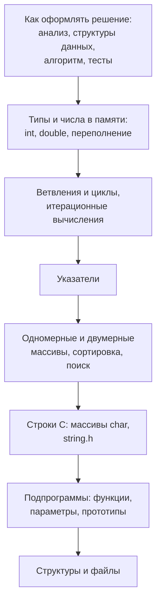

Каждая следующая тема опирается на предыдущую: массивы требуют циклов и указателей, строки — это массивы `char`, подпрограммы работают с массивами и строками через указатели, а структуры и файлы собирают всё вместе. Требования к отчёту (раздел 3) одинаковы для всех лабораторных.

## 3. Лекция 1 и требования к лабораторным и отчёту

> [!abstract] Главная идея
> Лабораторная — это не «написать программу», а пройти путь от условия к проверенному решению и показать его в отчёте: что дано и что найти (анализ), как данные устроены снаружи и в памяти (структуры данных), как решается задача (алгоритм), сама программа и доказательство, что она работает (тесты). Здесь собрано всё, что требуют лекция 1, методичка и преподаватель, — и как это было сделано в наших ЛР №2–6.

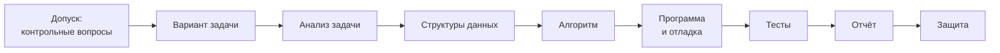

### 1. Как проходит лабораторная работа

Во введении методички «Методы программирования» (В. П. Хиценко, Т. А. Шапошникова, НГТУ, 2009) сказано, зачем вообще нужны лабораторные:
- сформировать практические навыки программирования и работы в современных вычислительных системах;
- овладеть одним из алгоритмических языков высокого уровня — в этом практикуме это C/C++.

Задачи идут от простого к сложному: сначала простейшие алгоритмы и управляющие структуры, потом типы и структуры данных посложнее. В методичке к каждой работе даны требования, рекомендации, контрольные вопросы и варианты заданий.

Каждая работа проходит три этапа.

1. **Допуск к работе.** Преподаватель проверяет, готов ли ты по теме: задаёт контрольные вопросы или упражнения. Поэтому лекцию и раздел методички по теме читают *до* занятия.
2. **Проектирование и реализация программы.** Вариант задачи выдаётся только после успешного допуска. Этап включает:
   - разработку и описание алгоритма решения задачи;
   - написание программы в соответствии с требованиями к работе;
   - трансляцию и отладку на тестовых примерах, причём **тесты подбирает сам студент**.
3. **Защита.** Нужно подготовить отчёт, показать работу программы на тестовых примерах и ответить на контрольные вопросы *(текст этого абзаца на фото методички виден частично)*.

Что отсюда следует на практике? Тесты в отчёте — твоя ответственность: преподаватель будет запускать программу на них и на своих данных, так что граничные случаи и ошибки ввода лучше проверить заранее (см. [[#7. Набор тестов и результаты]]).

### 2. Из чего состоит отчёт

На первом слайде лекции 1 перечислены разделы отчёта:
1. Условие задачи.
2. Анализ задачи.
3. Структуры данных.
4. Алгоритм решения задачи.
5. Текст программы.
6. Набор тестов.
7. Результаты работы программы.

Наши отчёты построены по образцу отчёта ЛР №1 — там к этим разделам добавлены цель работы, ход работы и вывод. Как разделы соответствуют друг другу:

![[treb-03-razdely-otcheta.png|660]]

Отдельного раздела «Результаты работы программы» в наших отчётах нет: результаты стоят в столбце «Результат» таблицы тестов, а в ЛР №6 после таблицы ещё и показан вывод программы на экран. Если преподаватель попросит этот раздел отдельно, туда идут снимки консоли или копии вывода по каждому тесту.

**Титульный лист** (одинаковый во всех отчётах): Министерство науки и высшего образования РФ; НГТУ; кафедра ТПИ; «Лабораторная работа № N по дисциплине „Информационные технологии и основы программирования“»; тема в две строки (например, «Обработка массивов. Одномерные массивы»); номер бригады, группа, фамилии и имена студентов; ФИО преподавателя; город и год (Новосибирск, 2026).

**Оформление, на котором остановились:**
- текст программы вставлен текстом, а не картинкой: моноширинный шрифт Courier New 8,5–9 pt, подсветка как в Visual Studio, серый фон;
- псевдокод — тем же шрифтом, 10 pt, на сером фоне;
- тесты — таблица «№ / входные данные / результат / назначение теста»;
- блок-схемы по ГОСТ 19.701-90 — рисунками с подписью «Рисунок N — …»;
- лишних пустых мест на листах нет: отчёт печатается.

### 3. Анализ задачи

Слайд 2 лекции 1 объясняет, зачем нужен анализ. Он должен:
- установить, что является **исходными данными** и что — **результатом**;
- выделить основные **отношения между входными и выходными данными** — по возможности описать их на языке математики (это и есть математическая модель);
- выделить **основные подзадачи**, которые надо решить, чтобы получить результат.

Из этого вырастает подход к алгоритму — в самом общем виде: что должен сделать алгоритм, чтобы превратить исходные данные в результат.

#### 3.1 Класс входных данных

В условии почти никогда не сказано, какого размера и типа данные. Поэтому в анализе нужно самому определить **класс входных данных**, которые обработает программа. Например, вход — матрица: значит, надо задать максимально допустимое число строк и столбцов.

> [!info] Правило из лекции 1
> Класс входных данных нужно не сужать, а **максимально расширять**, чтобы программа получилась как можно более универсальной.

Например, в ЛР №3 условие «дан массив размера N» мы превратили в «$1\le N\le50$, элементы — целые числа», а не зашили конкретное N = 5. В ЛР №6 файл F1 читается по одной записи, поэтому его размер вообще не ограничен, а ограничен только список новых студентов (не больше 100). Это и есть «расширять класс».

#### 3.2 Пример со слайдов: наибольшее из четырёх чисел

**Условие:** даны четыре произвольных числа, найти наибольшее значение среди них.

Разбираем по вопросам слайда 3:
- **Что дано?** Входные данные: $a,b,c,d\in\mathbb{R}$.
- **Что будет результатом?** Выходные данные: $x\in\mathbb{R}$.
- **Как решать?** Первая мысль на слайде — перебрать четыре условия: «если $a>b$, $a>c$ и $a>d$, то $x=a$», и так же для $c$, $d$, $b$.

> [!warning] Ловушка: равные числа
> Если два наибольших числа равны, например $a=b=5$, $c=d=1$, ни одно из четырёх условий со строгим «>» не выполнится, и $x$ останется неопределённым. Проверка перебором всех наборов из чисел 0, 1, 2 находит 45 таких случаев из 81. Алгоритм со слайда 4 этой ошибки не имеет.

Алгоритм со слайда 4 — на псевдо-C, вложенными «если»:
```c
{
  if (a > d)
      if (a > b)  if (a > c) x = a; else x = c;
      else        if (b > c) x = b; else x = c;
  else
      if (d > b)  if (d > c) x = d; else x = c;
      else        if (b > c) x = b; else x = c;
}
```
**Почему он верный?** Сначала сравниваем $a$ и $d$ и дальше работаем только с большим из них (назовём его «победителем»). Потом победителя сравниваем с $b$, нового победителя — с $c$. Каждое сравнение выбрасывает одно число, которое точно не наибольшее, и после трёх сравнений остаётся максимум. При равенстве срабатывает ветка `else`, и берётся второе число — оно такое же большое, так что ответ всё равно правильный. Та же логика на блок-схеме:

![[treb-02-max4.png|700]]

Ещё проще то же самое делается циклом — «текущий максимум»: `x = a; if (b > x) x = b; if (c > x) x = c; if (d > x) x = d;`. Он и обобщается на массив из N чисел (см. [[#7.2. Максимальный элемент|максимальный элемент]]).

#### 3.3 Математическая модель и ограничения

В наших отчётах анализ задачи состоит из трёх частей:
1. Абзац общего решения: как из данных получить результат.
2. **Математическая модель** — формулы, связывающие вход и выход. Преподаватель просил делать её **короткой и понятной**, без длинных рассуждений (это было замечание к ЛР №2).
3. **Ограничения и валидация**: допустимые значения входных данных и что программа делает при ошибке (сообщает и завершается или просит ввести заново).

Начиная с ЛР №5 в анализ добавляется ещё и **разбиение на подзадачи**: для каждой подпрограммы — имя, назначение, входные и выходные данные. Пример из методички — подзадача SUM: назначение — сумма элементов последовательности; вход: A — последовательность вещественных чисел, n — количество элементов; выход: s — вещественное число, сумма элементов A. Все требования этой работы → [[#4. Требования к работе «Подпрограммы» (методичка, с. 78–79)|требования к работе «Подпрограммы»]] и [[#10.1 Требования методички — коротко|коротко в конспекте]].

### 4. Структуры данных

В лекции 1 (слайд 5) и лекции 2 структуры данных делятся на два вида:

> [!abstract] Определение: внешние и внутренние структуры
> **Внешнее представление** — представление данных во внешней среде компьютера (в файлах, при вводе с клавиатуры и выводе на экран).
> **Внутреннее представление** — представление данных в оперативной памяти средствами языка программирования.

Откуда что берётся и как числа лежат в памяти — в [[#1. Структуры данных: внешние и внутренние|конспекте лекции 2]].

Как это написать в отчёте? Образец преподавателя со слайда 7 (для задачи про матрицу $10\times10$ по числу $X$):
- *Внешние структуры:* задаются количества столбцов и строк матрицы, число X. Все числа отделяются друг от друга пробелом.
- *Внутренние структуры:* статические переменные целого типа для обработки числа X и размерностей матрицы, статический массив целых чисел для хранения результата и вывода его на экран.

То есть во внешних — что и в каком формате вводится и выводится; во внутренних — какие переменные и массивы, какого типа и зачем каждый. По этому образцу писались наши отчёты, например в ЛР №5:
- *Вход:* векторы x и y (по 6 вещественных чисел) и матрицы A, B, C (по 6 строк из 6 чисел), числа разделяются пробелами или переводом строки. *Выход:* (Ax, By), (Cx, y), (x, By) и W либо сообщение об ошибке.
- *Внутренние:* одномерные массивы `double x[6], y[6]`, двумерные `double a[6][6]`…, переменные `double s1, s2, s3, w`; в подпрограммах массивы передаются по адресу, `n` — по значению.

Раздел называется **«Структуры данных»** (во множественном числе) — так поправил преподаватель в ЛР №5.

### 5. Алгоритм решения задачи

#### 5.1 Алгоритм — для человека, а не для машины

На слайде 4 лекции 1 главное определение раздела:

> [!info] Что такое описание алгоритма
> Алгоритм решения задачи — это не программа её решения, а способ дать **человеку** представление о структуре алгоритма, о смысле его шагов и их логической взаимосвязи. Поэтому шаги алгоритма описываются в терминах тех объектов и отношений между ними, о которых идёт речь в условии задачи (это не исключает математической и другой условной символики).

Что это означает? В алгоритме пишут «заполнить первую строку матрицы», а не `for (j = 0; j < 10; j++) A[0][j] = …`. Код показывает, *как* сделать, алгоритм — *что* делается и *зачем*.

#### 5.2 Пошаговая детализация

Слайд 6 показывает, как такой алгоритм пишется. Пример: по заданному целому X сформировать матрицу $10\times10$, у которой в первой строке $1, x, x^2,\dots,x^9$, а каждая следующая строка — предыдущая со сдвигом на одну степень. Сначала — **укрупнённый алгоритм** на псевдоязыке (на слайде — псевдоПаскаль):
```
begin
  {ввод заданного числа X};
  {заполнить 1-ю строку матрицы A};
  for i := 2 to 10 do
  begin
    {заполнить первые девять элементов i-й строки, взяв их из (i−1)-й строки};
    {заполнить последний элемент i-й строки};
  end
end.
```
В фигурных скобках — крупные шаги словами. «Если необходимо, нужно продолжить описание, детализируя отдельные шаги» — то есть каждый шаг в скобках потом расписывается подробнее, пока не станет ясно, как его запрограммировать. Как этот алгоритм работает (для наглядности матрица $5\times5$, $X=2$):

![[treb-04-detalizaciya.gif|640]]

Видно, зачем нужна детализация: шаг «взять из $(i-1)$-й строки» сразу подсказывает, что степени не надо пересчитывать — элементы просто сдвигаются, и новым считается только последний.

#### 5.3 Псевдокод и блок-схемы

В наших отчётах алгоритм записан двумя способами:
- **псевдокод (псевдо-C)**, как на слайде 4: управляющие конструкции C плюс шаги словами (`read`, `print`, «поменять местами»);
- **блок-схемы по ГОСТ 19.701-90** — в ЛР №5 и ЛР №6. В ЛР №2 блок-схему для печати разрешили убрать, а в ЛР №5 попросили добавить снова. Безопаснее делать её всегда.

Какие блоки используются:

![[treb-01-gost-bloki.png|560]]

Правила, которых мы придерживались:
- у каждой схемы один вход («Начало» или заголовок подпрограммы) и выход («Конец» или «Возврат …»);
- у ромба подписаны выходы «да» и «нет»;
- цикл `for` — блок «модификация» (шестиугольник), возврат к нему — линией слева, выход — справа;
- цикл `while` — ромб с условием и линией возврата к нему;
- вызов своей подпрограммы — блок с двойными боковыми линиями;
- в работе «Подпрограммы» алгоритм описывается **и для задачи в целом** (через подзадачи), **и для каждой подзадачи** отдельно.

### 6. Текст программы

Требования, которые набрались за ЛР №2–6:
- **Язык и среда:** C (не C++) в Visual Studio. Первая строка — `#define _CRT_SECURE_NO_WARNINGS`, иначе Visual Studio не даёт использовать `scanf`.
- **Русский текст:** `setlocale(LC_CTYPE, "Russian");`. Если русские буквы ещё и *вводятся* (ЛР №4, №6), нужны `SetConsoleCP(1251); SetConsoleOutputCP(1251);` из `<windows.h>`. `LC_CTYPE`, а не `LC_ALL` — чтобы десятичным разделителем осталась точка.
- **Только пройденное.** Решение строится на том, что было на лекциях: в ЛР №3 — `#define N` и ввод с повторным запросом размера, как на слайдах про массивы; в ЛР №4 — `fgets`, `strlen`, `strcpy` (→ [[#2.1. Ввод в C-строку|ввод строк]]).
- **Размеры массивов — константами** `#define`: компилятор Visual Studio не принимает `const int` как размер массива в C.
- **Проверка ввода:** `scanf` возвращает число прочитанных значений; если не 1 — сообщение и `return 1`. Для числа вне диапазона — повторный запрос в цикле `while` (без `do … while` — так было принято в ЛР №3).
- **Вещественные** сравниваются с точностью: `fabs(x) < EPS`, а не `x == 0`.
- **Комментарии** — к каждой переменной и к каждому смысловому блоку, чтобы преподавателю было понятно, что к чему.
- **Подпрограммы** (с ЛР №5): данные передаются только через параметры, глобальных переменных нет, в начале — прототипы, ввод выделен в отдельную подпрограмму. Преподаватель отдельно просил, чтобы **ввод и умножение** были отдельными подпрограммами.
- **Файлы** (ЛР №6): результат `fopen` проверяется на `NULL`, каждый открытый файл закрывается `fclose`.

### 7. Набор тестов и результаты

Тесты подбирает студент (§1), и их задача — убедить, что программа верна **на всём классе входных данных**. В каждом нашем наборе есть три группы:
1. **Общий случай** — типичные данные. Ответ проверен вручную или отдельным расчётом.
2. **Граничные случаи** — минимальный и максимальный размер, первый и последний элемент, ноль, равные значения, переход через край (например, «я» → «б» в шифре ЛР №4).
3. **Ошибки ввода** — не число, значение вне диапазона, пустая строка, нет файла, неверная запись. Программа должна выдать понятное сообщение, а не зависнуть и не упасть.

Таблица: № / входные данные / результат / назначение теста. Столбец «назначение» отвечает на вопрос «зачем нужен этот тест» — без него таблица выглядит как набор случайных чисел. Перед сдачей все тесты нужно реально прогнать: на защите программу запускают.

### 8. Требования по темам лабораторных

**ЛР №2 «Программирование циклов. Итерационные циклы».** Вычисление суммы ряда с заданной точностью ε (у нас — $I(x)=\int_0^x\frac{\sin t}{t}\,dt$). Требовалось: итерационный цикл, который останавливается по точности ($\lvert a_n\rvert<\varepsilon$) с защитой от бесконечного цикла по числу шагов; отдельные пункты про входные и выходные структуры; простой C (только циклы и условия); короткая математическая модель (рекуррентная формула члена ряда).

**ЛР №3 «Обработка массивов. Одномерные массивы».** Задача 13: после каждого отрицательного элемента вставить 0. По лекции: `#define N` для размера, ввод N с повторным запросом при ошибке, ввод элементов с подсказками `a[i] =`, отбор в новый массив со счётчиком (→ [[#7.5. Отбор нужных элементов|отбор нужных элементов]]).

**ЛР №4 «Обработка строк. Символьные строки».** Задача 13: циклический сдвиг русских букв на K позиций. По лекции 4: строка — массив `char` с `'\0'`; ввод `fgets`, длина `strlen`, копия `strcpy`; буквы распознаются по кодам CP-1251, алфавит из 32 букв (без «ё»).

**ЛР №5 «Программирование с использованием подпрограмм».** Цели и 8 требований методички (с. 78–79): нисходящее проектирование, подзадачи с входом и выходом, алгоритм для задачи и каждой подзадачи, функция или процедура по смыслу, только формальные параметры, прототипы, отдельные подпрограммы ввода и вывода для сложных данных, свои ограничения на размер. Подробно → [[#4. Требования к работе «Подпрограммы» (методичка, с. 78–79)|ИТИОП подрограммы]]. Варианты на с. 81 (задачи 7–13): 7 — отрезки из полных квадратов, степеней пятёрки и простых чисел; 8 — периметр десятиугольника по координатам вершин (подпрограмма расстояния между точками); 9 — величина $U$ по 20-элементным x и y; 10 — величина $T$ через min и max последовательностей a, b, c; 11 — $(a,a)-(b,c)$ для векторов x, y, z; 12 — найти равные векторы среди x, y, z (n ≤ 50); 13 — $(Ax,By)+(Cx,y)/(x,By)$ (наш вариант).

**ЛР №6 «Структуры и файлы».** Контрольные вопросы (с. 91–92): 1. … *(на фото не читается)*; 2. Операции над структурами и их элементами; 3. Понятие файлового типа; 4. Режимы работы с файлами; 5. Способы обращения к элементам файла; 6. Стандартные и пользовательские файлы; 7. Форматирование вводимых и выводимых значений; 8. Основные функции чтения-записи. Варианты (с. 92–93):
1. Файл F1 — студенты курса по алфавиту (ФИО, пол, оценки за сессию по 5 предметам), F2 — список одной группы. Найти: число мужчин-отличников; среднюю успеваемость мужчин и женщин; процент отличников, хорошистов, троечников и неуспевающих; неуспевающих с предметами; среднюю и качественную успеваемость каждого; предметы с самым высоким и низким результатом.
2. Включить новых студентов из F3 в F1, не нарушая алфавитного порядка (**наш вариант**).
3. Исключить из F1 выбывших студентов из F4.
4. Файл A1 — владельцы автомобилей (ФИО, марка, год, номер из 4 цифр). Найти: число машин каждой марки по годам; владельцев машин заданной марки; возможных владельцев угнанных машин по маркам из A2; владельцев угнанных машин из A3.
5. Дополнить A1 сведениями о нарушениях ПДД из A4.
6. Откорректировать A1 по списку новых владельцев из A5.

Лекции по структурам и файлам в присланных материалах нет — теория к ЛР №6 сейчас есть только в тексте отчёта.

### 9. Наши лабораторные

| ЛР | Тема | Задача | Отчёт | Файлы |
|---|---|---|---|---|
| 1 | — | сделана раньше | образец оформления для остальных | — |
| 2 | Итерационные циклы | ряд для $\int_0^x\frac{\sin t}{t}dt$ с точностью ε | полный и краткий варианты | [[Отчет_ЛР2.docx]], [[Отчет_ЛР2_кратко.docx]], [[lab2.c]] |
| 3 | Одномерные массивы | № 13: после отрицательных вставить 0 | 5 страниц | [[Отчет_ЛР3.docx]], [[lab3.c]] |
| 4 | Символьные строки | № 13: шифр сдвигом на K букв | 5 страниц | [[Отчет_ЛР4.docx]], [[lab4.c]] |
| 5 | Подпрограммы | № 13: $(Ax,By)+(Cx,y)/(x,By)$ | 9 страниц, блок-схемы | [[Отчет_ЛР5.docx]], [[lab5.c]] |
| 6 | Структуры и файлы | № 2: включить F3 в F1 по алфавиту | 16 страниц, блок-схемы | [[Отчет_ЛР6.docx]], [[lab6.c]], [[F1.txt]], [[F3.txt]] |

Файлы лежат в папках `Лабораторные/ЛР2` … `ЛР6` рядом с этой заметкой. В `ЛР3/lab3.c` — исходный вариант программы, тот же, что в отчёте. В нём при вводе букв вместо числа программа зацикливается: после сообщения об ошибке нет `return 1`. Перед защитой это стоит исправить и в коде, и в отчёте.

Кроме того, по строкам решена задача 1 (а, б) про последовательность слов — без отчёта: [[words_ab.c]].

### Итог

Отчёт повторяет путь решения: **что дано и что найти** (анализ и математическая модель) → **как данные выглядят снаружи и в памяти** (структуры данных) → **как решается** (алгоритм для человека: псевдокод, блок-схема) → **программа** → **доказательство, что работает** (тесты и результаты). Каждый раздел отвечает на свой вопрос, и преподаватель на защите спрашивает именно по ним.

#### Шпаргалка: чек-лист перед сдачей

| Что проверить | Как должно быть |
|---|---|
| Титульный лист | номер ЛР, тема, бригада, преподаватель |
| Анализ | вход, выход, связь между ними (короткая мат. модель), подзадачи |
| Класс входных данных | заданы максимальные размеры; класс не сужен |
| Ограничения и валидация | что программа делает при каждой ошибке |
| Структуры данных | внешние (формат ввода-вывода) и внутренние (типы, массивы, зачем) |
| Алгоритм | в терминах задачи; псевдокод и/или блок-схема по ГОСТ |
| Подпрограммы (ЛР 5+) | имя, назначение, вход, выход; без глобальных; прототипы |
| Текст программы | текстом, с комментариями; только пройденное |
| Ввод | проверен `scanf` / `fopen`; повторный запрос при неверном значении |
| Тесты | общий, граничные, ошибки; столбец «назначение» |
| Результаты | прогнаны все тесты, вывод совпал с таблицей |
| Вывод | что освоено и что подтвердили тесты |

#### Проверь себя

> [!question]- Чем внешнее представление данных отличается от внутреннего?
> Внешнее — формат данных при вводе-выводе и в файлах (что и как пишет человек). Внутреннее — как данные хранятся в оперативной памяти: какие переменные, типы, массивы.

> [!question]- Почему класс входных данных нужно расширять, а не сужать?
> Чтобы программа решала задачу для как можно большего числа случаев: не «массив из 5 чисел», а «массив до 50 чисел», не «файл до 100 записей», а «файл любого размера».

> [!question]- Чем описание алгоритма отличается от текста программы?
> Алгоритм пишется для человека в терминах задачи («заполнить первую строку матрицы»), программа — для компьютера в конструкциях языка.

> [!question]- Почему алгоритм «четыре условия со строгим >» для максимума из четырёх чисел неверен?
> При двух равных наибольших числах ни одно условие не выполняется, и результат не определён. Вложенные сравнения или «текущий максимум» этой ошибки не имеют.

> [!question]- Какие три группы тестов должны быть в каждом наборе?
> Общий случай, граничные случаи (минимум и максимум размера, края, равные значения) и ошибки ввода.

> [!question]- Когда подзадачу оформляют функцией, а когда процедурой?
> Функцией — если результат одно значение (возвращается через `return`). Процедурой (`void`) — если подпрограмма выполняет действие: ввод, вывод, изменение массива.

## 4. Требования к работе «Подпрограммы» (методичка, с. 78–79)

На основе методических указаний из методички (страницы 78–79) и списка вариантов заданий, вот **максимально подробный и структурированный свод всех требований**, которым должно соответствовать решение любой из этих задач.

---

### I. Требования к анализу и документированию задачи (до написания кода)

Преподаватель требует применить метод **нисходящего проектирования** (декомпозиции). В отчете или пояснительной записке перед кодом должен быть раздел **«Анализ задачи»**:

1. **Описание общего решения:**
   * Кратко описать решение задачи в целом, используя разбиение на подзадачи.
2. **Декомпозиция на подзадачи (крупные действия):**
   * Решение разбивается на логические блоки (например: «ввод массива», «поиск минимума», «вычисление формулы», «вывод результата»).
   * *Принцип одной ответственности:* одна подпрограмма должна выполнять ровно **одно** законченное действие.
3. **Спецификация для каждой подзадачи (строгий формат):**
   Для каждой выделенной функции/процедуры необходимо выписать:
   * **Имя** подпрограммы (например, `min_element`, `area_triangle`, `complex_add`).
   * **Назначение** (какое действие она выполняет).
   * **Входные данные:** перечень параметров, их тип данных и физический/математический смысл.
   * **Выходные данные (результат):** возвращаемое значение или изменяемые параметры, их тип и смысл.
   > *Пример из методички:*  
   > *Имя:* `SUM`.  
   > *Назначение:* вычисление суммы элементов массива вещественных чисел.  
   > *Входные данные:* $A$ — последовательность вещ. чисел, $n$ — количество элементов в $A$.  
   > *Выходные данные:* $s$ — вещественное число, сумма элементов $A$.

---

### II. Требования к архитектуре и исходному коду программы

1. **Категорический запрет на глобальные переменные (Пункт 4):**
   * Все данные в подпрограммы должны передаваться **только через механизм формальных параметров** (аргументы функций).
   * Использовать глобальные переменные для передачи данных между `main` и функциями **запрещено**.
2. **Использование прототипов функций (Пункт 5):**
   * В начале программы (до функции `main`) желательно объявить **прототипы** всех подпрограмм.
   * Сами тела (определения) функций размещаются после `main` (или в произвольном порядке, что обеспечивается прототипами).
3. **Правильный выбор типа подпрограммы (Функция vs Процедура / `void`) (Пункт 3):**
   * **Функция:** используется, если подзадача вычисляет и возвращает **одно** скалярное значение (например, минимум, площадь, логическое `true`/`false`). Значение возвращается через оператор `return`.
   * **Процедура (`void` в C/C++):** используется, если подпрограмма:
     * выполняет ввод/вывод данных;
     * возвращает несколько значений (через указатели `*` или ссылки `&`);
     * изменяет состояние переданной структуры/массива на месте.
4. **Обязательные подпрограммы ввода и вывода (Пункт 6):**
   * Если задача работает со сложными типами данных (массивы, матрицы, комплексные числа, координаты фигур), ввод и вывод этих структур **обязательно оформляются в виде отдельных подпрограмм**.
   * Нельзя «раздувать» `main` циклами ввода элементов массива или структур.
5. **Ограничения на размеры входных данных (Пункт 8):**
   * Если в условии задачи размерность массивов/данных задана абстрактно ($n, m, p$), вы **обязаны сами задать максимальный размер (ограничение сверху)** через именованную константу (например, `#define MAX_SIZE 100` или `const int MAX_N = 100;`).
   * Программа должна предусматривать проверку, чтобы введенный пользователем размер не превышал эту константу.

---

### III. Специфика реализации в зависимости от выбранного задания (с 1 по 6)

* **Задание 1 (Треугольники):**
  * Создать функцию вычисления площади треугольника по координатам (например, по формуле Герона или векторному/матричному произведению через координаты трех вершин).
  * Функция должна вызываться дважды — для первого и для второго треугольника (демонстрация повторного использования кода).
* **Задание 2 (Минимумы и максимумы в массивах $a, b, c$):**
  * Отдельные подпрограммы для: ввода массива, вывода массива, поиска минимума в массиве, поиска максимума в массиве.
  * Функции поиска min/max должны быть универсальными: принимать массив и его длину (`int find_min(int arr[], int n)`), чтобы одну и ту же функцию можно было применить к массивам $a$, $b$ и $c$.
* **Задание 3 (Вычисление функции $h(a, b)$):**
  * Реализовать отдельную функцию `h(double a, double b)`, вычисляющую формулу из условия:
    $$h(a, b) = \frac{a}{1 + b^2} + \frac{b}{1 + a^2} - (a - b)^3$$
  * Затем в основной программе/функции собирать общее выражение, вызывая `h(...)` с разными аргументами: `h(S, T)`, `h(S-T, S*T)`, `h(S-T, S+T)`, `h(1, 1)`.
* **Задания 4 и 5 (Комплексные числа и схема Горнера):**
  * Описать комплексное число (через структуру `struct Complex { double re, im; };`).
  * Реализовать набор подпрограмм арифметики: сложение, вычитание, умножение комплексных чисел, а также ввод и вывод комплекс

## 5. Лекция 2. Структуры данных и компьютерная арифметика

> [!abstract] Главная идея
> Любые данные программы живут в двух видах: **внешнем** (как их вводит человек или хранит файл) и **внутреннем** (как они лежат в оперативной памяти). Внутри памяти у числа всегда конечное число битов — отсюда предельные значения, переполнение и неточность дробей. Лекция объясняет, как именно хранятся целые числа (беззнаковые и в дополнительном коде) и вещественные (с плавающей запятой), как с ними работает процессор (сложение, сдвиги, битовые маски) и какие ловушки из этого следуют для программиста.

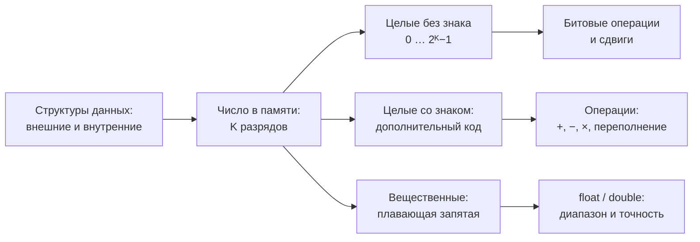

### 0. Освежим в памяти

- **Позиционная система с основанием B**: цифра в разряде $k$ весит $B^k$. Например, $1001110_2=64+8+4+2=78$. *На этом держится весь разговор о разрядах и диапазонах.*
- **Двоичная ↔ шестнадцатеричная**: одна 16-ричная цифра = ровно 4 бита. $1110_2=E_{16}$, поэтому байт удобно читать как две 16-ричные цифры: $0100\,1110_2=4E_{16}$. *Так записывают маски и коды в §27–29.*
- **Бит и байт**: бит хранит 0 или 1, байт — 8 бит. Тип `char` занимает 1 байт, `int` — 4 байта, `double` — 8 байт (таблица в [[#5.5 Базовые типы C++ (слайд 41)]]).
- **Тип данных** определяет, сколько памяти отводится под значение и какие операции с ним разрешены. → [[#1. Классификация типов данных|классификация типов данных]]

### 1. Структуры данных: внешние и внутренние

Когда пишешь программу, у одних и тех же данных есть две «жизни». Человек вводит с клавиатуры строчку `10 10 2` — это одно представление. Программа хранит те же числа в переменных `int` и массиве — это другое. Отчёт по каждой лабораторной требует описать **оба** представления, поэтому лекция с них и начинается.

> [!abstract] Определение: структуры данных
> **Внешнее представление** — представление данных во внешней среде компьютера (в файлах, на клавиатуре и экране): в каком формате данные вводятся и выводятся.
> **Внутреннее представление** — представление данных в оперативной памяти (ОП) средствами языка программирования: какие переменные, каких типов, какие массивы.

Зачем думать о внутреннем представлении отдельно? Его выбор определяет, **насколько удобно обращаться к данным и сколько памяти они займут**. Например, матрицу $10\times10$ можно хранить как 100 отдельных переменных, а можно как массив `int A[10][10]` — во втором случае к элементу обращаешься по индексам `A[i][j]` и обходишь всё двумя циклами.

**Пример со слайдов (Лекция 1, слайды 6–7).** По заданному целому $X$ сформировать матрицу $A$ размера $10\times10$:
$$
A=\begin{pmatrix}1&x&x^2&\dots&x^9\\x&x^2&x^3&\dots&x^{10}\\\dots&\dots&\dots&\dots&\dots\\x^9&x^{10}&x^{11}&\dots&x^{18}\end{pmatrix}
$$
Как преподаватель описывает структуры данных для этой задачи:
- *внешние структуры:* задаются количество столбцов и строк матрицы и число $X$; все числа отделяются друг от друга пробелом;
- *внутренние структуры:* статические переменные целого типа для числа $X$ и размерностей матрицы, статический массив целых чисел для хранения результата и вывода его на экран.

![[arifm-01-struktury.png|620]]

Слева — то, что видит человек (три числа через пробел), справа — то, что получилось в памяти после `scanf`: три переменные и таблица. Обрати внимание: в задаче нигде не сказано «используй `int`». Выбор типа и размеров — решение программиста, и его нужно обосновать. Как это оформляется в отчёте — в [[#4. Структуры данных|требованиях к отчёту]].

Выбор внутреннего представления упирается в вопрос: **как число хранится в памяти и что в ней может не поместиться?** Этому посвящена вся остальная лекция.

### 2. Особенности представления чисел в компьютере (§26)

#### 2.1 Предельные значения и переполнение

В математике нет «самого большого числа». В компьютере — есть: число хранится в ячейке с конечным количеством разрядов (деталей конечное число). Значит, у каждого типа есть **диапазон**.

Сколько чисел поместится в $K$ разрядах системы с основанием $B$? Каждый разряд принимает $B$ значений, всего комбинаций $B^K$. Наименьшее — ноль, значит наибольшее
$$
X_{\max}=\underbrace{B^K}_{\text{всего комбинаций}}-\underbrace{1}_{\text{занял ноль}}
$$
Например, в 4 десятичных разрядах ($B=10$, $K=4$) поместятся числа от 0 до $10^4-1=9999$ — это ответ на вопрос слайда «какой диапазон? 10000?»: само число 10000 уже не помещается. В 8 двоичных разрядах — от 0 до $2^8-1=255$.

> [!abstract] Определение: переполнение разрядной сетки
> **Переполнение** — ситуация, когда число, которое требуется сохранить, не умещается в имеющемся количестве разрядов вычислительного устройства.

Похоже на счётчик пробега у старой машины: после 9999 он показывает 0000, а «единица» пятого разряда просто теряется:

![[arifm-02-perepolnenie.gif|560]]

Что это значит для программы? Компьютер **не сообщает** о переполнении целых: результат молча становится неверным. Например, в Visual Studio
```c
unsigned char c = 255;
c = c + 1;      /* c == 0, а не 256 */
```

#### 2.2 Вещественные числа: дискретность и неточность

С целыми всё честно: между 1 и 2 нет других целых, их можно перечислить по порядку — целые числа **дискретны**. Вещественные числа **непрерывны**: между любыми двумя есть бесконечно много других. А компьютер умеет работать только с дискретными данными — с конечным набором кодов.

Поэтому для хранения дробей нужна **дискретизация**: из бесконечной прямой выбирается сетка точек, которые можно записать. Если в дробной части $F$ разрядов, шаг сетки равен
$$
B^{-F}
$$
Например, при $F=3$ десятичных знаках шаг $10^{-3}$: представимы 1,320; 1,321; 1,322… А число 1,3211 записать нельзя — оно округлится до ближайшей точки сетки:

![[arifm-03-diskretnost.png|620]]

Три разных числа 1,3211, 1,3212 и 1,3214 после записи стали одинаковыми — часть информации потерялась. Это и есть главная мысль слайдов 8 и 10:

> [!info] Неточность представления
> Не все вещественные числа могут быть представлены в компьютере точно. При дискретизации возможна потеря информации (искажение данных); большинство трудностей связано именно с кодированием вещественных чисел.

В двоичной системе неточными оказываются даже «простые» десятичные дроби. Например, $0{,}1=0{,}000110011001\ldots_2$ — бесконечная дробь, поэтому `float` хранит не 0,1, а $0{,}100000001490116\ldots$

#### 2.3 Сравнение вещественных чисел

Из неточности хранения следует практическое правило, которое пригодилось во всех лабораторных с `double`.

> [!warning] Не сравнивай вещественные числа через ==
> Результат вычислений хранится неточно, поэтому `0.1 + 0.2 == 0.3` в C даёт **ложь** (слева получается $0{,}30000000000000004$). Сравнивай с допустимой погрешностью: $\lvert x-y\rvert<\varepsilon$, например $\varepsilon=10^{-6}$.

На слайде 9 есть второй вариант той же идеи: вместо $x\cdot y=1$ проверяют $\lvert 1-x\cdot y\rvert<\varepsilon$. В коде это выглядит так:
```c
#include <math.h>
#define EPS 1e-6
if (fabs(x - y) < EPS)      /* «x равно y» с точностью EPS */
```
Так, например, в ЛР №5 проверялось деление на $(x,By)$: `if (fabs(s3) < EPS)` — число, близкое к нулю, считается нулём.

Теперь понятно, *почему* всё так: осталось разобраться, *как именно* числа лежат в битах. Начнём с целых.

### 3. Хранение целых чисел (§27)

#### 3.1 Целые без знака (unsigned)

Самый простой случай: все $K$ битов отводятся под величину числа, знака нет — **беззнаковые данные не могут быть отрицательными**. Число просто записывается в двоичной системе.

Разберём байт со слайда 12: $78=1001110_2$. В 8 битах это `0100 1110` — слева дописан ноль до полного байта:

![[arifm-04-bait.png|560]]

Биты нумеруются справа налево с нуля: бит 0 — **младший** (вес $2^0$), бит 7 — **старший** (вес $2^7$). Байт делится на два **полубайта** по 4 бита, и каждый полубайт — одна 16-ричная цифра: $0100_2=4$, $1110_2=E$. Поэтому $78=4E_{16}$. А если этот же байт прочитать как символ, получится буква `'N'`: её код в таблице как раз 78. Один и тот же набор битов — число или символ, смотря как его читать.

**Диапазон.** В $K$ битах — от 0 до $2^K-1$ (формула из [[#2.1 Предельные значения и переполнение]] при $B=2$):

| K, бит | $X_{\min}$ | $X_{\max}$ | тип в C |
|---|---|---|---|
| 8 | 0 | 255 | `unsigned char` |
| 16 | 0 | 65 535 | `unsigned short` |
| 32 | 0 | 4 294 967 295 | `unsigned int` |
| 64 | 0 | 18 446 744 073 709 551 615 | `unsigned long long` |

*(на слайде 64-битный тип подписан `long`; в Visual Studio `long` занимает 32 бита, а 64-битный беззнаковый — это `unsigned long long`)*

Удобно представлять коды на круге (слайд 13): после `FF` (255) снова идёт `00` (0). Именно так выглядит переполнение: $255+1$ «перескакивает» в 0 — `1111 1111 + 0000 0001 = 1 0000 0000`, а девятый бит в байт не помещается.

#### 3.2 Целые со знаком: дополнительный код

Как хранить отрицательные числа? **Сколько места нужно на знак?** Ровно один бит: старший. Если он 0 — число неотрицательное, если 1 — отрицательное.

Первая идея — **прямой код**: старший бит — знак, остальные 7 — модуль. Тогда $78=0\,1001110$, а $-78=1\,1001110$. Но у прямого кода плохое свойство: сложение положительных и отрицательных чисел приходится делать **по разным алгоритмам** (а ещё у нуля два кода: $+0$ и $-0$). Процессору нужен один способ на всё.

**Идея дополнительного кода.** Код числа $-1$ должен быть таким, чтобы при сложении с $+1$ получился 0. Смотрим на байт: $1111\,1111+0000\,0001=1\,0000\,0000$, и девятый бит пропадает — остаётся ровно 0. Значит, $-1$ удобно кодировать как `1111 1111` — тем же кодом, что у беззнакового 255. Заметь: $255=256-1$. Обобщаем:

> [!info] Дополнительный код
> Для 8-битных чисел код числа $-X$ равен двоичному коду числа $256-X$ (дополнение до 256). При $K$-битном кодировании дополнительный код числа $-X$ равен двоичному коду числа $2^K-X$ (дополнение до $2^K$).

**Почему это работает?** Потому что сложение в $K$ битах — это сложение «по модулю $2^K$» (лишний разряд теряется). $X+(2^K-X)=2^K$, а $2^K$ в $K$ битах выглядит как ноль. Значит, код $2^K-X$ ведёт себя при сложении в точности как $-X$.

> [!success] Простыми словами
> Дополнительный код — это «круг вместо прямой»: отрицательные числа занимают верхнюю половину кодов. Шаг назад от нуля по кругу — это `FF`, то есть $-1$; ещё шаг — `FE`, то есть $-2$.

![[arifm-05-krug-kodov.png|680]]

Сравни два круга: коды одинаковые, а смысл разный. Слева `80` — это 128, справа — это $-128$. Скачок (оранжевая черта) у беззнаковых — между 255 и 0, у знаковых — между 127 и $-128$. Поэтому $127+1$ в `char` даёт $-128$: это то же самое переполнение, только в другом месте круга.

#### 3.3 Как построить дополнительный код

На слайдах 17–18 четыре способа получить код $-X$. Все дают один результат; разберём их на $X=78$, $K=8$.

**Алгоритм А0** — прямо по определению: перевести $2^K-X$ в двоичную систему. $256-78=178=1011\,0010_2$. Неудобство: для вычисления $256$ нужен лишний, $(K+1)$-й разряд.

**Алгоритм А1** — самый употребимый:
1. перевести $X$ в двоичную систему;
2. построить **обратный код** — инвертировать все биты (0 ↔ 1);
3. к результату прибавить 1.

![[arifm-06-dopkod.gif|560]]

Почему это то же самое, что $256-X$? Инверсия даёт $255-X$ (сумма числа и его инверсии — `1111 1111` = 255), а $+1$ превращает это в $256-X$. На последнем кадре — проверка: $78+(-78)$ даёт `1 0000 0000`, лишняя единица теряется, остаётся 0.

**Алгоритм А2:** перевести $X-1$ в двоичную и инвертировать все биты. $78-1=77=0100\,1101_2$, инверсия — `1011 0010`. То же самое, потому что $255-(X-1)=256-X$.

**Алгоритм А3** — удобен «в уме»: записать $X$ в двоичной и инвертировать все биты **левее самой младшей единицы**, а её и нули после неё оставить. $78=0100\,11\boxed{1}0$: младшая единица — бит 1. Оставляем `10`, остальное инвертируем: `1011 00` + `10` = `1011 0010`.

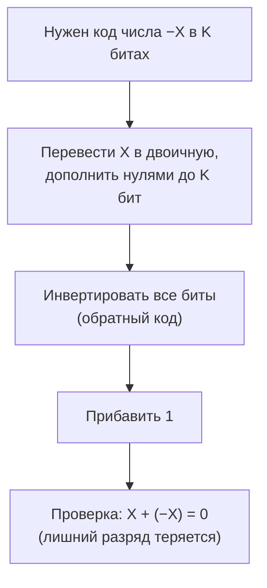

#### 3.4 Диапазон чисел со знаком

Коды со старшим битом 0 (`00`…`7F`) — это $0\ldots127$, со старшим битом 1 (`80`…`FF`) — это $-128\ldots-1$. Отрицательных на одно больше, потому что ноль «занял» место среди неотрицательных. В общем виде для $K$ битов: от $-2^{K-1}$ до $2^{K-1}-1$.

| K, бит | $X_{\min}$ | $X_{\max}$ | тип в C |
|---|---|---|---|
| 8 | −128 | 127 | `char` (`signed char`) |
| 16 | −32 768 | 32 767 | `short` |
| 32 | −2 147 483 648 | 2 147 483 647 | `int` |
| 64 | $-2^{63}$ | $2^{63}-1$ | `long long` |

*(на слайде 20 16-битный тип подписан `int` — так было в старых компиляторах; в Visual Studio `int` занимает 32 бита, а строка для 32 бит на слайде пустая — дописано по смыслу)*

Зачем это знать? Например, факториал $13!=6\,227\,020\,800$ уже не помещается в `int`: программа выдаст мусор без всякого предупреждения.

### 4. Операции с целыми числами (§28)

#### 4.1 Сложение и вычитание

Главный выигрыш дополнительного кода:

> [!info] Сложение и вычитание в дополнительном коде
> Операции с положительными и отрицательными числами выполняются **по одинаковым алгоритмам**. Вычитание — это сложение с дополнительным кодом вычитаемого: $a-b=a+(-b)$.

**Пример со слайда 22:** $5-9=5+(-9)$. Код $-9$ по алгоритму А1: $9=0000\,1001$ → инверсия `1111 0110` → $+1$ = `1111 0111`. Складываем столбиком, как обычные двоичные числа:
$$
\begin{array}{r}0000\,0101\\+\;1111\,0111\\\hline1111\,1100\end{array}
$$
Что получилось? Старший бит 1 — число отрицательное. Какое? Построим дополнительный код от результата: инверсия `0000 0011`, $+1$ = `0000 0100` = 4. Значит, ответ $-4$ — верно. Никаких отдельных правил для знаков процессору не понадобилось.

#### 4.2 Переполнение при сложении чисел со знаком

У знаковых чисел переполнение выглядит особенно коварно: сумма двух положительных получается отрицательной. Как его заметить? На слайде 23 правило через два бита. Оба слагаемых сначала расширяют на один разряд слева, повторив в нём знаковый бит (было `0010 0001`, стало `0 0010 0001`), и складывают уже 9-разрядные числа:
- $S$ — **знаковый бит** результата (бит 7, как обычно);
- $S'$ — **дополнительный бит** — новый девятый разряд суммы.

> [!info] Признак переполнения
> Если бит $S$ не совпадает с битом $S'$, произошло переполнение и результат неверный.

![[arifm-07-perepolnenie-znak.png|680]]

Слева: $96+33=129$, а 129 > 127 в `char` не помещается. Код `1000 0001` читается как $-127$: знаковый бит $S=1$, а дополнительный $S'=0$ (оба слагаемых положительные, в девятом разряде у них нули, переноса туда нет) — биты не совпали, значит, переполнение. Справа то же «с другой стороны»: $(-33)+(-96)=-129<-128$, получилось $+127$ ($S=0$, $S'=1$).

**Почему правило работает?** Без переполнения девятый разряд — просто копия знака, и $S'=S$. Если же сумма вышла за диапазон, знаковый бит «испортился», а девятый разряд по-прежнему хранит правильный знак — они и расходятся. Проверим на нормальном примере $5+(-9)$: `0 0000 0101 + 1 1111 0111 = 1 1111 1100`, $S'=1$, $S=1$ — совпали, переполнения нет, ответ $-4$ верный.

**Как это проверить без расширения?** Переполнение при сложении возможно, только если оба слагаемых одного знака, а сумма получилась противоположного знака. Слагаемые разных знаков переполнения не дают никогда.

#### 4.3 Умножение

> [!info] Умножение
> Умножение выполняется с помощью сложения и сдвига.

Это обычное умножение «столбиком», только в двоичной системе оно проще: каждая цифра множителя — 0 или 1, так что слагаемое — либо ноль, либо сам множимый, сдвинутый влево. **Пример:** $9\cdot5$, $5=101_2$:
$$
\underbrace{0000\,1001}_{9\cdot1}+\underbrace{0000\,0000}_{9\cdot0,\ \text{сдвиг на 1}}+\underbrace{0010\,0100}_{9\cdot1,\ \text{сдвиг на 2}}=0010\,1101_2=45
$$
С отрицательными числами в дополнительном коде то же самое: $-9\cdot5$ — складываем сдвинутые копии `1111 0111`, оставляем младшие 8 бит и получаем `1101 0011` $=-45$.

#### 4.4 Поразрядные логические операции

**Поразрядные операции** выполняются с каждым битом отдельно и не влияют на соседние биты. На слайде 25 вопрос: **сложение — поразрядная операция?** Нет: при сложении `1 + 1` возникает перенос в соседний разряд, то есть биты влияют друг на друга.

Четыре поразрядные операции и их запись в C:

| Операция | В C | Правило для одного бита | Чем полезна с маской |
|---|---|---|---|
| НЕ (инверсия) | `~R` | 0 ↔ 1 | — (меняет все биты) |
| И | `D & M` | 1, только если оба 1 | **сбросить** в 0 биты, где в маске 0 |
| ИЛИ | D \| M | 1, если хотя бы один 1 | **установить** в 1 биты, где в маске 1 |
| исключающее ИЛИ | `D ^ M` | 1, если биты разные | **инвертировать** биты, где в маске 1 |

> [!abstract] Определение: маска
> **Маска** — константа, которая определяет область применения логической операции к битам многоразрядного числа.

Все три вопроса со слайдов 26–28 на одних данных: $D=AA_{16}=1010\,1010$, $M=6C_{16}=0110\,1100$:

![[arifm-08-maski.png|700]]

- `AA & 6C = 28` — уцелели только те единицы $D$, над которыми в маске 1; где в маске 0 (оранжевые клетки), бит стал 0;
- `AA | 6C = EE` — где в маске 1, бит стал 1, остальные как в $D$;
- `AA ^ 6C = C6` — где в маске 1, бит перевернулся.

**Задача с лампочками (слайд 29).** Байт $R=0000\,1111$ — 8 лампочек, биты 3…0 горят.
1. Погасить лампочки 2 и 1, не трогая остальные: нужен И с маской, где на местах 2 и 1 нули, а остальные единицы: `1111 1001` $=F9_{16}$. `R & 0xF9` $=0000\,1001$.
2. Включить лампочки 7 и 4: ИЛИ с маской `1001 0000` $=90_{16}$. `R | 0x90` $=1001\,1111$.
3. Переключить лампочки 5, 4 и 2: исключающее ИЛИ с маской `0011 0100` $=34_{16}$. `R ^ 0x34` $=0011\,1011$ — лампочки 5 и 4 зажглись, 2 погасла.

**Как составить маску?** Выпиши 8 позиций, поставь 1 на те биты, которые надо изменить (для И — наоборот, 0), и переведи по 4 бита в 16-ричные цифры.

#### 4.5 Сдвиги

Сдвиг двигает все биты числа на одну позицию; бит, который «выпал» с края, попадает в **бит переноса C**. На слайдах три вида сдвига:

![[arifm-09-sdvigi.gif|560]]

- **Логический сдвиг** влево `N << 1` или вправо `N >> 1`: освободившееся место заполняется нулём.
- **Арифметический сдвиг вправо**: освободившееся слева место заполняется копией знакового бита, поэтому отрицательное число остаётся отрицательным.
- **Циклический сдвиг**: выпавший бит возвращается с другой стороны. Он нужен, чтобы последовательно просмотреть все биты без потери данных. В C отдельного оператора нет — его собирают из двух сдвигов и ИЛИ.

> [!info] Сдвиг и умножение
> Логический сдвиг влево (вправо) — быстрый способ умножить (разделить без остатка) положительное число на 2. Арифметический сдвиг вправо — деление на 2 нацело с округлением «вниз», к ближайшему меньшему целому.

Например, $12=0000\,1100$: влево — `0001 1000` $=24$, вправо — `0000 0110` $=6$. Ответы на вопросы слайдов:
- **Если число нечётное?** Младшая единица выпадает в бит переноса: $15\gg1=7$, остаток просто теряется.
- **Если число отрицательное?** Логический сдвиг вправо испортит его: в старший бит придёт 0, и число станет положительным. Поэтому для знаковых чисел есть арифметический сдвиг: $-12=1111\,0100\to1111\,1010=-6$.

С округлением вниз нужно быть внимательным: $15\gg1=7$, но $-15\gg1=-8$, а не $-7$ (на слайде 32 вся таблица: $-11\to-6$, $-3\to-2$, $-1\to-1$). Обычное деление `-15 / 2` в C даёт $-7$ — у них разное округление. *(В C сдвиг вправо отрицательного `int` по стандарту зависит от компилятора; Visual Studio делает арифметический.)*

#### 4.6 Пример: составляющие цвета RGB (слайд 34)

В 32-битной переменной `N` закодирован цвет пикселя: байт 3 пустой, дальше R (биты 23…16), G (15…8) и B (7…0). Как достать G? Два шага, оба из этого параграфа:
1. обнулить всё, кроме G: И с маской `0x0000FF00`;
2. сдвинуть вправо на 8, чтобы G оказалось в младшем байте.

![[arifm-10-rgb.png|620]]

```c
G = (N & 0xFF00) >> 8;
```
Например, для $N=00123456_{16}$: `N & 0xFF00` $=00003400_{16}$, после сдвига $G=34_{16}=52$. Красный канал достаётся так же: `R = (N & 0xFF0000) >> 16`, синий — без сдвига: `B = N & 0xFF`.

С целыми закончили. Осталась самая хитрая часть — дробные числа.

### 5. Хранение вещественных чисел (§29)

#### 5.1 Фиксированная и плавающая запятая

**С фиксированной запятой** (в первых ЭВМ) часть разрядов отводилась под целую часть, часть — под дробную. Беда в том, что очень маленькие и очень большие числа так не уместить: $0{,}000000000000012345$ требует кучу разрядов под нули после запятой, $123450000000000000{,}0$ — под нули до неё. Приходилось вручную масштабировать данные.

**С плавающей запятой** число хранится как три поля — знак, порядок $P$ (положение запятой) и значащая часть $Z$ (цифры числа):
$$
0{,}000000000000012345=1{,}2345\cdot10^{-14},\qquad 123450000000000000=1{,}2345\cdot10^{17}
$$
Запятая «плавает»: масштаб подбирается автоматически порядком, а под цифры всегда отводится одно и то же количество разрядов.

#### 5.2 Нормализация

Одно и то же число можно записать по-разному: $12{,}345=0{,}12345\cdot10^2=1{,}2345\cdot10^1$. Чтобы запись была однозначной, договорились о нормализованной форме.

> [!info] Нормализованная форма (стандарт IEEE 754)
> Значащая часть $Z$ удовлетворяет условию $1\le Z<B$, где $B$ — основание системы счисления.

Почему не $0\le Z<1$ (вариант «целая часть = 0»)? Тогда первый разряд всегда 0 и тратится впустую. При $1\le Z<B$ все разряды несут цифры — при том же количестве разрядов точность выше.

А в двоичной системе ($B=2$) есть ещё один бонус: условие $1\le Z<2$ означает, что целая часть $Z$ **всегда равна 1**. Раз она всегда 1, её можно не хранить в памяти — это лишний бит точности даром.

**Пример со слайда 38:** $17{,}25=10001{,}01_2$. Переносим запятую на 4 позиции влево: $1{,}000101_2\cdot2^4$.

Остальные числа слайда 38 *(задание с лекции)* — переводим целую и дробную части отдельно, затем двигаем запятую:

| Число | Двоичная запись | Нормализованная форма |
|---|---|---|
| 5,375 | $101{,}011_2$ | $1{,}01011_2\cdot2^2$ |
| 7,625 | $111{,}101_2$ | $1{,}11101_2\cdot2^2$ |
| 27,875 | $11011{,}111_2$ | $1{,}1011111_2\cdot2^4$ |
| 13,5 | $1101{,}1_2$ | $1{,}1011_2\cdot2^3$ |
| 0,125 | $0{,}001_2$ | $1{,}0_2\cdot2^{-3}$ |

Как получилась дробная часть, например, у 5,375? $0{,}375=0{,}25+0{,}125=2^{-2}+2^{-3}$, значит $0{,}011_2$. У 0,125 порядок отрицательный: запятая уехала вправо на 3 позиции.

#### 5.3 Число обычной точности (float, 32 бита)

Формат `single` (в C — `float`) занимает 4 байта: 1 бит знака, 8 бит порядка, 23 бита мантиссы. Два важных соглашения:
- **мантисса** — это только дробная часть $Z$ (ведущая 1 не хранится, см. [[#5.2 Нормализация]]);
- **порядок хранится со смещением** 127: в поле пишут $p+127$. Так и отрицательные порядки укладываются в беззнаковое поле: $2^{-3}$ даёт $-3+127=124$.

**Закодируем $-17{,}25$** (слайд 39) — по шагам:

![[arifm-11-float.gif|700]]

1. Знак откладываем, переводим модуль: $17{,}25=10001{,}01_2$.
2. Нормализуем: $1{,}000101_2\cdot2^4$, значит порядок $p=4$, дробная часть $Z$ — `000101`.
3. Число отрицательное → бит 31 равен 1.
4. Порядок со смещением: $4+127=131=1000\,0011_2$ → биты 30…23.
5. Мантисса: `000101`, дополненная нулями до 23 бит → биты 22…0.
6. Читаем все 32 бита по четыре: `1100 0001 1000 1010 0000…` $=C18A0000_{16}$.

Проверить себя можно в любой программе: если записать `float f = -17.25f;` и посмотреть байты, получится именно `C1 8A 00 00`.

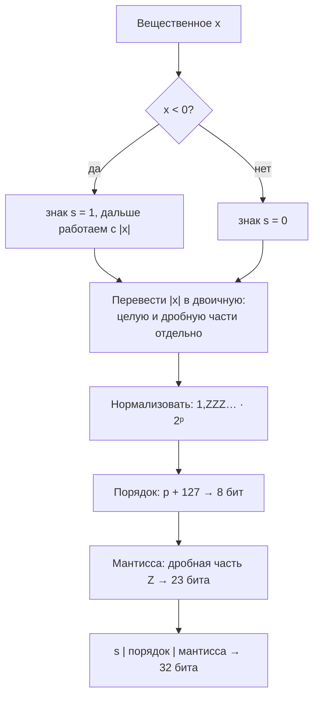

#### 5.4 Диапазон и точность вещественных типов

Из формата следует и диапазон, и точность: порядок задаёт, насколько большие и маленькие числа представимы, а длина мантиссы — сколько значащих цифр сохраняется.

| Тип | Диапазон | Значащих десятичных цифр | Размер, байт |
|---|---|---|---|
| `float` | $1{,}4\cdot10^{-45}$ – $3{,}4\cdot10^{38}$ | 7–8 | 4 |
| `double` | $4{,}9\cdot10^{-324}$ – $1{,}8\cdot10^{308}$ | 15–16 | 8 |
| `extended` | $3{,}6\cdot10^{-4951}$ – $1{,}2\cdot10^{4932}$ | 19–20 | 10 |

`extended` — тип для вычислений в сопроцессоре; в нём единица в значащей части не скрывается. *(В Visual Studio `long double` совпадает с `double`, так что в наших программах 10-байтного типа нет.)*

Что это значит на практике? У `float` всего 7–8 верных цифр: $16\,777\,217$ уже не помещается точно и превращается в $16\,777\,216$. Поэтому в лабораторных для вещественных данных берётся `double` — 15–16 цифр хватает с большим запасом.

#### 5.5 Базовые типы C++ (слайд 41)

Последний слайд собирает всё вместе — какие типы есть в языке, сколько они занимают и откуда берутся их диапазоны:

| Вид | Тип | Размер | Диапазон | Комментарий |
|---|---|---|---|---|
| логический | `bool` | 8 бит | `true` / `false` | `false` — это ноль, `true` — любое другое значение |
| символьный | `char` | 8 бит | 0–255 (или −128…127) | хранит число — код символа в таблице |
| целый | `int` | 32 бита | $-2^{31}\ldots2^{31}-1$ ≈ ±2·10⁹ | один бит — на знак, остальные 31 — на величину |
| целый | `unsigned int` | 32 бита | $0\ldots2^{32}-1$ ≈ 4·10⁹ | все 32 бита — на величину |
| целый | `long long` | 64 бита | $-2^{63}\ldots2^{63}-1$ ≈ ±9·10¹⁸ | |
| целый | `unsigned long long` | 64 бита | $0\ldots2^{64}-1$ ≈ 18·10¹⁸ | |
| вещественный | `double` | 64 бита | ±1,7·10³⁰⁸ | до 15 значащих цифр |

На слайде у `char` указан диапазон 0–255; в Visual Studio обычный `char` знаковый (−128…127), а 0–255 — у `unsigned char`. Это важно при работе с русскими буквами: в кодировке 1251 «а» имеет код 224, а в знаковом `char` это $224-256=-32$ (см. [[#1.2. Символ char|символ char]]).

### Итог

1. У данных два представления: внешнее (как вводятся и выводятся) и внутреннее (как лежат в памяти) — оба описываются в отчёте.
2. В памяти у числа конечное число разрядов → у каждого типа есть диапазон, а выход за него — переполнение, о котором компьютер молчит.
3. Целые без знака — просто двоичная запись; со знаком — дополнительный код ($-X\to2^K-X$, «инвертировать и прибавить 1»), и тогда сложение и вычитание делаются одним алгоритмом.
4. Над битами работают маски (`&` сбросить, `|` установить, `^` инвертировать) и сдвиги (×2, ÷2).
5. Вещественные хранятся с плавающей запятой: знак, порядок со смещением, мантисса без ведущей 1. Поэтому дроби хранятся неточно и их сравнивают через $\lvert x-y\rvert<\varepsilon$.

#### Шпаргалка

| Понятие | Формула / правило | Когда применять |
|---|---|---|
| Внешние / внутренние структуры | формат ввода-вывода / переменные и массивы в ОП | раздел «Структуры данных» отчёта |
| Наибольшее беззнаковое | $B^K-1$; в битах $2^K-1$ | оценить, поместится ли результат |
| Шаг сетки дробей | $B^{-F}$ | почему дробь хранится неточно |
| Сравнение вещественных | `fabs(x - y) < EPS` | любое «равно» для `double` |
| Дополнительный код $-X$ | $2^K-X$ = инверсия + 1 | хранение отрицательных целых |
| Диапазон со знаком | $-2^{K-1}\ldots2^{K-1}-1$ | `char` −128…127, `int` ≈ ±2·10⁹ |
| Переполнение при сложении | слагаемые одного знака, сумма другого | проверка результата |
| И (&) с маской | сбрасывает биты, где в маске 0 | выделить часть числа |
| ИЛИ (\|) с маской | устанавливает биты, где в маске 1 | включить флаги |
| XOR (^) с маской | инвертирует биты, где в маске 1 | переключить флаги |
| `<<` / `>>` | ×2 / ÷2 (арифм. сдвиг — округление вниз) | быстрые умножение и деление |
| Нормализация | $1\le Z<2$, ведущая 1 не хранится | кодирование вещественных |
| float | 1 + 8 + 23 бита, порядок $p+127$ | $-17{,}25=C18A0000_{16}$ |
| float / double | 7–8 / 15–16 значащих цифр | почему в лабах `double` |

#### Проверь себя

> [!question]- Почему в 8 битах со знаком отрицательных чисел на одно больше, чем положительных?
> Всего 256 кодов. Половина (старший бит 1) — отрицательные, их 128: $-128\ldots-1$. Вторая половина — 128 кодов на $0\ldots127$, и один из них занят нулём.

> [!question]- Чему равен дополнительный код числа −1 в 16 битах?
> $2^{16}-1=65535$, то есть все единицы: `FFFF`. В любом количестве битов $-1$ — это «все единицы».

> [!question]- Почему 0.1 + 0.2 == 0.3 в C даёт ложь?
> 0,1 и 0,2 в двоичной системе — бесконечные дроби, в `double` хранятся с округлением, и сумма отличается от 0,3 в 17-м знаке. Сравнивать нужно через `fabs(a - b) < EPS`.

> [!question]- Какой маской и операцией оставить только младший полубайт числа?
> `x & 0x0F`: И с маской `0000 1111` обнулит старшие 4 бита и сохранит младшие.

> [!question]- Почему −15 >> 1 даёт −8, а −15 / 2 даёт −7?
> Арифметический сдвиг округляет вниз (к меньшему целому), а деление `/` в C отбрасывает дробную часть (округляет к нулю).

> [!question]- Зачем порядок во float хранится со смещением 127?
> Чтобы отрицательные порядки (у чисел меньше 1) уложились в беззнаковое 8-битное поле: $p=-3$ хранится как 124.

> [!question]- Задача: закодируй 13,5 во float.
> $13{,}5=1101{,}1_2=1{,}1011_2\cdot2^3$. Знак 0, порядок $3+127=130=1000\,0010$, мантисса `1011 000…`. Биты: `0 10000010 10110000…` = `0100 0001 0101 1000 0…` $=41580000_{16}$.

## 6. Ветвления, циклы и итерационные вычисления (ЛР №1–2)

> [!abstract] Главная идея
> Отдельной лекции по управляющим конструкциям в присланных материалах нет: они нужны с первой лабораторной, а в лекциях 1–5 используются как известные. Здесь собрано то, что из них понадобилось, и главный метод ЛР №2 — **итерационный цикл**: вычисление суммы бесконечного ряда, пока очередной член не станет меньше заданной точности. *(раздел-дополнение: составлен по лабораторным)*

### 6.1 Ветвления

- `if (условие) действие; else другое;` — выбор из двух вариантов. Условие в C — любое выражение: 0 — ложь, не 0 — истина.
- Сравнения `== != < > <= >=`, логические `&&` (и), `||` (или), `!` (не). `&&` и `||` вычисляются «коротко»: в `len > 0 && s[len-1] == '\n'` второе условие не проверяется, если первое ложно, — так защищаются от выхода за границы.
- Вложенные `if` — как в задаче «максимум из четырёх» (раздел 3, требования): каждое сравнение отбрасывает одно число.
- `switch (x) { case 1: …; break; default: …; }` — выбор по целому значению; без `break` выполнение «проваливается» в следующий `case`.
- Ловушка: `if (x = 5)` — это присваивание, а не сравнение; условие всегда истинно.

### 6.2 Три цикла

| Цикл | Когда | Пример |
|---|---|---|
| `for (i = 0; i < n; i++)` | число повторений известно | обход массива |
| `while (условие)` | повторять, пока условие верно; может не выполниться ни разу | ввод с повторным запросом, итерационный цикл |
| `do { … } while (условие);` | тело выполняется хотя бы раз | меню; в наших ЛР не использовался по просьбе |

`break` — немедленный выход из цикла, `continue` — переход к следующему шагу. Накопление: `s = 0;` до цикла, `s = s + a;` в цикле; счётчик: `k = 0;` и `k++`.

**Ввод с проверкой** (используется во всех ЛР):
```c
printf("Введите n (1 <= n <= %d): ", N);
if (scanf("%d", &n) != 1) {            /* введено не число */
    printf("Ошибка ввода\n");
    return 1;                           /* иначе бесконечный цикл: мусор остаётся в буфере */
}
while (n < 1 || n > N) {                /* число есть, но вне диапазона — спросить снова */
    printf("Ошибка: введите заново: ");
    if (scanf("%d", &n) != 1) { printf("Ошибка ввода\n"); return 1; }
}
```

### 6.3 Итерационный цикл: сумма ряда с точностью ε

**Задача ЛР №2.** Вычислить $I(x)=\int_0^x\frac{\sin t}{t}\,dt$ с помощью ряда. Разложим $\sin t=t-\frac{t^3}{3!}+\frac{t^5}{5!}-\dots$, поделим на $t$ и проинтегрируем почленно:
$$
I(x)=\sum_{k=0}^{\infty}\frac{(-1)^k\,x^{2k+1}}{(2k+1)\,(2k+1)!}=x-\frac{x^3}{3\cdot3!}+\frac{x^5}{5\cdot5!}-\dots
$$
**Почему цикл «итерационный»?** Число членов заранее неизвестно: суммируем, пока очередной член не станет по модулю меньше заданной точности ε. Например, при $x=1$, $\varepsilon=10^{-10}$ хватает 6 членов: $I(1)\approx0{,}9460830704$.

**Рекуррентная формула.** Считать каждый раз степень и факториал заново медленно и опасно (переполнение). Вместо этого член получают из предыдущего. Пусть $c_k=\frac{(-1)^kx^n}{n!}$ при $n=2k+1$; тогда член ряда $a_k=\frac{c_k}{n}$, а
$$
c_{k+1}=-c_k\cdot\frac{x^2}{(n+1)(n+2)}
$$
— каждое следующее $c$ получается из предыдущего одним умножением.

**Три условия остановки** (все три — в программе ЛР №2, раздел 12):
1. $\lvert a\rvert<\varepsilon$ — точность достигнута;
2. `s + a == s` — член настолько мал, что уже не меняет сумму `double` (точность типа исчерпана; см. раздел 5 про хранение вещественных);
3. `k == M` — достигнуто наибольшее разрешённое число членов (защита от бесконечного цикла).

**Ограничение по x.** При больших $\lvert x\rvert$ члены ряда сначала растут до огромных значений, а потом сокращаются — из-за погрешностей округления `double` результат теряет точность. Поэтому в ЛР №2 принято $\lvert x\rvert\le20$.

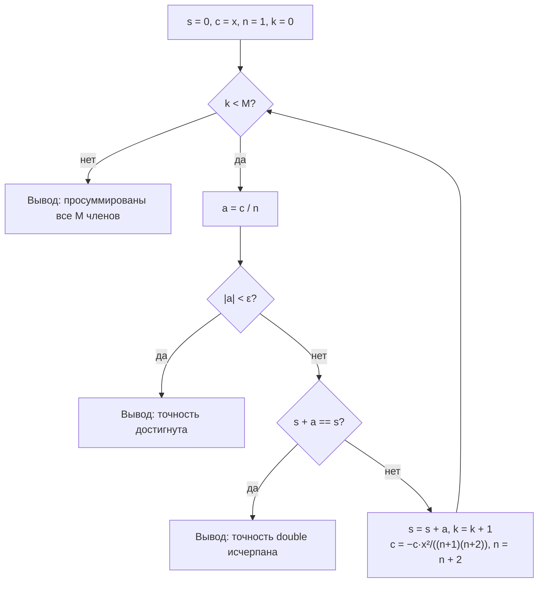

### 6.4 Что из этого следует для любой программы

- Вещественные числа сравнивают с точностью: `fabs(x - y) < EPS`.
- У любого цикла с условием должна быть гарантия завершения: счётчик или проверка, что состояние меняется.
- Типы: целые счётчики — `int`, вещественные величины — `double` (15–16 верных цифр, у `float` только 7–8).

## 7. Лекция 3. Указатели, массивы, сортировка и двоичный поиск

---

> [!abstract] О чём лекция
> Лекция по дисциплине «Основы программирования» (61 слайд). Путь такой: **типы данных** → **указатель** (`&`, `*`, арифметика) → **массив** (объявление, память, индексы) → **указатели и массивы вместе** → **типовые алгоритмы** обработки массивов (§ 63) → **сортировка** (§ 64) → **двоичный поиск**. В конце домашнее задание на дополнительный балл.

> [!info] Как пользоваться конспектом
> - Анимации (`.svg`) запускаются сами и идут по кругу: каждый кадр это один шаг программы.
> - Вопросы, которые лектор оставил на слайдах («Что плохо?», «Зачем float?»), собраны в **свёрнутые** блоки: сначала подумай, потом открывай.
> - Блоки **«Дополнение»** это то, чего нет на слайдах, но что помогает понять тему. Блоки **«Ошибка на слайде»** отмечают опечатки в презентации.
> - В лекции вперемешку C и C++ (`printf_s`/`scanf_s` и `cin`/`cout`). Идеи одни и те же.

### Содержание

1. [[#1. Классификация типов данных]]
2. [[#2. Указатели]]
3. [[#3. Массивы]]
4. [[#4. Массивы и указатели вместе]]
5. [[#5. Ввод массива и работа с его размером]]
6. [[#6. Обход массива в цикле]]
7. [[#7. § 63. Алгоритмы обработки массивов]]
8. [[#8. § 64. Сортировка]]
9. [[#9. Двоичный поиск]]
10. [[#10. Итоги и самопроверка]]
11. [[#11. Домашнее задание]]

### Карта лекции

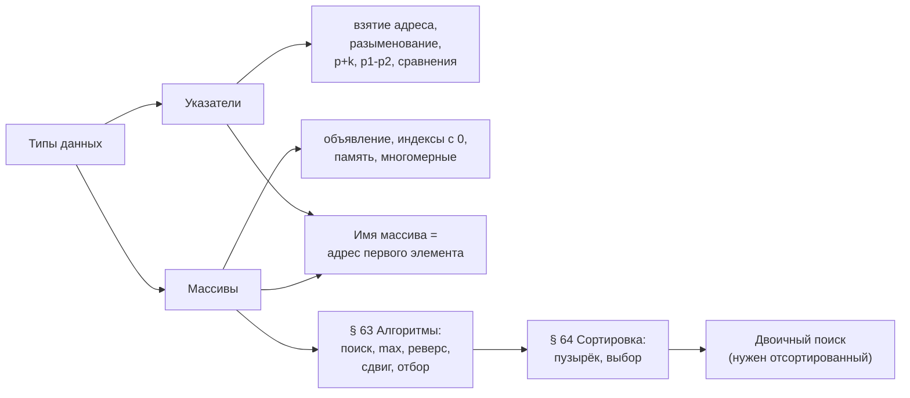

### Шпаргалка за одну минуту

| Что | Запись | Смысл |
|---|---|---|
| Указатель | `int *p;` | переменная, в которой лежит **адрес** другой переменной |
| Адрес | `&a` | адрес переменной `a` |
| Разыменование | `*p` | значение по адресу, который хранится в `p` |
| Сдвиг указателя | `p + k` | адрес растёт на `k * sizeof(тип)` байт |
| Разность указателей | `p2 - p1` | число **объектов** между ними (не байтов) |
| Массив | `int A[N];` | `N` переменных подряд, индексы `0 … N-1` |
| Имя массива | `A` | константа-указатель, равная `&A[0]` |
| Элемент массива | `A[i]` то же, что `*(A + i)` | |
| Сортировка | пузырёк, выбор | простые, около `N²/2` сравнений |
| Двоичный поиск | `L`, `R`, `c = (L+R)/2` | около `log₂N` шагов, массив **должен быть отсортирован** |

---

### 1. Классификация типов данных

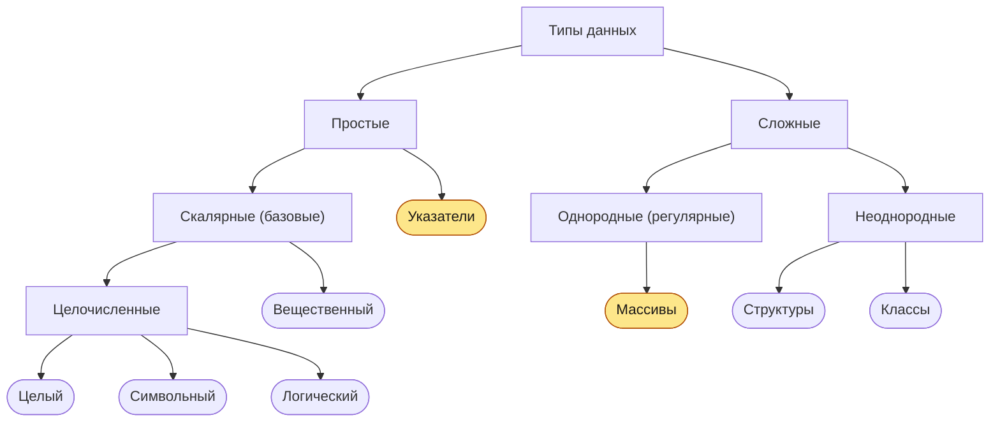

Жёлтым выделено то, что разбирается на этой лекции: **указатели** (простой тип) и **массивы** (сложный однородный тип).

#### Что такое сложный тип

Значение **сложного** типа состоит из множества элементов, связанных в единое целое. Такие типы различаются по трём признакам:

| Признак | Один вариант | Другой вариант |
|---|---|---|
| Тип элементов внутри | **одинаковый** (однородная структура) | **различный** (неоднородная) |
| Количество элементов | **фиксировано** | **переменное**, меняется во время работы программы |
| Обращение к элементу | **прямое**: по индексу, месту в структуре или имени | **последовательное** (для структур переменного размера) |

> [!tip] Где на этой карте массив
> Лекция посвящена **статическим однородным массивам**: тип элементов один, размер фиксирован, доступ прямой по индексу.

---

### 2. Указатели

#### 2.1. Определение

> [!abstract] Указатель
> **Указатель** это переменная, значением которой является **адрес другой переменной**, то есть номер (адрес) единицы памяти, выделенной под эту переменную.

```c
int a;
int *pa;        // определение указателя
pa = &a;        // & — операция определения адреса
```

На слайде 3 это нарисовано так: сам `pa` лежит по адресу `FF11`, а хранит значение `FD45`, то есть адрес переменной `a`.

![[lec-ptr-basics.svg]]

#### 2.2. Тип данных «Указатель»

**Описание переменной:** `тип_объекта *имя_указателя;`

```c
int *p;          // p — указатель на объект типа int
char *s, *c;     // s и c — указатели на объекты типа char
```

> [!warning] Звёздочка относится к каждому имени
> В `char *s, *c;` звёздочка стоит перед **каждой** переменной. Запись `char *s, c;` объявит `s` указателем, а `c` обычным `char`.

«Паспорт» типа (по схеме, которую лектор использует для каждого типа):

| № | Характеристика | Указатель |
|---|---|---|
| 1 | Структура значения | **простой** тип данных |
| 2 | Размер в ОП | **4 байта** |
| 3 | Множество допустимых значений | номер байта (адрес) в ОП: целое положительное число. Внешнее представление: целое число в **16-ричной** системе |
| 4 | Внутреннее представление | целое число (двоичное) |
| 5 | Допустимые операции | `=`, `&`, `*`, `+`/`-` с целым, вычитание указателей, сравнения |

> [!example] Размер указателя не зависит от типа объекта (слайд 9)
> ```c
> int A = 100;     int *a = &A;
> double B = 2.3;  double *b = &B;
> printf("%d\n", sizeof(A));   // 4   — int
> printf("%d\n", sizeof(a));   // 4   — указатель на int
> printf("%d\n", sizeof(B));   // 8   — double
> printf("%d\n", sizeof(b));   // 4   — указатель на double
> ```
> Вывод: `4 4 8 4`. Объект может занимать 4 или 8 байт, но **адрес** всегда занимает одинаково.

> [!tip] Дополнение: 32 и 64 бита
> Размер 4 байта относится к 32-битной сборке, которая использовалась в лекции. В 64-битной программе указатель занимает **8 байт**.

#### 2.3. Пример из памяти (слайды 7–8)

```c
int a, *b;
a = 134;
b = &a;
printf("Значение переменной a равно %d = %x шестн.", a, a);
printf("Адрес переменной a равен %x шестн.", &a);
printf("Данные по адресу указателя b равны %d = %x шестн.", *b, *b);
printf("Значение указателя b равно %x шестн.", b);
printf("Адрес расположения указателя b равен %x шестн.", &b);
```

```output
Значение переменной a равно 134 = 86 шестн.
Адрес переменной a равен 93f7b8 шестн.
Данные по адресу указателя b равны 134 = 86 шестн.
Значение указателя b равно 93f7b8 шестн.
Адрес расположения указателя b равен 93f7ac шестн.
```

![[lec-slide08-memory.png]]

Что видно на картинке:

- `a` (значение `134 = 0x86`) лежит по адресу `0093F7B8` и занимает 4 байта: `86 00 00 00`.
- `b` лежит по адресу `0093F7AC`, тоже занимает 4 байта: `B8 F7 93 00`. Это и есть число `0x0093F7B8`, то есть **адрес `a`**.

> [!tip] Дополнение: почему байты «задом наперёд»
> Число `0x0093F7B8` записано в памяти как `B8 F7 93 00`: младший байт идёт первым. Такой порядок называется *little-endian*, он принят в процессорах x86.

Та же идея в виде таблицы (слайд 7), для `char c; char *p; p = &c;`:

| | Переменная `c` | Указатель `p` |
|---|---|---|
| **Адрес** | `&c` | `p` |
| **Значение** | `c` | `*p` |

#### 2.4. Основные операции

##### Присваивание   =

`имя_указателя = выражение_типа_указатель;`

> [!warning] Типы должны совпадать
> Тип указателя и тип объекта, на который он указывает, **обязаны соответствовать** друг другу: `int *p` хранит адрес `int`, а не `double`.

##### Получение адреса `&`

```c
int a = 5;
int *p;
p = &a;         // p хранит адрес переменной a
```

##### Косвенная адресация (разыменование) `*`

Результат операции `*p` это **значение той переменной, чей адрес записан в `p`**.

```c
int a, b = 0;
int *pa;
pa = &a;
a = 15;
b = *pa;
printf_s("b=%d\n", b);     // будет выведено b=15
```

Четыре выражения, которые легко перепутать (слайд 11, пусть `x = 59`, `&x = 54100`):

| Выражение | Что это | Значение |
|---|---|---|
| `x` | значение обычной переменной | `59` |
| `&x` | адрес переменной | `54100` |
| `px` (после `px = &x`) | указатель, хранит адрес | `54100` |
| `*px` | значение по адресу из `px` | `59` |

![[lec-slide11-px.png]]

Через указатель значение можно не только читать, но и менять:

```c
x++;          // x = 60
(*px)++;      // увеличили значение по адресу px: x = 61
px++;         // увеличили сам адрес
*px;          // разыменование: значение по новому адресу
```

> [!bug] Ошибка на слайде: `px++` как «+1»
> На слайде 11 после `px++` написано `px = 54101`. Для `int *px` на самом деле будет `54100 + 4 = 54104`: указатель сдвигается на размер объекта (см. п. 2.5).

#### 2.5. Арифметика указателей

**1. Сдвиг на целое число**: `Указатель = Указатель1 + A;`
Адрес увеличивается на `A * размер объекта`.

```c
int *q;
int x, y;
q = &x + 1;     // q равен адресу x плюс 4 байта
```

**2. Вычитание указателей**: `Указатель1 - Указатель2`, результат целого типа.
Это **число объектов** (НЕ байтов), которые поместятся между адресами. Оба указателя должны быть одного типа.

**3. Сравнения**: `<`, `>`, `<=`, `>=`, `"==", !=. Результат логического типа.

```c
int a = 5;
int *p;
int b;
p = &a;
b = *p;
bool f;
f = (p == &b);      // false: p хранит адрес a, а не b
f = (b == *p);      // true:  b равно значению по адресу p, то есть 5
```

![[lec-ptr-arith.svg]]

> [!example] Пример со слайда 25: `p += 10`
> Пусть `int *p;` хранит адрес `CC02`. После `p += 10;` в нём будет
> `CC02 + sizeof(int) * 10 = CC02 + 40 = CC2A`.
> Всё считается в **шестнадцатеричной** системе: $40_{10} = 28_{16}$, а $\text{CC02} + 28 = \text{CC2A}$.

> [!tip] Зачем это нужно
> Если создать указатель на начало массива, то, прибавляя к нему число, можно «двигаться» по массиву и получать доступ к отдельным элементам. Об этом п. 4.

#### 2.6. Как разбирать задачи на указатели

> [!abstract] Алгоритм разбора (слайды 12–13)
> 1. Выпиши **адреса и значения** всех переменных из условия.
> 2. Для каждой операции над указателем считай шаг как `sizeof(тип объекта)`: для `char` это 1, для `int` и `float` это 4, для `double` это 8.
> 3. Помни: `&x` это **адрес самой переменной `x`**, он не меняется, даже если `px` сдвинули.
> 4. После сдвига `*px` указывает уже на «чужие» байты: значение там не определено.

**Условие.** Переменная `x` лежит по адресу `1000`, `y` по адресу `3232`, `c` по адресу `5000`. Что выведет программа?

```c
main() {
    double x, *px;
    int y, *py;
    char c, *pc;
    x = 20; y = 30; c = 'a';
    px = &x; py = &y; pc = &c;
    printf("x=%f, y=%d, c=%c, адрес x=%d, адрес y=%d, адрес c=%d\n", x, y, c, px, &y, pc);
    x = x + 1; y = y - 5; px++; py = py + 2; pc++;
    printf("x=%f, y=%d, c=%c, адрес x=%d, адрес y=%d, адрес c=%d\n", x, y, *pc, &x, py - 1, pc);
}
```

**Шаги по переменным:**

| Действие | `x` | `y` | `c` | `px` | `py` | `pc` |
|---|---|---|---|---|---|---|
| после присваиваний | 20 | 30 | `'a'` | 1000 | 3232 | 5000 |
| `x = x + 1` | **21** | | | | | |
| `y = y - 5` | | **25** | | | | |
| `px++` | | | | 1000 + 8 = **1008** | | |
| `py = py + 2` | | | | | 3232 + 2·4 = **3240** | |
| `pc++` | | | | | | 5000 + 1 = **5001** |

**Что напечатают два `printf`:**

| | `x` | `y` | третье значение | адрес x | адрес y | адрес c |
|---|---|---|---|---|---|---|
| 1-й | `20` | `30` | `c` = `a` | `px` = **1000** | `&y` = **3232** | `pc` = **5000** |
| 2-й | `21` | `25` | `*pc` = **???** | `&x` = **1000** | `py - 1` = 3240 − 4 = **3236** | `pc` = **5001** |

> [!note] Почему в `*pc` вопросительные знаки
> После `pc++` указатель смотрит на адрес `5001`, а символ `'a'` лежит по `5000`. Что хранится в байте `5001`, программа не знает: это **неопределённое значение** (мусор). На слайде так и стоит `???`.

> [!note] Почему `&x` остался 1000
> Сдвинули указатель `px`, а не саму переменную `x`. Адрес `x` по-прежнему `1000`.

> [!bug] Ошибки на слайдах 12–13
> - В слайде 12 написано `px=*x; py=*y; pc=*c;`, а надо **`px=&x; py=&y; pc=&c;`** (слайд 13 уже исправлен).
> - В слайде 13 в коде стоит `float x`, но в таблице `Px(1008)`, то есть шаг 8 байт, как у `double`. Для `float` было бы `1004`. Условие из слайда 12 с `double x` согласуется с таблицей.

---

### 3. Массивы

#### 3.1. Что такое массив

> [!abstract] Массив
> **Массив** это группа переменных **одного типа**, расположенных в памяти **рядом** (в соседних ячейках) и имеющих **общее имя**. Каждая ячейка имеет уникальный номер (**индекс**).

Зачем он нужен: как ввести 10 000 переменных? Не заводить же `a1, a2, …, a10000`. Массив решает это одним объявлением.

Что нужно уметь делать с массивом:

1. **выделять память** (объявить),
2. **записывать** данные в нужную ячейку,
3. **читать** данные из ячейки.

#### 3.2. Выделение памяти (объявление)

```c
int A[5];
double V[8];
bool L[10];
char S[80];
```

- Массив это **таблица**: в квадратных скобках пишется число элементов.
- Элементы нумеруются **с нуля**: у `int A[5]` это `A[0], A[1], A[2], A[3], A[4]`.
- Размер лучше задавать **через константу**:

```c
const int N = 10;
int A[N];
```

> [!question]- Вопрос со слайда 17: зачем размер через константу?
> Чтобы размер был записан **в одном месте**. Если потребуется другой размер, меняется одна строка, а все циклы, написанные через `N`, остаются верными. Лектор формулирует это на слайде 27: «при изменении `N` программа не должна меняться».

#### 3.3. Обращение к элементу

Для массива `A` из пяти элементов:

| индекс | 0 | 1 | 2 | 3 | 4 |
|---|---|---|---|---|---|
| **значение** | 5 | 10 | 15 | 20 | 25 |
| **запись** | `A[0]` | `A[1]` | `A[2]` | `A[3]` | `A[4]` |

`A[2]`: **индекс** (номер элемента) равен `2`, **значение** элемента равно `15`. Не путай эти два числа.

#### 3.4. Тип данных «Массив»: паспорт из пяти пунктов

**1) Структура значения**: сложный однородный (регулярный) тип.

Описание: `тип_элемента имя_массива[количество_элементов];`

- `тип_элемента` может быть простым (получается одномерный массив) или сложным (многомерный);
- `количество_элементов` это **целочисленное константное выражение**.

```c
#define N 100              // директива препроцессора
float Buf[N];              // то же, что float Buf[100]
int   A[10];               // обычная константа 10
const int d = 5;
char  T[d];                // именованная константа: char T[5]
int   mas[N*2];            // константное выражение: int mas[200]
```

**Многомерный массив** это массив массивов: `тип имя[N1][N2]…[Nm];`

```c
float M[7][N];   // 7 массивов по 100 элементов float = двумерный массив из 700 элементов
```

**2) Размер в ОП** = количество элементов × размер одного элемента:

```c
float M[7][100];     // 7 * 100 * 4 байта = 2800 байт
const int d = 5;
char T[d];           // 5 * 1 байт = 5 байт
```

**3) Множество допустимых значений**: для каждого элемента определено **типом элемента**.

**4) Внутреннее представление**: память под элементы выделяется **последовательно**, а представление каждого элемента определяет его тип. Двумерные массивы хранятся **«построчно»**.

![[lec-2d-rowmajor.svg]]

> [!abstract] Правило раскладки многомерных массивов
> Сначала меняется **последний** индекс, потом предпоследний и так далее.

Пример со слайда 20, `float X[2][2]`:

$$X = \begin{pmatrix} 5 & -0.7 \\ 10 & 0 \end{pmatrix}$$

В памяти подряд: `X[0][0]`, `X[0][1]`, `X[1][0]`, `X[1][1]`, то есть `5`, `-0.7`, `10`, `0`.

**5) Допустимые операции:**

- обращение к элементу: `имя_массива[индекс]`, где индекс это целое выражение со значением **от 0 до (количество_элементов − 1)**;
- множество допустимых операций над **элементом** определено типом элемента;
- над **массивом целиком** (или его частями) операции **не определены**: нельзя присвоить массив массиву или сравнить два массива через `==.

```c
N = 100;
float M[7][N];
const int d = 5;
char T[d];
float X[2][2];

// M[0][0]               — первый элемент массива M
// M[6][N-1] или M[6][99] — последний элемент массива M

for (int i = 0; i < 5; i++)
    scanf("%c", &T[i]);          // ввод элементов массива T
```

> [!danger] Выход за пределы массива компилятор не отслеживает!
> Запись `A[5]` для `int A[5]` **не вызовет ошибку компиляции**. Программа молча прочитает или перезапишет чужую память. Это самая частая ошибка новичков, подробнее в [[#8.10 Типичные ошибки|10 Типичные ошибки]].

> [!question]- Вопрос со слайда 21: чему равен `X[0][2]`?
> Допустимые индексы в строке `0` и `1`, поэтому `X[0][2]` **вне границ строки**. Если всё же «пройти» по построчной раскладке, то ячейка сразу после `X[0][1]` это `X[1][0]`, то есть **10**. Но так писать нельзя: формально результат не определён, а компилятор ничего не скажет.

Подробно по основам и с задачами: [[#8.2 Урок 1 - Как создать массив|02 Урок 1 - Как создать массив]], двумерные массивы: [[#8.8 Урок 7 - Двумерные массивы|08 Урок 7 - Двумерные массивы]].

---

### 4. Массивы и указатели вместе

#### 4.1. Имя массива это указатель

> [!abstract] Главное правило
> **Имя массива** это константа-указатель на начало массива, то есть адрес первого элемента.

```c
char ma[5];
char *pma, *pel;
pma = ma;          // ma = FFF1
pel = ma + 1;      // pel = FFF2
```

| элемент | `ma[0]` | `ma[1]` | `ma[2]` | `ma[3]` | `ma[4]` |
|---|---|---|---|---|---|
| адрес | `FFF1` (`ma`, `pma`) | `FFF2` (`pel`) | `FFF3` | `FFF4` | `FFF5` |

Для `float X[N]; bool b;` (слайд 23) все эти выражения **истинны**:

| Выражение | Что означает |
|---|---|
| `X == &X[0]` | значение `X` равно адресу элемента `X[0]` |
| `*X == X[0]` | содержимое по адресу `X` равно значению `X[0]` |
| `X + i == &X[i]` | адрес `X + i` равен адресу элемента `X[i]` |
| `*(X + i) == X[i]` | содержимое по адресу `X + i` равно значению `X[i]` |

> [!tip] Вывод
> Запись `X[i]` и запись `*(X + i)` **равнозначны**. Квадратные скобки это удобная форма разыменования со сдвигом.

#### 4.2. Три способа ввести массив

```c
float X[N];
float *p;
p = X;

// 1) без указателей
for (int i = 0; i < N; i++) scanf("%f", &X[i]);

// 2) p — адрес начала массива, сдвиг на i
for (int i = 0; i < N; i++) scanf("%f", p + i);

// 3) сам указатель p движется по массиву
for (int i = 0; i < N; i++, p++) scanf("%f", p);
```

> [!note] Почему в третьем способе двигают `p`, а не `X`
> `X` это **константа**-указатель: прибавлять к ней `i` можно (как в способе 2), а изменять её (`X++`) нельзя. Для движения заводят отдельную переменную-указатель.

#### 4.3. Двумерные массивы и указатели

Для `float Mas[N][M]; bool b;` (слайд 24):

| Выражение | Что означает |
|---|---|
| `Mas == &Mas[0]` | `Mas` это адрес **первой строки** |
| `Mas[i] == &Mas[i][0]` | `Mas[i]` это адрес **первого элемента i-й строки** |
| `*(*(Mas + i) + j) == Mas[i][j]` | двойное разыменование даёт элемент `Mas[i][j]` |

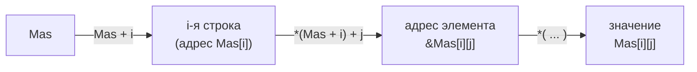

#### 4.4. «Ходим» по массиву указателем (слайд 25)

```c
void main() {
    int A[10] = {1, 2, 3, 4, 5, 6, 7, 8, 9, 10};
    int *p;

    p = A;
    printf("%d\n", *p);     // 1
    p++;
    printf("%d\n", *p);     // 2
    p = p + 4;
    printf("%d\n", *p);     // 6
}
```

```output
1
2
6
```

Шаг каждого `p++` равен `sizeof(int)`, но в записях на C мы думаем «на один элемент вперёд».

Связанные темы: [[#8.5 Урок 4 - Типовые алгоритмы|05 Урок 4 - Типовые алгоритмы]], [[#8.6 Урок 5 - Массивы и функции|06 Урок 5 - Массивы и функции]] (передача массива в функцию как раз использует эту идею).

---

### 5. Ввод массива и работа с его размером

Размер статического массива задаётся при объявлении, а реальных данных обычно меньше. Поэтому берут **максимальный** размер и отдельно хранят **реальное** количество элементов.

> [!abstract] Укрупнённый алгоритм (слайд 26)
> 1. Объявить и инициализировать **максимальное** количество элементов.
> 2. Объявить массив с максимальным количеством элементов.
> 3. Объявить переменную для **реального** количества элементов.
> 4. Ввести реальное количество.
> 5. Проверить: если значение меньше 1 или больше максимального, сообщить об ошибке и запросить заново.
> 6. Если значение правильное, продолжить решение, используя **реальное** количество.

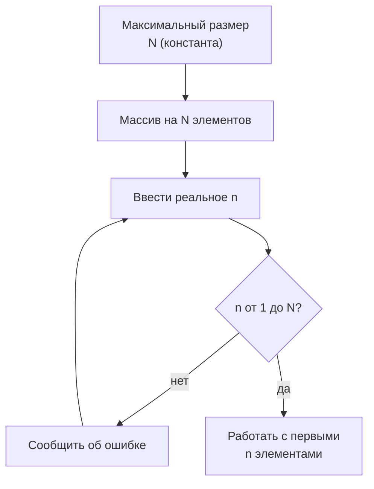

Код для одномерного массива со слайда 26:

```c
#define N 100
int main() {
    float Vector[N];
    int n;
    scanf_s("%d", &n);
    if (n < 1 || n > N - 1) { printf("error n \n"); scanf_s("%d", &n); }
    for (int i = 0; i < n; i++)
        scanf_s("%f", &Vector[i]);
    …
}
```

> [!bug] Ошибка на слайде 26: слабая проверка
> Здесь `if` проверит значение **один раз**: если пользователь опять введёт неверное `n`, программа пойдёт дальше. Условие `n > N-1` тоже лишнее строгое (`n = N` допустимо). Надёжнее `do … while`, как на слайде 33.

**Двумерный массив** (слайд 33), через `do … while`:

```c
#define N 100       // максимальное количество строк
#define M 500       // максимальное количество столбцов
int main() {
    float Matrix[N][M];
    int n, m, i, j;

    do {
        printf("введите количество строк (не больше %d)\n", N);
        scanf_s("%d", &n);
    } while (n < 1 || n > N);

    do {
        printf("введите количество столбцов (не больше %d)\n", M);
        scanf_s("%d", &m);
    } while (m < 1 || m > M);

    printf("введите элементы матрицы\n");
    for (i = 0; i < n; i++)         // n x m — реальные размеры
        for (j = 0; j < m; j++)
            scanf_s("%f", &Matrix[i][j]);
    …
}
```

Подробнее: [[#8.4 Урок 3 - Ввод и вывод|04 Урок 3 - Ввод и вывод]].

---

### 6. Обход массива в цикле

#### 6.1. Как обработать все элементы

Обработать `A[0]`, `A[1]`, … вручную по одному:

```c
const int N = 5;
int A[N];
// обработать A[0]
// обработать A[1]
// обработать A[2]
// обработать A[3]
// обработать A[4]
```

Это не работает по двум причинам: 1) если `N` велико (1000, 1 000 000), столько строк не написать; 2) при изменении `N` программа **не должна** меняться.

Выход: ввести **переменную-индекс** `i` и свести всё к циклу. Три эквивалентные записи (слайд 28):

```c
// 1) переменная i «руками»: те же действия повторяются
i = 0;
// обработать A[i]
i++;
// обработать A[i]
i++;
// … и так далее
```

```c
// 2) цикл while
i = 0;
while (i < N) {
    // обработать A[i]
    i++;
}
```

```c
// 3) цикл for — самая компактная запись
for (i = 0; i < N; i++) {
    // обработать A[i]
}
```

#### 6.2. Заполнение

```c
main() {
    const int N = 10;
    int A[N];
    int i;
    for (i = 0; i < N; i++)
        A[i] = i * i;
}
```

> [!question]- Вопрос со слайда 29: чему равен `A[9]`?
> `A[i] = i*i`, значит `A[9] = 9 * 9 = 81`. Весь массив: `0 1 4 9 16 25 36 49 64 81`.

#### 6.3. Ввод с клавиатуры и вывод на экран (слайд 30)

```cpp
const int N = 10;
int A[N];
int i;

// ввод
for (i = 0; i < N; i++) {
    cout << "A[" << i << "]=";
    cin >> A[i];
}

// вывод
cout << "Массив A:\n";
for (i = 0; i < N; i++)
    cout << A[i] << " ";
```

> [!question]- Вопрос со слайда 30: зачем пробел после элемента?
> Чтобы числа не слиплись в одно: без пробела `5`, `12`, `34` напечатаются как `51234`.

> [!bug] Ошибка на слайде 30
> Написано `cout >> "Массив A:\n";`. Для вывода нужен оператор `<<`: **`cout << …`**. Оператор `>>` у `cin`.

#### 6.4. Перебор: счётчик и среднее

Общая схема: «для каждого элемента сделать что-то с `A[i]`».

**Подсчёт нужных элементов.** В массиве записан рост баскетболистов. Сколько из них выше 180 см, но ниже 190 см?

```c
count = 0;
for (i = 0; i < N; i++)
    if (180 < A[i] && A[i] < 190)
        count++;
```

**Среднее арифметическое** тех же элементов:

```c
int count, sum;
count = 0;
sum = 0;
for (i = 0; i < N; i++)
    if (180 < A[i] && A[i] < 190) {
        count++;
        sum += A[i];
    }
cout << (float)sum / count;
```

> [!question]- Вопрос со слайда 32: зачем `float`?
> `sum` и `count` целые, а деление двух целых тоже целое: дробная часть отбросилась бы (например, `7 / 2 = 3`). Приведение `(float)sum` делает деление вещественным, и результат получается точным (`3.5`).

> [!tip] Дополнение: деление на ноль
> Если подходящих элементов нет, то `count = 0` и деление `sum / count` недопустимо. Перед делением полезно проверить `if (count > 0)`.

Подробнее с задачами: [[#8.3 Урок 2 - Индексы и циклы|03 Урок 2 - Индексы и циклы]].

---

### 7. § 63. Алгоритмы обработки массивов

#### 7.1. Поиск элемента, равного X

**Наивный вариант:**

```c
i = 0;
while (A[i] != X)
    i++;
cout << "A[" << i << "]=" << X;
```

> [!question]- Вопрос со слайда 35: что плохо?
> Если такого элемента **нет**, условие `A[i] != X` остаётся истинным, `i` растёт и выходит за пределы массива. Программа читает чужую память и может упасть или зациклиться.

**Исправленный вариант:** добавить проверку границы `i < N`.

```c
i = 0;
while (i < N && A[i] != X)
    i++;
if (i < N)
    cout << "A[" << i << "]=" << X;
else
    cout << "Не нашли!";
```

> [!question]- Вопрос со слайда 35: что, если такого элемента нет?
> Цикл остановится по условию `i < N` (когда `i` дойдёт до `N`), а проверка `if (i < N)` отличит «нашли» от «не нашли» и выведет «Не нашли!».

**Вариант с досрочным выходом** (`break`), слайд 36:

```c
nX = -1;
for (i = 0; i < N; i++)
    if (A[i] == X) {
        nX = i;
        break;            // досрочный выход из цикла
    }
if (nX >= 0)
    cout << "A[" << nX << "]=" << X;
else
    cout << "Не нашли!";
```

Здесь число `nX = -1` играет роль признака «не найдено» (такого индекса быть не может).

#### 7.2. Максимальный элемент

```c
M = A[0];
for (i = 1; i < N; i++)
    if (A[i] > M)
        M = A[i];
cout << M;
```

**Как найти его номер?** Запоминать ещё и индекс:

```c
M = A[0]; nMax = 0;
for (i = 1; i < N; i++)
    if (A[i] > M) {
        M = A[i];
        nMax = i;
    }
cout << "A[" << nMax << "]=" << M;
```

> [!question]- Вопрос со слайда 37: что можно улучшить?
> Отказаться от переменной `M` и хранить **только номер**: «по номеру элемента можно найти значение!» (слайд 38).

```c
nMax = 0;
for (i = 1; i < N; i++)
    if (A[i] > A[nMax])
        nMax = i;
cout << "A[" << nMax << "]=" << A[nMax];
```

Цикл начинается с `i = 1`, потому что `A[0]` уже взят как стартовый максимум: сравнивать его с самим собой незачем.

> [!example] Задача 23а (слайд 39)
> Заполнить массив случайными числами в интервале `[0, 100]` и найти минимальный и максимальный элементы массива **и их номера**.
>
> На слайде код дан картинкой, ниже тот же приём (минимум ищется так же, только с `<`):
>
> ```c
> #include <stdio.h>
> #include <stdlib.h>
> #include <time.h>
>
> #define N 10
>
> int main(void) {
>     int A[N];
>     srand((unsigned)time(NULL));
>     for (int i = 0; i < N; i++) {
>         A[i] = rand() % 101;            // число из [0, 100]
>         printf("%d ", A[i]);
>     }
>     printf("\n");
>
>     int nMin = 0, nMax = 0;
>     for (int i = 1; i < N; i++) {
>         if (A[i] < A[nMin]) nMin = i;
>         if (A[i] > A[nMax]) nMax = i;
>     }
>     printf("min: A[%d] = %d\n", nMin, A[nMin]);
>     printf("max: A[%d] = %d\n", nMax, A[nMax]);
>     return 0;
> }
> ```

Разные варианты задач на поиск: [[#8.5 Урок 4 - Типовые алгоритмы|05 Урок 4 - Типовые алгоритмы]].

#### 7.3. Реверс массива

Нужно поменять местами `A[0]` и `A[N-1]`, `A[1]` и `A[N-2]` и так далее.

| индекс | 0 | 1 | 2 | 3 | … | N-4 | N-3 | N-2 | N-1 |
|---|---|---|---|---|---|---|---|---|---|
| **до** | 7 | 12 | 5 | 8 | … | 18 | 34 | 40 | 23 |
| **после** | 23 | 40 | 34 | 18 | … | 8 | 5 | 12 | 7 |

«Простое» решение: для `i` от `0` до `N-1` менять `A[i]` и `A[N-1-i]`, но **остановиться на середине** (`N/2`).

```c
for (i = 0; i < (N / 2); i++) {
    c = A[i];
    A[i] = A[N - 1 - i];
    A[N - 1 - i] = c;
}
```

> [!warning] Почему останавливаемся на `N/2`
> Если пройти весь массив (`i < N`), каждая пара поменяется **дважды**, и массив вернётся в исходный вид. Для `1 2 3 4 5 6` полный проход даёт снова `1 2 3 4 5 6`.

> [!question]- Вопрос со слайда 41 (со звёздочкой): как обойтись без переменной `c`?
> Слайд оставляет вопрос открытым. Один из известных способов, обмен через арифметику:
> ```c
> A[i]       = A[i] + A[N-1-i];
> A[N-1-i]   = A[i] - A[N-1-i];
> A[i]       = A[i] - A[N-1-i];
> ```
> Проверка для `x = 3`, `y = 8`: `x = 11`, `y = 3`, `x = 8`. Способ работает, но при больших числах возможно переполнение, поэтому на практике используют `c`.

Анимация разворота с задачами: [[#8.7 Урок 6 - Разворот и сортировка|07 Урок 6 - Разворот и сортировка]].

#### 7.4. Циклический сдвиг элементов

Сдвиг **влево** на один элемент: каждый элемент встаёт на место левого соседа, а первый уходит в конец.

| индекс | 0 | 1 | 2 | 3 | … | N-4 | N-3 | N-2 | N-1 |
|---|---|---|---|---|---|---|---|---|---|
| **до** | 7 | 12 | 5 | 8 | … | 18 | 34 | 40 | 23 |
| **после** | 12 | 5 | 8 | 15 | … | 34 | 40 | 23 | 7 |

```c
c = A[0];
for (i = 0; i < N - 1; i++)
    A[i] = A[i + 1];
A[N - 1] = c;
```

![[lec-shift.svg]]

> [!question]- Вопрос со слайда 42: почему не до `N-1`?
> Для `i = N-1` понадобился бы `A[i+1] = A[N]`, то есть элемент **за концом** массива. Поэтому последний допустимый `i` это `N-2`.

> [!bug] Ошибка на слайде 42: `i < N-2`
> В коде на слайде стоит `i < N-2`, при строгом сравнении это пропустит `i = N-2`, и предпоследний элемент останется на месте. Для `7 12 5 8 34 23` получится `12 5 8 34 34 7` (потеряли `23`). Верно: **`i < N-1`**, то есть `i` доходит до `N-2` включительно.

> [!question]- Вопрос со слайда 42: что плохо в «простом» решении?
> Каждый элемент копируется поочерёдно, за один сдвиг мы делаем `N` присваиваний. Это нормально для сдвига на 1, но для сдвига на `k` позиций повторять цикл `k` раз неэффективно. (Это мой вывод, слайд вопрос не разбирает.)

> [!example] Задача (слайд 43): сдвиг **вправо** на 1 элемент
> Массив `1 2 3 4 5 6` → результат `6 1 2 3 4 5`.
> ```c
> c = A[N - 1];                 // запоминаем последний
> for (i = N - 1; i > 0; i--)   // идём с конца!
>     A[i] = A[i - 1];
> A[0] = c;
> ```
> Цикл идёт **с конца к началу**. Если идти с начала, `A[1] = A[0]` затрёт `A[1]`, и весь массив заполнится копиями `A[0]`.

#### 7.5. Отбор нужных элементов

**Задача.** Отобрать элементы массива `A`, удовлетворяющие условию, в массив `B`.

«Простое» решение `B[i] = A[i]` для подходящих `i` оставляет в `B` **«дыры»**: `12 ? 34 ? ? 46`.

> [!question]- Вопрос со слайда 44: что плохо?
> Элементы `B` попадают не подряд: на местах отброшенных остаются «дыры» с неопределёнными значениями, и непонятно, где кончаются полезные данные.

Правильно: вести **счётчик** `count`: номер следующей свободной ячейки в `B`.

```c
count = 0;
for (i = 0; i < N; i++)
    if (A[i] % 2 == 0) {        // выбрать чётные элементы
        B[count] = A[i];
        count++;
    }
```

![[lec-filter.svg]]

Вывод результата печатает только `count` элементов:

```c
for (i = 0; i < count; i++)
    printf("%d ", B[i]);
```

> [!question]- Вопрос со слайда 45: как вывести на экран?
> Цикл идёт **до `count`**, а не до `N`: в `B` осмысленны только первые `count` элементов, остальные не заполнены.

> [!question]- Вопрос со слайда 45: что, если `A` и `B` один и тот же массив?
> Алгоритм работает. Счётчик `count` никогда не обгоняет `i` (`count ≤ i`), поэтому запись в `A[count]` не затирает ещё не прочитанные элементы. Так элементы можно отбирать «на месте». (Проверено на `12 3 34 11 23 46`: результат `12 34 46`.)

> [!example] Задача (слайд 46)
> Заполнить массив случайными числами в интервале `[0, 100]` и отобрать все чётные числа в другой массив. Решение это связка заполнения (п. 7.2) и отбора (п. 7.5) выше.

---

### 8. § 64. Сортировка

#### 8.1. Что такое сортировка

> [!abstract] Сортировка
> **Сортировка** это расстановка элементов массива в заданном порядке: по возрастанию, по убыванию, по последней цифре, по сумме делителей, по алфавиту и т. д.

| Группа | Алгоритмы | Особенность |
|---|---|---|
| простые и понятные | метод **пузырька**, метод **выбора** | неэффективны для больших массивов |
| сложные, но эффективные | «быстрая сортировка» (**QuickSort**), сортировка «кучей» (**HeapSort**), сортировка слиянием (**MergeSort**), пирамидальная | быстро работают и на больших массивах |

На слайде 48 нарисован график «время работы от N»: у простых методов кривая уходит вверх гораздо круче.

> [!tip] Дополнение: насколько круче
> Простые методы делают порядка $N^2$ операций, эффективные порядка $N \log_2 N$:
>
> | N | $N^2$ | $N \log_2 N$ |
> |---|---|---|
> | 10 | 100 | 33 |
> | 1 000 | 1 000 000 | ≈ 10 000 |
> | 1 000 000 | $10^{12}$ | ≈ 20 000 000 |
>
> Сортировка «кучей» и «пирамидальная» на слайде перечислены отдельно, но это **один и тот же** алгоритм (HeapSort).

#### 8.2. Метод пузырька (сортировка обменами)

> [!abstract] Идея
> Пузырёк воздуха в стакане воды поднимается со дна вверх. Для массива **самый маленький («лёгкий») элемент «всплывает»** к началу.

Как работает один проход:

- сравниваем **два соседних** элемента; если они стоят «неправильно», меняем их местами;
- за **1 проход** по массиву один элемент (самый маленький) становится на своё место.

![[lec-bubble.svg]]

Разбор на массиве со слайдов 49–50, `4 5 2 1 3`:

| Состояние | Массив | Что произошло |
|---|---|---|
| исходный | `4 5 2 1 3` | |
| после 1-го прохода | `1 4 5 2 3` | `1` всплыла на место `A[0]` |
| после 2-го прохода | `1 2 4 5 3` | `2` встала на `A[1]` |
| после 3-го прохода | `1 2 3 4 5` | `3` на `A[2]`, массив уже отсортирован |
| после 4-го прохода | `1 2 3 4 5` | обменов нет |

> [!note] Сколько проходов
> Для массива из `N` элементов нужен **N−1 проход**: достаточно поставить на свои места `N−1` элементов, последний встанет сам.

Алгоритм словами (слайд 51):

- **1-й проход:** сделать для `j` от `N-2` до `0` шаг `-1`: если `A[j+1] < A[j]`, поменять их местами;
- **2-й проход:** то же, но `j` идёт от `N-2` до **`1`**. Это **единственное отличие**: нижняя граница растёт на 1, потому что `A[0]` уже стоит на месте.

Общий вид (слайд 52):

```c
for (i = 0; i < N - 1; i++)
    for (j = N - 2; j >= i; j--)
        if (A[j] > A[j + 1]) {
            c = A[j];             // поменять местами A[j] и A[j+1]
            A[j] = A[j + 1];
            A[j + 1] = c;
        }
```

Внешний цикл по `i` считает проходы, а нижняя граница внутреннего цикла равна `i`.

> [!tip] Сколько сравнений
> За проходы делается `(N-1) + (N-2) + … + 1` сравнений:
> $$\frac{N(N-1)}{2} \approx \frac{N^2}{2}$$
> Поэтому метод медленный на больших массивах. Для `4 5 2 1 3` это 10 сравнений, как и на анимации.

> [!question]- Вопрос со слайда 52: как написать метод «камня»?
> Это зеркальная версия: самый **тяжёлый** (максимальный) элемент «тонет» в конец массива, а проходы идут слева направо.
> ```c
> for (i = 0; i < N - 1; i++)
>     for (j = 0; j < N - 1 - i; j++)
>         if (A[j] > A[j + 1]) {
>             c = A[j]; A[j] = A[j + 1]; A[j + 1] = c;
>         }
> ```
> Проверено на `4 5 2 1 3`: получается `1 2 3 4 5`.

> [!question]- Вопрос со слайда 52: как сделать рекурсивный вариант?
> После одного прохода минимум стоит на `A[0]`. Остаётся отсортировать **остаток** массива (`A+1`, длина на 1 меньше), то есть тот же алгоритм на меньшей задаче:
> ```c
> void bubble(int A[], int n) {
>     if (n <= 1) return;                       // база: один элемент уже отсортирован
>     for (int j = n - 2; j >= 0; j--)          // один проход
>         if (A[j] > A[j + 1]) {
>             int c = A[j]; A[j] = A[j + 1]; A[j + 1] = c;
>         }
>     bubble(A + 1, n - 1);                     // сортируем остаток
> }
> ```
> Здесь работает связка из раздела 4: `A + 1` это указатель на второй элемент, который функция воспринимает как начало нового массива.

Сортировка с задачами: [[#8.7 Урок 6 - Разворот и сортировка|07 Урок 6 - Разворот и сортировка]].

#### 8.3. Метод выбора (минимального элемента)

> [!abstract] Идея
> Найти **минимальный** элемент и поставить его на **первое** место. Затем то же для оставшейся части.

Алгоритм (слайд 54):

```
сделать для i от 0 до N-2
    // найти номер nMin минимального элемента из A[i]..A[N-1]
    если i != nMin то
        // поменять местами A[i] и A[nMin]
```

Код (слайд 55):

```c
for (i = 0; i < N - 1; i++) {
    nMin = i;
    for (j = i + 1; j < N; j++)
        if (A[j] < A[nMin])
            nMin = j;
    if (i != nMin) {
        c = A[i];                  // поменять местами A[i] и A[nMin]
        A[i] = A[nMin];
        A[nMin] = c;
    }
}
```

Внутренний цикл (рамка на слайде) просто ищет **номер** минимума среди `A[i] … A[N-1]`.

![[lec-selection.svg]]

> [!example] Разбор на массиве со слайда 55
> Массив `5 4 2 6 0 8 12 1 4 6` (индексы `0…9`):
>
> | `i` | `nMin` | Обмен | Массив после прохода |
> |---|---|---|---|
> | 0 | 4 (значение 0) | `A[0] ↔ A[4]` | `0 4 2 6 5 8 12 1 4 6` |
> | 1 | 7 (значение 1) | `A[1] ↔ A[7]` | `0 1 2 6 5 8 12 4 4 6` |
> | 2 | 2 | не нужен (`i == nMin`) | `0 1 2 6 5 8 12 4 4 6` |
> | 3 | 7 (значение 4) | `A[3] ↔ A[7]` | `0 1 2 4 5 8 12 6 4 6` |
> | 4 | 8 (значение 4) | `A[4] ↔ A[8]` | `0 1 2 4 4 8 12 6 5 6` |
> | 5 | 8 (значение 5) | `A[5] ↔ A[8]` | `0 1 2 4 4 5 12 6 8 6` |
> | 6 | 7 (значение 6) | `A[6] ↔ A[7]` | `0 1 2 4 4 5 6 12 8 6` |
> | 7 | 9 (значение 6) | `A[7] ↔ A[9]` | `0 1 2 4 4 5 6 6 8 12` |
> | 8 | 8 | не нужен | `0 1 2 4 4 5 6 6 8 12` |

#### 8.4. Пузырёк и выбор: сравнение

| | Пузырёк | Выбор |
|---|---|---|
| Идея | меняем **соседей**, минимум «всплывает» | ищем минимум, ставим **одним обменом** |
| Проходов | `N-1` | `N-1` |
| Сравнений | около $N^2/2$ | около $N^2/2$ |
| Обменов | может быть до $N^2/2$ | **не больше `N-1`** (один за проход) |
| Класс | простой, неэффективный на больших `N` | простой, неэффективный на больших `N` |

> [!tip] Дополнение
> Число обменов в методе выбора заметно меньше. Это важно, когда обмен дорогой (например, элементы это большие структуры).

---

### 9. Двоичный поиск

#### 9.1. Идея

Слайд 57 открывается картинкой «лев в Африке за заборами»: чтобы найти зверя, территорию делят забором **пополам**, оставляют ту половину, где он есть, и повторяют. Не перебирать всё подряд, а каждый раз отсекать половину. Так же работает двоичный поиск в **отсортированном** массиве (на слайде ищут `X = 7` среди чисел `1…16`).

> [!abstract] Алгоритм (слайд 57)
> 1. Выбрать **средний** элемент `A[c]` и сравнить с `X`.
> 2. Если `X = A[c]`, то **нашли** (стоп).
> 3. Если `X < A[c]`, искать дальше в **первой** половине.
> 4. Если `X > A[c]`, искать дальше во **второй** половине.

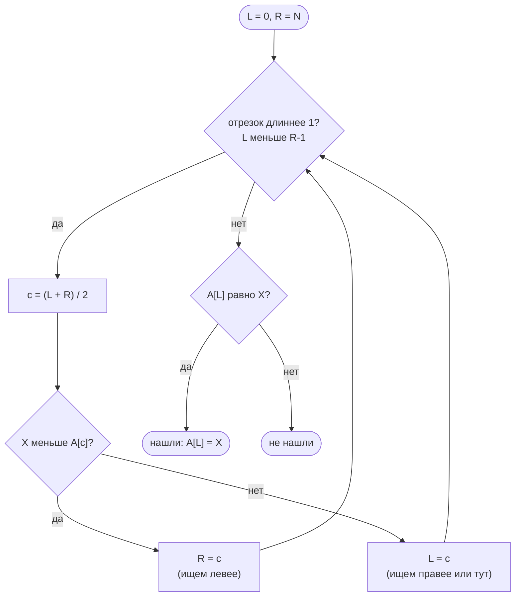

![[lec-binsearch.svg]]

> [!note] Слайды и анимация чуть расходятся в нумерации
> На слайде 57 массив пронумерован `1…16`, а середина выбирается «по картинке». В анимации выше нумерация с нуля, как в коде со слайда 59: шаги получаются `A[8]`, `A[4]`, `A[6]`, `A[7]`, но идея совершенно та же.

#### 9.2. Код и инвариант

```c
int X, L, R, c;
L = 0; R = N;              // начальный отрезок
while (L < R - 1) {
    c = (L + R) / 2;       // нашли середину
    if (X < A[c])          // сжатие отрезка
        R = c;
    else
        L = c;
}
if (A[L] == X)
    printf("A[%d]=%d", L, X);
else
    printf("Не нашли!");
```

Как это понимать: искомое значение всегда лежит в отрезке `A[L] … A[R-1]`. Граница `R = N` это условный «элемент за концом массива» (на слайде 58 он обозначен `A[N]` пунктиром). Цикл заканчивается, когда `L = R-1`: остался **один** кандидат `A[L]`, его и проверяют на равенство `X`.

#### 9.3. Разбор на слайде 58: `X = 44`

Массив `6 34 44 55 67 78 82`, `N = 7`:

| Шаг | `L` | `R` | `c` | `A[c]` | `X < A[c]`? | Действие |
|---|---|---|---|---|---|---|
| 1 | 0 | 7 | 3 | 55 | `44 < 55` да | `R = 3` |
| 2 | 0 | 3 | 1 | 34 | `44 < 34` нет | `L = 1` |
| 3 | 1 | 3 | 2 | 44 | `44 < 44` нет | `L = 2` |
| стоп | 2 | 3 | | | `L = R-1` | `A[2] = 44 = X`, **нашли** |

#### 9.4. Число сравнений (слайд 60)

| N | линейный поиск | двоичный поиск |
|---|---|---|
| 2 | 2 | **2** |
| 16 | 16 | **5** |
| 1 024 | 1 024 | **11** |
| 1 048 576 | 1 048 576 | **21** |

Для двоичного поиска число сравнений $\lfloor \log_2 N \rfloor + 1$: каждый шаг **вдвое** уменьшает отрезок. Миллион элементов проверяется за 21 шаг вместо миллиона.

| Плюс | Минус |
|---|---|
| **скорость выше**, чем при линейном поиске | **нужна предварительная сортировка** массива |

> [!question]- Вопрос со слайда 60: когда нужно применять?
> Когда массив **уже отсортирован** или когда по одному и тому же массиву приходится искать **много раз**: тогда один раз потратить время на сортировку (порядка $N \log_2 N$) выгоднее, чем каждый раз перебирать все элементы. Для одного-единственного поиска в неупорядоченном массиве проще линейный. (Вывод из двух пунктов слайда.)

---

### 10. Итоги и самопроверка

#### Сложность алгоритмов лекции

| Алгоритм | Сколько работы | Условие |
|---|---|---|
| линейный поиск | до `N` сравнений | работает всегда |
| двоичный поиск | около $\log_2 N$ сравнений | массив отсортирован |
| пузырёк | около $N^2/2$ сравнений | |
| выбор | около $N^2/2$ сравнений, до `N-1` обменов | |
| максимум, сумма, подсчёт, отбор | один проход, `N` шагов | |

#### Типичные ошибки из лекции

> [!danger] На что обратить внимание
> - **Индексы с нуля**, последний элемент `A[N-1]`; выход за границы компилятор **не проверяет**.
> - Поиск без проверки `i < N` уходит за массив, если элемента нет.
> - Реверс до `N`, а не до `N/2`, возвращает массив в исходный вид.
> - Цикл сдвига доходит до `N-2` включительно (`i < N-1`).
> - Отбор: выводить нужно `count` элементов, а не `N`.
> - Деление двух целых отбрасывает дробную часть: нужен `(float)`.
> - Размеры указателей и шаг арифметики зависят от **типа объекта**: `p + 1` это не «+1 байт».
> - Двоичный поиск работает **только на отсортированном** массиве.

#### Вопросы для самопроверки

> [!question]- 1. Чем `&a` отличается от `*p`?
> `&a` это **адрес** переменной `a`. `*p` это **значение по адресу**, хранящемуся в указателе `p`.

> [!question]- 2. Какой размер в ОП у указателя и от чего он зависит?
> В лекции 4 байта; он **не зависит** от типа объекта (`int *` и `double *` одинаковы), потому что хранит только адрес.

> [!question]- 3. Что даёт `p + 3` для `int *p` по адресу `1000`?
> `1000 + 3 · sizeof(int) = 1012`: указатель сдвигается на три **элемента**, а не на три байта.

> [!question]- 4. Что выдаст `p2 - p1`, если указатели на `int` стоят на `1000` и `1012`?
> `3`: число объектов между адресами, а не 12 байт.

> [!question]- 5. Чему равно `*(A + i)` для массива `A`?
> Это `A[i]`: имя массива равно адресу первого элемента, а скобки это сдвиг и разыменование.

> [!question]- 6. В каком порядке лежат в памяти элементы двумерного массива?
> Построчно: сначала меняется последний индекс. Для `X[2][2]` порядок `X[0][0], X[0][1], X[1][0], X[1][1]`.

> [!question]- 7. Сколько проходов нужно пузырьку и методу выбора для `N` элементов?
> `N-1` проход у обоих.

> [!question]- 8. Сколько сравнений нужно двоичному поиску для 1024 элементов?
> 11 (`⌊log₂ 1024⌋ + 1`), против 1024 у линейного поиска.

---

### 11. Домашнее задание

> [!success] Домашнее задание (дополнительный балл), слайд 61
> Переменная `x` расположена в памяти по адресу **2004**, `y` по адресу **3000**, `c` по адресу **1000**. Каков результат работы программы?
>
> ```c
> void main() {
>     float x, *px;
>     int y, *py; char c, *pc;
>     x = 20; y = 30; c = 'a';
>     px = &x; py = &y; pc = &c;      // на слайде опечатка: стоит px=*x; py=*y; pc=*c;
>     printf("x=%f,y=%d,c=%c,адрес x=%d, адрес y=%d, адрес c=%d\n", x, y, c, &x, py, &c);
>     x = x - 4; y = y + 5; px--; py = py + 3; pc++;
>     printf("x=%f,y=%d,c=%c,адрес x=%d, адрес y=%d, адрес c=%d\n", *px, y, c, px + 1, py + 2, pc);
> }
> ```

Метод решения такой же, как в п. 2.6: заведи таблицу «переменная: значение / адрес», сделай шаги `x = x - 4`, `y = y + 5`, `px--`, `py = py + 3`, `pc++` и аккуратно посчитай шаги указателей по размеру типа (`float` 4, `int` 4, `char` 1). Обрати внимание, что во втором `printf` вместо `x` печатается `*px`, а вместо `&x` стоит `px + 1`.

> [!success]- Проверь себя (открывай после того, как решишь сам)
> **Первый `printf`:** `x=20.000000, y=30, c=a, адрес x=2004, адрес y=3000, адрес c=1000`
> (`py` хранит адрес `y`, поэтому печатается `3000`).
>
> **Изменения:** `x = 16`, `y = 35`, `px = 2004 − 4 = 2000`, `py = 3000 + 3·4 = 3012`, `pc = 1000 + 1 = 1001`.
>
> **Второй `printf`:**
>
> | Что печатается | Значение |
> |---|---|
> | `*px` (как `x=%f`) | значение по адресу `2000`: **не определено** (мусор), ведь `x` лежит по `2004` |
> | `y` | `35` |
> | `c` | `a` |
> | `px + 1` (адрес x) | `2000 + 4 = 2004` |
> | `py + 2` (адрес y) | `3012 + 2·4 = 3020` |
> | `pc` (адрес c) | `1001` |

---

### Связанные заметки

- [[#8.0 Оглавление|00 Оглавление]]: курс «Массивы в Си» с задачами и решениями
- [[#8.1 Шпаргалка|01 Шпаргалка]]: весь синтаксис массивов на одной странице
- [[#8.2 Урок 1 - Как создать массив|02 Урок 1 - Как создать массив]], [[#8.3 Урок 2 - Индексы и циклы|03 Урок 2 - Индексы и циклы]], [[#8.4 Урок 3 - Ввод и вывод|04 Урок 3 - Ввод и вывод]]
- [[#8.5 Урок 4 - Типовые алгоритмы|05 Урок 4 - Типовые алгоритмы]], [[#8.7 Урок 6 - Разворот и сортировка|07 Урок 6 - Разворот и сортировка]], [[#8.8 Урок 7 - Двумерные массивы|08 Урок 7 - Двумерные массивы]]
- [[#8.10 Типичные ошибки|10 Типичные ошибки]]
- [[#5. Лекция 2. Структуры данных и компьютерная арифметика|ИТИОП]]

## 8. Практикум «Массивы в Си»

Практические уроки по массивам из папки «Массивы в Си»: от объявления массива до итоговой лабораторной.

### 8.0 Оглавление

---

> [!abstract] Для чего этот курс
> За один-два вечера выучить синтаксис массивов так, чтобы писать типовую лабу без справочника. В каждом уроке: короткая теория, анимация, готовый пример и **5 задач с решениями**. Всего 8 уроков, 40 задач и разбор итоговой лабы.

#### Как проходить

1. Открой [[#8.1 Шпаргалка|01 Шпаргалка]]: весь синтаксис на одной странице. Читать её целиком пока не нужно, она пригодится как справочник.
2. Иди по урокам **по порядку**: каждый опирается на предыдущий.
3. Решай задачу сам и только потом разворачивай решение: оно свёрнуто (нажми на заголовок «Решение»).
4. Код **набирай руками**, а не копируй: так синтаксис запоминается быстрее.
5. В конце разбери [[#8.11 Итоговая лаба|11 Итоговая лаба]] и пройди чек-лист перед сдачей.

> [!tip] Если времени мало
> Минимум для лабы: уроки 1, 2, 3 и 4, плюс шпаргалка и итоговая лаба. Функции (урок 5), сортировка (урок 6), матрицы (7) и строки (8) читай, если они есть в твоём задании.

---

#### Карта курса

| № | Заметка | Что запомнишь |
|---|---|---|
| — | [[#8.1 Шпаргалка|01 Шпаргалка]] | Весь синтаксис на одной странице |
| 1 | [[#8.2 Урок 1 - Как создать массив|02 Урок 1 - Как создать массив]] | Объявление, инициализация, индексы, `sizeof` |
| 2 | [[#8.3 Урок 2 - Индексы и циклы|03 Урок 2 - Индексы и циклы]] | Обход циклом, заполнение, накопители |
| 3 | [[#8.4 Урок 3 - Ввод и вывод|04 Урок 3 - Ввод и вывод]] | `scanf` с `&`, проверка `n`, форматы вывода |
| 4 | [[#8.5 Урок 4 - Типовые алгоритмы|05 Урок 4 - Типовые алгоритмы]] | Сумма, max/min, подсчёт, поиск, сравнение |
| 5 | [[#8.6 Урок 5 - Массивы и функции|06 Урок 5 - Массивы и функции]] | Передача в функцию, `const`, `n` параметром |
| 6 | [[#8.7 Урок 6 - Разворот и сортировка|07 Урок 6 - Разворот и сортировка]] | Обмен, разворот, сдвиг, пузырёк |
| 7 | [[#8.8 Урок 7 - Двумерные массивы|08 Урок 7 - Двумерные массивы]] | Матрицы, вложенные циклы, диагонали |
| 8 | [[#8.9 Урок 8 - Строки|09 Урок 8 - Строки]] | `char`-массивы, `'\0'`, `strlen`, `strcmp` |
| — | [[#8.10 Типичные ошибки|10 Типичные ошибки]] | 10 ошибок и как их находить |
| — | [[#8.11 Итоговая лаба|11 Итоговая лаба]] | Разбор типового задания, тесты, защита |

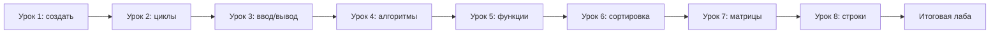

---

#### Прогресс

- [ ] Урок 1. Как создать массив
- [ ] Урок 2. Индексы и циклы
- [ ] Урок 3. Ввод и вывод
- [ ] Урок 4. Типовые алгоритмы
- [ ] Урок 5. Массивы и функции
- [ ] Урок 6. Разворот и сортировка
- [ ] Урок 7. Двумерные массивы
- [ ] Урок 8. Строки
- [ ] Типичные ошибки
- [ ] Итоговая лаба разобрана и написана самостоятельно

---

#### Как запускать код

Каждый пример из курса — готовая программа целиком. Сохрани её в файл `main.c` и скомпилируй:

```
gcc main.c -o main -Wall -Wextra
./main
```

На Windows запуск такой: `main.exe`. Флаги `-Wall -Wextra` включают предупреждения: **читай их всегда**, большинство ошибок в массивах компилятор называет сам.

> [!note] Visual Studio
> - Первой строкой файла добавь `#define _CRT_SECURE_NO_WARNINGS`, иначе `scanf` выдаст ошибку C4996.
> - Массив длиной из переменной (`int a[n]`) не компилируется, поэтому в курсе везде `#define`.
> - Русский текст в консоли может отображаться кракозябрами, поэтому сообщения в примерах написаны по-английски. Комментарии в коде оставлены на русском.

---

#### Анимации

В уроках встречаются анимированные схемы. Они проигрываются прямо в заметке и повторяются по кругу:

| Анимация | Где |
|---|---|
| Как массив лежит в памяти | [[#8.2 Урок 1 - Как создать массив|02 Урок 1 - Как создать массив]] |
| Цикл и накопление суммы | [[#8.3 Урок 2 - Индексы и циклы|03 Урок 2 - Индексы и циклы]] |
| Поиск максимума | [[#8.5 Урок 4 - Типовые алгоритмы|05 Урок 4 - Типовые алгоритмы]] |
| Передача массива в функцию | [[#8.6 Урок 5 - Массивы и функции|06 Урок 5 - Массивы и функции]] |
| Разворот массива | [[#8.7 Урок 6 - Разворот и сортировка|07 Урок 6 - Разворот и сортировка]] |
| Пузырьковая сортировка | [[#8.7 Урок 6 - Разворот и сортировка|07 Урок 6 - Разворот и сортировка]] |
| Обход двумерного массива | [[#8.8 Урок 7 - Двумерные массивы|08 Урок 7 - Двумерные массивы]] |
| Выход за границы | [[#8.10 Типичные ошибки|10 Типичные ошибки]] |

Файлы анимаций лежат в папке `assets`. Любую можно вставить в свою заметку: `![[anim-max.svg]]`.

> [!info] Если анимация не движется
> Файлы из папки `assets` проигрываются и в обычном браузере: открой любой из них двойным кликом из проводника. Если там она движется, а в Obsidian стоит на месте, скажи мне, и я заменю её на GIF.

### 8.1 Шпаргалка

[[#5. Лекция 2. Структуры данных и компьютерная арифметика|ИТИОП]]# Шпаргалка: массивы в Си

---

> [!abstract] Как пользоваться
> Весь синтаксис массивов на одной странице. Открывай перед лабой и сверяйся. Подробности и практика по каждому разделу в уроках (номера в скобках).

#### Объявление и размер ([[#8.2 Урок 1 - Как создать массив|урок 1]])

```c
#define N 5

int a[N];                   // N элементов, значения — мусор
double t[8];                // другие типы: double, char, ...
```

- Индексы: `0 … N-1`. Элемента `a[N]` **нет**.
- Размер — константа (`#define`). Если `n` вводится, массив объявляют на `MAX`, а `n <= MAX` проверяют.

#### Инициализация

| Запись | Что получится |
|---|---|
| `int a[5] = {1, 2, 3, 4, 5};` | 1 2 3 4 5 |
| `int a[] = {1, 2, 3};` | размер 3 |
| `int a[5] = {1, 2};` | 1 2 0 0 0 |
| `int a[5] = {0};` | все нули |
| `int a[5] = {[2] = 7};` | 0 0 7 0 0 (C99) |
| `const int d[3] = {1, 2, 3};` | массив нельзя менять |

#### Доступ и размер

```c
a[0] = 10;                              // записать
x = a[i];                               // прочитать
a[i + 1] = a[i] * 2;                    // индекс — любое целое выражение
int n = sizeof(a) / sizeof(a[0]);       // длина (только там, где массив объявлен)
```

#### Перебор ([[#8.3 Урок 2 - Индексы и циклы|урок 2]])

```c
for (int i = 0; i < n; i++) { ... a[i] ... }          // вперёд
for (int i = n - 1; i >= 0; i--) { ... }              // назад
for (int i = 0; i < n; i += 2) { ... }                // через один
for (int i = 0; i < n - 1; i++) { ... a[i], a[i+1] }  // пары соседей
```

#### Ввод и вывод ([[#8.4 Урок 3 - Ввод и вывод|урок 3]])

```c
if (scanf("%d", &n) != 1 || n < 1 || n > MAX) { /* ошибка */ }

for (int i = 0; i < n; i++) scanf("%d",  &a[i]);   // int:    %d,  с &
for (int i = 0; i < n; i++) scanf("%lf", &t[i]);   // double: %lf, с &

for (int i = 0; i < n; i++) printf("%d ", a[i]);   // вывод без &
printf("%.2f ", t[i]);                             // double, 2 знака
printf("%4d", a[i]);                               // ширина поля 4
```

#### Типовые алгоритмы ([[#8.5 Урок 4 - Типовые алгоритмы|урок 4]])

```c
int sum = 0;                                     // сумма
for (int i = 0; i < n; i++) sum += a[i];
double avg = (double)sum / n;                    // среднее

int max = a[0], imax = 0;                        // максимум и индекс
for (int i = 1; i < n; i++)
    if (a[i] > max) { max = a[i]; imax = i; }

int count = 0;                                   // подсчёт по условию
for (int i = 0; i < n; i++)
    if (a[i] > 0) count++;

int pos = -1;                                    // поиск первого вхождения
for (int i = 0; i < n; i++)
    if (a[i] == x) { pos = i; break; }

int ok = 1;                                      // «все ли ...» (флаг)
for (int i = 0; i < n; i++)
    if (a[i] <= 0) { ok = 0; break; }

for (int i = 0; i < n; i++) b[i] = a[i];         // копия массива
```

#### Разворот, сдвиг, сортировка ([[#8.7 Урок 6 - Разворот и сортировка|урок 6]])

```c
int t = a[i]; a[i] = a[j]; a[j] = t;             // обмен (нужна третья переменная)

for (int i = 0; i < n / 2; i++) {                // разворот
    int j = n - 1 - i;
    int t = a[i]; a[i] = a[j]; a[j] = t;
}

int first = a[0];                                // сдвиг влево на 1
for (int i = 0; i < n - 1; i++) a[i] = a[i + 1];
a[n - 1] = first;

for (int pass = 0; pass < n - 1; pass++)         // пузырёк по возрастанию
    for (int j = 0; j < n - 1 - pass; j++)
        if (a[j] > a[j + 1]) { int t = a[j]; a[j] = a[j + 1]; a[j + 1] = t; }
```

#### Функции ([[#8.6 Урок 5 - Массивы и функции|урок 5]])

```c
void fill(int arr[], int n);                // меняет массив
int  sum_array(const int arr[], int n);     // только читает: const

fill(a, n);                                 // вызов: имя без [] и без &
```

- Размер передаётся **отдельным параметром**; `sizeof(arr)` в функции — размер указателя.
- Функция работает с **оригиналом**, копии нет.
- Вернуть массив нельзя: возвращай число или заполняй переданный массив.

#### Двумерные массивы ([[#8.8 Урок 7 - Двумерные массивы|урок 7]])

```c
int m[R][C];                                // R строк, C столбцов
int m[2][3] = {{1, 2, 3}, {4, 5, 6}};
m[i][j]                                     // сначала строка, потом столбец

for (int i = 0; i < R; i++) {
    for (int j = 0; j < C; j++) { ... m[i][j] ... }
    printf("\n");
}

void print_matrix(int m[][C], int rows);    // столбцы — константой, строки — параметром
```

- Главная диагональ: `i == j`. Побочная: `i + j == n - 1`.

#### Строки ([[#8.9 Урок 8 - Строки|урок 8]])

```c
char s[20] = "hello";                       // в конце '\0'
char t[] = "hi";                            // 3 байта: 'h', 'i', '\0'

scanf("%19s", s);                           // слово, БЕЗ &, ширина = размер - 1
fgets(s, sizeof(s), stdin);                 // строка с пробелами
s[strcspn(s, "\n")] = '\0';                 // убрать '\n' после fgets

strlen(s)  strcpy(dst, src)  strcat(dst, src)  strcmp(a, b)    // <string.h>
for (int i = 0; s[i] != '\0'; i++) { ... s[i] ... }
```

---

#### Чего нельзя

> [!danger] Запрещено
> - `b = a;` — копировать массив присваиванием. **Цикл.**
> - `a = {1, 2, 3};` — задавать значения скобками после объявления.
> - `a == b` — сравнивать массивы. **Цикл с флагом.** Строки — `strcmp`.
> - `s = "abc";` — присваивать строку. **`strcpy`.**
> - `a[n]` и `i <= n` — выход за границы.
> - `scanf("%d", a[i])` — без `&` (кроме строк).
> - `int a[n]` с вводимым `n` — не работает в Visual Studio.

#### Топ-5 ловушек

1. Условие цикла строго `i < n`.
2. `sum = 0` до цикла, `max = a[0]` (не `0`).
3. `(double)sum / n` для среднего.
4. `%lf` в `scanf` для `double`.
5. Для строки из `k` символов нужно `k + 1` место.

Подробнее: [[#8.10 Типичные ошибки|10 Типичные ошибки]].

---

[[#8.0 Оглавление|← Оглавление]] · [[#8.2 Урок 1 - Как создать массив|Урок 1 →]]

### 8.2 Урок 1 - Как создать массив

---

> [!abstract] Что ты узнаешь
> Как объявить массив, задать ему начальные значения, не запутаться в индексах и узнать его размер. Это база: всё остальное в курсе стоит на ней.

Массив — это набор элементов **одного типа**, лежащих в памяти **подряд** под **одним именем**. К каждому элементу обращаются по номеру (индексу), и нумерация начинается **с нуля**.

Вместо десяти переменных `a1`, `a2`, … `a10` заводишь одну `a[10]` и обрабатываешь её циклом.

![[anim-array-memory.svg]]

---

#### 1. Объявление

Общий вид:

```c
тип имя[размер];
```

```c
int a[5];        // 5 целых чисел
double t[8];     // 8 вещественных
char s[20];      // 20 символов
```

Запомни четыре вещи:

1. Число в скобках — это **количество** элементов, а не номер последнего.
2. Индексы идут от `0` до `размер - 1`. У `int a[5]` это `a[0]`, `a[1]`, `a[2]`, `a[3]`, `a[4]`. Элемента `a[5]` **не существует**.
3. Локальный массив без инициализации **не очищен**: в ячейках лежит мусор. Нули стоят только в глобальных и `static` массивах.
4. Размер — целое положительное число, известное при компиляции (подробнее в разделе 3).

> [!warning] Самая частая путаница
> `int a[5]` — это пять элементов с индексами 0…4, а не «элементы от 1 до 5». Последний элемент всегда `a[размер - 1]`.

---

#### 2. Как массив лежит в памяти

```
int a[5] = {10, 20, 30, 40, 50};

индекс:       0     1     2     3     4
          +-----+-----+-----+-----+-----+
значение: | 10  | 20  | 30  | 40  | 50  |
          +-----+-----+-----+-----+-----+
смещение:   +0    +4    +8    +12   +16    (в байтах, если int = 4 байта)
```

Элементы стоят вплотную. Поэтому массив занимает $5 \times 4 = 20$ байт, а адрес любого элемента вычисляется по формуле:

$$\text{адрес}(a[i]) = \text{адрес}(a[0]) + i \cdot \text{sizeof}(a[0])$$

Именно поэтому номер начинается с нуля: индекс — это **сдвиг от начала** в элементах. У первого элемента сдвиг ноль.

---

#### 3. Размер массива

```c
int a[10];          // числом прямо в скобках

#define N 10
int b[N];           // через #define — лучший вариант для лабы
```

`#define` позволяет поменять размер в одном месте, а не искать десятку по всему коду. Имя константы пиши заглавными буквами.

Два соблазна, от которых лучше отказаться:

- `int n = 10; int a[n];` — массив переменной длины (VLA, стандарт C99). В gcc он работает, а Visual Studio его не компилирует; во многих лабах он прямо запрещён.
- `const int n = 10; int a[n];` — в Си (в отличие от C++) `const`-переменная не считается константой для размера массива.

Если количество элементов вводит пользователь, заведи массив **с запасом**, а реальное количество храни в отдельной переменной:

```c
#define MAX 100

int a[MAX];     // место на 100 элементов
int n;          // сколько реально используем (n <= MAX)
```

Как вводить `n` и проверять `n <= MAX`, разберём в [[#8.4 Урок 3 - Ввод и вывод|уроке 3]].

---

#### 4. Способы инициализации

Инициализация — это задание значений в момент объявления, через фигурные скобки.

| Запись | Что окажется в массиве |
|---|---|
| `int a[5];` | 5 элементов, значения — мусор |
| `int a[5] = {1, 2, 3, 4, 5};` | 1 2 3 4 5 |
| `int a[] = {1, 2, 3};` | размер 3 берётся по числу значений: 1 2 3 |
| `int a[5] = {1, 2};` | 1 2 0 0 0 |
| `int a[5] = {0};` | 0 0 0 0 0 |
| `int a[5] = {1};` | 1 0 0 0 0 (**не** пять единиц!) |
| `int a[5] = {[2] = 7, [4] = 9};` | 0 0 7 0 9 (стандарт C99) |

Правило частичной инициализации: перечисленные значения встают **с начала**, всё остальное заполняется **нулями**. Значений больше, чем размер, быть не должно.

> [!tip] Как обнулить весь массив
> Пиши `= {0}`. Заполнить массив единицами или другим числом одной записью нельзя, для этого нужен цикл ([[#8.3 Урок 2 - Индексы и циклы|урок 2]]).

Проверь на практике:

```c
#include <stdio.h>

#define N 5

/* Печатает имя и элементы массива. Функции с массивами разберём в уроке 5,
   пока считай, что show() просто выводит массив. */
static void show(const char *name, const int arr[], int n) {
    printf("%-9s", name);
    for (int i = 0; i < n; i++) {
        printf(" %d", arr[i]);
    }
    printf("\n");
}

int main(void) {
    int full[N]    = {1, 2, 3, 4, 5};
    int inferred[] = {7, 8, 9};
    int part[N]    = {1, 2};
    int zeros[N]   = {0};
    int one[N]     = {1};
    int pick[N]    = {[2] = 7, [4] = 9};

    show("full", full, N);
    show("inferred", inferred, 3);
    show("part", part, N);
    show("zeros", zeros, N);
    show("one", one, N);
    show("pick", pick, N);
    return 0;
}
```

```output
full      1 2 3 4 5
inferred  7 8 9
part      1 2 0 0 0
zeros     0 0 0 0 0
one       1 0 0 0 0
pick      0 0 7 0 9
```

---

#### 5. Массивы других типов

```c
double t[3] = {1.5, 2.0, 3.25};
char letters[3] = {'a', 'b', 'c'};
char word[] = "cat";          // 4 элемента: 'c', 'a', 't', '\0'
const int days[12] = {31, 28, 31, 30, 31, 30, 31, 31, 30, 31, 30, 31};
```

- Тип у всех элементов **один**: в `int`-массив не положить строку, а в `double`-массив — символы.
- Строка в Си — это массив `char`, в конце которого стоит символ `'\0'`. Поэтому для `"cat"` нужно **4** места, а не 3. Подробно в [[#8.9 Урок 8 - Строки|уроке 8]].
- `const` перед типом делает массив неизменяемым: `days[0] = 30;` не скомпилируется. Удобно для таблиц, которые не должны меняться.

---

#### 6. Доступ к элементам

```c
a[0] = 10;             // записать в первый элемент
int x = a[0];          // прочитать
a[i + 1] = a[i] * 2;   // индекс может быть выражением
```

Индекс — любое целое число или целое выражение, не обязательно константа. Именно это делает массивы удобными: цикл по `i` обходит все элементы.

---

#### 7. Размер массива в коде: sizeof

```c
int a[5];
sizeof(a)                   // 20: всего байт (если int = 4 байта)
sizeof(a[0])                // 4: байт в одном элементе
sizeof(a) / sizeof(a[0])    // 5: количество элементов
```

Так можно получить длину, не вписывая число вручную. Работает **только там, где массив объявлен**; в функцию массив передаётся иначе, и `sizeof` там даст другое ([[#8.6 Урок 5 - Массивы и функции|урок 5]]).

---

#### 8. Чего с массивом делать нельзя

> [!danger] Запрещённые действия
> - **Присвоить целиком:** `b = a;` не скомпилируется. Копируют по одному элементу циклом ([[#8.5 Урок 4 - Типовые алгоритмы|урок 4]]).
> - **Задать значения скобками после объявления:** `a = {1, 2, 3};` тоже ошибка. Фигурные скобки работают только в строке объявления.
> - **Сравнить через `==`:** `a == b` сравнивает адреса, а не содержимое. Содержимое сравнивают циклом.
> - **Изменить размер** после объявления.
> - **Выйти за границы:** `a[5]` при `int a[5]`. Компилятор обычно молчит, а программа получает неопределённое поведение: может работать, может выдать мусор, может упасть. Это самая частая ошибка в лабах, подробнее в [[#8.10 Типичные ошибки|10 Типичные ошибки]].

---

#### 9. Полный пример

```c
#include <stdio.h>

#define N 5

int main(void) {
    int a[N] = {10, 20, 30, 40, 50};

    printf("first = %d\n", a[0]);
    printf("last = %d\n", a[N - 1]);

    a[2] = 99;
    printf("a[2] = %d\n", a[2]);

    printf("bytes = %d\n", (int)sizeof(a));
    printf("count = %d\n", (int)(sizeof(a) / sizeof(a[0])));
    return 0;
}
```

```output
first = 10
last = 50
a[2] = 99
bytes = 20
count = 5
```

---

#### Практика

Сначала решай сам, потом открывай решение (оно свёрнуто).

> [!question] Задача 1.1. Что выведет программа?
> ```c
> int a[4] = {5, 6};
> printf("%d %d %d %d\n", a[0], a[1], a[2], a[3]);
> ```

> [!success]- Решение
> `5 6 0 0`. Заданные значения встают с начала, остальные элементы обнуляются.

> [!question] Задача 1.2. Определи размер и значения
> Для `int a[] = {4, 8, 15, 16, 23, 42};` найди: сколько в нём элементов, чему равны `a[3]` и последний элемент, сколько байт он занимает (`int` = 4 байта).

> [!success]- Решение
> Размер берётся по числу значений: **6** элементов. Счёт с нуля: `a[0]` = 4, `a[1]` = 8, `a[2]` = 15, `a[3]` = **16**. Последний элемент — `a[5]` = **42**, то есть `a[n - 1]`. Занимает $6 \times 4 = 24$ байта.

> [!question] Задача 1.3. Объяви массив по описанию
> Массив из 10 целых: первый элемент равен 1, последний 100, остальные 0.

> [!success]- Решение
> ```c
> int a[10] = {1};    // a[0] = 1, остальные нули
> a[9] = 100;         // последний элемент
> ```
>
> Одной строкой, если компилятор поддерживает C99: `int a[10] = {1, [9] = 100};`

> [!question] Задача 1.4. Найди ошибки
> ```c
> int a[3] = {1, 2, 3, 4};   // строка 1
> int b[3];                  // строка 2
> b = {1, 2, 3};             // строка 3
> a[3] = 10;                 // строка 4
> ```

> [!success]- Решение
> - **Строка 1:** значений четыре, а места три. gcc выдаст предупреждение, Visual Studio — ошибку. Исправление: `int a[4]` или убрать лишнее значение.
> - **Строка 2** верна: массив объявлен, значения в нём пока мусор.
> - **Строка 3:** ошибка компиляции, фигурные скобки не работают вне объявления. Пиши `int b[3] = {1, 2, 3};` или присваивай по элементам: `b[0] = 1; b[1] = 2; b[2] = 3;`.
> - **Строка 4:** индекса 3 нет, у массива из трёх элементов последний — `a[2]`. Выход за границы: компилятор может промолчать, но поведение не определено.

> [!question] Задача 1.5. Первый, последний, количество
> Массив из шести вещественных чисел `1.5, 2.5, 3.0, 4.5, 5.0, 6.5`. Выведи первый и последний элементы и количество элементов, вычисленное через `sizeof`.

> [!success]- Решение
> ```c
> #include <stdio.h>
>
> int main(void) {
>     double t[] = {1.5, 2.5, 3.0, 4.5, 5.0, 6.5};
>     int n = sizeof(t) / sizeof(t[0]);
>
>     printf("first = %.1f\n", t[0]);
>     printf("last = %.1f\n", t[n - 1]);
>     printf("count = %d\n", n);
>     return 0;
> }
> ```
>
> ```output
> first = 1.5
> last = 6.5
> count = 6
> ```
>
> Для `double` в `printf` используется `%f`, а не `%d`.

---

#### Что запомнить

> [!important] Итог урока
> - `тип имя[размер];` — размер это **количество**, индексы `0 … размер-1`.
> - Локальный массив без `= {...}` содержит мусор.
> - `= {0}` обнуляет всё; пропущенные значения становятся нулями.
> - `int a[] = {...}` — размер считает компилятор.
> - Длина: `sizeof(a) / sizeof(a[0])`.
> - Нельзя: `b = a`, `a = {...}` после объявления, `a == b`, `a[размер]`.

[[#8.0 Оглавление|← Оглавление]] · [[#8.1 Шпаргалка|Шпаргалка]] · [[#8.3 Урок 2 - Индексы и циклы|Урок 2 →]]

### 8.3 Урок 2 - Индексы и циклы

---

> [!abstract] Что ты узнаешь
> Как обойти массив циклом `for`, заполнить его по формуле, пройти в обратную сторону и с шагом, и почему граница цикла всегда строго меньше размера.

Массив нужен ради цикла: один и тот же код применяется к каждому элементу. Главный шаблон, который надо знать наизусть:

```c
for (int i = 0; i < n; i++) {
    // работаем с a[i]
}
```

Здесь `n` — количество элементов, `i` — индекс текущего элемента. Цикл выполняется для `i = 0, 1, …, n-1`, то есть ровно `n` раз.

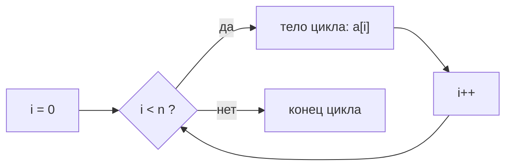

![[anim-sum-loop.svg]]

> [!warning] Условие строго «меньше»
> Пиши `i < n`, **не** `i <= n`. Последний допустимый индекс — `n - 1`. При `i <= n` цикл добежит до `a[n]`, которого нет, и выйдет за границы массива.

---

#### 1. Шпаргалка по циклам

| Что нужно | Цикл |
|---|---|
| Все элементы по порядку | `for (int i = 0; i < n; i++)` |
| С конца в начало | `for (int i = n - 1; i >= 0; i--)` |
| Через один (0, 2, 4, …) | `for (int i = 0; i < n; i += 2)` |
| Начиная со второго | `for (int i = 1; i < n; i++)` |
| Без последнего (пары соседей) | `for (int i = 0; i < n - 1; i++)` |

> [!note] Если компилятор не принимает `for (int i ...)`
> Это синтаксис C99. В старых настройках объяви счётчик заранее: `int i; for (i = 0; i < n; i++)`.

---

#### 2. Заполнение массива

Три типичных способа:

```c
for (int i = 0; i < n; i++) a[i] = 0;          // одним значением
for (int i = 0; i < n; i++) a[i] = i * i;      // по формуле от индекса
for (int i = 0; i < n; i++) a[i] = i + 1;      // 1, 2, 3, ...
```

Если в теле цикла одна команда, фигурные скобки можно опустить. Но в лабе лучше ставить их всегда: так проще не ошибиться при правке.

Пример: заполним массив квадратами и выведем.

```c
#include <stdio.h>

#define N 8

int main(void) {
    int sq[N];

    for (int i = 0; i < N; i++) {
        sq[i] = i * i;
    }
    for (int i = 0; i < N; i++) {
        printf("sq[%d] = %d\n", i, sq[i]);
    }
    return 0;
}
```

```output
sq[0] = 0
sq[1] = 1
sq[2] = 4
sq[3] = 9
sq[4] = 16
sq[5] = 25
sq[6] = 36
sq[7] = 49
```

---

#### 3. Накопление результата

Самый частый приём: заводишь переменную **до** цикла, а в цикле обновляешь её. Так считают сумму (см. анимацию выше), произведение, количество.

```c
int sum = 0;                       // начальное значение ДО цикла
for (int i = 0; i < n; i++) {
    sum += a[i];                   // то же, что sum = sum + a[i]
}
```

> [!tip] Начальное значение
> Для суммы стартуй с `0`, для произведения — с `1`. Забытая инициализация даёт мусор в результате.

---

#### Практика

> [!question] Задача 2.1. Числа от 1 до 10
> Заполни массив из 10 элементов числами 1, 2, …, 10 и выведи их через пробел в одной строке.

> [!success]- Решение
> ```c
> #include <stdio.h>
>
> #define N 10
>
> int main(void) {
>     int a[N];
>
>     for (int i = 0; i < N; i++) {
>         a[i] = i + 1;
>     }
>     for (int i = 0; i < N; i++) {
>         printf("%d ", a[i]);
>     }
>     printf("\n");
>     return 0;
> }
> ```
>
> ```output
> 1 2 3 4 5 6 7 8 9 10
> ```
>
> Элемент с индексом `i` хранит число `i + 1`: индексы идут с нуля, а числа с единицы.

> [!question] Задача 2.2. Нечётные числа в обратном порядке
> Заполни массив из 8 элементов по формуле `a[i] = 2*i + 1` (получатся нечётные числа 1, 3, 5, …, 15) и выведи его **с конца в начало**.

> [!success]- Решение
> ```c
> #include <stdio.h>
>
> #define N 8
>
> int main(void) {
>     int a[N];
>
>     for (int i = 0; i < N; i++) {
>         a[i] = 2 * i + 1;
>     }
>     for (int i = N - 1; i >= 0; i--) {
>         printf("%d ", a[i]);
>     }
>     printf("\n");
>     return 0;
> }
> ```
>
> ```output
> 15 13 11 9 7 5 3 1
> ```
>
> Обратный цикл стартует с последнего индекса `N - 1` и идёт, пока `i >= 0`.

> [!question] Задача 2.3. Сумма и среднее
> Для массива `{3, 8, 1, 9, 4}` найди сумму элементов и среднее арифметическое.

> [!success]- Решение
> ```c
> #include <stdio.h>
>
> int main(void) {
>     int a[] = {3, 8, 1, 9, 4};
>     int n = sizeof(a) / sizeof(a[0]);
>     int sum = 0;
>
>     for (int i = 0; i < n; i++) {
>         sum += a[i];
>     }
>     printf("sum = %d\n", sum);
>     printf("average = %.1f\n", (double)sum / n);
>     return 0;
> }
> ```
>
> ```output
> sum = 25
> average = 5.0
> ```
>
> > [!warning] Деление целых
> > `sum / n` для двух `int` отбрасывает дробную часть (`26 / 5` даст `5`). Приведи одну из величин к `double`: `(double)sum / n`.
>

> [!question] Задача 2.4. Через один
> Выведи элементы массива `{10, 20, 30, 40, 50, 60, 70}` с чётными индексами: `a[0]`, `a[2]`, `a[4]`, `a[6]`.

> [!success]- Решение
> ```c
> #include <stdio.h>
>
> int main(void) {
>     int a[] = {10, 20, 30, 40, 50, 60, 70};
>     int n = sizeof(a) / sizeof(a[0]);
>
>     for (int i = 0; i < n; i += 2) {
>         printf("%d ", a[i]);
>     }
>     printf("\n");
>     return 0;
> }
> ```
>
> ```output
> 10 30 50 70
> ```
>
> Шаг `i += 2` перепрыгивает через один элемент.

> [!question] Задача 2.5. Найди ошибки в циклах
> Массив `int a[5];`, `#define N 5`.
>
> ```c
> // фрагмент А: заполнить числами 0..4
> for (int i = 0; i <= N; i++) {
>     a[i] = i;
> }
>
> // фрагмент Б: вывести с конца
> for (int i = N; i > 0; i--) {
>     printf("%d ", a[i]);
> }
> ```

> [!success]- Решение
> - **Фрагмент А:** условие `i <= N` даёт шесть итераций, на последней `i = 5` и запись идёт в несуществующий `a[5]`. Правильно: `i < N`.
> - **Фрагмент Б:** цикл стартует с `i = N = 5`, а последний элемент — `a[4]`. Снова `a[5]` за границей, при этом `a[0]` не выводится. Правильно: `for (int i = N - 1; i >= 0; i--)`.
>
> Оба бага — классическая ошибка «на единицу». Проверяй обе границы цикла: первый и последний индекс.

---

#### Что запомнить

> [!important] Итог урока
> - Обход: `for (int i = 0; i < n; i++)`, всегда строго `<`.
> - Назад: `for (int i = n - 1; i >= 0; i--)`.
> - Накопитель (`sum`, `count`) заводят **до** цикла и обнуляют (для произведения ставят 1).
> - Деление двух `int` целочисленное: для среднего приводи к `double`.

[[#8.2 Урок 1 - Как создать массив|← Урок 1]] · [[#8.0 Оглавление|Оглавление]] · [[#8.4 Урок 3 - Ввод и вывод|Урок 3 →]]

### 8.4 Урок 3 - Ввод и вывод

---

> [!abstract] Что ты узнаешь
> Как ввести массив с клавиатуры, проверить количество элементов, красиво вывести результат и не забыть `&` в `scanf`.

Любая лаба по массивам начинается с одного и того же: ввести данные, обработать, вывести. Этот урок — готовые шаблоны для первого и последнего шага.

---

#### 1. Спецификаторы формата

| Тип | В `scanf` | В `printf` |
|---|---|---|
| `int` | `%d` | `%d` |
| `double` | `%lf` | `%f` (или `%.2f`, два знака) |
| `float` | `%f` | `%f` |
| `char` | `%c` | `%c` |
| строка (`char[]`) | `%s` | `%s` |

> [!warning] Главное отличие scanf от printf
> `scanf` **записывает** значение в переменную, поэтому ему нужен **адрес**: `&x`, `&a[i]`. `printf` только **читает** значение, адрес не нужен.
>
> Для `double` в `scanf` обязательно `%lf` (long float). Если написать `%f`, в переменную попадёт мусор.

---

#### 2. Ввод элементов

```c
for (int i = 0; i < n; i++) {
    scanf("%d", &a[i]);     // &a[i] — адрес i-го элемента
}
```

Пользователь может вводить числа через пробел или по одному в строке: `scanf` пропускает пробелы и переводы строк.

---

#### 3. Ввод количества с проверкой

Если `n` вводится, массив объявляют с запасом (`MAX`), а `n` проверяют: иначе слишком большое `n` выйдет за границы массива.

```c
#include <stdio.h>

#define MAX 100

int main(void) {
    int a[MAX];
    int n;

    printf("Enter n:\n");
    if (scanf("%d", &n) != 1 || n < 1 || n > MAX) {
        printf("Error: n must be from 1 to %d\n", MAX);
        return 1;
    }

    printf("Enter %d numbers:\n", n);
    for (int i = 0; i < n; i++) {
        scanf("%d", &a[i]);
    }

    printf("Array:");
    for (int i = 0; i < n; i++) {
        printf(" %d", a[i]);
    }
    printf("\n");
    return 0;
}
```

Ввод:

```input
4
5 -2 7 0
```

Вывод:

```output
Enter n:
Enter 4 numbers:
Array: 5 -2 7 0
```

Что здесь важно:

- `scanf` возвращает, **сколько значений удалось прочитать**. Если пользователь ввёл букву вместо числа, вернётся 0, и `!= 1` поймает это.
- Условия в `if` проверяются слева направо и останавливаются на первом истинном (`||`). Поэтому `n < 1` проверяется только после успешного чтения.
- Подсказку (`Enter n:`) печатай **перед** `scanf`, иначе пользователь не поймёт, что от него хотят.

> [!tip] Этот код — шаблон
> Скопируй его в начало любой лабы по массивам и меняй только то, что между вводом и выводом.

---

#### 4. Форматы вывода

```c
#include <stdio.h>

int main(void) {
    int a[] = {5, -2, 17, 0};
    int n = sizeof(a) / sizeof(a[0]);
    double t[] = {1.5, 2.0, 3.14159};
    int m = sizeof(t) / sizeof(t[0]);

    for (int i = 0; i < n; i++) {
        printf("%4d", a[i]);              // ширина 4: столбиком выровнено
    }
    printf("\n");

    for (int i = 0; i < n; i++) {
        if (i > 0) {
            printf(", ");                 // запятая только МЕЖДУ элементами
        }
        printf("%d", a[i]);
    }
    printf("\n");

    for (int i = 0; i < m; i++) {
        printf("%.2f ", t[i]);            // два знака после запятой
    }
    printf("\n");
    return 0;
}
```

```output
   5  -2  17   0
5, -2, 17, 0
1.50 2.00 3.14
```

| Что нужно | Запись |
|---|---|
| Через пробел | `printf("%d ", a[i]);` |
| Каждый в новой строке | `printf("%d\n", a[i]);` |
| Выровнять по ширине 4 | `printf("%4d", a[i]);` |
| Два знака после запятой | `printf("%.2f", t[i]);` |
| Элемент вместе с индексом | `printf("a[%d] = %d\n", i, a[i]);` |

---

#### Практика

> [!question] Задача 3.1. Через запятую
> Введи 5 целых чисел и выведи их в одну строку через запятую с пробелом, **без** запятой после последнего. Пример: ввод `3 -1 4 1 5`, вывод `3, -1, 4, 1, 5`.

> [!success]- Решение
> ```c
> #include <stdio.h>
>
> #define N 5
>
> int main(void) {
>     int a[N];
>
>     for (int i = 0; i < N; i++) {
>         scanf("%d", &a[i]);
>     }
>     for (int i = 0; i < N; i++) {
>         if (i > 0) {
>             printf(", ");
>         }
>         printf("%d", a[i]);
>     }
>     printf("\n");
>     return 0;
> }
> ```
>
> ```input
> 3 -1 4 1 5
> ```
>
> ```output
> 3, -1, 4, 1, 5
> ```
>
> Приём «разделитель перед каждым элементом, кроме первого» работает везде, где нужен список без хвостовой запятой.

> [!question] Задача 3.2. Вещественные числа
> Введи `n` (от 1 до 20), затем `n` вещественных чисел. Выведи их с двумя знаками после запятой через пробел. Если `n` неверное, выведи `Error`.

> [!success]- Решение
> ```c
> #include <stdio.h>
>
> #define MAX 20
>
> int main(void) {
>     double t[MAX];
>     int n;
>
>     if (scanf("%d", &n) != 1 || n < 1 || n > MAX) {
>         printf("Error\n");
>         return 1;
>     }
>     for (int i = 0; i < n; i++) {
>         scanf("%lf", &t[i]);
>     }
>     for (int i = 0; i < n; i++) {
>         printf("%.2f ", t[i]);
>     }
>     printf("\n");
>     return 0;
> }
> ```
>
> ```input
> 3
> 1.5 2 3.14159
> ```
>
> ```output
> 1.50 2.00 3.14
> ```
>
> В `scanf` для `double` стоит `%lf`, в `printf` — `%f` или `%.2f`.

> [!question] Задача 3.3. Таблица «индекс — значение»
> Выведи массив `{7, 42, -5}` в виде таблицы:
> ```
>  i | a[i]
> ---+-----
>  0 |    7
>  1 |   42
>  2 |   -5
> ```

> [!success]- Решение
> ```c
> #include <stdio.h>
>
> int main(void) {
>     int a[] = {7, 42, -5};
>     int n = sizeof(a) / sizeof(a[0]);
>
>     printf(" i | a[i]\n");
>     printf("---+-----\n");
>     for (int i = 0; i < n; i++) {
>         printf("%2d | %4d\n", i, a[i]);
>     }
>     return 0;
> }
> ```
>
> ```output
>  i | a[i]
> ---+-----
>  0 |    7
>  1 |   42
>  2 |   -5
> ```
>
> `%2d` резервирует две позиции под индекс, `%4d` — четыре под значение, поэтому столбцы выровнены.

> [!question] Задача 3.4. Найди ошибки
> ```c
> int a[5];
> double x;
> int n;
> scanf("%d", a[0]);                   // 1
> scanf("%f", &x);                     // 2
> scanf("%d", &n);                     // 3
> for (int i = 0; i < n; i++) {
>     scanf("%d", &a[i]);
> }
> ```

> [!success]- Решение
> 1. **Нет `&`:** `scanf` получил значение `a[0]` вместо адреса и попытается писать по «адресу», равному этому мусору. Правильно: `scanf("%d", &a[0]);`.
> 2. **`%f` для `double`:** нужен `%lf`. gcc с флагом `-Wall` предупредит об этом.
> 3. **`n` не проверено:** если пользователь введёт `n = 10`, цикл запишет элементы с `a[5]` по `a[9]` за границами массива из пяти. Нужна проверка `if (n < 1 || n > 5)` до цикла.

> [!question] Задача 3.5. Ввод до нуля
> Считывай целые числа и сохраняй в массив, пока не введён `0` (сам ноль не сохраняй) или пока не набралось 10 чисел. Выведи количество и сами числа. Ввод: `4 8 15 0 99`.

> [!success]- Решение
> ```c
> #include <stdio.h>
>
> #define MAX 10
>
> int main(void) {
>     int a[MAX];
>     int n = 0;
>     int x;
>
>     while (n < MAX && scanf("%d", &x) == 1 && x != 0) {
>         a[n] = x;
>         n++;
>     }
>
>     printf("count = %d\n", n);
>     for (int i = 0; i < n; i++) {
>         printf("%d ", a[i]);
>     }
>     printf("\n");
>     return 0;
> }
> ```
>
> ```input
> 4 8 15 0 99
> ```
>
> ```output
> count = 3
> 4 8 15
> ```
>
> Счётчик `n` растёт вместе с заполнением, так что после цикла он же хранит реальное количество элементов. Проверка `n < MAX` стоит первой: когда место кончилось, `scanf` даже не вызывается.

---

#### Что запомнить

> [!important] Итог урока
> - `scanf("%d", &a[i]);` — **с `&`**; `double` читается через `%lf`.
> - Если `n` вводится, массив объявляй с запасом и **проверяй** `1 <= n <= MAX`.
> - Подсказка выводится до `scanf`.
> - `%4d` — ширина, `%.2f` — два знака после запятой, `if (i > 0) printf(", ");` — запятые без хвоста.

[[#8.3 Урок 2 - Индексы и циклы|← Урок 2]] · [[#8.0 Оглавление|Оглавление]] · [[#8.5 Урок 4 - Типовые алгоритмы|Урок 4 →]]

### 8.5 Урок 4 - Типовые алгоритмы

---

> [!abstract] Что ты узнаешь
> Пять заготовок, из которых собирается почти любая лаба по массивам: сумма, максимум и минимум, подсчёт по условию, поиск, копирование и сравнение. Выучи шаблоны, и задачи превратятся в «найди нужный и подставь условие».

Все алгоритмы устроены одинаково: **цикл по элементам + одна переменная-накопитель**. Меняется только то, что делается внутри цикла.

| Задача | Накопитель до цикла | Что в теле цикла |
|---|---|---|
| Сумма | `int sum = 0;` | `sum += a[i];` |
| Максимум | `int max = a[0];` | `if (a[i] > max) max = a[i];` |
| Подсчёт | `int count = 0;` | `if (условие) count++;` |
| Поиск | `int pos = -1;` | `if (a[i] == x) { pos = i; break; }` |
| «Все ли…» | `int ok = 1;` | `if (плохо) { ok = 0; break; }` |

---

#### 1. Максимум и минимум

Начальное значение берём **из самого массива**: `max = a[0]`. Тогда цикл можно начинать с `i = 1`.

![[anim-max.svg]]

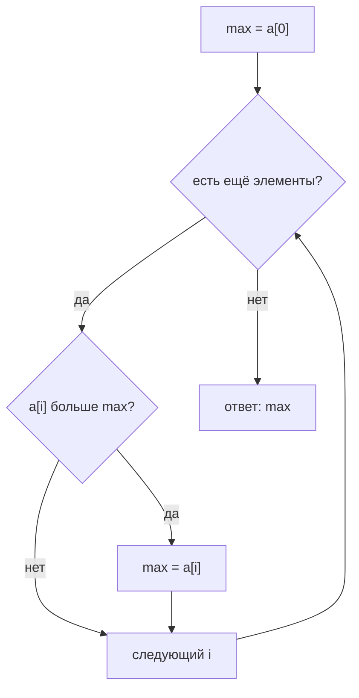

Чтобы узнать ещё и **позицию**, запоминай индекс вместе со значением:

```c
#include <stdio.h>

int main(void) {
    int a[] = {3, 8, 1, 9, 4, 7};
    int n = sizeof(a) / sizeof(a[0]);

    int max = a[0], imax = 0;
    int min = a[0], imin = 0;
    for (int i = 1; i < n; i++) {
        if (a[i] > max) {
            max = a[i];
            imax = i;
        }
        if (a[i] < min) {
            min = a[i];
            imin = i;
        }
    }
    printf("max = %d at index %d\n", max, imax);
    printf("min = %d at index %d\n", min, imin);
    return 0;
}
```

```output
max = 9 at index 3
min = 1 at index 2
```

> [!danger] Классическая ошибка: `max = 0`
> Если начать с `int max = 0;`, то для массива `{-5, -2, -9}` программа выдаст `0`, которого в массиве нет. Стартовое значение всегда `a[0]`, а не «подходящее число».

---

#### 2. Подсчёт по условию

```c
int count = 0;
for (int i = 0; i < n; i++) {
    if (a[i] > 0) {        // любое условие
        count++;
    }
}
```

> [!warning] Чётность и отрицательные числа
> В Си `-5 % 2` равно `-1`, а не `1`. Поэтому чётность проверяют так: `a[i] % 2 == 0`. Нечётность — `a[i] % 2 != 0`, а **не** `== 1`.

Пример: чётные и нечётные.

```c
#include <stdio.h>

int main(void) {
    int a[] = {12, -5, 7, 0, 19, -3, 8};
    int n = sizeof(a) / sizeof(a[0]);
    int even = 0, odd = 0;

    for (int i = 0; i < n; i++) {
        if (a[i] % 2 == 0) {
            even++;
        } else {
            odd++;
        }
    }
    printf("even = %d\n", even);
    printf("odd = %d\n", odd);
    return 0;
}
```

```output
even = 3
odd = 4
```

Ноль считается чётным, поэтому чётных три: `12`, `0`, `8`.

---

#### 3. Линейный поиск

Идём по массиву, пока не найдём. Результат — **индекс** или `-1`, если элемента нет (такого индекса не бывает, поэтому он годится как «не найдено»).

```c
int pos = -1;
for (int i = 0; i < n; i++) {
    if (a[i] == x) {
        pos = i;
        break;             // нашли — дальше смотреть не нужно
    }
}
if (pos == -1) {
    printf("not found\n");
}
```

`break` выходит из цикла сразу. Без него `pos` указывал бы на **последнее** вхождение, а не на первое.

---

#### 4. Копирование и сравнение

Массив нельзя скопировать или сравнить одной командой ([[#8.2 Урок 1 - Как создать массив|урок 1]]), только поэлементно:

```c
for (int i = 0; i < n; i++) {
    b[i] = a[i];           // копия
}

int same = 1;              // допускаем, что равны
for (int i = 0; i < n; i++) {
    if (a[i] != b[i]) {
        same = 0;          // нашли отличие
        break;
    }
}
```

Это приём **флага**: сначала предполагаем «всё хорошо» (`1`), а в цикле ищем хотя бы одно нарушение. Нашли — опускаем флаг в `0`.

---

#### Практика

> [!question] Задача 4.1. Минимум и максимум с позициями
> Для `{12, -5, 7, 0, 19, -3, 8}` найди наименьший и наибольший элементы и их индексы.

> [!success]- Решение
> ```c
> #include <stdio.h>
>
> int main(void) {
>     int a[] = {12, -5, 7, 0, 19, -3, 8};
>     int n = sizeof(a) / sizeof(a[0]);
>     int min = a[0], imin = 0;
>     int max = a[0], imax = 0;
>
>     for (int i = 1; i < n; i++) {
>         if (a[i] < min) {
>             min = a[i];
>             imin = i;
>         }
>         if (a[i] > max) {
>             max = a[i];
>             imax = i;
>         }
>     }
>     printf("min = %d at index %d\n", min, imin);
>     printf("max = %d at index %d\n", max, imax);
>     return 0;
> }
> ```
>
> ```output
> min = -5 at index 1
> max = 19 at index 4
> ```

> [!question] Задача 4.2. Положительные, отрицательные, нули
> Для того же массива посчитай, сколько в нём положительных, отрицательных элементов и нулей.

> [!success]- Решение
> ```c
> #include <stdio.h>
>
> int main(void) {
>     int a[] = {12, -5, 7, 0, 19, -3, 8};
>     int n = sizeof(a) / sizeof(a[0]);
>     int pos = 0, neg = 0, zero = 0;
>
>     for (int i = 0; i < n; i++) {
>         if (a[i] > 0) {
>             pos++;
>         } else if (a[i] < 0) {
>             neg++;
>         } else {
>             zero++;
>         }
>     }
>     printf("positive = %d\n", pos);
>     printf("negative = %d\n", neg);
>     printf("zero = %d\n", zero);
>     return 0;
> }
> ```
>
> ```output
> positive = 4
> negative = 2
> zero = 1
> ```
>
> Три счётчика в одном цикле: каждый элемент попадает ровно в одну ветку `if / else if / else`.

> [!question] Задача 4.3. Поиск числа
> В массиве `{4, 8, 15, 16, 23, 42}` найди число `x`, введённое с клавиатуры. Выведи индекс первого вхождения или `not found`.

> [!success]- Решение
> ```c
> #include <stdio.h>
>
> int main(void) {
>     int a[] = {4, 8, 15, 16, 23, 42};
>     int n = sizeof(a) / sizeof(a[0]);
>     int x, pos = -1;
>
>     printf("Enter x:\n");
>     scanf("%d", &x);
>
>     for (int i = 0; i < n; i++) {
>         if (a[i] == x) {
>             pos = i;
>             break;
>         }
>     }
>
>     if (pos == -1) {
>         printf("not found\n");
>     } else {
>         printf("index = %d\n", pos);
>     }
>     return 0;
> }
> ```
>
> ```input
> 16
> ```
>
> ```output
> Enter x:
> index = 3
> ```
>
> При вводе `5` программа выведет `not found`: такого элемента нет, `pos` так и остался `-1`.

> [!question] Задача 4.4. Копия и сравнение
> Скопируй `a = {1, 2, 3}` в массив `c`. Сравни `a` с `c`, затем `a` с `b = {1, 2, 4}`. Для каждой пары выведи `equal` или `differ`.

> [!success]- Решение
> ```c
> #include <stdio.h>
>
> #define N 3
>
> int main(void) {
>     int a[N] = {1, 2, 3};
>     int b[N] = {1, 2, 4};
>     int c[N];
>
>     for (int i = 0; i < N; i++) {
>         c[i] = a[i];
>     }
>
>     int same_ac = 1;
>     int same_ab = 1;
>     for (int i = 0; i < N; i++) {
>         if (a[i] != c[i]) {
>             same_ac = 0;
>         }
>         if (a[i] != b[i]) {
>             same_ab = 0;
>         }
>     }
>
>     printf("a and c: %s\n", same_ac ? "equal" : "differ");
>     printf("a and b: %s\n", same_ab ? "equal" : "differ");
>     return 0;
> }
> ```
>
> ```output
> a and c: equal
> a and b: differ
> ```
>
> `условие ? "equal" : "differ"` — компактная запись `if / else` внутри выражения.

> [!question] Задача 4.5. Выше среднего
> Для массива `{2, 4, 9, 7, 8}` найди среднее арифметическое и посчитай, сколько элементов строго больше среднего.

> [!success]- Решение
> ```c
> #include <stdio.h>
>
> int main(void) {
>     int a[] = {2, 4, 9, 7, 8};
>     int n = sizeof(a) / sizeof(a[0]);
>     int sum = 0;
>
>     for (int i = 0; i < n; i++) {
>         sum += a[i];
>     }
>     double avg = (double)sum / n;
>
>     int above = 0;
>     for (int i = 0; i < n; i++) {
>         if (a[i] > avg) {
>             above++;
>         }
>     }
>     printf("average = %.1f\n", avg);
>     printf("above average: %d\n", above);
>     return 0;
> }
> ```
>
> ```output
> average = 6.0
> above average: 3
> ```
>
> Здесь нужно **два прохода**: пока не знаем среднего, сравнивать не с чем. Сначала считаем сумму, потом считаем элементы, превысившие среднее: это `9`, `7` и `8`.

---

#### Что запомнить

> [!important] Итог урока
> - Максимум и минимум стартуют с `a[0]`, а не с `0`.
> - Чтобы получить позицию, храни индекс рядом со значением.
> - Поиск: `pos = -1`, нашли — `pos = i; break;`.
> - Флаг: `ok = 1` до цикла, нашёл нарушение — `ok = 0; break;`.
> - Нечётность проверяй как `% 2 != 0`: для отрицательных `% 2` даёт `-1`.
> - Если для ответа нужна величина, зависящая от всего массива (среднее), делай два прохода.

[[#8.4 Урок 3 - Ввод и вывод|← Урок 3]] · [[#8.0 Оглавление|Оглавление]] · [[#8.6 Урок 5 - Массивы и функции|Урок 5 →]]

### 8.6 Урок 5 - Массивы и функции

---

> [!abstract] Что ты узнаешь
> Как передать массив в функцию, почему функция меняет оригинал, зачем нужен отдельный параметр `n` и как оформить лабу набором маленьких функций.

В лабах почти всегда требуют разбить программу на функции: ввод, вывод, обработка. С массивами тут есть два правила, которые отличают их от обычных переменных.

---

#### 1. Синтаксис

```c
void print_array(const int arr[], int n);   // в скобках пусто, размер не пишется
int  sum_array(const int arr[], int n);
void fill(int arr[], int n);
```

Вызов:

```c
print_array(a, n);      // имя массива БЕЗ скобок и БЕЗ &
```

> [!important] Два правила
> 1. **Размер передаётся отдельным параметром `n`.** Функция сама не знает длину массива.
> 2. **Массив не копируется.** Функция получает адрес его первого элемента и работает с **оригиналом**. Всё, что она запишет в `arr[i]`, изменит массив в `main`.

![[anim-pass-to-function.svg]]

Запись `int arr[]` в параметре — то же самое, что `int *arr` (указатель на первый элемент). Указатели в этом курсе не нужны, достаточно скобок.

---

#### 2. const: «только читаю»

Если функция только **читает** массив (печатает, считает сумму), ставь `const`:

```c
int sum_array(const int arr[], int n)   // arr[i] = 5; здесь не скомпилируется
```

Это защита от случайной порчи данных и подсказка тому, кто читает код: функция массив не меняет. Функциям, которые массив **заполняют или меняют**, `const` не ставят.

---

#### 3. Целый пример

```c
#include <stdio.h>

#define N 5

void fill_squares(int arr[], int n) {
    for (int i = 0; i < n; i++) {
        arr[i] = (i + 1) * (i + 1);
    }
}

void print_array(const int arr[], int n) {
    for (int i = 0; i < n; i++) {
        printf("%d ", arr[i]);
    }
    printf("\n");
}

int sum_array(const int arr[], int n) {
    int sum = 0;
    for (int i = 0; i < n; i++) {
        sum += arr[i];
    }
    return sum;
}

int max_array(const int arr[], int n) {
    int max = arr[0];
    for (int i = 1; i < n; i++) {
        if (arr[i] > max) {
            max = arr[i];
        }
    }
    return max;
}

int main(void) {
    int a[N];

    fill_squares(a, N);
    print_array(a, N);
    printf("sum = %d\n", sum_array(a, N));
    printf("max = %d\n", max_array(a, N));
    return 0;
}
```

```output
1 4 9 16 25
sum = 55
max = 25
```

`fill_squares` ничего не возвращает, но массив `a` в `main` оказался заполнен: функция работала с оригиналом. А `sum_array` и `max_array` возвращают число через `return`.

---

#### 4. Ловушка: sizeof внутри функции

```c
// БАГ: sizeof в функции даёт размер указателя, а не массива
#include <stdio.h>

void f(int arr[]) {
    printf("inside f: %d\n", (int)sizeof(arr));
}

int main(void) {
    int a[10];
    printf("in main: %d\n", (int)sizeof(a));
    f(a);
    return 0;
}
```

На 64-битной системе выведет:

```output
in main: 40
inside f: 8
```

В `main` `sizeof(a)` — это 10 элементов по 4 байта. В функции `arr` — просто адрес, и `sizeof` возвращает размер **адреса** (8 байт). Поэтому `sizeof(arr) / sizeof(arr[0])` внутри функции даст чепуху (2). Длину всегда передавай параметром.

---

#### 5. Функция не возвращает массив

Нельзя написать `int[] make()` или вернуть локальный массив. Есть два способа получить результат:

- вернуть **число** (сумму, индекс, количество): `int sum_array(...)`;
- **заполнить массив, переданный параметром**: `void fill(int arr[], int n)`.

---

#### 6. Шаблон лабы с прототипами

Если функции записаны **после** `main`, сверху пишут их прототипы (заголовки с точкой с запятой):

```c
#include <stdio.h>

#define MAX 100

void read_array(int arr[], int n);          // прототипы
void print_array(const int arr[], int n);
int  sum_array(const int arr[], int n);

int main(void) {
    int a[MAX];
    int n = 5;
    read_array(a, n);
    print_array(a, n);
    printf("sum = %d\n", sum_array(a, n));
    return 0;
}

void read_array(int arr[], int n) {
    for (int i = 0; i < n; i++) {
        scanf("%d", &arr[i]);
    }
}

void print_array(const int arr[], int n) {
    for (int i = 0; i < n; i++) {
        printf("%d ", arr[i]);
    }
    printf("\n");
}

int sum_array(const int arr[], int n) {
    int sum = 0;
    for (int i = 0; i < n; i++) {
        sum += arr[i];
    }
    return sum;
}
```

```input
1 2 3 4 5
```

```output
1 2 3 4 5
sum = 15
```

Сверху читается как оглавление программы: сразу видно, какие есть функции. Сами тела лежат ниже `main`, и там их удобно править.

---

#### Практика

> [!question] Задача 5.1. Функция минимума
> Напиши функцию `int min_array(const int arr[], int n)` и вызови её для `{7, 3, 9, 1, 5}`.

> [!success]- Решение
> ```c
> #include <stdio.h>
>
> int min_array(const int arr[], int n) {
>     int min = arr[0];
>     for (int i = 1; i < n; i++) {
>         if (arr[i] < min) {
>             min = arr[i];
>         }
>     }
>     return min;
> }
>
> int main(void) {
>     int a[] = {7, 3, 9, 1, 5};
>     int n = sizeof(a) / sizeof(a[0]);
>
>     printf("min = %d\n", min_array(a, n));
>     return 0;
> }
> ```
>
> ```output
> min = 1
> ```
>
> `n` вычисляется в `main`, где массив объявлен, и передаётся в функцию параметром.

> [!question] Задача 5.2. Меняем оригинал
> Напиши `void scale(int arr[], int n, int k)`, умножающую каждый элемент на `k`. Выведи массив `{1, 2, 3, 4}` до и после вызова `scale(a, n, 3)`.

> [!success]- Решение
> ```c
> #include <stdio.h>
>
> void scale(int arr[], int n, int k) {
>     for (int i = 0; i < n; i++) {
>         arr[i] *= k;
>     }
> }
>
> void print_array(const int arr[], int n) {
>     for (int i = 0; i < n; i++) {
>         printf("%d ", arr[i]);
>     }
>     printf("\n");
> }
>
> int main(void) {
>     int a[] = {1, 2, 3, 4};
>     int n = sizeof(a) / sizeof(a[0]);
>
>     print_array(a, n);
>     scale(a, n, 3);
>     print_array(a, n);
>     return 0;
> }
> ```
>
> ```output
> 1 2 3 4
> 3 6 9 12
> ```
>
> Функция ничего не возвращает, но массив в `main` изменился: она работала с оригиналом, а не с копией.

> [!question] Задача 5.3. Подсчёт в функции
> Напиши `int count_positive(const int arr[], int n)`, возвращающую количество положительных элементов. Проверь на `{-1, 4, 0, 7, -3, 2}`.

> [!success]- Решение
> ```c
> #include <stdio.h>
>
> int count_positive(const int arr[], int n) {
>     int count = 0;
>     for (int i = 0; i < n; i++) {
>         if (arr[i] > 0) {
>             count++;
>         }
>     }
>     return count;
> }
>
> int main(void) {
>     int a[] = {-1, 4, 0, 7, -3, 2};
>     int n = sizeof(a) / sizeof(a[0]);
>
>     printf("positive: %d\n", count_positive(a, n));
>     return 0;
> }
> ```
>
> ```output
> positive: 3
> ```

> [!question] Задача 5.4. Ввод и вывод функциями
> Реализуй `void read_array(int arr[], int n)` и `void print_array(const int arr[], int n)`. В `main` введи `n` (не больше 10), прочитай массив, выведи его и сумму. Ввод: `3`, затем `10 20 30`.

> [!success]- Решение
> ```c
> #include <stdio.h>
>
> #define MAX 10
>
> void read_array(int arr[], int n) {
>     for (int i = 0; i < n; i++) {
>         scanf("%d", &arr[i]);
>     }
> }
>
> void print_array(const int arr[], int n) {
>     for (int i = 0; i < n; i++) {
>         printf("%d ", arr[i]);
>     }
>     printf("\n");
> }
>
> int main(void) {
>     int a[MAX];
>     int n;
>
>     if (scanf("%d", &n) != 1 || n < 1 || n > MAX) {
>         printf("Error\n");
>         return 1;
>     }
>     read_array(a, n);
>     print_array(a, n);
>
>     int sum = 0;
>     for (int i = 0; i < n; i++) {
>         sum += a[i];
>     }
>     printf("sum = %d\n", sum);
>     return 0;
> }
> ```
>
> ```input
> 3
> 10 20 30
> ```
>
> ```output
> 10 20 30
> sum = 60
> ```
>
> Внутри `read_array` стоит `&arr[i]`: в функции `arr` — тот же массив, и адрес элемента берётся так же, как в `main`.

> [!question] Задача 5.5. Найди ошибки
> ```c
> print_array(a[], n);                                    // 1
>
> int len(int arr[]) {                                    // 2
>     return sizeof(arr) / sizeof(arr[0]);
> }
>
> int[] make(void) {                                      // 3
>     int b[3] = {1, 2, 3};
>     return b;
> }
> ```

> [!success]- Решение
> 1. **Скобки при вызове:** `a[]` пишут только в объявлении параметра. При вызове передают просто имя: `print_array(a, n);`.
> 2. **`sizeof` в функции:** `arr` здесь — указатель, `sizeof(arr)` равен 8 (или 4) байтам, а не размеру массива. Длину передают параметром: `int len(int arr[], int n)`, или просто используют `n`.
> 3. **Возврат массива:** функция в Си не может вернуть массив. Заполни массив, переданный параметром (`void make(int b[])`), а локальный массив возвращать нельзя: он исчезает при выходе из функции.

---

#### Что запомнить

> [!important] Итог урока
> - Параметр-массив: `int arr[]`, **размер отдельным параметром** `int n`.
> - Вызов: `f(a, n)`, без `[]` и без `&`.
> - Функция работает с **оригиналом**: запись в `arr[i]` меняет массив в `main`.
> - Только читаешь, ставь `const int arr[]`.
> - `sizeof(arr)` внутри функции — размер указателя, **не** массива.
> - Массив из функции не возвращают: возвращают число или заполняют переданный массив.

[[#8.5 Урок 4 - Типовые алгоритмы|← Урок 4]] · [[#8.0 Оглавление|Оглавление]] · [[#8.7 Урок 6 - Разворот и сортировка|Урок 6 →]]

### 8.7 Урок 6 - Разворот и сортировка

---

> [!abstract] Что ты узнаешь
> Как поменять местами два элемента, развернуть массив на месте, сдвинуть его по кругу и отсортировать пузырьком. Всё это делается в самом массиве, без второго.

Во всех этих задачах массив **меняется на месте**, а общий инструмент один: обмен двух элементов.

---

#### 1. Обмен двух элементов

Чтобы поменять `a[i]` и `a[j]`, нужна **третья переменная**:

```c
int t = a[i];     // 1. спрятали первое значение
a[i] = a[j];      // 2. записали на его место второе
a[j] = t;         // 3. вернули спрятанное на место второго
```

> [!danger] Обмен без временной переменной не работает
> ```c
> a[i] = a[j];      // теперь в обеих ячейках одно и то же
> a[j] = a[i];      // первое значение потеряно навсегда
> ```
> Если не спрятать значение в `t`, оно перезаписывается раньше, чем его успели сохранить.

---

#### 2. Разворот массива на месте

Меняем первый элемент с последним, второй с предпоследним и так далее, пока не дойдём до середины.

![[anim-reverse.svg]]

```c
#include <stdio.h>

int main(void) {
    int a[] = {1, 2, 3, 4, 5, 6};
    int n = sizeof(a) / sizeof(a[0]);

    for (int i = 0; i < n / 2; i++) {
        int j = n - 1 - i;     // парный элемент с другого конца
        int t = a[i];
        a[i] = a[j];
        a[j] = t;
    }

    for (int i = 0; i < n; i++) {
        printf("%d ", a[i]);
    }
    printf("\n");
    return 0;
}
```

```output
6 5 4 3 2 1
```

Цикл идёт только до `n / 2`. Если пройти весь массив, каждая пара поменяется дважды и всё вернётся как было. При нечётном `n` средний элемент остаётся на месте: у него нет пары.

---

#### 3. Циклический сдвиг

Сдвиг влево на одну позицию: первый элемент уходит в конец, остальные подвигаются влево.

```c
int first = a[0];                   // сохранили первый
for (int i = 0; i < n - 1; i++) {
    a[i] = a[i + 1];                // каждый берёт значение соседа справа
}
a[n - 1] = first;                   // первый встал последним
```

Цикл идёт до `n - 2` включительно: в теле используется `a[i + 1]`, и при `i = n - 1` оно вышло бы за границу.

---

#### 4. Сортировка пузырьком

Идея: проходим по массиву, сравниваем **соседей** и меняем, если левый больше правого. После первого прохода самый большой элемент оказывается в конце («всплывает»), после второго — второй по величине, и так далее.

![[anim-bubble-sort.svg]]

```c
for (int pass = 0; pass < n - 1; pass++) {
    for (int j = 0; j < n - 1 - pass; j++) {
        if (a[j] > a[j + 1]) {
            int t = a[j];
            a[j] = a[j + 1];
            a[j + 1] = t;
        }
    }
}
```

Откуда границы:

- внешний цикл: `n - 1` проходов хватает, последний элемент встанет сам;
- внутренний: `n - 1 - pass`, потому что хвост из `pass` элементов уже отсортирован, и сравнение `a[j + 1]` не должно выйти за конец.

Полная программа, которая показывает массив после каждого прохода:

```c
#include <stdio.h>

int main(void) {
    int a[] = {5, 2, 9, 1, 7};
    int n = sizeof(a) / sizeof(a[0]);

    for (int pass = 0; pass < n - 1; pass++) {
        for (int j = 0; j < n - 1 - pass; j++) {
            if (a[j] > a[j + 1]) {
                int t = a[j];
                a[j] = a[j + 1];
                a[j + 1] = t;
            }
        }
        printf("pass %d:", pass + 1);
        for (int i = 0; i < n; i++) {
            printf(" %d", a[i]);
        }
        printf("\n");
    }
    return 0;
}
```

```output
pass 1: 2 5 1 7 9
pass 2: 2 1 5 7 9
pass 3: 1 2 5 7 9
pass 4: 1 2 5 7 9
```

> [!tip] По убыванию
> Чтобы отсортировать от большего к меньшему, поменяй в сравнении знак: `if (a[j] < a[j + 1])`.

> [!info] Готовая сортировка qsort
> В стандартной библиотеке есть `qsort`, но она требует функции-компаратора и работает с указателями. Если в лабе просят «написать сортировку», нужен пузырёк или аналог, а не `qsort`.
>
> ```c
> #include <stdio.h>
> #include <stdlib.h>
>
> static int cmp_int(const void *p, const void *q) {
>     int x = *(const int *)p;
>     int y = *(const int *)q;
>     return (x > y) - (x < y);
> }
>
> int main(void) {
>     int a[] = {5, 2, 9, 1, 7};
>     int n = sizeof(a) / sizeof(a[0]);
>
>     qsort(a, n, sizeof(a[0]), cmp_int);
>     for (int i = 0; i < n; i++) {
>         printf("%d ", a[i]);
>     }
>     printf("\n");
>     return 0;
> }
> ```
>
> ```output
> 1 2 5 7 9
> ```

---

#### Практика

> [!question] Задача 6.1. Первый и последний
> Поменяй местами первый и последний элементы массива `{1, 2, 3, 4, 5}`.

> [!success]- Решение
> ```c
> #include <stdio.h>
>
> int main(void) {
>     int a[] = {1, 2, 3, 4, 5};
>     int n = sizeof(a) / sizeof(a[0]);
>
>     int t = a[0];
>     a[0] = a[n - 1];
>     a[n - 1] = t;
>
>     for (int i = 0; i < n; i++) {
>         printf("%d ", a[i]);
>     }
>     printf("\n");
>     return 0;
> }
> ```
>
> ```output
> 5 2 3 4 1
> ```

> [!question] Задача 6.2. Сдвиг влево
> Сдвинь массив `{1, 2, 3, 4, 5}` циклически влево на одну позицию. Должно получиться `2 3 4 5 1`.

> [!success]- Решение
> ```c
> #include <stdio.h>
>
> int main(void) {
>     int a[] = {1, 2, 3, 4, 5};
>     int n = sizeof(a) / sizeof(a[0]);
>
>     int first = a[0];
>     for (int i = 0; i < n - 1; i++) {
>         a[i] = a[i + 1];
>     }
>     a[n - 1] = first;
>
>     for (int i = 0; i < n; i++) {
>         printf("%d ", a[i]);
>     }
>     printf("\n");
>     return 0;
> }
> ```
>
> ```output
> 2 3 4 5 1
> ```
>
> Первое значение нужно сохранить **до** цикла: сдвиг его затирает.

> [!question] Задача 6.3. Сортировка по возрастанию
> Отсортируй пузырьком массив `{8, 3, 6, 1, 9, 2}` и выведи результат.

> [!success]- Решение
> ```c
> #include <stdio.h>
>
> int main(void) {
>     int a[] = {8, 3, 6, 1, 9, 2};
>     int n = sizeof(a) / sizeof(a[0]);
>
>     for (int pass = 0; pass < n - 1; pass++) {
>         for (int j = 0; j < n - 1 - pass; j++) {
>             if (a[j] > a[j + 1]) {
>                 int t = a[j];
>                 a[j] = a[j + 1];
>                 a[j + 1] = t;
>             }
>         }
>     }
>
>     for (int i = 0; i < n; i++) {
>         printf("%d ", a[i]);
>     }
>     printf("\n");
>     return 0;
> }
> ```
>
> ```output
> 1 2 3 6 8 9
> ```

> [!question] Задача 6.4. Сортировка по убыванию
> Отсортируй `{4, 10, 3, 8}` от большего к меньшему.

> [!success]- Решение
> ```c
> #include <stdio.h>
>
> int main(void) {
>     int a[] = {4, 10, 3, 8};
>     int n = sizeof(a) / sizeof(a[0]);
>
>     for (int pass = 0; pass < n - 1; pass++) {
>         for (int j = 0; j < n - 1 - pass; j++) {
>             if (a[j] < a[j + 1]) {          // знак поменяли: < вместо >
>                 int t = a[j];
>                 a[j] = a[j + 1];
>                 a[j + 1] = t;
>             }
>         }
>     }
>
>     for (int i = 0; i < n; i++) {
>         printf("%d ", a[i]);
>     }
>     printf("\n");
>     return 0;
> }
> ```
>
> ```output
> 10 8 4 3
> ```

> [!question] Задача 6.5. Отсортирован ли массив
> Напиши функцию `int is_sorted(const int arr[], int n)`, которая возвращает `1`, если массив неубывающий, иначе `0`. Проверь на `{1, 2, 2, 5}` и `{3, 1, 4}`.

> [!success]- Решение
> ```c
> #include <stdio.h>
>
> int is_sorted(const int arr[], int n) {
>     for (int i = 0; i < n - 1; i++) {
>         if (arr[i] > arr[i + 1]) {
>             return 0;           // нашли нарушение порядка
>         }
>     }
>     return 1;
> }
>
> int main(void) {
>     int a[] = {1, 2, 2, 5};
>     int b[] = {3, 1, 4};
>
>     printf("first: %s\n", is_sorted(a, 4) ? "sorted" : "not sorted");
>     printf("second: %s\n", is_sorted(b, 3) ? "sorted" : "not sorted");
>     return 0;
> }
> ```
>
> ```output
> first: sorted
> second: not sorted
> ```
>
> Цикл сравнивает пары соседей, поэтому идёт до `n - 2` включительно, а не до `n - 1`. Раньше выйти из функции можно через `return 0`, так флаг не нужен.

---

#### Что запомнить

> [!important] Итог урока
> - Обмен: `t = a[i]; a[i] = a[j]; a[j] = t;`, **без `t` нельзя**.
> - Разворот: цикл до `n / 2`, пара для `i` это `n - 1 - i`.
> - Сдвиг влево: сохрани `a[0]`, сдвинь остальные, поставь в конец.
> - Пузырёк: два вложенных цикла, внешний `n - 1` раз, внутренний `n - 1 - pass`, сравнение `a[j] > a[j + 1]`.
> - По убыванию: поменяй `>` на `<`.
> - Работа с парами соседей `a[i]` и `a[i + 1]`: цикл идёт до `i < n - 1`.

[[#8.6 Урок 5 - Массивы и функции|← Урок 5]] · [[#8.0 Оглавление|Оглавление]] · [[#8.8 Урок 7 - Двумерные массивы|Урок 7 →]]

### 8.8 Урок 7 - Двумерные массивы

---

> [!abstract] Что ты узнаешь
> Как объявить и заполнить таблицу (матрицу), обойти её вложенными циклами, посчитать суммы по строкам, столбцам и диагоналям и передать её в функцию.

Двумерный массив — это таблица: **строки × столбцы**. Первый индекс выбирает строку, второй — столбец.

```c
int m[3][4];        // 3 строки, 4 столбца: всего 12 элементов
m[1][2] = 7;        // строка 1, столбец 2
```

> [!warning] Не перепутай порядок
> `m[i][j]`: сначала **строка** `i`, потом **столбец** `j`. Объявление `int m[3][4]` читается так же: 3 строки по 4 элемента.

---

#### 1. Объявление и инициализация

```c
int m[2][3] = {{1, 2, 3},
               {4, 5, 6}};      // каждая строка в своих скобках

int z[3][3] = {0};              // вся таблица из нулей

int p[][3] = {{1, 2, 3},
              {4, 5, 6}};       // число строк можно опустить, столбцов — нельзя
```

| Запись | Результат |
|---|---|
| `int m[2][3];` | 6 элементов, значения — мусор |
| `int m[2][3] = {{1, 2, 3}, {4, 5, 6}};` | строки `1 2 3` и `4 5 6` |
| `int m[2][3] = {{1}, {4}};` | строки `1 0 0` и `4 0 0` |
| `int m[2][3] = {0};` | всё нули |
| `int m[][3] = {{1, 2, 3}, {4, 5, 6}};` | 2 строки, считает компилятор |

---

#### 2. Как таблица лежит в памяти

Память одномерна, поэтому строки записаны **одна за другой**:

```
int m[2][3] = {{1, 2, 3}, {4, 5, 6}};

 m[0][0] m[0][1] m[0][2] | m[1][0] m[1][1] m[1][2]
    1       2       3    |    4       5       6
```

Смещение элемента от начала считается по формуле (`COLS` — число столбцов):

$$\text{смещение} = (i \cdot COLS + j) \cdot \text{sizeof}(\text{тип})$$

Поэтому при передаче в функцию нужно знать число **столбцов**: без него не понять, где кончается одна строка и начинается следующая.

---

#### 3. Обход: вложенные циклы

Внешний цикл идёт по строкам, внутренний по столбцам.

![[anim-2d-traverse.svg]]

```c
for (int i = 0; i < ROWS; i++) {
    for (int j = 0; j < COLS; j++) {
        // работаем с m[i][j]
    }
}
```

Вывод таблицы всегда выглядит так: внутри внутреннего цикла печатаем элементы, **после** него переводим строку.

```c
for (int i = 0; i < ROWS; i++) {
    for (int j = 0; j < COLS; j++) {
        printf("%4d", m[i][j]);
    }
    printf("\n");
}
```

> [!tip] Размеры из самого массива
> ```c
> int rows = sizeof(m) / sizeof(m[0]);                // число строк
> int cols = sizeof(m[0]) / sizeof(m[0][0]);          // число столбцов
> ```
> `m[0]` — это целая первая строка, поэтому её размер делится на размер одного элемента.

---

#### 4. Целый пример: суммы по строкам и столбцам

```c
#include <stdio.h>

#define ROWS 3
#define COLS 4

int main(void) {
    int m[ROWS][COLS] = {
        {1, 2, 3, 4},
        {5, 6, 7, 8},
        {9, 10, 11, 12}
    };

    printf("rows = %d, cols = %d\n",
           (int)(sizeof(m) / sizeof(m[0])),
           (int)(sizeof(m[0]) / sizeof(m[0][0])));

    for (int i = 0; i < ROWS; i++) {
        int row_sum = 0;
        for (int j = 0; j < COLS; j++) {
            printf("%4d", m[i][j]);
            row_sum += m[i][j];
        }
        printf("  | %d\n", row_sum);
    }

    for (int j = 0; j < COLS; j++) {
        int col_sum = 0;
        for (int i = 0; i < ROWS; i++) {
            col_sum += m[i][j];
        }
        printf("%4d", col_sum);
    }
    printf("\n");
    return 0;
}
```

```output
rows = 3, cols = 4
   1   2   3   4  | 10
   5   6   7   8  | 26
   9  10  11  12  | 42
  15  18  21  24
```

Для суммы **по строке** накопитель обнуляется внутри внешнего цикла (своя сумма на каждую строку). Для суммы **по столбцу** меняют циклы местами: внешний идёт по `j`, внутренний по `i`.

---

#### 5. Диагонали квадратной матрицы

Для матрицы `n × n`:

| Диагональ | Условие на индексы | Какие элементы |
|---|---|---|
| Главная | `i == j` | `m[0][0]`, `m[1][1]`, `m[2][2]`, … |
| Побочная | `i + j == n - 1` | `m[0][n-1]`, `m[1][n-2]`, … |

Для главной диагонали вложенные циклы не нужны: достаточно одного, где `m[i][i]`.

---

#### 6. Передача в функцию

У параметра-матрицы **обязательно** указывают число столбцов константой; число строк передают отдельным параметром.

```c
#include <stdio.h>

#define COLS 3

void print_matrix(int m[][COLS], int rows) {
    for (int i = 0; i < rows; i++) {
        for (int j = 0; j < COLS; j++) {
            printf("%d ", m[i][j]);
        }
        printf("\n");
    }
}

int main(void) {
    int m[2][COLS] = {{1, 2, 3}, {4, 5, 6}};

    print_matrix(m, 2);
    return 0;
}
```

```output
1 2 3
4 5 6
```

Как и с одномерным массивом, функция получает **оригинал**, а не копию. Столбцов в `print_matrix` ровно `COLS`: изменишь константу, и функция подстроится вместе с массивом.

---

#### Практика

> [!question] Задача 7.1. Таблица умножения
> Создай матрицу `4 × 4`, где `t[i][j] = (i + 1) * (j + 1)`, и выведи её с шириной поля 4.

> [!success]- Решение
> ```c
> #include <stdio.h>
>
> #define N 4
>
> int main(void) {
>     int t[N][N];
>
>     for (int i = 0; i < N; i++) {
>         for (int j = 0; j < N; j++) {
>             t[i][j] = (i + 1) * (j + 1);
>         }
>     }
>
>     for (int i = 0; i < N; i++) {
>         for (int j = 0; j < N; j++) {
>             printf("%4d", t[i][j]);
>         }
>         printf("\n");
>     }
>     return 0;
> }
> ```
>
> ```output
>    1   2   3   4
>    2   4   6   8
>    3   6   9  12
>    4   8  12  16
> ```
>
> Индексы идут с нуля, а множители таблицы с единицы, отсюда `+ 1`.

> [!question] Задача 7.2. Суммы по строкам и общая
> Для `{{1, 2, 3}, {4, 5, 6}, {7, 8, 9}}` выведи сумму каждой строки и сумму всех элементов.

> [!success]- Решение
> ```c
> #include <stdio.h>
>
> #define N 3
>
> int main(void) {
>     int m[N][N] = {{1, 2, 3}, {4, 5, 6}, {7, 8, 9}};
>     int total = 0;
>
>     for (int i = 0; i < N; i++) {
>         int row_sum = 0;
>         for (int j = 0; j < N; j++) {
>             row_sum += m[i][j];
>         }
>         printf("row %d: %d\n", i, row_sum);
>         total += row_sum;
>     }
>     printf("total: %d\n", total);
>     return 0;
> }
> ```
>
> ```output
> row 0: 6
> row 1: 15
> row 2: 24
> total: 45
> ```
>
> Общую сумму удобно копить из сумм строк: отдельный проход по матрице не нужен.

> [!question] Задача 7.3. Диагонали
> Для матрицы `{{2, 0, 5}, {1, 4, 3}, {6, 1, 7}}` найди сумму главной и побочной диагоналей.

> [!success]- Решение
> ```c
> #include <stdio.h>
>
> #define N 3
>
> int main(void) {
>     int m[N][N] = {{2, 0, 5}, {1, 4, 3}, {6, 1, 7}};
>     int main_diag = 0, side_diag = 0;
>
>     for (int i = 0; i < N; i++) {
>         main_diag += m[i][i];
>         side_diag += m[i][N - 1 - i];
>     }
>     printf("main = %d\n", main_diag);
>     printf("secondary = %d\n", side_diag);
>     return 0;
> }
> ```
>
> ```output
> main = 13
> secondary = 15
> ```
>
> Главная: `2 + 4 + 7 = 13`. Побочная: `5 + 4 + 6 = 15`. Достаточно одного цикла: для побочной диагонали столбец равен `N - 1 - i`.

> [!question] Задача 7.4. Транспонирование
> Матрицу `2 × 3` `{{1, 2, 3}, {4, 5, 6}}` транспонируй в матрицу `3 × 2` (строки становятся столбцами) и выведи результат.

> [!success]- Решение
> ```c
> #include <stdio.h>
>
> #define ROWS 2
> #define COLS 3
>
> int main(void) {
>     int m[ROWS][COLS] = {{1, 2, 3}, {4, 5, 6}};
>     int t[COLS][ROWS];
>
>     for (int i = 0; i < ROWS; i++) {
>         for (int j = 0; j < COLS; j++) {
>             t[j][i] = m[i][j];
>         }
>     }
>
>     for (int i = 0; i < COLS; i++) {
>         for (int j = 0; j < ROWS; j++) {
>             printf("%d ", t[i][j]);
>         }
>         printf("\n");
>     }
>     return 0;
> }
> ```
>
> ```output
> 1 4
> 2 5
> 3 6
> ```
>
> Ключевая строка: `t[j][i] = m[i][j]`. Размеры результата меняются местами: `t` объявлен как `[COLS][ROWS]`.

> [!question] Задача 7.5. Максимум и его позиция
> В матрице `{{3, 7, 2, 4}, {9, 1, 8, 6}, {5, 0, 2, 3}}` найди наибольший элемент и выведи его номер строки и столбца.

> [!success]- Решение
> ```c
> #include <stdio.h>
>
> #define ROWS 3
> #define COLS 4
>
> int main(void) {
>     int m[ROWS][COLS] = {{3, 7, 2, 4}, {9, 1, 8, 6}, {5, 0, 2, 3}};
>     int max = m[0][0], mi = 0, mj = 0;
>
>     for (int i = 0; i < ROWS; i++) {
>         for (int j = 0; j < COLS; j++) {
>             if (m[i][j] > max) {
>                 max = m[i][j];
>                 mi = i;
>                 mj = j;
>             }
>         }
>     }
>     printf("max = %d at row %d, col %d\n", max, mi, mj);
>     return 0;
> }
> ```
>
> ```output
> max = 9 at row 1, col 0
> ```
>
> Тот же алгоритм, что для одномерного массива ([[#8.5 Урок 4 - Типовые алгоритмы|урок 4]]), только запоминаются **два** индекса.

---

#### Что запомнить

> [!important] Итог урока
> - `int m[R][C];` — `R` строк, `C` столбцов; элемент `m[i][j]`: **строка, потом столбец**.
> - Инициализация: `{{1, 2, 3}, {4, 5, 6}}`; пропустить можно только первую размерность.
> - Обход: внешний цикл по строкам, внутренний по столбцам; после внутреннего цикла `printf("\n");`.
> - Главная диагональ: `i == j`; побочная: `i + j == n - 1`.
> - Параметр функции: `int m[][COLS], int rows`, число столбцов константой обязательно.

[[#8.7 Урок 6 - Разворот и сортировка|← Урок 6]] · [[#8.0 Оглавление|Оглавление]] · [[#8.9 Урок 8 - Строки|Урок 8 →]]

### 8.9 Урок 8 - Строки

---

> [!abstract] Что ты узнаешь
> Строка в Си — это обычный массив `char` с особым символом в конце. Поймёшь, почему для строки нужно на один элемент больше, как её вводить и выводить и как обходить посимвольно.

В Си нет отдельного типа «строка». Строка — это **массив символов, заканчивающийся нулевым символом `'\0'`**. Всё, что ты знаешь про массивы, работает и здесь, плюс несколько особенностей.

```
char s[] = "cat";

индекс:      0       1       2        3
          +-----+-------+-------+--------+
значение: | 'c' |  'a'  |  't'  | '\0'   |
          +-----+-------+-------+--------+
                                   ^ конец строки
```

Символ `'\0'` (код 0) — маркер конца: по нему функции понимают, где строка заканчивается. Поэтому для строки из `k` символов нужно **`k + 1`** ячеек.

---

#### 1. Объявление и инициализация

```c
char s[20] = "hello";       // 20 ячеек, занято 6 ('h','e','l','l','o','\0'), остальное нули
char t[] = "hi";            // размер 3: 'h', 'i', '\0'
char u[4] = {'a', 'b', 'c', '\0'};     // то же самое, символ за символом
```

> [!danger] Нельзя присваивать и сравнивать как числа
> - `s = "abc";` не скомпилируется: массиву нельзя присвоить целиком (как и в [[#8.2 Урок 1 - Как создать массив|уроке 1]]). Копируют функцией `strcpy`.
> - `s == "abc"` сравнивает **адреса**, а не символы. Строки сравнивают функцией `strcmp`.

---

#### 2. Ввод и вывод

| Что нужно | Как |
|---|---|
| Одно слово (до пробела) | `scanf("%19s", s);` — **без `&`** |
| Строка целиком, с пробелами | `fgets(s, sizeof(s), stdin);` |
| Вывести | `printf("%s\n", s);` или `puts(s);` |

- Перед `s` в `scanf` **не пишут `&`**: имя массива и так является адресом.
- Число после `%` (`%19s`) — максимум символов для чтения. Ставь `размер - 1`, чтобы остался запас под `'\0'`, иначе длинное слово переполнит массив.
- `fgets` сохраняет в строке и символ перевода строки `'\n'`. Его обычно убирают одной строкой: `s[strcspn(s, "\n")] = '\0';`.

```c
#include <stdio.h>
#include <string.h>

int main(void) {
    char s[50];

    printf("Enter a line:\n");
    if (fgets(s, sizeof(s), stdin) == NULL) {
        return 1;
    }
    s[strcspn(s, "\n")] = '\0';     // убрали '\n' в конце

    printf("You entered: \"%s\"\n", s);
    printf("length = %d\n", (int)strlen(s));
    return 0;
}
```

```input
hello world
```

```output
Enter a line:
You entered: "hello world"
length = 11
```

---

#### 3. Длина строки: strlen и sizeof

```c
char s[20] = "hello";
sizeof(s)       // 20 — сколько места занимает массив
strlen(s)       // 5  — сколько символов до '\0'
```

`sizeof` показывает размер **массива**, `strlen` — длину **строки внутри него**. Это разные числа. `strlen` объявлена в `<string.h>`.

---

#### 4. Обход строки

Длина заранее не нужна: идём, пока не встретим `'\0'`.

```c
for (int i = 0; s[i] != '\0'; i++) {
    // работаем с s[i]
}
```

Пример: считаем буквы и цифры (функции из `<ctype.h>`):

```c
#include <stdio.h>
#include <ctype.h>

int main(void) {
    char s[] = "Room 42, floor 3";
    int letters = 0, digits = 0;

    for (int i = 0; s[i] != '\0'; i++) {
        if (isalpha((unsigned char)s[i])) {
            letters++;
        } else if (isdigit((unsigned char)s[i])) {
            digits++;
        }
    }
    printf("letters = %d\n", letters);
    printf("digits = %d\n", digits);
    return 0;
}
```

```output
letters = 9
digits = 3
```

---

#### 5. Функции для работы со строками

| Функция | Что делает | Заголовок |
|---|---|---|
| `strlen(s)` | длина строки (без `'\0'`) | `<string.h>` |
| `strcpy(dst, src)` | копирует `src` в `dst` | `<string.h>` |
| `strcat(dst, src)` | дописывает `src` в конец `dst` | `<string.h>` |
| `strcmp(a, b)` | `0`, если строки равны; `< 0`, если `a` раньше `b`; `> 0`, если позже | `<string.h>` |
| `isalpha(c)`, `isdigit(c)` | буква? цифра? | `<ctype.h>` |
| `toupper(c)`, `tolower(c)` | символ в верхний или нижний регистр | `<ctype.h>` |

```c
#include <stdio.h>
#include <string.h>

int main(void) {
    char a[20] = "ab";
    char b[20];

    strcpy(b, a);                 // b = "ab"
    strcat(b, "cd");              // b = "abcd"
    printf("%s\n", b);
    printf("equal: %s\n", strcmp(a, "ab") == 0 ? "yes" : "no");
    return 0;
}
```

```output
abcd
equal: yes
```

> [!warning] strcpy и strcat не проверяют размер
> Если места в `dst` не хватает, они молча пишут за границу массива. Следи, чтобы размер приёмника был **не меньше** `strlen(src) + 1` (для `strcat` — длины обеих строк плюс один).

---

#### Практика

> [!question] Задача 8.1. Длина вручную
> Не используя `strlen`, найди длину строки `"hello world"`.

> [!success]- Решение
> ```c
> #include <stdio.h>
>
> int main(void) {
>     char s[] = "hello world";
>     int len = 0;
>
>     while (s[len] != '\0') {
>         len++;
>     }
>     printf("length = %d\n", len);
>     return 0;
> }
> ```
>
> ```output
> length = 11
> ```
>
> Пробел тоже символ, поэтому в `"hello world"` их 11.

> [!question] Задача 8.2. Гласные
> Посчитай гласные английские буквы (`a, e, i, o, u`, любого регистра) в строке `"Programming in C"`.

> [!success]- Решение
> ```c
> #include <stdio.h>
> #include <ctype.h>
>
> int main(void) {
>     char s[] = "Programming in C";
>     int count = 0;
>
>     for (int i = 0; s[i] != '\0'; i++) {
>         char c = (char)tolower((unsigned char)s[i]);
>         if (c == 'a' || c == 'e' || c == 'i' || c == 'o' || c == 'u') {
>             count++;
>         }
>     }
>     printf("vowels = %d\n", count);
>     return 0;
> }
> ```
>
> ```output
> vowels = 4
> ```
>
> Сначала приводим символ к нижнему регистру, чтобы не писать условие для заглавных. Гласные: `o`, `a`, `i` в «Programming» и `i` в «in».

> [!question] Задача 8.3. Верхний регистр
> Преврати `"c arrays"` в `"C ARRAYS"`, меняя строку на месте.

> [!success]- Решение
> ```c
> #include <stdio.h>
> #include <ctype.h>
>
> int main(void) {
>     char s[] = "c arrays";
>
>     for (int i = 0; s[i] != '\0'; i++) {
>         s[i] = (char)toupper((unsigned char)s[i]);
>     }
>     printf("%s\n", s);
>     return 0;
> }
> ```
>
> ```output
> C ARRAYS
> ```
>
> Пробел `toupper` не трогает: функция меняет только буквы.

> [!question] Задача 8.4. Развернуть строку
> Разверни строку `"abcdef"` на месте: должно получиться `"fedcba"`.

> [!success]- Решение
> ```c
> #include <stdio.h>
> #include <string.h>
>
> int main(void) {
>     char s[] = "abcdef";
>     int n = (int)strlen(s);
>
>     for (int i = 0; i < n / 2; i++) {
>         char t = s[i];
>         s[i] = s[n - 1 - i];
>         s[n - 1 - i] = t;
>     }
>     printf("%s\n", s);
>     return 0;
> }
> ```
>
> ```output
> fedcba
> ```
>
> Тот же алгоритм, что в [[#8.7 Урок 6 - Разворот и сортировка|уроке 6]]. Важно брать `n = strlen(s)`, а не `sizeof(s)`: `sizeof` включает `'\0'`, и он оказался бы в начале строки.

> [!question] Задача 8.5. Палиндром
> Введи слово (до 49 символов) и выведи `yes`, если оно читается одинаково в обе стороны, иначе `no`. Для `level` ответ `yes`, для `hello` — `no`.

> [!success]- Решение
> ```c
> #include <stdio.h>
> #include <string.h>
>
> int main(void) {
>     char s[50];
>
>     printf("Enter a word:\n");
>     scanf("%49s", s);
>
>     int n = (int)strlen(s);
>     int ok = 1;
>     for (int i = 0; i < n / 2; i++) {
>         if (s[i] != s[n - 1 - i]) {
>             ok = 0;
>             break;
>         }
>     }
>     printf("%s\n", ok ? "yes" : "no");
>     return 0;
> }
> ```
>
> ```input
> level
> ```
>
> ```output
> Enter a word:
> yes
> ```
>
> Сравниваем символы с двух концов, двигаясь к середине. Для `hello` уже первая пара `h` и `o` не совпадёт, и программа выведет `no`.

---

#### Что запомнить

> [!important] Итог урока
> - Строка = `char`-массив, в конце `'\0'`; места нужно на **один больше**, чем символов.
> - `scanf("%19s", s)` без `&`, ширина = размер − 1; строка с пробелами читается через `fgets`.
> - Присвоить `s = "..."` и сравнить `s == "..."` нельзя: есть `strcpy` и `strcmp`.
> - `strlen` — длина строки, `sizeof` — размер массива.
> - Обход: `for (int i = 0; s[i] != '\0'; i++)`.

[[#8.8 Урок 7 - Двумерные массивы|← Урок 7]] · [[#8.0 Оглавление|Оглавление]] · [[#8.10 Типичные ошибки|Типичные ошибки →]]

### 8.10 Типичные ошибки

---

> [!abstract] Для чего эта заметка
> Десять ошибок, на которых «горят» почти все лабы по массивам. Для каждой: как она выглядит, почему возникает и как исправить. В конце: как находить ошибки самому, а не гадать.

#### Сводная таблица

| № | Ошибка | Что видишь | Исправление |
|---|---|---|---|
| 1 | Выход за границы: `i <= n`, `a[n]` | то работает, то мусор или вылет | `i < n`, проверка `n <= MAX` |
| 2 | Нет `&` в `scanf` | предупреждение `format`, вылет при вводе | `scanf("%d", &a[i]);` |
| 3 | `%f` вместо `%lf` для `double` в `scanf` | в переменной мусор | `%lf` |
| 4 | Не обнулён накопитель (`int sum;`) | результат «плавает» от запуска к запуску | `int sum = 0;` |
| 5 | Старт `max = 0` | неверный ответ для отрицательных чисел | `max = a[0];` |
| 6 | `b = a;` | ошибка компиляции | цикл копирования |
| 7 | `a == b` для массивов | сравнение адресов, всегда «не равно» | цикл с флагом |
| 8 | `sizeof(arr)` в функции | 8 или 4 вместо размера | передать `n` параметром |
| 9 | Среднее как `sum / n` | `5` вместо `5.2` | `(double)sum / n` |
| 10 | Строка без места под `'\0'` | мусор после текста, вылет | размер = символов + 1 |

---

#### 1. Выход за границы

Самая опасная ошибка: компилятор её не видит, а программа ведёт себя непредсказуемо.

![[anim-out-of-bounds.svg]]

```c
// БАГ: цикл выходит за границу массива (i <= N)
#include <stdio.h>

#define N 5

int main(void) {
    int a[N];

    for (int i = 0; i <= N; i++) {
        a[i] = i;               // при i = 5 пишем за концом массива
    }
    printf("done\n");
    return 0;
}
```

Эта программа **может напечатать `done` и завершиться как ни в чём не бывало**. Запись ушла в чужую ячейку, и последствия видны позже, в совсем другом месте: так баг превращается в «странное поведение через пять минут».

Если запустить её с проверкой на выход за границы (см. ниже), получим:

```text
runtime error: index 5 out of bounds for type 'int [5]'
ERROR: AddressSanitizer: stack-buffer-overflow
```

> [!warning] Работает ≠ правильно
> Отсутствие вылета не доказывает, что выхода за границы нет. Если ошибка в индексах есть, программа **неправильна**, даже когда сегодня выводит верный ответ.

---

#### 2. Мусор вместо нуля

```c
int a[5] = {1, 2, 3, 4, 5};
int sum;                        // забыли = 0
for (int i = 0; i < 5; i++) {
    sum += a[i];
}
```

`sum` изначально содержит то, что случайно лежало в памяти. На одном запуске там оказался ноль и ответ получился верный (`15`), на другом будет что-то вроде `-1281309441`. Компилятор с оптимизацией предупредит:

```text
warning: 'sum' is used uninitialized [-Wuninitialized]
```

Лечение одно: **каждую переменную-накопитель инициализируй при объявлении**.

---

#### 3. Предупреждения о scanf

```c
int a[3];
double x;
scanf("%d", a[0]);       // нет &
scanf("%f", &x);         // %f для double
```

Компилятор (`gcc -Wall -Wextra`) прямо говорит об обеих ошибках:

```text
warning: format '%d' expects argument of type 'int *', but argument 2 has type 'int' [-Wformat=]
warning: format '%f' expects argument of type 'float *', but argument 2 has type 'double *' [-Wformat=]
```

Первое сообщение: «ты передал значение, а нужен адрес» (нужен `&`). Второе: «для `double` в `scanf` формат `%lf`».

---

#### 4. Копирование и сравнение массивов

```c
b = a;          // error: assignment to expression with array type
if (a == b) {   // warning: comparison between two arrays [-Warray-compare]
}
```

Первое не компилируется совсем. Второе компилируется, но сравнивает **адреса** двух разных массивов, поэтому «равно» не получится никогда, даже при одинаковом содержимом. И то и другое делают циклом ([[#8.5 Урок 4 - Типовые алгоритмы|урок 4]]).

---

#### 5. Деление целых

```c
#include <stdio.h>

int main(void) {
    int sum = 26, n = 5;

    printf("wrong = %d, right = %.1f\n", sum / n, (double)sum / n);
    return 0;
}
```

```output
wrong = 5, right = 5.2
```

Если оба операнда `int`, дробная часть отбрасывается. Достаточно привести **один** из них к `double`.

---

#### 6. Строки: нет места под `'\0'`

```c
// БАГ: в массиве из 3 символов не помещается "cat" вместе с '\0'
#include <stdio.h>
#include <string.h>

int main(void) {
    char s[3];

    strcpy(s, "cat");           // нужно 4 байта: c, a, t, '\0'
    printf("%s\n", s);
    return 0;
}
```

gcc предупредит об этом ещё при компиляции:

```text
warning: '__builtin_memcpy' writing 4 bytes into a region of size 3 overflows the destination [-Wstringop-overflow=]
```

Правило: для строки из `k` символов нужно `char s[k + 1]`.

---

#### Как искать ошибки самому

##### Шаг 1. Включи предупреждения и читай их

```
gcc main.c -o main -Wall -Wextra
```

Ни одно предупреждение не должно остаться «просто так». Большинство ошибок из таблицы выше компилятор называет сам.

##### Шаг 2. Включи проверку выхода за границы

```
gcc main.c -o main -g -fsanitize=address,undefined
./main
```

Программа сама остановится на первой записи или чтении за границей и покажет **строку кода** и **индекс**. Для лабы это самый быстрый способ найти ошибку в индексах.

> [!note] Если ты на Windows
> В среде MinGW эти флаги могут не поддерживаться. Тогда работают два других способа: отладочная печать и отладчик IDE. В Visual Studio в режиме Debug запись за границу локального массива останавливается сообщением вроде `Stack around the variable 'a' was corrupted`.

##### Шаг 3. Напечатай индексы

Когда непонятно, что происходит, добавь `printf` прямо в цикл:

```c
for (int i = 0; i < n; i++) {
    printf("i = %d, a[i] = %d\n", i, a[i]);     // временная отладочная строка
    sum += a[i];
}
```

Видно, на каком `i` значения становятся странными. Потом отладочную строку удали.

##### Шаг 4. Пройди программу в отладчике

В любой IDE поставь точку останова на первой строке цикла и иди по шагам, следя за `i` и массивом в окне наблюдения. Это занимает минуту и показывает, где реальность разошлась с ожиданием.

---

#### Что запомнить

> [!important] Главное
> - Граница цикла — `i < n`, всегда. Границу `n` вводимого массива проверяй.
> - Любая переменная, в которую что-то копят, начинает с `= 0` (или `= 1` для произведения).
> - Если программа «работает», но ты не уверен в индексах, проверь её с `-fsanitize=address,undefined`.
> - Читай предупреждения компилятора: в них названа половина ошибок.

[[#8.9 Урок 8 - Строки|← Урок 8]] · [[#8.0 Оглавление|Оглавление]] · [[#8.11 Итоговая лаба|Итоговая лаба →]]

### 8.11 Итоговая лаба

---

> [!abstract] Что здесь
> Типичное условие лабы по массивам, план решения, полный рабочий код, тесты на граничные случаи, чек-лист перед сдачей и вопросы, которые задают на защите. Разбери, как устроен этот код, и любой другой вариант станет перестановкой знакомых кусков.

#### Условие

Дан одномерный массив из `n` целых чисел (`n ≤ 20`). Написать программу, которая:

1. вводит `n` (с проверкой) и элементы массива;
2. выводит массив;
3. находит сумму и среднее арифметическое;
4. находит наибольший и наименьший элементы и их индексы;
5. подсчитывает положительные, отрицательные и нулевые элементы;
6. ищет заданное число `x` и выводит индекс первого вхождения;
7. разворачивает массив и выводит результат;
8. сортирует массив по возрастанию и выводит результат.

Каждый пункт оформить отдельной функцией.

---

#### План решения

Прежде чем писать код, разложи задачу на функции. Каждая соответствует одному уроку курса.

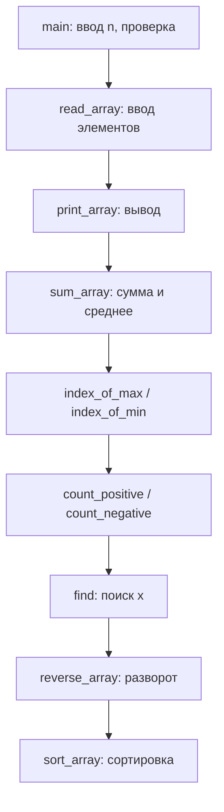

| Пункт | Функция | Разбор в курсе |
|---|---|---|
| 1 | `read_array` и проверка `n` в `main` | [[#8.4 Урок 3 - Ввод и вывод|04 Урок 3 - Ввод и вывод]] |
| 2 | `print_array` | [[#8.4 Урок 3 - Ввод и вывод|04 Урок 3 - Ввод и вывод]] |
| 3 | `sum_array` + `(double)sum / n` | [[#8.3 Урок 2 - Индексы и циклы|03 Урок 2 - Индексы и циклы]] |
| 4 | `index_of_max`, `index_of_min` | [[#8.5 Урок 4 - Типовые алгоритмы|05 Урок 4 - Типовые алгоритмы]] |
| 5 | `count_positive`, `count_negative` | [[#8.5 Урок 4 - Типовые алгоритмы|05 Урок 4 - Типовые алгоритмы]] |
| 6 | `find` | [[#8.5 Урок 4 - Типовые алгоритмы|05 Урок 4 - Типовые алгоритмы]] |
| 7 | `reverse_array` | [[#8.7 Урок 6 - Разворот и сортировка|07 Урок 6 - Разворот и сортировка]] |
| 8 | `sort_array` | [[#8.7 Урок 6 - Разворот и сортировка|07 Урок 6 - Разворот и сортировка]] |

> [!tip] Порядок важен
> Разворот и сортировка **меняют** массив, поэтому они стоят в самом конце: все вычисления (сумма, максимум, поиск) должны видеть исходные данные. Если нужен и исходный массив, и отсортированный, сначала скопируй его в другой.

---

#### Полный код

```c
#include <stdio.h>

#define MAX 20

void read_array(int arr[], int n) {
    for (int i = 0; i < n; i++) {
        scanf("%d", &arr[i]);
    }
}

void print_array(const char *title, const int arr[], int n) {
    printf("%s:", title);
    for (int i = 0; i < n; i++) {
        printf(" %d", arr[i]);
    }
    printf("\n");
}

int sum_array(const int arr[], int n) {
    int sum = 0;
    for (int i = 0; i < n; i++) {
        sum += arr[i];
    }
    return sum;
}

int index_of_max(const int arr[], int n) {
    int imax = 0;
    for (int i = 1; i < n; i++) {
        if (arr[i] > arr[imax]) {
            imax = i;
        }
    }
    return imax;
}

int index_of_min(const int arr[], int n) {
    int imin = 0;
    for (int i = 1; i < n; i++) {
        if (arr[i] < arr[imin]) {
            imin = i;
        }
    }
    return imin;
}

int count_positive(const int arr[], int n) {
    int count = 0;
    for (int i = 0; i < n; i++) {
        if (arr[i] > 0) {
            count++;
        }
    }
    return count;
}

int count_negative(const int arr[], int n) {
    int count = 0;
    for (int i = 0; i < n; i++) {
        if (arr[i] < 0) {
            count++;
        }
    }
    return count;
}

int find(const int arr[], int n, int x) {
    for (int i = 0; i < n; i++) {
        if (arr[i] == x) {
            return i;           // первое вхождение
        }
    }
    return -1;                  // не найдено
}

void reverse_array(int arr[], int n) {
    for (int i = 0; i < n / 2; i++) {
        int j = n - 1 - i;
        int t = arr[i];
        arr[i] = arr[j];
        arr[j] = t;
    }
}

void sort_array(int arr[], int n) {
    for (int pass = 0; pass < n - 1; pass++) {
        for (int j = 0; j < n - 1 - pass; j++) {
            if (arr[j] > arr[j + 1]) {
                int t = arr[j];
                arr[j] = arr[j + 1];
                arr[j + 1] = t;
            }
        }
    }
}

int main(void) {
    int a[MAX];
    int n, x;

    printf("Enter n (1..%d):\n", MAX);
    if (scanf("%d", &n) != 1 || n < 1 || n > MAX) {
        printf("Error: wrong n\n");
        return 1;
    }

    printf("Enter %d numbers:\n", n);
    read_array(a, n);

    printf("Enter x to search:\n");
    scanf("%d", &x);

    print_array("array", a, n);

    int sum = sum_array(a, n);
    printf("sum = %d, average = %.2f\n", sum, (double)sum / n);

    int imax = index_of_max(a, n);
    int imin = index_of_min(a, n);
    printf("max = %d (index %d)\n", a[imax], imax);
    printf("min = %d (index %d)\n", a[imin], imin);

    int pos = count_positive(a, n);
    int neg = count_negative(a, n);
    printf("positive = %d, negative = %d, zero = %d\n", pos, neg, n - pos - neg);

    int idx = find(a, n, x);
    if (idx == -1) {
        printf("%d not found\n", x);
    } else {
        printf("%d found at index %d\n", x, idx);
    }

    reverse_array(a, n);
    print_array("reversed", a, n);

    sort_array(a, n);
    print_array("sorted", a, n);
    return 0;
}
```

Пример работы. Ввод:

```input
7
12 -5 7 0 19 -3 8
19
```

Вывод:

```output
Enter n (1..20):
Enter 7 numbers:
Enter x to search:
array: 12 -5 7 0 19 -3 8
sum = 38, average = 5.43
max = 19 (index 4)
min = -5 (index 1)
positive = 4, negative = 2, zero = 1
19 found at index 4
reversed: 8 -3 19 0 7 -5 12
sorted: -5 -3 0 7 8 12 19
```

Что стоит заметить в коде:

- Размер задан одной константой `MAX`, все функции получают `n` параметром.
- Функции, которые только читают массив, принимают `const int arr[]`; меняют массив только `read_array`, `reverse_array` и `sort_array`.
- Количество нулей не считается отдельной функцией: `n - pos - neg`.
- `index_of_max` возвращает **индекс**, а значение берётся как `a[imax]`: так один результат даёт и позицию, и значение.
- Для сравнения при поиске максимума используется строгое `>`, поэтому при повторах возвращается **первое** вхождение.

---

#### Тесты на граничные случаи

Преподаватель любит проверять нестандартные данные. Прогони их сам до сдачи.

| Что проверяем | Ввод (`n`, элементы, `x`) | Что должно быть |
|---|---|---|
| Один элемент | `1`, `5`, `5` | `sum = 5, average = 5.00`, максимум и минимум `5 (index 0)` |
| Все отрицательные | `3`, `-3 -1 -7`, `-1` | `max = -1 (index 1)`, `min = -7 (index 2)`, нулей нет |
| Число не найдено | `4`, `1 2 3 4`, `9` | `9 not found` |
| Повторы максимума | `4`, `4 9 9 1`, `9` | `max = 9 (index 1)`: берётся первое вхождение |
| Неверное `n` | `0` или `25` | `Error: wrong n`, программа завершается |

---

#### Чек-лист перед сдачей

- [ ] Программа компилируется без предупреждений: `gcc main.c -o main -Wall -Wextra`
- [ ] Размер массива задан константой (`#define MAX`), в циклах нет «волшебных» чисел
- [ ] Во всех циклах `i < n`, индексы не выходят за границы
- [ ] `n` проверяется на диапазон `1 … MAX`
- [ ] Накопители инициализированы (`sum = 0`, счётчики `= 0`)
- [ ] `max` и `min` стартуют с первого элемента (`a[0]`), а не с числа `0`
- [ ] Среднее считается через `(double)`
- [ ] Каждый пункт задания вынесен в функцию, длина передаётся параметром, где массив не меняется, стоит `const`
- [ ] Пройдены граничные тесты из таблицы выше
- [ ] Прогон под `-fsanitize=address,undefined` без сообщений (если доступно в твоей среде)
- [ ] Подсказки ввода и подписи вывода понятны человеку
- [ ] Можешь объяснить каждую строку (см. вопросы ниже)

---

#### Что ещё могут попросить

Варианты лаб отличаются небольшими добавками. Вот две самые частые, обе собираются из знакомых кусков.

**Удаление и вставка элемента.** Удаление: сдвинуть хвост влево на место удаляемого и уменьшить `n`. Вставка: освободить место, сдвигая хвост вправо **с конца**, затем записать значение и увеличить `n`.

```c
#include <stdio.h>

#define MAX 10

int main(void) {
    int a[MAX] = {10, 20, 30, 40, 50};
    int n = 5;
    int k;

    k = 1;                                  // удалить элемент с индексом 1
    for (int i = k; i < n - 1; i++) {
        a[i] = a[i + 1];
    }
    n--;

    printf("after delete:");
    for (int i = 0; i < n; i++) {
        printf(" %d", a[i]);
    }
    printf("\n");

    k = 2;                                  // вставить 99 на индекс 2
    for (int i = n; i > k; i--) {
        a[i] = a[i - 1];                    // сдвиг вправо идёт С КОНЦА
    }
    a[k] = 99;
    n++;

    printf("after insert:");
    for (int i = 0; i < n; i++) {
        printf(" %d", a[i]);
    }
    printf("\n");
    return 0;
}
```

```output
after delete: 10 30 40 50
after insert: 10 30 99 40 50
```

> [!warning] Почему сдвиг вправо идёт с конца
> Если сдвигать `a[i + 1] = a[i]` слева направо, первое же присваивание затрёт следующий элемент, и весь хвост заполнится одним значением. С конца каждая ячейка копируется в уже освобождённую.

**Другие частые добавки:**

- *Второй по величине элемент:* найди максимум, затем максимум среди элементов, которые меньше его.
- *Слияние двух отсортированных массивов:* два индекса `i`, `j`; на каждом шаге бери меньший из `a[i]`, `b[j]` и сдвигай соответствующий индекс.
- *Удаление дубликатов:* для каждого элемента ищи такой же среди предыдущих (линейный поиск из урока 4).

---

#### Вопросы на защите

Нажми на вопрос, чтобы увидеть ответ. Сначала ответь вслух.

> [!question]- Почему индексы массива начинаются с нуля?
> Индекс — это **смещение от начала** массива в элементах. У первого элемента смещение ноль: он лежит в самом начале. Адрес `a[i]` равен `адрес a[0] + i * sizeof(элемента)`.

> [!question]- Что будет, если обратиться к `a[n]` у массива из `n` элементов?
> Выход за границы: поведение **не определено**. Программа может вывести мусор, испортить соседние переменные или аварийно завершиться. Компилятор обычно не ловит это при компиляции.

> [!question]- Как массив передаётся в функцию?
> Передаётся **адрес первого элемента**, копия не создаётся. Поэтому функция меняет оригинал, а длину надо передавать отдельным параметром: `sizeof` внутри функции даёт размер указателя.

> [!question]- Почему массив объявлен на `MAX` элементов, а не на `n`?
> Размер статического массива должен быть известен при компиляции. `n` вводится во время работы, поэтому массив берётся с запасом, а `n` хранит реально используемое количество и проверяется на `n <= MAX`.

> [!question]- Почему `max` начинается с `a[0]`, а не с нуля?
> Если все числа отрицательные, ноль «победит» и вернётся значение, которого в массиве нет. Стартовое значение должно быть реальным элементом массива.

> [!question]- Чем строка отличается от обычного массива `char`?
> Строка заканчивается символом `'\0'`, по которому функции находят конец. Поэтому под строку из `k` символов нужно `k + 1` элемент. Длину строки даёт `strlen`, размер массива — `sizeof`.

> [!question]- Сколько сравнений делает пузырьковая сортировка?
> Порядка $n^2/2$: на первом проходе `n - 1` сравнений, на втором `n - 2` и так далее. Говорят, что сложность $O(n^2)$. Для массивов из десятков элементов этого достаточно.

---

[[#8.10 Типичные ошибки|← Типичные ошибки]] · [[#8.0 Оглавление|Оглавление]] · [[#8.1 Шпаргалка|Шпаргалка]]

## 9. Лекция 4. Строки в C и C++

> [!tip] Быстрый доступ
> Основные методы одной страницей: [[#9.99 Шпаргалка: строки в C и C++|Шпаргалка - Строки]].

> [!abstract] Для чего эта методичка
> Разобрать всё, что есть в лекции 4 «Обработка текстовой информации»: как устроена строка, как её вводить, искать, менять, сравнивать и преобразовывать в число. Каждая функция описана отдельно: синтаксис, параметры, что возвращает, как работает, пример с реальным выводом и типичные ловушки. Добавлены методы, которых в лекции нет (`replace`, `find_first_of`, `stoi`, `istringstream` и др.), исправлены места лекции с ошибками и приведены задачи с решениями.

#### Две «строки», которые нужно различать

| | C-строка | `std::string` |
|---|---|---|
| Что это | массив `char` с `'\0'` в конце | объект класса из `<string>` |
| Длина | фиксирована при объявлении | меняется во время работы |
| Присваивание, `+`, `==` | **не работают** (нужны `strcpy`, `strcat`, `strcmp`) | работают как с числами |
| Риск переполнения | высокий | практически нет |
| Где нужна | язык C, старые функции, понимание «как внутри» | почти все задачи на C++ |

#### Как читать описание функции

Каждая функция оформлена по одному плану:

1. **Синтаксис**: как записывается вызов.
2. **Параметры**: что значит каждый аргумент.
3. **Возвращает / что делает**: результат и побочные эффекты (меняется ли строка).
4. **Как работает**: что происходит внутри, простыми словами.
5. **Пример** с результатом в комментарии (все результаты получены запуском).
6. **Ловушки**: типичные ошибки.

#### Содержание

1. [[#Урок 1. Что такое строка]]
2. [[#Урок 2. Ввод и вывод строк]]
3. [[#Урок 3. Функции для C-строк]]
4. [[#Урок 4. Класс string — создание и доступ]]
5. [[#Урок 5. Класс string — вырезать, вставить, удалить, заменить]]
6. [[#Урок 6. Поиск в строке]]
7. [[#Урок 7. Преобразования «строка ↔ число»]]
8. [[#Урок 8. Сравнение и сортировка строк]]
9. [[#Урок 9. Хранение текста]]
10. [[#Урок 10. Разбор задач]]
11. [[#Урок 11. Ошибки и контрольные вопросы]]

> [!tip] Если времени мало
> Минимум: уроки 1, 2, 4, 5, 6 и задачи 1–3 из урока 10.

> [!warning] Кодировка и русский язык
> В лекции подразумевается консоль Windows с кодировкой CP-1251: одна русская буква = 1 байт. В UTF-8 (Linux, macOS, многие онлайн-компиляторы) русская буква занимает **2 байта**, и `size()`, `find('с')`, индексы работают «странно». Подробности: [[#5.11. Русские буквы и длина]].

---

### Урок 1. Что такое строка

> [!abstract] Что ты узнаешь
> Зачем нужны строки, что такое символ `char`, как C-строка лежит в памяти, зачем в конце `'\0'` и чем длина строки отличается от размера массива.

#### 1.1. Зачем нужны строки

Имя, адрес, команда, содержимое файла: всё это текст. Обработка текста относится к **нечисловым** задачам и сводится к двум подзадачам:

| Подзадача | Что нужно сделать | Что получаем |
|---|---|---|
| Поиск | найти в тексте вхождение другой последовательности символов или слов | «да/нет» либо позицию (индекс первого символа вхождения) |
| Редактирование | заменить, удалить или вставить фрагмент | изменённая последовательность |

Хочется работать с текстом как с **одним объектом**, длина которого может меняться во время работы:

```cpp
char s1[10];   // C: массив из 10 отдельных символов, длину отслеживаешь сам
string s2;     // C++: единый объект, растёт сам
```

В языке C типа «строка» нет, и строку делают из массива `char`. В C++ добавили класс `string`. В методичке разобраны оба варианта.

#### 1.2. Символ char

`char` хранит **один символ**, но внутри это маленькое целое число (код символа):

```cpp
char c = 'A';
cout << c;        // A
cout << (int)c;   // 65
```

| Запись | Что значит |
|---|---|
| `'A'` | символ в одинарных кавычках, число 65 |
| `"A"` | строка в двойных кавычках: два байта, `'A'` и `'\0'` |
| `'\n'` | перевод строки |
| `'\t'` | табуляция |
| `'\\'` | сам обратный слэш |
| `'\''`, `'\"'` | кавычки |
| `'\0'` | символ с кодом 0, признак конца строки |

Раз символы это числа, их можно сравнивать (`'a' < 'b'`) и делать арифметику (`'a' + 1` равно `'b'`). Именно так строки сравниваются, см. [[#Урок 8. Сравнение и сортировка строк]].

#### 1.3. C-строка в памяти

> [!important] Главное определение
> **C-строка** — это массив `char`, в котором сразу за последним символом текста стоит служебный символ `'\0'` (код 0), называемый **терминатором**. Он показывает, где строка заканчивается.

Строка `"abc"` занимает **4 байта**:

| Индекс | 0 | 1 | 2 | 3 |
|---|---|---|---|---|
| Значение | `'a'` | `'b'` | `'c'` | `'\0'` |

Посмотри, как функции находят конец строки по `'\0'`:

![[anim-strlen.svg]]

> [!note] Запомни
> В массиве из N элементов помещается строка не длиннее **N − 1** символов: один байт всегда занят под `'\0'`.

#### 1.4. Объявление и инициализация

| Объявление | Размер массива | Что лежит в памяти |
|---|---|---|
| `char str[5];` | 5 байт | не инициализировано (мусор) |
| `char word[] = {'a','b','c','\0'};` | 4 (вычисляется сам) | `a b c \0` |
| `char word[] = "abc";` | 4 | то же, `'\0'` добавляется автоматически |
| `char stroka[6] = "123";` | 6 | `1 2 3 \0 \0 \0` |

Если размер не указан, компилятор считает его сам: число символов плюс 1. Если указан, выделяется ровно столько, сколько написано, а остаток заполняется нулями.

> [!bug] Уточнение к лекции
> В лекции сказано, что для `char stroka[6] = "123"` «инициализируются не все» элементы. Строго говоря, остаток заполняется нулями, так что строка корректно завершена (проверено запуском). Опасен только `char str[5];` без инициализации.

#### 1.5. Длина строки и размер массива

Это **два разных числа**:

```cpp
char s[] = "hello";
char t[20] = "ab";
cout << strlen(s) << " " << sizeof(s) << "\n";   // 5 6
cout << strlen(t) << " " << sizeof(t) << "\n";   // 2 20
```

- `sizeof(s)` — сколько байт занимает **весь массив** (считается при компиляции).
- `strlen(s)` — сколько символов **до `'\0'`** (считается при запуске, проходом по строке).

#### 1.6. Обход строки

Длина заранее не нужна: идём, пока не встретим `'\0'`.

```cpp
char s[] = "hello";
int len = 0;
while (s[len] != '\0')      // можно короче: while (s[len])
    len++;
// len == 5
```

> [!warning] Что будет, если `'\0'` потерялся
> Функции продолжат читать соседнюю память, пока случайно не встретят нулевой байт. Результат: «мусор» на экране или аварийное завершение. Это одна из самых частых ошибок, см. [[#Почему gets опасна]].

#### 1.7. Строковый литерал

`"abc"` прямо в тексте программы называется **строковым литералом**. Его **нельзя менять**. Если нужен указатель на него, пиши `const char* p = "abc";`. Менять символы можно только в массиве:

```cpp
char s[] = "abc";
s[0] = 'X';          // можно: s == "Xbc"
```

> [!question] Проверь себя
> Что выведет `sizeof("abc")`? Ответ: 4.

---

### Урок 2. Ввод и вывод строк

> [!abstract] Что ты узнаешь
> Как работают `scanf`, `fgets`, `gets`, `getchar`, `cin` и `getline`, чем они отличаются и почему одни безопасны, а другие нет. Как вывести строку через `printf`, `puts`, `putchar` и `cout`.

> [!important] Правило одно
> Любой ввод в `char`-массив должен знать **размер буфера**. Если он неизвестен, длинный ввод выйдет за границы массива.

#### 2.1. Ввод в C-строку

##### scanf("%s", s) — прочитать одно слово

**Заголовок:** `<stdio.h>`

| Часть | Что значит |
|---|---|
| `%s` | прочитать слово: пропустить пробелы в начале, читать до следующего пробельного символа (пробел, Tab, Enter) |
| `%19s` | то же, но не более **19** символов (ширина) |
| `s` | массив, куда писать. **Без `&`**: имя массива и так адрес |

Что делает: пропускает пробелы, читает символы слова, в конец добавляет `'\0'`. Остаток строки (после слова) остаётся во входном потоке.

```cpp
char name[20];
scanf("%19s", name);       // ввод: Ivan Petrov
printf("[%s]", name);      // [Ivan]
```

> [!warning] Ловушки
> - **Одно слово.** `Ivan Petrov` прочитается только как `Ivan`, а `Petrov` останется в потоке.
> - **Ширина = размер − 1.** Для `char name[20]` пиши `%19s`: один байт нужен под `'\0'`. Без ширины длинный ввод переполнит массив.
> - **Без `&`** для массивов (в отличие от `int`: `scanf("%d", &n)`).
> - В Visual Studio вместо `scanf` часто требуют `scanf_s("%s", s, N)`: размер передаётся отдельным аргументом.

##### fgets(s, count, stream) — прочитать строку целиком

**Заголовок:** `<stdio.h>`  **Синтаксис:** `char* fgets(char* str, int count, FILE* stream);`

| Параметр | Что значит |
|---|---|
| `str` | массив, куда писать |
| `count` | размер массива (читается не более `count − 1` символов) |
| `stream` | откуда читать; с клавиатуры это `stdin` |

**Что возвращает:** `str` при успехе или `NULL`, если ничего не прочитано (конец файла или ошибка).

**Как работает:** читает символы, пока не встретит перевод строки `'\n'`, не прочитает `count − 1` символов или не дойдёт до конца файла. Затем дописывает `'\0'`.

```cpp
char str[50];
fgets(str, sizeof(str), stdin);   // ввод: hello world
printf("[%s]", str);              // [hello world\n]: перевод строки остался в строке!
```

> [!warning] fgets оставляет `'\n'`
> Если перевод строки поместился в буфер, он **остаётся в строке**. Обычно его убирают одной строкой:
> ```cpp
> str[strcspn(str, "\n")] = '\0';
> ```
> `strcspn(str, "\n")` возвращает индекс первого `'\n'` (или длину строки, если его нет), и на это место ставится `'\0'`.

Если введено больше `count − 1` символов, `fgets` берёт первые `count − 1`, а остаток остаётся в потоке для следующего чтения.

**Это рекомендуемый способ ввода строки с пробелами в C.**

##### gets(s) — не использовать

**Синтаксис:** `char* gets(char* s);`

Читает строку до Enter и кладёт в `s`, дописав `'\0'`. **Размер массива не проверяется.** Если ввод длиннее массива, происходит переполнение буфера. Функция удалена из стандартов C11 и C++14: современные компиляторы выдают ошибку или предупреждение (проверено: в C++17 даже не компилируется).

##### Почему gets опасна

Пусть массивы `strA[5]` и `strB[5]` лежат в памяти подряд (порядок компилятор не гарантирует, это учебная модель). Вводим в `strA` строку `12345`: пять символов заняли весь массив, и `'\0'` пишется **за границей**, то есть в `strB[0]`. Потом вводим в `strB` строку `abc`, и символ `'a'` затирает этот `'\0'`.

![[anim-gets-overflow.svg]]

В итоге у `strA` нет собственного конца, она «слилась» со следующей и выводится как `12345abc`. В реальных программах такое переполнение портит чужие переменные, а иногда ведёт к уязвимостям безопасности.

##### getchar() — один символ

**Синтаксис:** `int getchar(void);`  Читает **один символ** из ввода и возвращает его код (или `EOF`, если ввод закончился). Вместо `scanf("%c", &ch)` можно писать `ch = getchar();`.

Посимвольный ввод нужен, когда есть своё условие остановки. Задача из лекции: читать до точки, не более 10 символов. Под `'\0'` нужен ещё байт, поэтому размер 11.

```cpp
const int N = 11;
char ch, stroka[N];
int len = 0;
ch = getchar();
while (ch != '.' && len < N - 1) {   // пока не точка и есть место
    stroka[len++] = ch;
    ch = getchar();
}
if (ch != '.') printf("error");       // не вместились
else stroka[len] = '\0';              // закрываем строку
```

##### Сравнение способов

| Способ | Читает до | Пробелы внутри | Безопасно ли |
|---|---|---|---|
| `scanf("%19s", s)` | первого пробельного символа | нет | да, с шириной |
| `scanf_s("%s", s, N)` | то же | нет | да (Visual Studio) |
| `gets(s)` | Enter | да | **нет** |
| `fgets(s, N, stdin)` | Enter или `N−1` символов | да | да |
| `getchar()` | один символ за вызов | да | зависит от цикла |

> [!bug] Ошибки в примерах лекции
> - В примерах с `fgets` и `gets` написано `char str;` (одна переменная) или `string str;` вместо массива `char str[N]`.
> - В `scanf("%49s", name)` для `char name[48]` ширина указана на 2 больше нужного: должно быть `%47s`.

#### 2.2. Ввод в string

##### cin >> s — одно слово

Работает как `scanf("%s")`: пропускает пробелы, читает слово до пробельного символа. Размер буфера не нужен: `string` растёт сам.

##### getline(cin, s) — строка целиком

**Заголовок:** `<string>`  **Синтаксис:** `getline(поток, строка)` или `getline(поток, строка, разделитель)`

| Параметр | Что значит |
|---|---|
| `cin` | откуда читать (можно любой входной поток, например `istringstream`) |
| `s` | строка, куда писать (старое содержимое стирается) |
| разделитель | необязательный, по умолчанию `'\n'` |

**Что делает:** читает все символы до разделителя и **удаляет** разделитель из потока (в строку он не попадает). Пробелы сохраняются.

```cpp
istringstream in("a;b;c");
string p;
while (getline(in, p, ';'))      // разделитель ';' вместо Enter
    cout << "[" << p << "]";     // [a][b][c]
```

> [!warning] Ловушка: `cin >>` и `getline` вместе
> После `cin >> n` в потоке остаётся `'\n'`, и следующий `getline` прочитает **пустую строку**. Проверка запуском: после чтения `12 hello` оператором `>>` и вызова `getline` получаем строку длины 0.
> Лечение: выбросить остаток строки.
> ```cpp
> int n;
> cin >> n;
> cin.ignore(1000, '\n');   // выбросить до 1000 символов или до '\n'
> string s;
> getline(cin, s);
> ```

#### 2.3. Вывод

| Способ | Что делает | Пример |
|---|---|---|
| `printf("%s", s)` | выводит строку до `'\0'` | `printf("Имя: %s\n", s);` |
| `puts(s)` | то же **и добавляет перевод строки** | `puts(s);` |
| `putchar(c)` | выводит один символ | `putchar(s[0]);` |
| `printf("%c", s[i])` в цикле `while (s[i])` | посимвольный вывод | когда надо обработать каждый символ |
| `cout << s` | работает и с `char[]`, и с `string` | `cout << s << endl;` |

> [!warning] `printf(s)` без формата
> Если в `s` окажется символ `%`, `printf` попытается разобрать его как формат. Пиши `printf("%s", s)` или `puts(s)`.

> [!question] Проверь себя
> Почему для `char s[10]` в `scanf` нужна ширина `%9s`, а не `%10s`? Ответ: десятый байт нужен под `'\0'`.

---

### Урок 3. Функции для C-строк

> [!abstract] Что ты узнаешь
> Как копировать, склеивать, сравнивать и искать в C-строках функциями из `<string.h>` (в C++ можно `<cstring>`). Для каждой функции: синтаксис, параметры, что возвращает, пример с реальным выводом и ловушки.

> [!important] Главное
> Для обычного `char`-массива операторы `=`, `+`, `==` **не работают с текстом**, и всё делают функции. Они идут по массиву до `'\0'`, поэтому если терминатора нет или места не хватает, они выйдут за границы массива. **Проверять размеры должен ты сам.**

#### 3.1. strlen — длина строки

**Синтаксис:** `size_t strlen(const char* s);`

| Параметр | Что значит |
|---|---|
| `s` | C-строка |

**Возвращает:** число символов **до** `'\0'` (сам `'\0'` не считается).

**Как работает:** проходит по массиву от начала, пока не встретит `'\0'`, и считает шаги. Значит, время работы пропорционально длине.

```cpp
char s[] = "hello";
char t[20] = "ab";
strlen(s)    // 5
strlen(t)    // 2
```

> [!warning] Ловушки
> - Длина строки и размер массива разные: `sizeof(t)` равно 20, `strlen(t)` равно 2.
> - В условии цикла `for (i = 0; i < strlen(s); i++)` длина пересчитывается **на каждом шаге**. Вычисли её один раз: `int n = strlen(s);`.
> - Тип `size_t` беззнаковый: `strlen(a) - strlen(b)` при `a` короче `b` даст огромное число, а не отрицательное.

#### 3.2. strcpy — копирование

**Синтаксис:** `char* strcpy(char* dst, const char* src);`

| Параметр | Что значит |
|---|---|
| `dst` | куда копировать (должен быть массив достаточного размера) |
| `src` | откуда копировать |

**Возвращает:** `dst`.

**Как работает:** копирует символы из `src` в `dst`, начиная с адреса `src`, пока не скопирует `'\0'` (он копируется тоже).

```cpp
char a[20];
strcpy(a, "hello");
// a = "hello"
```

> [!danger] Не проверяет размер
> Если `dst` короче `src` (с учётом `'\0'`), запись уйдёт за границу массива. Размер приёмника ты должен проверить сам.
> Присвоить `a = "hello"` для массива нельзя, только `strcpy`.

#### 3.3. strncpy — копирование с ограничением

**Синтаксис:** `char* strncpy(char* dst, const char* src, size_t n);`

| Параметр | Что значит |
|---|---|
| `dst` | куда копировать |
| `src` | откуда |
| `n` | максимум символов для копирования |

**Как работает:** копирует не более `n` символов. Если `src` короче `n`, остаток `dst` до `n` заполняется нулями.

```cpp
char b[4];
strncpy(b, "abcdefgh", 3);   // скопировано 'a','b','c'
b[3] = '\0';                  // терминатор ставим сами
// b = "abc"
```

> [!warning] Главная ловушка
> Если `src` длиннее или равна `n`, **`'\0'` не добавляется**. Поэтому после `strncpy(dst, src, size - 1)` всегда пиши `dst[size - 1] = '\0';`.

#### 3.4. strcat — дописать в конец

**Синтаксис:** `char* strcat(char* dst, const char* src);`

**Как работает:** находит конец `dst` (его `'\0'`) и копирует туда `src` вместе с `'\0'`. Начальное содержимое `dst` должно быть корректной C-строкой.

```cpp
char a[20] = "hello ";
strcat(a, "world");
// a = "hello world"
```

> [!warning] Ловушки
> - В `dst` должно хватить места на **оба** текста и `'\0'`: длина1 + длина2 + 1.
> - `dst` должен быть уже инициализирован (иначе `strcat` не найдёт его конец).

##### strncat — дописать не более n символов

**Синтаксис:** `char* strncat(char* dst, const char* src, size_t n);`

Дописывает не более `n` символов из `src` и **сама** добавляет `'\0'` (в отличие от `strncpy`).

```cpp
char a[20] = "hello world";
strncat(a, "!!!!!", 2);       // a = "hello world!!", strlen(a) = 13
```

#### 3.5. strcmp — сравнение

**Синтаксис:** `int strcmp(const char* a, const char* b);`

**Возвращает:**

| Результат | Значение |
|---|---|
| `0` | строки равны |
| `> 0` | `a` больше `b` |
| `< 0` | `a` меньше `b` |

**Как работает:** сравнивает символы парами по кодам, пока они равны. На первом отличии решает, какой код больше. Если одна строка закончилась раньше, она меньше.

```cpp
strcmp("abc", "abc")   // 0
strcmp("abc", "abd")   // < 0: 'c' < 'd'
strcmp("b", "a")       // > 0
strcmp("abc", "ab")    // > 0: "abc" длиннее "ab"
```

> [!warning] Ловушки
> - Сравнивай результат только с нулём. Точное число стандарт не фиксирует: это может быть 1, 5 или −3.
> - `if (a == b)` для массивов сравнивает **адреса**, а не текст. Равенство текстов: `if (strcmp(a, b) == 0)`.

> [!bug] Опечатка в лекции
> Про `strcmp` сказано: «меньше 0, если первая строка больше второй». Правильно: меньше 0, если первая строка **меньше** второй.

##### strncmp — сравнить первые n символов

**Синтаксис:** `int strncmp(const char* a, const char* b, size_t n);`

```cpp
strncmp("hello", "help", 3)   // 0: "hel" == "hel"
strncmp("hello", "help", 4)   // < 0: 'l' < 'p'
```

Удобно проверять **префикс**: `if (strncmp(s, "http", 4) == 0)`.

#### 3.6. strchr и strrchr — поиск символа

**Синтаксис:** `char* strchr(const char* s, int c);`  `char* strrchr(const char* s, int c);`

| Функция | Ищет |
|---|---|
| `strchr` | первое вхождение символа `c` слева |
| `strrchr` | последнее вхождение (справа) |

**Возвращает:** **указатель** на найденный символ или `NULL`, если символа нет.

**Как получить индекс:** вычесть адрес начала: `p - s`.

```cpp
char s[] = "banana";
char* p = strchr(s, 'n');
// p указывает на "nana"; индекс p - s == 2
char* q = strrchr(s, 'n');
// q - s == 4
strchr(s, 'z')    // NULL
```

**Все вхождения (пример из лекции).** Каждый следующий поиск начинается с символа после найденного:

```cpp
char S[] = "abcbce";
char* p = strchr(S, 'b');            // p == &S[1]
while (p != NULL) {
    printf("%d ", (int)(p - S));      // 1 3
    p = strchr(p + 1, 'b');
}
```

> [!warning] Проверяй на `NULL`
> Если символа нет, а ты разыменуешь `NULL` (например, напечатаешь `*p`), программа упадёт.

#### 3.7. strstr — поиск подстроки

**Синтаксис:** `char* strstr(const char* s, const char* sub);`

**Возвращает:** указатель на **первое вхождение** подстроки `sub` в `s` или `NULL`.

```cpp
char s[] = "one two three";
char* p = strstr(s, "two");
// p указывает на "two three"; индекс p - s == 4
strstr(s, "four")    // NULL
```

Это аналог `string::find` для C-строк.

#### 3.8. strtok — разбить строку на слова

**Синтаксис:** `char* strtok(char* s, const char* delim);`

| Параметр | Что значит |
|---|---|
| `s` | строка при первом вызове, `NULL` при последующих |
| `delim` | строка из **всех возможных разделителей** (каждый символ — отдельный разделитель) |

**Возвращает:** указатель на очередное слово или `NULL`, когда слов больше нет.

**Как работает:** при каждом вызове пропускает разделители, находит конец слова, ставит на его месте `'\0'` и запоминает позицию. Поэтому **исходная строка портится**.

```cpp
char text[] = "one, two; three";      // массив, не литерал!
char* w = strtok(text, ",; ");
while (w != NULL) {
    printf("[%s]", w);                // [one][two][three]
    w = strtok(NULL, ",; ");          // продолжить с того же места
}
// после цикла text == "one" (разделители заменены на '\0')
```

> [!warning] Ловушки
> - Не работает со строковым литералом: нужен изменяемый массив.
> - Портит исходную строку: сделай копию, если она ещё нужна.
> - Помнит состояние внутри себя: нельзя разбирать две строки одновременно.

#### 3.9. memset — заполнить память

**Синтаксис:** `void* memset(void* p, int value, size_t n);`

Записывает значение `value` в `n` байт, начиная с адреса `p`. Чаще всего им обнуляют буфер.

```cpp
char b[6];
memset(b, 0, sizeof(b));   // все 6 байт равны 0, strlen(b) == 0
memset(b, 'x', 3);
b[3] = '\0';               // b = "xxx"
```

#### 3.10. Безопасное копирование

`strcpy` не знает размера приёмника, поэтому это классический источник переполнения. Три безопасных варианта:

```cpp
char dst[10];

// 1. strncpy + ручной терминатор
strncpy(dst, src, sizeof(dst) - 1);
dst[sizeof(dst) - 1] = '\0';

// 2. snprintf: всегда закрывает строку сама
snprintf(dst, sizeof(dst), "%s", src);

// 3. strcpy_s(dst, sizeof(dst), src);   // Visual Studio (в стандарте C11 это необязательное приложение K)
```

> [!tip] В C++ всего этого можно избежать
> Если нет требования использовать C-строки, работай с `std::string`: там копирование, склейка, поиск и сравнение есть «из коробки» и без риска переполнения. Дальше разбираем именно его.

#### 3.11. Сводная таблица

| Функция | Что делает | Возвращает |
|---|---|---|
| `strlen(s)` | длина без `'\0'` | `size_t` |
| `strcpy(dst, src)` | копирует вместе с `'\0'` | `dst` |
| `strncpy(dst, src, n)` | копирует ≤ n, **может не поставить `'\0'`** | `dst` |
| `strcat(dst, src)` | дописывает в конец | `dst` |
| `strncat(dst, src, n)` | дописывает ≤ n, `'\0'` ставит | `dst` |
| `strcmp(a, b)` | сравнивает | `int` (0 — равны) |
| `strncmp(a, b, n)` | сравнивает первые n | `int` |
| `strchr(s, c)` / `strrchr(s, c)` | первый / последний символ | указатель или `NULL` |
| `strstr(s, sub)` | подстрока | указатель или `NULL` |
| `strtok(s, delim)` | следующее слово | указатель или `NULL` |
| `memset(p, v, n)` | заполняет память | `p` |

> [!question] Проверь себя
> Сколько байт нужно под `strcat` двух строк длиной 5 и 7 символов? Ответ: 13 (5 + 7 + `'\0'`).

---

### Урок 4. Класс string — создание и доступ

> [!abstract] Что ты узнаешь
> Как создать строку `string`, узнать её длину, обратиться к символам, склеить строки и добавить или убрать символ в конце.

> [!important] Главное
> `string` — объект, который **сам хранит длину, сам выделяет память и растёт**. Всё, что в C делалось функциями и циклами, здесь делают операторами и **методами** (функциями, вызываемыми через точку: `s.size()`). Нужен `#include <string>`.

#### 4.1. Создание и присваивание

```cpp
string s = "Привет!";   // начальное значение
string t;               // пустая строка
t = s;                  // копирует ТЕКСТ (в C это был бы strcpy)
cout << s;              // вывод
```

Присваивание копирует содержимое, а не адрес: после `t = s` строки независимы, изменение `t` не затрагивает `s`.

#### 4.2. Длина и пустота

##### size() / length() — длина

**Синтаксис:** `size_t n = s.size();`  (`length()` делает то же самое)

Возвращает число символов. Работает за одно действие: длина хранится в объекте.

```cpp
string s = "hello";
s.size()    // 5
s.length()  // 5
```

##### empty() и clear()

| Метод | Что делает |
|---|---|
| `s.empty()` | `true`, если строка пуста (`size() == 0`) |
| `s.clear()` | делает строку пустой |

```cpp
string s = "hello";
s.empty()   // false (0)
s.clear();
s.empty()   // true (1)
s.size()    // 0
```

#### 4.3. Доступ к символам

##### s[i] и at(i)

| Запись | Что делает | Если индекс неверный |
|---|---|---|
| `s[i]` | символ с индексом `i` (можно читать и менять) | **неопределённое поведение**, проверки нет |
| `s.at(i)` | то же, но с проверкой | бросает исключение `out_of_range` |

```cpp
string s = "hello";
s[1]        // 'e'
s[1] = 'a'; // s == "hallo"
s.at(0)     // 'h'
s.at(10)    // исключение out_of_range
```

##### front() и back()

`s.front()` — первый символ (то же, что `s[0]`), `s.back()` — последний (то же, что `s[s.size() - 1]`). Для пустой строки вызывать нельзя.

```cpp
string s = "hallo";
s.front()   // 'h'
s.back()    // 'o'
```

Пример из лекции: заменить в строке все буквы `'а'` на `'б'`. Цикл по всем символам:

```cpp
#include <iostream>
using namespace std;

int main() {
    string s;
    cout << "Введите строку: ";
    getline(cin, s);
    for (size_t i = 0; i < s.size(); i++)
        if (s[i] == 'а')
            s[i] = 'б';
    cout << s;
}
```

> [!warning] Граница цикла
> Пиши `i < s.size()`, не `i <= s.size()`. Последний допустимый индекс равен `size() − 1`.

#### 4.4. Склейка — +, +=, append, push_back

##### Оператор +

Склеивает строки и возвращает **новую**. Хотя бы один из операндов должен быть `string`.

```cpp
string a = "Hello", b = "world";
a + ", " + b + "!"     // "Hello, world!"
```

> [!warning] Ловушка
> `"Hello" + ", "` не работает: это сложение двух указателей, а не строк. Пиши `string("Hello") + ", "`.

##### += и append

Дописывают в конец **саму** строку (без создания новой).

| Запись | Что делает |
|---|---|
| `s += "abc";` | дописать строку |
| `s += 'x';` | дописать символ |
| `s.append(" ok");` | то же, что `+=` |
| `s.append(3, '*');` | дописать три звёздочки |

```cpp
string a = "Hello";
a += "!!";            // "Hello!!"
a.append(" ok");      // "Hello!! ok"
a.append(3, '*');     // "Hello!! ok***"
```

##### push_back(c) и pop_back()

| Метод | Что делает |
|---|---|
| `s.push_back('?')` | добавить **один символ** в конец |
| `s.pop_back()` | удалить последний символ (на пустой строке нельзя) |

```cpp
string a = "Hello!!";
a.push_back('?');    // "Hello!!?"
a.pop_back();        // "Hello!!"
```

> [!question] Проверь себя
> Что будет с `string s = "abc"; s.pop_back(); s += "XY";`? Ответ: `abXY`.

---

### Урок 5. Класс string — вырезать, вставить, удалить, заменить

> [!abstract] Что ты узнаешь
> Как вырезать часть строки, вставить, удалить и заменить фрагмент, как изменить длину и обменять строки. Какие методы меняют саму строку, а какие возвращают новую.

> [!important] Главное
> Во всех примерах исходная строка `s = "0123456789"`, позиции считаются **с нуля**. Все результаты проверены запуском.

#### 5.1. substr(pos, len) — вырезать часть

**Синтаксис:** `string r = s.substr(pos, len);`

| Параметр | Что значит |
|---|---|
| `pos` | с какого индекса начинать |
| `len` | сколько символов взять (необязательный; без него до конца строки) |

**Возвращает:** **новую** строку, исходная не меняется.

```cpp
string s = "0123456789";
s.substr(3)        // "3456789": с индекса 3 до конца
s.substr(3, 5)     // "34567":   5 символов, начиная с индекса 3
s.substr(0, 1)     // "0":       первый символ
s.substr(8, 100)   // "89":      длины не хватило, взято сколько есть
s.substr(10)       // "":        pos равен размеру: пустая строка
s.substr(11)       // исключение out_of_range: pos больше размера
```

> [!warning] Ловушки
> - Второй аргумент — **длина**, а не конечный индекс (в отличие от Python). `substr(3, 5)` это 5 символов, а не символы с 3 по 5.
> - `pos` больше размера строки вызывает `out_of_range`.

#### 5.2. insert(pos, text) — вставить

**Синтаксис:** `s.insert(pos, text);`

| Параметр | Что значит |
|---|---|
| `pos` | **перед** каким индексом вставить |
| `text` | что вставить (строка; есть вариант `insert(pos, count, ch)`) |

**Что делает:** вставляет текст в саму строку, остальные символы сдвигаются вправо.

```cpp
string s = "0123456789";
s.insert(3, "ABC");        // "012ABC3456789"

s = "0123456789";
s.insert(0, "X");          // "X0123456789": в начало
s = "0123456789";
s.insert(s.size(), "Z");   // "0123456789Z": в конец
s = "0123456789";
s.insert(2, 3, '-');       // "01---23456789": три символа '-'
```

#### 5.3. erase(pos, len) — удалить

**Синтаксис:** `s.erase(pos, len);`

| Параметр | Что значит |
|---|---|
| `pos` | с какого индекса удалять |
| `len` | сколько символов (без него до конца строки) |

**Что делает:** удаляет часть **самой строки**, хвост сдвигается влево.

```cpp
string s = "0123456789";
s.erase(3, 6);     // "0129":      удалены 6 символов с индекса 3
s = "0123456789";
s.erase(5);        // "01234":     всё, начиная с индекса 5
s = "0123456789";
s.erase(2, 1);     // "013456789": удалён один символ
```

#### 5.4. replace(pos, len, text) — заменить

**Синтаксис:** `s.replace(pos, len, text);`

| Параметр | Что значит |
|---|---|
| `pos` | с какого индекса |
| `len` | сколько символов **убрать** |
| `text` | что поставить на их место (может быть другой длины) |

**Что делает:** это `erase(pos, len)` и `insert(pos, text)` одной операцией.

```cpp
string s = "0123456789";
s.replace(2, 4, "XY");        // "01XY6789":      на место "2345" встало "XY"
s = "0123456789";
s.replace(0, 3, "ABCDE");     // "ABCDE3456789":  на место "012" встало "ABCDE"
s = "0123456789";
s.replace(3, 0, "--");        // "012--3456789":  len = 0 ничего не убирает, это вставка
```

#### 5.5. resize(n) — изменить длину

**Синтаксис:** `s.resize(n);` или `s.resize(n, ch);`

Если `n` меньше длины, строка **обрезается**; если больше, **дополняется** символом `ch` (по умолчанию нулевым).

```cpp
string s = "abc";
s.resize(5, '.');   // "abc.."
s.resize(2);        // "ab"
```

#### 5.6. c_str() — получить C-строку

**Синтаксис:** `const char* p = s.c_str();`

Возвращает указатель на C-строку (с `'\0'` в конце). Нужен, чтобы передать `string` в функции языка C, которые принимают `const char*`: `atoi(s.c_str())`, `strlen(s.c_str())`, `printf("%s", s.c_str())`.

```cpp
string s = "abc";
const char* c = s.c_str();
strlen(c)        // 3
```

> [!warning] Ловушка
> Указатель действителен, пока строка `s` не изменилась и не удалена. После `s += "x"` старым указателем пользоваться нельзя.

#### 5.7. swap(a, b) — обменять строки

`swap(a, b);` меняет содержимое двух строк местами (`<algorithm>` или `<utility>`).

```cpp
string s = "abc", t = "xyz";
swap(s, t);       // s == "xyz", t == "abc"
```

#### 5.8. Какие операции меняют строку

| Меняют саму строку | Возвращают новую |
|---|---|
| `insert`, `erase`, `replace`, `resize`, `clear` | `substr`, `+` |
| `+=`, `append`, `push_back`, `pop_back` | |
| `s[i] = ...`, `swap`, `reverse` | |

> [!note] Ошибки индекса
> Если начальный индекс (`pos`) больше длины, методы `substr`, `insert`, `erase`, `replace` бросают исключение `out_of_range`. Если не хватает длины в конце (`len` слишком большое), берётся сколько есть.

#### 5.9. Алгоритмы <algorithm> и проверки <cctype>

`string` — контейнер, поэтому работают стандартные алгоритмы:

```cpp
#include <algorithm>
#include <cctype>

string s = "Hello";
reverse(s.begin(), s.end());        // "olleH": развернуть

string t = "hello";
sort(t.begin(), t.end());           // "ehllo": отсортировать символы

string u = "abc";
transform(u.begin(), u.end(), u.begin(),
          [](unsigned char c) { return toupper(c); });   // "ABC"
```

`begin()` и `end()` задают диапазон «от первого символа до места за последним».

Проверки и преобразования символа из `<cctype>`:

| Функция | Что делает | Пример |
|---|---|---|
| `isdigit(c)` | цифра? | `isdigit('5')` — истина |
| `isalpha(c)` | буква? | `isalpha('5')` — ложь |
| `isalnum(c)` | буква или цифра? | `isalnum('_')` — ложь |
| `isspace(c)` | пробельный символ (пробел, Tab, `'\n'`)? | `isspace(' ')` — истина |
| `ispunct(c)` | знак препинания? | `ispunct('!')` — истина |
| `isupper(c)`, `islower(c)` | большая / маленькая буква? | |
| `toupper(c)` | в верхний регистр | `toupper('a')` даёт `'A'` |
| `tolower(c)` | в нижний регистр | `tolower('Q')` даёт `'q'` |

> [!warning] Ловушки
> - Эти функции понимают только латиницу и без настройки локали русские буквы не преобразуют.
> - Передавай `(unsigned char)c`: для отрицательных значений `char` поведение не определено.

#### 5.10. Новые методы стандарта

| Метод | Что делает | С какой версии |
|---|---|---|
| `s.starts_with("01")` | начинается с … | C++20 |
| `s.ends_with("89")` | заканчивается на … | C++20 |
| `s.contains("45")` | содержит подстроку | C++23 |

Если компилятор старый, замени: `s.rfind(x, 0) == 0` вместо `starts_with`, `s.find(x) != string::npos` вместо `contains`.

#### 5.11. Русские буквы и длина

`size()` считает **байты**, а не буквы. В CP-1251 (консоль Windows, лекция) буква = 1 байт, и всё работает как в примерах. В UTF-8 русская буква занимает 2 байта. Проверка запуском: для `"Здесь был Вася."` (15 символов) `size()` даёт **27**, а `find('с')` с русской буквой даже не компилируется корректно.

> [!tip] Что делать
> Для учёбы проще всего проверять код на английском тексте или в среде с CP-1251 (Visual Studio плюс `setlocale(LC_ALL, "Russian")`).

> [!question] Проверь себя
> Что даст `string s = "abc"; s.insert(1, "XY");`? Ответ: `aXYbc`.

---

### Урок 6. Поиск в строке

> [!abstract] Что ты узнаешь
> Как найти символ или подстроку методами `find`, `rfind`, `find_first_of` и другими, что такое `npos`, как найти **все** вхождения и заменить их.

> [!important] Главное
> Методы поиска возвращают **индекс** найденного места, а если ничего не найдено, константу `string::npos`. Это и есть два варианта подзадачи «поиск» из лекции: «есть ли вхождение» (сравнить с `npos`) и «где оно» (сам индекс).

#### 6.1. Что такое npos

`string::npos` — специальное значение «не найдено». Это число −1 в **беззнаковом** типе `size_t`, то есть очень большое число (`18446744073709551615` на 64-битной системе). Поэтому:

```cpp
size_t n = s.find("abc");
if (n != string::npos) { /* нашли, n — индекс */ }
else                   { /* не нашли */ }
```

В лекции результат хранится в `int n` и проверяется как `n >= 0`. Это работает: при записи в `int` значение снова становится −1. Но правильнее хранить в `size_t` и сравнивать с `string::npos`.

> [!warning] Индекс 0 — это валидный результат
> `find` вернул 0, если искомое стоит **в самом начале**. Условие `if (s.find(x))` неверно: оно считает 0 «ложью», а `npos` «истиной».

#### 6.2. find — первое вхождение

**Синтаксис:** `size_t n = s.find(x);` или `s.find(x, pos);`

| Параметр | Что значит |
|---|---|
| `x` | что искать: символ (`'b'`), строка (`"c d"`) |
| `pos` | с какого индекса начать поиск (необязательный, по умолчанию 0) |

**Возвращает:** индекс первого вхождения при поиске **слева направо** или `npos`.

Для `s = "a,b;c d"` (индексы: `a`=0, `,`=1, `b`=2, `;`=3, `c`=4, пробел=5, `d`=6):

```cpp
s.find('b')            // 2
s.find("c d")          // 4: индекс первого символа подстроки
s.find('z')            // npos
s.find(',', 2)         // npos: начиная с индекса 2 запятых больше нет
```

Пустая подстрока находится в позиции 0: `s.find("")` равно 0.

#### 6.3. rfind — последнее вхождение

**Синтаксис:** `s.rfind(x)` или `s.rfind(x, pos)`

Ищет **справа налево** и возвращает индекс начала последнего вхождения. Необязательный `pos` задаёт, с какого индекса начинать поиск влево.

```cpp
string s = "abcabcab";
s.find("ab")        // 0: первое
s.rfind("ab")       // 6: последнее
s.find("ab", 1)     // 3: следующее после индекса 1
```

#### 6.4. Поиск по набору символов

Эти методы ищут не подстроку, а **один символ из набора** (набор задаётся строкой).

| Метод | Что ищет |
|---|---|
| `find_first_of(set)` | первый символ слева, который есть в наборе |
| `find_last_of(set)` | последний символ справа, который есть в наборе |
| `find_first_not_of(set)` | первый символ слева, которого **нет** в наборе |
| `find_last_not_of(set)` | последний символ, которого нет в наборе |

Для `s = "a,b;c d"`:

```cpp
s.find_first_of(",; ")       // 1: первый разделитель (запятая)
s.find_last_of(",; ")        // 5: последний разделитель (пробел)
s.find_first_not_of("abc")   // 1: первая «не a, b, c» (запятая)
s.find_last_not_of("abc")    // 6: последняя «не a, b, c» (буква d)
```

Типичные применения: найти ближайший **разделитель** (`find_first_of(" ,;")`) или пропустить пробелы в начале строки (`find_first_not_of(" ")`).

#### 6.5. Найти все вхождения

Второй аргумент `pos` позволяет искать дальше найденного места:

```cpp
string s = "abcabcab";
size_t pos = 0;
while ((pos = s.find("ab", pos)) != string::npos) {
    cout << pos << ' ';     // 0 3 6
    pos += 2;               // сдвинуться за найденное вхождение
}
```

#### 6.6. Найти и заменить

Замена всех вхождений подстроки — это `find` плюс [[#5.4. replace(pos, len, text) — заменить|replace]]:

```cpp
string s = "cat and cat";
size_t pos = 0;
while ((pos = s.find("cat", pos)) != string::npos) {
    s.replace(pos, 3, "dog");   // заменить 3 символа на "dog"
    pos += 3;                   // пропустить заменённый кусок
}
// s == "dog and dog"
```

> [!warning] Не забывай `pos += ...`
> Без сдвига цикл будет находить одно и то же вхождение (особенно если новый текст содержит искомый) и зациклится.

**Удалить подстроку** `x`: `n = s.find(x); if (n != string::npos) s.erase(n, x.size());`.

#### 6.7. Поиск в C-строках

Для `char[]` есть `strchr`, `strrchr`, `strstr`: они возвращают указатель, а не индекс. См. [[#3.6. strchr и strrchr — поиск символа]] и [[#3.7. strstr — поиск подстроки]].

> [!question] Проверь себя
> Что вернёт `string("hello").find('l')`? А `rfind('l')`? Ответ: 2 и 3.

---

### Урок 7. Преобразования «строка ↔ число»

> [!abstract] Что ты узнаешь
> Как получить число из текста (`atoi`, `stoi` и др.) и текст из числа (`to_string`, `ostringstream`, `snprintf`), как отформатировать вещественное число и как разбить строку на слова потоком `istringstream`.

> [!important] Главное
> Строка `"123"` и число `123` — разные вещи: у первой три символа-цифры, у второго числовое значение. Преобразовывать нужно, когда данные приходят из файла или поля ввода, или когда результат надо вставить в текст.

#### 7.1. Из строки в число

##### atoi и atof (стиль C)

**Синтаксис:** `int atoi(const char* s);`  `double atof(const char* s);`  **Заголовок:** `<stdlib.h>` (`<cstdlib>`)

**Как работает (по лекции):** пропускает пробельные символы в начале, читает знак `+` или `-` и цифры, **останавливается на первом неподходящем символе**. Если число не начинается сразу, возвращает 0.

С `string` используют `s.c_str()`: `atoi(s.c_str())`.

```cpp
atoi("42")          // 42
atoi("  -17abc")    // -17: пробелы пропущены, чтение остановилось на 'a'
atoi("12 34")       // 12:  остановилось на пробеле
atoi("+5")          // 5
atoi("abc")         // 0:   ошибка
atoi("")            // 0:   ошибка
atof("3.14xyz")     // 3.14
```

> [!warning] Главный недостаток
> Ошибка и честный ноль **неразличимы**: `atoi("0")` и `atoi("abc")` оба дают 0. При переполнении поведение не определено. Поэтому для проверки ввода лучше `stoi`.

##### stoi, stol, stod (C++11)

**Синтаксис:** `int stoi(const string& s, size_t* pos = nullptr, int base = 10);`

| Параметр | Что значит |
|---|---|
| `s` | строка (принимает `string` напрямую, `c_str()` не нужен) |
| `pos` | необязательно: сюда запишется индекс, где остановилось чтение |
| `base` | необязательно: система счисления (2, 8, 10, 16) |

| Функция | Результат |
|---|---|
| `stoi(s)` | `int` |
| `stol(s)` | `long` |
| `stof(s)`, `stod(s)` | `float`, `double` |

```cpp
stoi("42")                  // 42
stoi("-17abc")              // -17: хвост 'abc' игнорируется
stod("2.5e3")               // 2500
stol("123456789012")        // 123456789012 (в int не поместилось бы)
stoi("ff", nullptr, 16)     // 255: шестнадцатеричная система
stoi("101", nullptr, 2)     // 5:   двоичная система
size_t p;
stoi("12x3", &p);           // 12, и p == 2: чтение остановилось на индексе 2
```

**Ошибки сообщаются исключениями:**

| Исключение | Когда |
|---|---|
| `invalid_argument` | в начале строки нет числа (`"abc"`) |
| `out_of_range` | число не помещается в тип (`"99999999999"` для `int`) |

```cpp
try {
    int x = stoi(s);
    cout << x + 1;
} catch (const invalid_argument&) {
    cout << "Не число";
} catch (const out_of_range&) {
    cout << "Слишком большое число";
}
```

Проверить, что **вся** строка — число, можно по `pos`: если после `stoi(s, &p)` значение `p` меньше `s.size()`, в конце остался мусор (например, `12x3`).

#### 7.2. Из числа в строку

##### to_string (C++11) — самый простой способ

**Синтаксис:** `string to_string(число);`

```cpp
to_string(123)       // "123"
to_string(-7)        // "-7"
to_string(3.5)       // "3.500000": у double всегда 6 знаков после запятой
to_string(2.0 / 3)   // "0.666667"
```

> [!warning] Ловушка
> Формат нельзя задать: для `double` всегда шесть знаков после запятой. Если нужен другой формат, используй `ostringstream` или `snprintf`.

##### ostringstream — строковый поток вывода

Нужен `#include <sstream>` (а для манипуляторов `<iomanip>`). Работает как `cout`, но накапливает текст **в памяти**. Оператор `<<` «вставляет» значения, `ss.str()` возвращает готовую строку, `ss.str("")` очищает поток.

```cpp
ostringstream ss;
ss << "x=" << 5 << ", y=" << 2.5;
ss.str()            // "x=5, y=2.5"
```

**Форматирование (манипуляторы из `<iomanip>`):**

| Манипулятор | Что делает |
|---|---|
| `setw(n)` или `ss.width(n)` | минимальная **ширина** следующего вывода (по умолчанию добивает пробелами слева) |
| `setfill(c)` | чем добивать ширину (по умолчанию пробелом) |
| `fixed` | дробные числа с точкой, `setprecision` задаёт знаки **после запятой** |
| `scientific` | научный формат |
| `setprecision(n)` или `ss.precision(n)` | точность (см. ниже) |

```cpp
ostringstream ss;
ss << setw(8) << 42;                       // "      42"
ss.str("");
ss << setw(8) << setfill('0') << 42;       // "00000042"
ss.str("");
ss << fixed << setprecision(2) << 3.14159; // "3.14"
ss.str("");
ss << scientific << setprecision(2) << 12345.678;   // "1.23e+04"
```

> [!bug] Поправки к лекции (проверено запуском)
> - Без `fixed` точность задаёт число **значащих цифр**, а не знаков после запятой. С `defaultfloat` и `setprecision(3)` число `123.456` превращается в `123`. Чтобы получить `123.456`, нужны `fixed` и `setprecision(3)`.
> - Научный формат даёт `1.234560e+02` (две цифры порядка). Вид `E+002` с тремя цифрами встречается у отдельных реализаций, например в старых версиях Visual Studio.
> - `width` действует только на **ближайший** вывод. А `precision`, `fixed`, `scientific` «залипают»: действуют, пока их не переключишь.

##### snprintf (стиль C)

**Синтаксис:** `int snprintf(char* buf, size_t size, const char* format, ...);`

| Параметр | Что значит |
|---|---|
| `buf` | массив, куда писать |
| `size` | размер массива (запишется не более `size − 1` символов и `'\0'`) |
| `format` | шаблон, как у `printf` (`%d`, `%s`, `%.2f` и т. д.) |

**Возвращает:** сколько символов было бы записано без ограничения.

```cpp
char b[32];
snprintf(b, sizeof(b), "%d-%s-%.1f", 7, "ab", 2.5);   // "7-ab-2.5"

int r = snprintf(b, 5, "%s", "abcdefgh");             // b = "abcd" (обрезано), r = 8
```

Это безопасная замена `sprintf`: размер ограничен, а `'\0'` ставится всегда.

#### 7.3. Разбор строки потоком — istringstream

Обратный поток читает из строки как из `cin`. Оператор `>>` сам **пропускает пробелы** и читает следующее слово или число.

```cpp
istringstream is("10 20 abc 30");
int x, sum = 0;
while (is >> x) sum += x;      // sum == 30: чтение остановилось на "abc"
```

Самый удобный способ разбить текст на слова:

```cpp
istringstream is("one two  three");
string word;
int count = 0;
while (is >> word) count++;       // count == 3, лишние пробелы не мешают
```

`getline(is, p, ';')` режет строку по любому разделителю (см. [[#getline(cin, s) — строка целиком]]).

> [!question] Проверь себя
> Что вернёт `atoi("  -17abc")`? А `stoi("abc")`? Ответ: −17 и исключение `invalid_argument`.

---

### Урок 8. Сравнение и сортировка строк

> [!abstract] Что ты узнаешь
> Как сравниваются строки, почему `"Zebra" < "apple"`, как сравнить без учёта регистра и как отсортировать массив строк.

> [!important] Главное
> Строки сравниваются **посимвольно по числовым кодам** до первого отличия. Если одна строка — начало другой, **короче считается меньше**. Это лексикографический порядок (как в словаре, но по кодам символов).

#### 8.1. Коды символов

| Группа | Диапазон кодов | Комментарий |
|---|---|---|
| Цифры `0`–`9` | 48–57 | одинаково в CP-1251 и Unicode |
| Большие латинские `A`–`Z` | 65–90 | одинаково |
| Маленькие латинские `a`–`z` | 97–122 | одинаково |
| Большие русские `А`–`Я` | CP-1251: 192–223; Unicode: 1040–1071 | `Ё` отдельно: 168 и 1025 |
| Маленькие русские `а`–`я` | CP-1251: 224–255; Unicode: 1072–1103 | `ё` отдельно: 184 и 1105 |

Что из этого следует:

- Цифры < большие латинские < маленькие латинские < русские. Поэтому `5STEAM < STEAM < Steam < steam`, а дальше `steam < ПАР < Пар < пар < парк`.
- Большая буква всегда «меньше» маленькой: `"Zebra" < "apple"`.
- Префикс меньше целой строки: `"ab" < "abc"`, а пустая строка меньше любой непустой.
- `Ё` стоит вне алфавитной последовательности и по коду меньше `А`, поэтому слова с «ё» при сортировке встают не на своё место.

#### 8.2. Операторы сравнения для string

Работают `==`, `!=`, `<`, `>`, `<=`, `>=`. Для `string` они сравнивают **текст**:

```cpp
string a = "abc", b = "abd";
a == b        // false
a < b         // true: 'c' < 'd'
a == "abc"    // true: можно сравнивать и с литералом
```

##### compare

**Синтаксис:** `int r = a.compare(b);`

Возвращает 0 (равны), число < 0 (`a` меньше), число > 0 (`a` больше), как `strcmp`. Сравнивай с нулём, а не с 1 или −1.

```cpp
string a = "abc";
a.compare("abc")    // 0
a.compare("abd")    // < 0
a.compare("ab")     // > 0
```

#### 8.3. Сравнение C-строк

```cpp
char s[] = "abc", t[] = "abba";
int rez = strcmp(s, t);         // > 0: первые два символа равны, 'c' > 'b'
if (strcmp(s, t) == 0) ...      // строки равны
```

> [!danger] `==` для C-строк сравнивает адреса
> `if (s == t)` проверяет, один и тот же ли это массив, а не равен ли текст. Используй `strcmp`. Подробнее в [[#3.5. strcmp — сравнение]].

#### 8.4. Сравнение без учёта регистра

В стандарте для `string` такого нет, делают вручную: привести обе строки к одному регистру.

```cpp
string lower(string s) {
    for (char& c : s) c = tolower((unsigned char)c);
    return s;
}
bool equalIgnoreCase(const string& a, const string& b) {
    return lower(a) == lower(b);
}
```

#### 8.5. Сортировка массива строк

Если строки лежат в массиве `string S[N]`, в любой сортировке достаточно заменить сравнение чисел сравнением строк. Вариант из лекции, «пузырёк»:

```cpp
for (i = 0; i < N - 1; i++)
    for (j = N - 2; j >= i; j--)
        if (S[j] > S[j + 1]) {       // сравнение строк как чисел
            s1 = S[j];               // обмен через временную строку
            S[j] = S[j + 1];
            S[j + 1] = s1;
        }
```

То же одной строкой средствами стандартной библиотеки:

```cpp
#include <algorithm>
sort(S, S + N);                       // по возрастанию (по кодам)
sort(S, S + N, greater<string>());    // по убыванию (нужен <functional>)
swap(S[0], S[1]);                     // обмен двух строк
```

`sort(S, S + N)` принимает адрес первого элемента и адрес места **за последним**. Для `vector<string> v` пиши `sort(v.begin(), v.end())`.

Для массива C-строк (`char T[N][M]`) сравнивать нужно через `strcmp`, а менять местами через три вызова `strcpy`.

> [!question] Проверь себя
> В каком порядке отсортируются `"b"`, `"Zebra"`, `"apple"`? Ответ: `Zebra`, `apple`, `b`.

---

### Урок 9. Хранение текста

> [!abstract] Что ты узнаешь
> Три способа хранить текст из нескольких слов: двумерный массив, один массив и `vector<string>`.

> [!important] Главное
> **Текст** — последовательность слов, разделённых разделителями (пробел, запятая и др.) и заканчивающаяся признаком конца (обычно точкой). **Слово** — последовательность символов без разделителей.

#### 9.1. Двумерный массив — одно слово = одна строка

```cpp
char text[N][M];   // N: максимум слов, M: максимальная длина слова + 1 (под '\0')
```

Текст `"В город пришла зима."` в `char text[5][7]` (самое длинное слово «пришла» = 6 букв, плюс `'\0'`):

| Строка | 0 | 1 | 2 | 3 | 4 | 5 | 6 |
|---|---|---|---|---|---|---|---|
| `text[0]` | В | \0 | | | | | |
| `text[1]` | г | о | р | о | д | \0 | |
| `text[2]` | п | р | и | ш | л | а | \0 |
| `text[3]` | з | и | м | а | \0 | | |
| `text[4]` | *(не используется)* | | | | | | |

`text[1]` — целое слово «город» (обычная C-строка, с ней работают все функции из [[#Урок 3. Функции для C-строк]]), а `text[1][0]` — буква «г».

**Плюс:** слова легко доставать, сравнивать и сортировать. **Минус:** под каждое слово отводится место по самому длинному, память тратится зря.

#### 9.2. Одномерный массив — весь текст как одна строка

```cpp
char str[N * M];   // слова разделены пробелами внутри одного массива
```

| 0 | 1 | 2 | 3 | 4 | 5 | 6 | 7 | 8 | 9 | 10 | 11 | 12 | 13 | 14 | 15 | 16 | 17 | 18 | 19 |
|---|---|---|---|---|---|---|---|---|---|---|---|---|---|---|---|---|---|---|---|
| В | _ | г | о | р | о | д | _ | п | р | и | ш | л | а | _ | з | и | м | а | . |

(`_` — пробел, после точки ставится `'\0'`.)

**Плюс:** минимум лишнего места, весь текст подаётся в одну функцию. **Минус:** чтобы достать слово, нужно искать разделители (`find`, `strtok`).

#### 9.3. Современный вариант — vector<string>

В C++ для списка слов обычно не задают максимумы: `vector` растёт сам, а каждое слово занимает ровно столько, сколько нужно.

```cpp
#include <vector>
#include <sstream>

string line = "The city got winter";
vector<string> words;
istringstream is(line);
string w;
while (is >> w) words.push_back(w);   // {"The", "city", "got", "winter"}
cout << words.size();                  // 4
```

---

### Урок 10. Разбор задач

> [!abstract] Как работать
> Реши задачу сам, потом разверни решение (нажми на заголовок «Решение»). Для проверки запускай на английском тексте: так не будет проблем с кодировкой.

#### Задача 1. Замена букв

Ввести строку и заменить в ней все буквы `'a'` на `'b'`. Вывести результат и число замен.

```input
banana
```

```output
bbnbnb
3
```

> [!success]- Решение
> ```cpp
> #include <iostream>
> #include <string>
> using namespace std;
>
> int main() {
>     string s;
>     getline(cin, s);
>     int count = 0;
>     for (size_t i = 0; i < s.size(); i++) {
>         if (s[i] == 'a') {
>             s[i] = 'b';
>             count++;
>         }
>     }
>     cout << s << endl << count << endl;
>     return 0;
> }
> ```

---

#### Задача 2. Фамилия и инициалы

Ввести имя, отчество и фамилию. Вывести в формате «фамилия-инициалы».

```input
Vasiliy Alibabaevich Hryundikov
```

```output
Hryundikov V.A.
```

**Алгоритм:** найти первый пробел и выделить имя; запомнить первую букву; удалить имя с пробелом; то же для отчества; склеить фамилию и инициалы.

> [!success]- Решение
> ```cpp
> #include <iostream>
> #include <string>
> using namespace std;
>
> int main() {
>     string s;
>     getline(cin, s);
>     string name = s.substr(0, 1) + ".";    // инициал имени
>     size_t n = s.find(' ');
>     s = s.substr(n + 1);                   // убрали имя и пробел
>     string name2 = s.substr(0, 1) + ".";   // инициал отчества
>     n = s.find(' ');
>     s = s.substr(n + 1);                   // осталась фамилия
>     cout << s << " " << name << name2 << endl;
>     return 0;
> }
> ```

> [!bug] Ошибка в коде лекции
> В лекции удаление имени написано как `s = s.substr(0, n+1);`. Это **оставляет** первые `n+1` символов (то есть как раз имя с пробелом), а не удаляет их. Нужно `s = s.substr(n + 1);`: взять всё **начиная** с символа после пробела.

---

#### Задача 3. Сколько слов

Ввести строку и посчитать количество слов (между словами может быть несколько пробелов).

```input
  hello   big world  
```

```output
3
```

> [!success]- Решение
> ```cpp
> #include <iostream>
> #include <sstream>
> #include <string>
> using namespace std;
>
> int main() {
>     string line, word;
>     getline(cin, line);
>     istringstream is(line);
>     int count = 0;
>     while (is >> word) count++;     // >> сам пропускает пробелы
>     cout << count << endl;
>     return 0;
> }
> ```

---

#### Задача 4. Палиндром

Проверить, является ли строка палиндромом. Пробелы, знаки препинания и регистр не учитывать.

```input
A man, a plan, a canal: Panama
```

```output
yes
```

> [!success]- Решение
> ```cpp
> #include <iostream>
> #include <string>
> #include <algorithm>
> #include <cctype>
> using namespace std;
>
> int main() {
>     string s, t;
>     getline(cin, s);
>     for (char c : s)
>         if (isalnum((unsigned char)c))
>             t += tolower((unsigned char)c);   // оставили только буквы и цифры
>     string r = t;
>     reverse(r.begin(), r.end());
>     cout << (t == r ? "yes" : "no") << endl;
>     return 0;
> }
> ```

---

#### Задача 5. Буквы и цифры в C-строке

Ввести строку с пробелами функцией `fgets` и посчитать буквы и цифры.

```input
Room 42, floor 3
```

```output
letters = 9
digits = 3
```

> [!success]- Решение
> ```cpp
> #include <stdio.h>
> #include <string.h>
> #include <ctype.h>
>
> int main(void) {
>     char s[100];
>     int letters = 0, digits = 0;
>     fgets(s, sizeof(s), stdin);
>     s[strcspn(s, "\n")] = '\0';
>     for (int i = 0; s[i] != '\0'; i++) {
>         if (isalpha((unsigned char)s[i])) letters++;
>         else if (isdigit((unsigned char)s[i])) digits++;
>     }
>     printf("letters = %d\n", letters);
>     printf("digits = %d\n", digits);
>     return 0;
> }
> ```

---

#### Задача 6. Заменить все вхождения

Ввести строку и заменить все вхождения слова `cat` на `dog`.

```input
cat and cat
```

```output
dog and dog
```

> [!success]- Решение
> ```cpp
> #include <iostream>
> #include <string>
> using namespace std;
>
> int main() {
>     string s;
>     getline(cin, s);
>     size_t pos = 0;
>     while ((pos = s.find("cat", pos)) != string::npos) {
>         s.replace(pos, 3, "dog");
>         pos += 3;                  // пропустить заменённый кусок
>     }
>     cout << s << endl;
>     return 0;
> }
> ```

---

#### Задача 7. Сортировка строк

Ввести 5 строк и вывести их по возрастанию.

```input
b
Zebra
apple
cat
Dog
```

```output
Dog
Zebra
apple
b
cat
```

> [!success]- Решение
> ```cpp
> #include <iostream>
> #include <string>
> #include <algorithm>
> using namespace std;
>
> int main() {
>     const int N = 5;
>     string S[N];
>     for (int i = 0; i < N; i++)
>         getline(cin, S[i]);
>     sort(S, S + N);                 // порядок по кодам символов
>     for (int i = 0; i < N; i++)
>         cout << S[i] << endl;
>     return 0;
> }
> ```

---

#### Задача 8. Самое длинное слово

Ввести строку, слова разделены пробелами и запятыми. Вывести самое длинное слово.

```input
one, three; seventeen two
```

```output
seventeen
```

> [!success]- Решение
> ```cpp
> #include <iostream>
> #include <string>
> using namespace std;
>
> int main() {
>     string s, best, cur;
>     getline(cin, s);
>     s += ' ';                                  // чтобы закрыть последнее слово
>     for (char c : s) {
>         if (c == ' ' || c == ',' || c == ';') {   // разделитель
>             if (cur.size() > best.size()) best = cur;
>             cur.clear();
>         } else {
>             cur += c;
>         }
>     }
>     cout << best << endl;
>     return 0;
> }
> ```

---

### Урок 11. Ошибки и контрольные вопросы

> [!abstract] Зачем эта заметка
> Здесь собраны типичные ошибки со строками и все неточности, найденные в презентации лекции. Знать их полезно, чтобы не повторить на защите.

#### Типичные ошибки

| Ошибка | Почему плохо | Как правильно |
|---|---|---|
| `char s[5] = "hello";` | нет места под `'\0'` | `char s[6] = "hello";` или `char s[] = "hello";` |
| `s = "abc";` для `char s[10]` | массиву нельзя присвоить целиком | `strcpy(s, "abc");` |
| `if (s == t)` для C-строк | сравнивает адреса, а не текст | `if (strcmp(s, t) == 0)` |
| `gets(s)` | нет проверки размера, удалена из стандарта | `fgets(s, sizeof(s), stdin)` |
| `scanf("%s", s)` без ширины | переполнение буфера | `scanf("%9s", s)` для `char s[10]` |
| `getline` после `cin >> n` | читает пустую строку | `cin.ignore(1000, '\n');` между ними |
| `"a" + "b"` | складывает указатели, а не текст | `string("a") + "b"` |
| `int n = s.find(x)`; проверка `n > 0` | индекс 0 — это валидное вхождение | сравнивать с `string::npos` |
| `strcat` без запаса места | переполнение | размер ≥ длина1 + длина2 + 1 |
| `strncpy` без ручного `'\0'` | строка может остаться незавершённой | `dst[n-1] = '\0';` |
| `i <= s.size()` в цикле | выход за границу | `i < s.size()` |

#### Неточности в лекции

| Слайд | Что написано | Как правильно |
|---|---|---|
| 10, 11 | `string str;` в примере на C с `gets`, `char str;` в примере с `fgets` | массив: `char str[50];` |
| 12 | `char name[48]; scanf("%49s", name);` | ширина = размер − 1: `%47s` |
| 21 | `s = s.substr(0, n+1);` для «удаления» имени | `s = s.substr(n + 1);` (см. [[#Задача 2. Фамилия и инициалы]]) |
| 27 | `ss.precision(3)` даёт `123.456` | без `fixed` это 3 значащие цифры, получится `123` |
| 27 | научный формат `1.234560E+002` | обычно `1.234560e+02` (зависит от реализации) |
| 31 | `strcmp`: «меньше 0, если первая строка больше второй» | меньше 0, если первая **меньше** второй |
| 7 | при `char stroka[6] = "123"` «инициализируются не все» | остаток тоже заполняется нулями |

#### Контрольные вопросы

1. Зачем в конце C-строки символ `'\0'`? Сколько байт занимает `"abc"`?
2. Чем отличаются `sizeof(s)` и `strlen(s)` для `char s[10] = "hi"`?
3. Чем отличаются `'a'` и `"a"`?
4. Почему `gets` объявили небезопасной? Чем её заменить?
5. Что делает `fgets` с символом перевода строки и как его убрать?
6. Почему после `cin >> n` может не сработать `getline`?
7. Что возвращает `find`, если подстроки нет? Как это проверить?
8. Чем `substr` отличается от `erase` с точки зрения изменения исходной строки?
9. Как получить число из строки так, чтобы отличить ошибку от нуля?
10. Почему `"Zebra" < "apple"`? Как сравнить строки без учёта регистра?
11. Почему нельзя сравнивать C-строки оператором `==`?
12. Как хранить текст из нескольких слов и какой способ сколько памяти тратит?

> [!success]- Ответы на вопросы 2, 3, 7, 9
> 2. `sizeof(s)` = 10 (весь массив), `strlen(s)` = 2 (символы до `'\0'`).
> 3. `'a'` — один символ (1 байт); `"a"` — строка из двух байт: `'a'` и `'\0'`.
> 7. `string::npos`; проверка `if (s.find(x) != string::npos)`.
> 9. Использовать `stoi`/`stod` с обработкой исключений `invalid_argument` и `out_of_range`: у `atoi` ошибка неотличима от нуля.

### 9.99 Шпаргалка: строки в C и C++

Подробности и примеры: [[#9. Лекция 4. Строки в C и C++|Методичка - Строки]]. Индексы везде с нуля. `s` — строка, `n` — число.

---

#### 1. C-строка (`char[]`)

| Что | Запись |
|---|---|
| Объявить | `char s[20];`  `char s[] = "abc";` (размер 4) |
| Конец строки | `'\0'`, под него нужен лишний байт: максимум N−1 символов |
| Длина / размер | `strlen(s)` — до `'\0'`, `sizeof(s)` — весь массив |
| Обход | `for (int i = 0; s[i]; i++)` |
| Присвоить / сравнить | **только функциями** (`=` и `==` не работают с текстом) |

#### 2. Ввод и вывод

| Что | C-строка | `std::string` |
|---|---|---|
| Слово | `scanf("%19s", s)` (ширина = размер − 1) | `cin >> s;` |
| Строка с пробелами | `fgets(s, sizeof(s), stdin);` | `getline(cin, s);` |
| Убрать `'\n'` после `fgets` | `s[strcspn(s, "\n")] = '\0';` | не нужно |
| Вывод | `printf("%s", s);`  `puts(s);` (+ перевод строки) | `cout << s;` |
| После `cin >> n` перед `getline` | | `cin.ignore(1000, '\n');` |

> [!danger] Не использовать
> `gets(s)`: нет проверки размера, удалена из стандарта.

#### 3. Методы `string` (для `s = "0123456789"`)

| Действие | Запись | Результат |
|---|---|---|
| Длина | `s.size()` / `s.length()` | 10 |
| Пустая? / очистить | `s.empty()` / `s.clear()` | |
| Символ | `s[i]`, `s.at(i)` (с проверкой), `s.front()`, `s.back()` | |
| Склеить | `s1 + ", " + s2`, `s += "x"`, `s.push_back('x')` | |
| Срез | `s.substr(3)` / `s.substr(3, 5)` | `3456789` / `34567` |
| Вставить | `s.insert(3, "ABC")` | `012ABC3456789` |
| Удалить | `s.erase(3, 6)` | `0129` |
| Заменить | `s.replace(2, 4, "XY")` | `01XY6789` |
| Удалить последний | `s.pop_back()` | |
| Изменить длину | `s.resize(3)` | |
| В C-строку | `s.c_str()` | |
| Начало / конец | `s.starts_with("01")`, `s.ends_with("89")` | C++20 |
| Содержит | `s.contains("45")` | C++23 |

`insert`, `erase`, `replace`, `+=`, `push_back` **меняют** `s`. `substr` и `+` возвращают **новую** строку.

#### 4. Поиск

| Метод | Что ищет |
|---|---|
| `s.find(x)` | первое вхождение символа или подстроки `x` |
| `s.find(x, pos)` | то же, начиная с позиции `pos` |
| `s.rfind(x)` | последнее вхождение |
| `s.find_first_of("abc")` | первый символ **из набора** |
| `s.find_last_of("abc")` | последний символ из набора |
| `s.find_first_not_of("abc")` | первый символ **не из набора** |
| `s.find_last_not_of("abc")` | последний символ не из набора |

Не найдено → `string::npos`. Проверка: `if (s.find(x) != string::npos)`. Тип результата: `size_t`.

```cpp
size_t pos = 0;
while ((pos = s.find("ab", pos)) != string::npos) { /* ... */ pos += 2; }
```

#### 5. Строка ↔ число

| Что | Запись | Заметка |
|---|---|---|
| Строка → `int` | `stoi(s)` | бросает `invalid_argument`, `out_of_range` |
| Строка → `double` | `stod(s)` | |
| Строка → `int` (C) | `atoi(s.c_str())` | при ошибке 0 (не отличить от «0») |
| Строка → `double` (C) | `atof(s.c_str())` | |
| Число → строка | `to_string(n)` | для `double`: всегда 6 знаков |
| Число → строка с форматом | `ostringstream ss; ss << fixed << setprecision(3) << x; ss.str()` | `<sstream>`, `<iomanip>` |
| Число → `char[]` | `snprintf(buf, sizeof(buf), "%.2f", x);` | безопасно |
| Разбить на слова | `istringstream is(s); while (is >> w) ...` | |

#### 6. Сравнение и сортировка

| Что | Запись |
|---|---|
| `string` | `a == b`, `a < b`, `a.compare(b)` |
| C-строки | `strcmp(a, b) == 0` (равны), `< 0` (a меньше), `> 0` (a больше) |
| Сортировка | `sort(S, S + N);` по убыванию: `sort(S, S + N, greater<string>());` |
| Порядок кодов | цифры < `A`–`Z` < `a`–`z` < русские буквы |

> [!warning] Порядок по кодам
> `"Zebra" < "apple"`. Для порядка без учёта регистра сначала приведи строки к одному регистру. `strcmp` сравнивай только с 0.

#### 7. Функции `<string.h>` для C-строк

| Функция | Что делает |
|---|---|
| `strlen(s)` | длина |
| `strcpy(dst, src)` | копировать (нужно место!) |
| `strncpy(dst, src, n)` | копировать ≤ n (`'\0'` поставить самому) |
| `strcat(dst, src)` | дописать в конец |
| `strcmp(a, b)`, `strncmp(a, b, n)` | сравнить |
| `strchr(s, c)`, `strrchr(s, c)` | символ слева, справа → указатель или `NULL` |
| `strstr(s, sub)` | подстрока → указатель или `NULL` |
| `strtok(s, delim)` | разбить на слова (портит `s`) |

Индекс из указателя: `p - s`.

#### 8. Символы `<cctype>` и алгоритмы

| Что | Запись |
|---|---|
| Цифра / буква / пробельный | `isdigit(c)`, `isalpha(c)`, `isspace(c)`, `isalnum(c)` |
| Регистр | `toupper(c)`, `tolower(c)`, `isupper(c)`, `islower(c)` |
| Развернуть строку | `reverse(s.begin(), s.end());` |
| Отсортировать символы | `sort(s.begin(), s.end());` |
| Всё в нижний регистр | `transform(s.begin(), s.end(), s.begin(), [](unsigned char c){ return tolower(c); });` |

Передавай в `<cctype>` значение `(unsigned char)c`.

#### 9. Пять главных ловушек

1. Под `'\0'` всегда нужен лишний байт.
2. `==` для C-строк сравнивает адреса, нужен `strcmp`.
3. `gets` не использовать; ширина в `%s` = размер − 1.
4. `find` вернул `npos` → вхождения нет (индекс 0 — это валидное вхождение).
5. `size()` считает байты: русские буквы в UTF-8 занимают по 2.

## 10. Лекция 5. Подпрограммы (процедуры и функции)

> [!abstract] Главная идея
> Большую программу удобно писать кусками: каждый кусок решает одну подзадачу, у него есть имя, входные данные и результат. Такой кусок называется **подпрограммой**. Лекция отвечает на три вопроса: как подпрограмму **записать** (заголовок, тело, прототип), как её **вызвать** и как **передать данные внутрь и вернуть наружу** (return, по значению, по адресу, по ссылке). Последний вопрос главный: от него зависит, изменит функция твою переменную или нет.

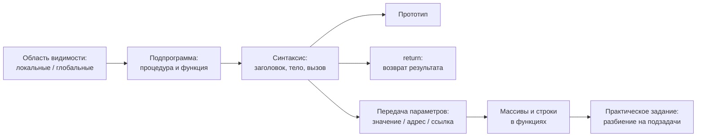

### 0. Освежим в памяти

Подробно — в [[#7. Лекция 3. Указатели, массивы, сортировка и двоичный поиск|Конспект - Указатели, массивы, сортировка и двоичный поиск]].

- **Блок** — всё, что между `{` и `}`. *От блока зависит, где «живёт» переменная (§1).*
- **Адрес** `&x` — номер ячейки, где лежит `x`; **указатель** `int *p = &x;` хранит адрес; **разыменование** `*p` — сама переменная по этому адресу. *На этом держится передача по адресу (§6).*
- **Имя массива** — это адрес его нулевого элемента: `A` и `&A[0]` — одно и то же. *Поэтому функция, получившая массив, меняет оригинал (§7).*
- **Целочисленное деление**: `178 / 128 = 1`, `178 % 128 = 50`. *Нужно в printBin и сумме цифр (§3, §5).*
- **Строка** в Си — массив `char`, который заканчивается символом `'\0'`. *Нужно для strcmp и stringupper (§5, §7).*

### 1. Где «живут» переменные: локальные и глобальные

Прежде чем делить программу на части, надо понять, какие переменные какой части видны. Иначе непонятно, почему функция «не видит» переменную из `main` или почему изменение внутри функции пропадает.

> [!abstract] Определение: локальная переменная
> Описывается **внутри блока** `{ }`. Существует от места описания до конца этого блока и видна во вложенных блоках (если там не объявлена переменная с таким же именем). При повторном входе в блок создаётся **заново** — прошлое значение не сохраняется.

> [!abstract] Определение: глобальная переменная
> Описывается **вне всех блоков**. Существует и хранит значение всё время работы программы. Видна во всех блоках, расположенных **ниже** места описания, если там её не «закрыла» локальная переменная с тем же именем.

Разберём пример со слайдов (2–3) построчно — это хорошая тренировка, такое любят давать на контрольной:

```cpp
float X = 0.1;                    // глобальная X
int main() {
    printf("X=%f\n", X);          // X = 0.1 — локальной X ещё нет, видна глобальная
    float X = 5.9;                // локальная X main; глобальная теперь «закрыта»
    {   float Y;                  // Y создана, но мусор (значение не присвоено)
        Y = X + 1;                // X из main: Y = 6.9
        {   int X = 3;            // своя X во внутреннем блоке
            int Z = X + 1;        // Z = 4 — берётся ближайшая X, т.е. 3
        }                         // X=3 и Z уничтожены
        X = X - Y;                // снова X из main: 5.9 − 6.9 = −1
    }                             // Y уничтожена
    printf("X=%f\n", X);          // напечатает X=-1.000000
}
```

![[podpr-01-scope.png|620]]

Правило поиска имени простое: компилятор ищет переменную **в текущем блоке, потом во внешнем, потом ещё внешнем**, а в самом конце — среди глобальных. Какая нашлась первой, та и используется. Без глобальной `float X = 0.1` первая строка `printf` дала бы ошибку компиляции: локальная `X` объявлена ниже, а «заглядывать вперёд» компилятор не умеет.

**Почему это важно для подпрограмм?** Тело функции — тоже блок. Значит, переменные, объявленные внутри функции (и её параметры), — **локальные**: они создаются при каждом вызове и исчезают при выходе. Например, если в функции написать `int count = 0;`, то при каждом вызове счётчик начнёт с нуля — «запомнить» число вызовов так нельзя.

Мостик: теперь понятно, что у каждой части программы свои переменные. Осталось научиться эти части выделять.

### 2. Что такое подпрограмма и зачем она нужна

Представь, что в программе десять раз нужно написать сообщение об ошибке. Можно десять раз скопировать `cout << "Ошибка программы";`, но если текст надо поменять — менять в десяти местах. Удобнее один раз дать этому действию имя `Error()` и дальше просто «звать его по имени».

> [!abstract] Определение: подпрограмма
> **Подпрограмма** — независимая, особым образом оформленная часть программы, выполняющая **законченное действие**. Обычно на вход ей подаются исходные данные, на выходе получается результат. В языке Си любая подпрограмма называется **функцией**, а программа (как правило) состоит из подпрограмм; главная из них, которая запускается первой, — `main`.

```cpp
void Error() {                       // описание процедуры
    cout << "Ошибка программы";
}
int main() {
    int n;  cin >> n;
    if (n < 0) Error();              // вызов процедуры по имени
}
```

Что это даёт (слайды 4, 22):
- **короче** — одинаковые действия описаны один раз, а вызываются где угодно;
- **понятнее** — `main` читается как план: «ввести, посчитать, вывести»;
- **меньше ошибок** — исправил функцию, и исправилось во всех местах вызова;
- **экономия памяти** и размера кода;
- можно применять **структурное (нисходящее) программирование**: задачу делим на подзадачи, подзадачи — на ещё более мелкие.

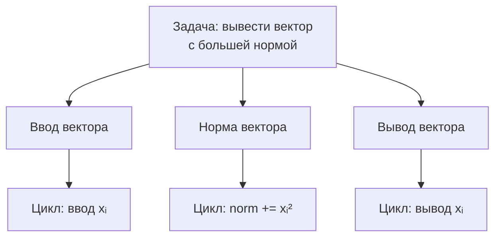

#### 2.1 Процедура и функция

Подпрограммы бывают двух видов, и разница только в одном — **возвращают ли они основной результат**.

> [!abstract] Определение: процедура и функция
> **Процедура** — подпрограмма, которая выполняет действия, но **не возвращает основной результат** в точку вызова (в C++ её тип — `void`).
> **Функция** — подпрограмма, которая **возвращает значение-результат** (число, символ, логическое значение…) через `return`.

Например, `Error()` — процедура: она что-то печатает, но «ответа» не даёт. А `sumDigits(12345)` — функция: её вызов превращается в число 15, которое можно сложить, сравнить, напечатать. Бытовая аналогия: процедура — «вынеси мусор» (сделал и всё), функция — «узнай, сколько времени» (тебе возвращают ответ).

> [!success] Простыми словами
> Если подзадачу можно назвать **вопросом** («какой максимум?», «простое ли число?») — это функция. Если **командой** («введи массив», «выведи результат») — процедура.

Как устроено исполнение: текст процедуры можно писать после `main` (тогда нужен прототип, §4.3) или до неё; процедур может быть сколько угодно; чтобы процедура заработала, её нужно **вызвать по имени** из `main` или из другой подпрограммы. Пока её не вызвали, её код не выполняется.

### 3. Процедура с параметрами

Процедура без параметров делает всегда одно и то же. Но чаще нужно одно и то же действие **над разными данными**: вывести в двоичном виде то 178, то 99. Для этого у процедуры есть **параметры**.

**Задача (слайды 7–9).** Вывести целое число от 0 до 255 в 8-битном двоичном коде.

Сначала придумаем алгоритм на числе 178. Старший (7-й) разряд имеет вес $2^7=128$. Первая цифра — сколько раз 128 «влезает» в число: $178/128=1$. Остаток $178\,\%\,128=50$ — это то, что осталось для младших разрядов. Вторая цифра — сколько раз влезает 64 в 50: $50/64=0$, остаток 50. И так далее: делитель `k` каждый раз уменьшается вдвое, пока не станет 0.

![[podpr-06-printbin.gif|620]]

На анимации видно: на каждом шаге берём цифру `n / k`, оставляем остаток `n % k`, делим `k` пополам. Получилось $178 = 10110010_2$. Проверим: $128+32+16+2=178$ ✓.

Результат зависит от `n` — значит, `n` надо сделать **параметром**:

```cpp
void printBin(int n)          // n — формальный параметр
{
    int k;                    // k — локальная переменная
    k = 128;
    while (k > 0) {
        cout << n / k;
        n = n % k;
        k = k / 2;
    }
}
int main() {
    printBin(99);             // 99 — фактический параметр (аргумент) → 01100011
}
```

> [!abstract] Определение: формальные и фактические параметры
> **Формальный параметр** — переменная, описанная в заголовке подпрограммы (`int n`). Это «пустое место» для данных.
> **Фактический параметр (аргумент)** — конкретное значение или выражение, которое подставляется при вызове (`99`, `x`, `a+1`).

Что это означает? При вызове `printBin(99)` создаётся переменная `n`, и в неё кладётся 99. Внутри процедура портит `n` (`n = n % k`), но это её личная копия — исходное число у вызывающего не меняется (подробно — §6).

Параметров может быть несколько, они перечисляются через запятую, и **у каждого свой тип**:

```cpp
void printSred(int a, int b) { cout << (a + b) / 2.; }   // 2. — чтобы деление было вещественным
printSred(56, 99);                                        // напечатает 77.5
```

Обрати внимание на `2.`: если написать `/ 2`, то `(56+99)/2 = 155/2 = 77` — целое деление съест половинку. Писать `int a, b` в заголовке нельзя — тип указывается для каждого параметра отдельно: `int a, int b`.

### 4. Синтаксис: определение, вызов, прототип

#### 4.1 Определение подпрограммы

> [!info] Общий вид определения (слайд 23)
> ```
> <тип результата> имя ( [<список формальных параметров>] )   ← заголовок
> {                                                              ← тело
>     описания локальных переменных;
>     операторы;
>     return <выражение>;
> }
> ```
> **Тип результата** — любой простой базовый тип (`int`, `float`, `double`, `char`, `bool`) или `void`. **Список параметров** — пары «тип имя» через запятую; может быть пустым.

Разберём по частям на функции максимума из двух чисел:

```cpp
float max(float x, float y)   // результат float, два параметра float
{
    float z = x;              // локальная переменная
    if (z < y) z = y;
    return z;                 // вернуть основной результат
}
```

Здесь `float` перед именем — «что вернётся», `(float x, float y)` — «что нужно на вход», `{ … }` — «как считается». Имя подчиняется тем же правилам, что имена переменных: латиница, цифры, `_`, не начинается с цифры.

#### 4.2 Вызов и что при нём происходит

> [!info] Вызов подпрограммы
> `имя(<список фактических параметров>);`
> Фактические и формальные параметры обязаны совпадать **по количеству, порядку и типу**.

Например, для `void input_vector(int x[], int n)` правильный вызов — `input_vector(X, 10);` (сначала массив, потом число). Вызов `input_vector(10, X)` — ошибка: на первом месте ожидается массив.

На слайде 29 список фактических параметров записан как «тип1 имя1, тип2 имя2» — это неточность: **при вызове типы не пишут**, пишут только значения или имена: `Add(37, 54)`, а не `Add(int 37, int 54)`. *(уточнение к слайду)*

Посмотрим, что происходит в памяти при вызове функции сложения со слайдов 12–13:

```cpp
int Add(int A1, int A2) {
    int Total;
    Total = A1 + A2;
    return Total;
}
int main() {
    int X, Y, Z;
    X = Add(37, 54);     // 91
    Y = Add(45, 89);     // 134
    Z = Add(33, 90);     // 123
}
```

При каждом вызове в специальной области памяти — **стеке** — создаётся «кадр» функции: место под параметры и локальные переменные. Фактические параметры **копируются** в формальные, тело выполняется, `return` отдаёт результат, кадр уничтожается:

![[podpr-02-call.gif|620]]

Что это означает? Три вызова `Add` — это три разных кадра, которые по очереди создаются и исчезают. `A1`, `A2`, `Total` между вызовами не существуют. А одна и та же функция работает с разными данными — ради этого её и писали.

На слайдах встречается `Int`, `Void`, `Vivod()` при описанной `vivod()` — это опечатки. C++ **различает регистр**: `Int` — не тип, `Vivod` и `vivod` — разные имена. Правильно: `int`, `void`, одно и то же имя в описании и вызове.

#### 4.3 Прототип функции

Компилятор читает файл **сверху вниз**. Если `main` вызывает `norma_vector`, а описана она ниже, компилятор в момент вызова ещё не знает, что это за имя, какие у него параметры и что оно возвращает, — и выдаёт ошибку. Выхода два: писать подпрограммы **до** `main` или поставить перед `main` **прототипы**.

> [!abstract] Определение: прототип функции
> **Прототип** — это сообщение компилятору, что функция с таким именем, параметрами и типом результата существует. Это заголовок функции **без тела**, с точкой с запятой в конце:
> `тип_результата Имя(параметры);`
> Имена параметров в прототипе можно не писать — достаточно типов.

```cpp
void myfunc();                 // прототип: «где-то ниже есть такая функция»

int main() {
    cout << "In main()\n";
    myfunc();                  // компилятор уже знает myfunc — можно вызывать
    cout << "Back in main()\n";
    return 0;
}

void myfunc() {                // определение (полное описание)
    cout << "Inside myfunc()\n";
}
```

Вывод: `In main()` → `Inside myfunc()` → `Back in main()`. Управление «ныряет» в функцию и возвращается ровно в точку после вызова.

Например, для функции `double Average(int A[], int size)` подойдут оба прототипа: `double Average(int A[], int size);` и `double Average(int[], int);`.

> [!success] Простыми словами
> Прототип — как оглавление в начале книги: сама глава дальше, но ты уже знаешь, что она есть и как называется. С прототипами порядок определений функций может быть **любым** — это прямо рекомендует методичка (п. 5).

Прототип можно написать и **внутри** `main` (так сделано на слайдах 13, 50–52: `void main() { float srzn(float *m, int n); … }`), но тогда функция «объявлена» только для `main`. Обычно прототипы ставят в начале файла, после `#include`.

Мостик: функцию записали и вызвали. Теперь — как она отдаёт результат.

### 5. Функции и оператор return

> [!abstract] Определение: функция
> **Функция** — вспомогательный алгоритм, который **возвращает значение-результат** (число, символ или объект другого типа). Тип результата пишется перед именем, а само значение передаётся оператором `return`.

#### 5.1 Пример: сумма цифр числа

Алгоритм: пока число не 0, прибавляем последнюю цифру (`n % 10`) и отбрасываем её (`n / 10`).

```cpp
int sumDigits(int n)          // int — тип результата
{
    int sum = 0;
    while (n != 0) {
        sum += n % 10;
        n /= 10;
    }
    return sum;               // передача результата
}
```

Прогоним на 12345: `sum`: 5 → 9 → 12 → 14 → 15, а `n`: 1234 → 123 → 12 → 1 → 0, цикл закончился, возвращается 15.

Главное свойство функции: **её вызов — это выражение**. Функция, возвращающая целое, может стоять везде, где может стоять целое число:

```cpp
x = 2 * sumDigits(n + 5);                // в арифметике; аргумент — тоже выражение
z = sumDigits(k) + sumDigits(m);         // дважды в одном выражении
if (sumDigits(n) % 2 == 0)               // в условии
    cout << "Сумма цифр чётная, она равна " << sumDigits(n);
```

Например, при `n = 10` первая строка даёт `x = 2 * sumDigits(15) = 2 * 6 = 12`. С процедурой (`void`) так нельзя: `x = Error();` — ошибка, «ответа» у неё нет.

#### 5.2 Логические функции

**Задача (слайды 19–21).** Вывести все простые числа от 2 до 100. Удобно, если в `main` будет написано прямо по-человечески: «если `i` простое — вывести».

```cpp
bool isPrime(int n)
{
    int count = 0, k = 2;
    while (k < n && count == 0) {     // ищем делитель от 2 до n−1
        if (n % k == 0) count++;      // нашли — число составное
        k++;
    }
    return (count == 0);              // true, если делителей нет
}

int main() {
    for (int i = 2; i <= 100; i++)
        if (isPrime(i)) cout << i << endl;
}
```

Строка `return (count == 0);` — короткая запись для
```cpp
if (count == 0) return true;
else return false;
```
потому что выражение `count == 0` само по себе уже `true` или `false`.

Например, `isPrime(9)`: $k=2$ — остаток 1, $k=3$ — $9\%3=0$, `count = 1`, цикл останавливается, возвращается `false`. А `isPrime(7)`: делители 2…6 не подходят, `count` остался 0 → `true`. Условие `count == 0` в `while` нужно, чтобы не перебирать дальше, когда делитель уже найден.

Логическая функция может стоять везде, где нужно условие:
```cpp
cin >> n;
while (isPrime(n)) {            // вводим, пока вводят простые
    cout << "простое число\n";
    cin >> n;
}
```

#### 5.3 Оператор return: две формы

> [!info] Оператор return
> `return выражение;` — завершает функцию и **возвращает значение** в точку вызова (для функций с типом ≠ `void`).
> `return;` — просто завершает подпрограмму (для `void`). Если `return` нет, процедура заканчивается на закрывающей `}`.
> В любом случае `return` **сразу** передаёт управление вызывающей подпрограмме — код после него не выполняется.

```cpp
void f() {
    cout << "Inside f()\n";
    return;                            // немедленный выход
    cout << "This won't display.\n";   // никогда не выполнится
}
// main: "Before call" → f() → "After call"
// Вывод: Before call / Inside f() / After call
```

Тип выражения в `return` должен совпадать с типом функции. Например, `double box(double length, double width, double height) { return length * width * height; }` и вызов `box(10.1, 11.2, 3.3)` вернёт $10{,}1\cdot11{,}2\cdot3{,}3=373{,}296$.

`return` в функции может быть **несколько** — сработает первый, до которого дойдёт выполнение. Это видно на функции модуля:

```cpp
float MyAbs(float x) {
    if (x < 0) return -x;
    else return x;
}
```

#### 5.4 Разбор: функция сравнения строк

Пример 2 с лекции хорошо показывает несколько `return` и работу с указателями. Функция возвращает 1, если строка `a` «больше» `b` (по алфавиту), −1, если меньше, 0, если строки равны.

```cpp
int strcmp(char *a, char *b)         // a и b — адреса первых символов строк
{
    while (*a || *b) {               // пока хотя бы одна строка не кончилась
        if (*a < *b) return -1;      // символ a меньше — a «меньше»
        else if (*a > *b) return 1;  // символ a больше — a «больше»
        else a++, b++;               // символы равны — сдвигаемся дальше
    }
    return 0;                        // обе кончились одновременно — равны
}
```

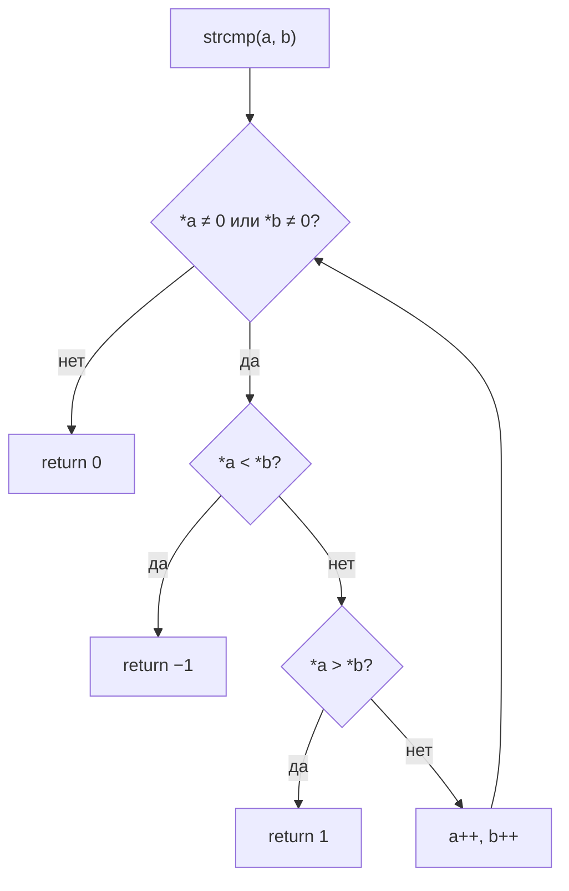

Прогоним: `strcmp("abc", "abd")`. Символы `a`=`a` и `b`=`b` — сдвигаемся. Дальше `'c' < 'd'` (код 99 < 100) → `return -1`. А `strcmp("abc", "ab")`: на третьем шаге `*a = 'c'`, `*b = '\0'` (код 0), `'c' > 0` → `return 1` — более длинная строка с тем же началом считается «больше». Что значит `a++` для указателя? Указатель переходит к следующему символу строки — разбирали в прошлой лекции.

Важно: в настоящей библиотеке `<cstring>` уже есть `strcmp`, поэтому свою лучше назвать иначе (`my_strcmp`), иначе будет конфликт имён.

Мостик: функция умеет вернуть **одно** значение через `return`. А если нужно поменять переменные вызывающего или вернуть два значения? Для этого — способы передачи параметров.

### 6. Способы передачи параметров

Это центральная тема лекции и самая частая ошибка в лабах.

#### 6.1 По значению — функция работает с копией

> [!info] Передача по значению (call-by-value)
> При вызове фактические параметры **копируются** в ячейки стека, отведённые под формальные параметры. Функция работает с копией, поэтому **изменение формального параметра не меняет фактический**. По умолчанию в C++ все параметры передаются по значению.
> Плюс: **безопасность** — функция не испортит данные вызывающего.

Например, `res = MyAbs(a);` при `a = -18.25`: `x` получит копию −18.25, функция вернёт 18.25, а сама `a` так и останется −18.25. Фактическим параметром может быть и константа: `MyAbs(-23)` — копировать число в `x` никто не мешает.

Теперь задача, на которой передача по значению ломается (слайд 33): **поменять местами значения двух переменных**.

```cpp
void Swap(int a, int b) {
    int c;
    c = a; a = b; b = c;
}
int main() {
    int x = 2, y = 3;
    Swap(x, y);
    cout << x << " " << y;     // 2 3  — ничего не поменялось!
}
```

**Почему не работает?** Посмотри по шагам:

![[podpr-03-swap-value.gif|620]]

`Swap` честно поменяла `a` и `b`, но это были **копии** `x` и `y`. При выходе кадр со всеми копиями уничтожился, а `x` и `y` никто не трогал. Жизненная аналогия: ты дал другу ксерокопию документа, он на ней всё исправил — твой оригинал остался прежним.

Нужно, чтобы функция работала не с копией, а с самой переменной. Для этого есть два способа.

#### 6.2 По адресу (через указатель)

> [!info] Передача по адресу
> В подпрограмму передаётся **адрес** переменной, формальный параметр имеет тип **указатель**. Через разыменование `*` функция обращается к самой переменной вызывающего, и все изменения **сохраняются** после выхода.
> Плюсы: можно вернуть результат, можно вернуть **много значений**, при больших данных экономится память (копируется только адрес).

```cpp
void Swap(int *a, int *b) {     // a, b — указатели
    int c;
    c = *a; *a = *b; *b = c;    // работаем с тем, НА ЧТО указывают
}
int x = 2, y = 3;
Swap(&x, &y);                   // передаём адреса → теперь x = 3, y = 2
```

Разберём по частям. В `a` лежит копия **адреса** `x`. Копия адреса указывает туда же, куда оригинал, — на `x`. Поэтому `*a = *b` пишет прямо в `x`. Три места, где нельзя ошибиться: `*` в заголовке (`int *a`), `*` при каждом использовании внутри (`*a`), `&` при вызове (`&x`).

Например, на слайде 44: `int i; int *p = &i; f(p);` — передаём указатель `p`, внутри `void f(int *j) { *j = 100; }`. Параметр `j` получает копию `p`, то есть тоже указывает на `i`, и `*j = 100` записывает 100 в `i`. На экране — 100.

Что **нельзя** передать по адресу: `Swap(2, 3)` — у числа 2 нет адреса; `Swap(&a, &(b+3))` — у выражения `b+3` тоже нет ячейки в памяти. Передавать можно только **переменные**.

На слайде 37 обмен написан как `Int CHANGE(int *X, int *Y) { … return (); }` — правильно `void CHANGE(int *X, int *Y)` без `return ()`: функция ничего не возвращает, результат «уходит» через указатели.

#### 6.3 По ссылке (&)

> [!info] Передача по ссылке (call-by-reference)
> Аналог передачи по адресу, но удобнее: к имени формального параметра приписывается `&`. **Ссылка** — это второе имя для переданной переменной. Все действия над ссылочным параметром выполняются над аргументом. Внутри функции не нужны `*`, при вызове не нужен `&`.

```cpp
void Swap(int &a, int &b) {     // a, b — ссылки, т.е. другие имена для x, y
    int c;
    c = a; a = b; b = c;        // пишем как обычно, без *
}
int x = 2, y = 3;
Swap(x, y);                     // вызов как обычно → x = 3, y = 2
```

Например, со слайда 41: `void f(int &i) { i = 10; }` и в `main` `int val = 1; f(val);` — напечатается «Старое значение: 1», потом «Новое значение: 10». Внутри `f` имя `i` и есть `val`.

Ограничения те же, что у указателей: `Swap(2, 3)` и `Swap(a, b+3)` — ошибки, ссылка должна быть привязана к переменной.

> [!success] Простыми словами
> **По значению** — дал ксерокопию. **По адресу** — дал адрес своей квартиры: друг может прийти и переставить мебель, но каждый раз надо «идти по адресу» (`*`). **По ссылке** — дал ключ и сказал: «это теперь и твоя квартира» — переставляет мебель напрямую.

#### 6.4 Все три способа на одном примере

Слайд 42 сравнивает способы в одной функции:

```cpp
void MyFunction(int x, int *y, int &c) {
    x = 8;     // меняется только копия
    *y = 8;    // меняется переменная по адресу
    c = 8;     // меняется переменная, на которую ссылаемся
}
int a, b, c;
a = b = c = 5;
MyFunction(a, &b, c);      // на выходе a = 5, b = 8, c = 8
```

![[podpr-04-three-ways.png|620]]

Что это означает? Через `a` ничего наружу не вернулось — это была копия. Через `b` и `c` вернулось, потому что функция получила доступ к самим переменным.

#### 6.5 Как выбрать способ

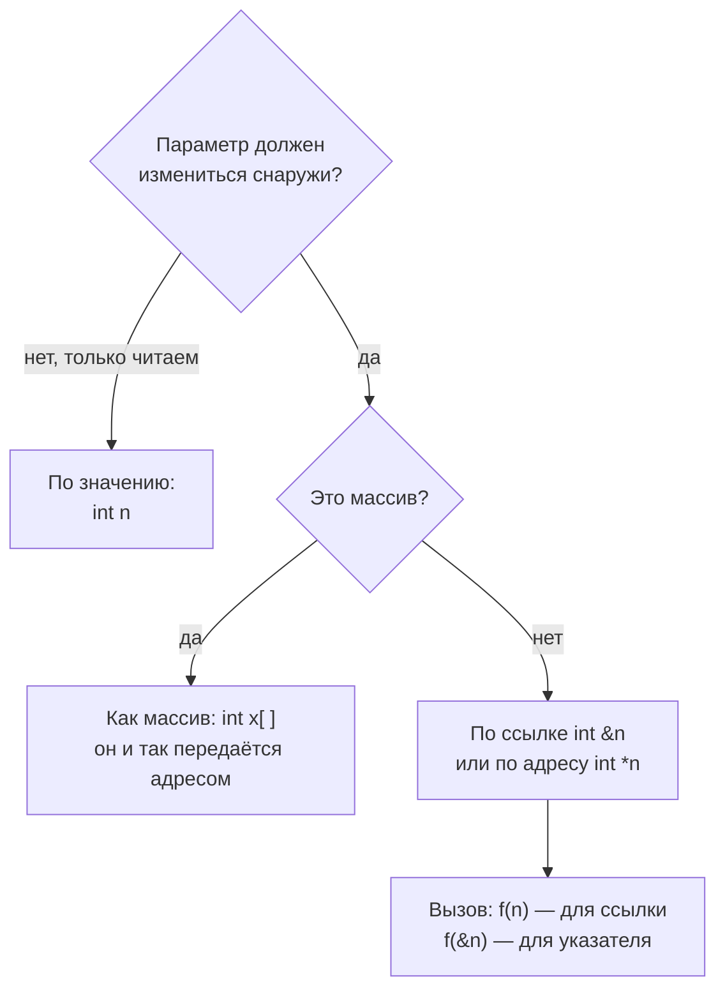

#### 6.6 Разбор: ввод вектора неизвестной длины (слайд 43)

Задача: процедура должна **ввести** количество элементов `n` и сами элементы. Количество должно оказаться в `main` — значит, `n` меняется снаружи.

**Вариант 1 — по значению — неправильно.**
```cpp
void input_vector(float x[], int n) {
    scanf_s("%d", &n);                       // ввели в КОПИЮ
    for (int i = 0; i < n; i++) scanf_s("%f", &x[i]);
}
float A[10]; int m;
input_vector(A, m);     // m так и осталась мусором!
```
Элементы массива ввелись (массив передаётся адресом, §7), а `m` — нет.

**Вариант 2 — по адресу.**
```cpp
void input_vector(float x[], int *n) {       // n — указатель
    scanf_s("%d", n);                        // n уже адрес, & не нужен
    for (int i = 0; i < *n; i++) scanf_s("%f", &x[i]);   // *n — разыменование
}
input_vector(A, &m);                         // передаём адрес m
```

**Вариант 3 — по ссылке.**
```cpp
void input_vector(float x[], int &n) {       // n — ссылка
    scanf_s("%d", &n);
    for (int i = 0; i < n; i++) scanf_s("%f", &x[i]);    // без разыменования
}
input_vector(A, m);                          // вызов как обычно
```

На слайде в вариантах 2 и 3 строка с вводом `n` не показана — здесь она дописана *(дописано по смыслу)*. Обрати внимание на `scanf_s("%d", n)` во втором варианте: `scanf` нужен адрес, а `n` уже адрес — поэтому без `&`.

#### 6.7 Как передать данные в подпрограмму и из неё (слайды 38, 40)

| Способ | В подпрограмму | Из подпрограммы | Плюсы | Минусы |
|---|---|---|---|---|
| Основной результат `return` | — | одно значение простого типа (или `struct`) | вызов можно поставить в выражение | только **одно** значение |
| Параметры по значению | ✓ | ✗ | безопасно для аргумента | расход памяти на копии |
| Параметры-указатели / ссылки, массивы | ✓ | ✓ (сколько угодно значений) | можно вернуть много; не копируются большие данные | расход памяти на формальные параметры |
| Глобальные переменные | ✓ | ✓ | экономия памяти | **теряется гибкость**: функция привязана к конкретным переменным |
| Файлы | ✓ | ✓ | большой объём данных | медленно |

Почему глобальные переменные «теряют гибкость»? Если функция нормы считает норму глобального массива `A`, то посчитать норму `B` она уже не сможет — придётся писать вторую. А `norma_vector(x, n)` с параметрами работает с любым вектором. Поэтому в практическом задании **глобальные переменные для передачи данных запрещены** (методичка, п. 4).

### 7. Массивы и строки в функциях

> [!info] Передача массива
> При передаче массива в функцию передаётся **только адрес его нулевого элемента**, а не копия массива. Поэтому:
> 1. функция **меняет оригинальный массив**;
> 2. функция **не знает длину** массива — её передают отдельным параметром `n`.

![[podpr-05-array.png|620]]

Параметр-массив можно объявить тремя способами, и все три означают одно и то же — **указатель**:
```cpp
void display(int num[10]);   // как массив с размером — размер игнорируется
void display(int num[]);     // как массив без размера — так пишут чаще всего в лабах
void display(int *num);      // как указатель — так любят профессионалы
```
Внутри всех трёх можно писать `num[i]`: любой указатель можно индексировать квадратными скобками, `num[i]` — это `*(num + i)`.

Например, в `main`: `int t[10]; for (i = 0; i < 10; ++i) t[i] = i; display(t);` — передаём `t` **без скобок и без `&`**: имя массива уже адрес. Вызов `display(&t[0])` делает ровно то же самое — так написано в задачах со слайдов 51–52 (`srzn(&mas[0], n)`).

Слайды показывают `display`, где внутри зашито `i < 10`. Так делать не надо: функция будет работать только для массивов из 10 элементов. Правильно — `void display(int num[], int n)`.

Если функция массив только читает, полезно написать `const int x[]` — тогда компилятор не даст случайно его изменить. Это необязательно, но аккуратно.

#### 7.1 Строки

Строка — массив `char`, значит, в функцию тоже передаётся указатель `char*` на первый символ. Длину передавать не нужно: конец строки отмечен `'\0'`.

```cpp
void stringupper(char *str) {
    while (*str) {                 // пока не дошли до '\0'
        *str = toupper(*str);      // заменяем символ на заглавный (нужен <cctype>)
        str++;                     // переходим к следующему символу
    }
}
char str[80];
strcpy(str, "Мне нравится C++");
stringupper(str);                  // меняет сам массив str
cout << str;
```

Функция ничего не возвращает (`void`), но строка в `main` изменилась — потому что функция получила её адрес. Это тот же механизм, что и в §6.2. Ремарка: стандартный `toupper` гарантированно переводит только латиницу, поэтому в выводе `МНЕ НРАВИТСЯ` может остаться строчным в зависимости от кодировки — а `C++` точно станет заглавным.

### 8. Задачи со слайдов: разбор и исправление ошибок

В учебных примерах со слайдов 50–52 есть ошибки — разберём их, это отличная проверка понимания.

#### 8.1 Минимум из трёх вещественных чисел (слайд 50)

На слайде функция объявлена `void minim(int a, int b, int c)`, но внутри стоит `return(z1)`, а в `main` её результат печатается через `%d`. Ошибки:
1. Функция возвращает значение → тип должен быть не `void`, а тип результата.
2. По условию числа **вещественные** → `float`, а не `int`, и в `printf` — `%f`.
3. Сравнения строгие: при вводе `3 3 5` ни одно условие `(a<b)&&(a<c)` не выполнится, и вернётся мусор из неинициализированной `z1`.

Исправленная версия — «считаем первое число минимальным, потом проверяем остальные»:
```cpp
float minim(float a, float b, float c);       // прототип

int main() {
    float x, y, z;
    printf("Введите 3 вещественных числа\n");
    scanf_s("%f %f %f", &x, &y, &z);
    printf("Минимальным является число %f\n", minim(x, y, z));
    return 0;
}
float minim(float a, float b, float c) {
    float m = a;
    if (b < m) m = b;
    if (c < m) m = c;
    return m;
}
```
Проверка: `minim(3, 3, 5)` → `m = 3`, `3 < 3` ложно, `5 < 3` ложно → 3 ✓.

#### 8.2 Среднее значение элементов массива (слайд 51)

```cpp
float srzn(float *m, int n) {
    float s = 0;
    for (int i = 0; i < n; i++, m++)   // m++ — указатель идёт по массиву
        s = s + *m;
    return s / n;
}
// вызов: sr = srzn(&mas[0], n);   или просто srzn(mas, n)
```
Здесь всё верно. Например, для массива `{2, 4, 9}` получаем $s=15$, среднее $15/3=5$. Интересный момент: `m++` внутри функции сдвигает **копию** указателя — исходный `mas` в `main` от этого не сдвигается.

#### 8.3 Номер первого вхождения буквы (слайд 52)

На слайде цикл `for (i = 0; *m != sim; i++, m++);` ищет букву, пока не найдёт. Если буквы **нет**, цикл уйдёт за конец строки — ошибка. Параметр `n` при этом не используется. Надёжнее останавливаться на `'\0'` и возвращать −1, если буква не найдена:
```cpp
int poisk(const char *m, char sim) {
    for (int i = 0; m[i] != '\0'; i++)
        if (m[i] == sim) return i;     // нашли — сразу выходим
    return -1;                         // дошли до конца строки — буквы нет
}
```
Проверка: `poisk("banana", 'n')` → 2, `poisk("kiwi", 'a')` → −1. Ещё одно улучшение: искомая буква здесь — параметр, а на слайде она зашита через `#define sim 'a'`, то есть функция ищет только `a`.

### 9. Динамическое выделение памяти

До сих пор размер массива задавался константой: `float A[10]`. Если пользователь хочет 1000 элементов — не хватит, если 3 — зря занята память. В C++ можно выделить память нужного размера **во время работы программы**.

> [!info] Операторы new и delete
> `new тип;` — выделить память под одну переменную; `new тип[размер];` — под массив. Результат — **указатель** на выделенную память (при нехватке памяти — исключение `std::bad_alloc`).
> `delete p;` — освободить память переменной, `delete[] p;` — массива.

```cpp
int size;
int *dan;
cin >> size;
dan = new int[size];                 // массив ровно на size элементов
for (int i = 0; i < size; i++) cin >> dan[i];
for (int i = 0; i < size; i++) cout << dan[i] << " ";
delete[] dan;                        // обязательно вернуть память
```

Например, ввели `size = 5` и числа `4 3 7 9 6` — программа выведет `4 3 7 9 6`. `dan` — указатель на начало, а работать с ним можно как с обычным массивом. В функцию такой массив передаётся так же: `print(dan, size)`. Если забыть `delete[]`, память останется занятой до конца программы («утечка памяти»).

### 10. Как решать задачи практического задания «Подпрограммы»

Всё выше — инструменты. Теперь, как ими пользоваться в лабе (методичка, стр. 78–79, и слайды 55–57 про оформление отчёта).

#### 10.1 Требования методички — коротко

1. В пункте **«Анализ задачи»** описать решение в целом и **разбить на подзадачи**. Подзадача — одно крупное действие: ввести массив, найти максимум, посчитать формулу.
2. Каждую подзадачу описать кратко: **имя**, **назначение** (что делает), **входные данные**, **выходные данные**. Образец из методички: *имя* `SUM`; *назначение* — сумма элементов последовательности; *вход* — `A` (последовательность вещ. чисел), `n` (количество элементов); *выход* — `s` (вещ. число, сумма).
3. Алгоритм (блок-схему) описать для задачи в целом **и** для каждой подзадачи.
4. Для каждой подзадачи выбрать **процедуру или функцию** — по тому, что она выдаёт (§2.1).
5. Данные передавать **только через параметры**, без глобальных переменных.
6. Желательно использовать **прототипы** — тогда порядок функций любой.
7. **Ввод и вывод** сложных данных (массивы, матрицы, комплексные числа) — отдельные подзадачи.
8. Если задача простая — решение оформляется как одна подзадача.
9. Ограничения на размер — это **максимум**; если в условии их нет, задай сам (`const int NMAX = 100;`) и проверяй ввод.

#### 10.2 Алгоритм решения любой задачи

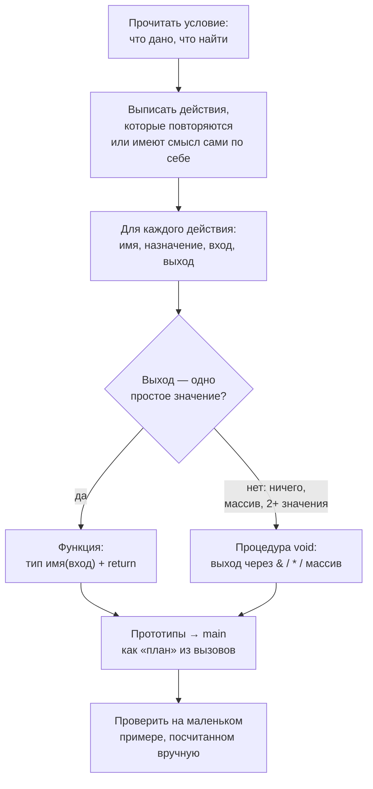

#### 10.3 Оформление отчёта на примере «вектор с большей нормой» (слайды 30–31, 55–57)

**Метод решения.** «Можно выделить подзадачи: ввод вектора, вывод вектора, вычисление нормы вектора». (Для вывода блок-схему можно не рисовать — она такая же, как для ввода.)

**Структура программы** (что кого вызывает):
```mermaid
flowchart TD
    M["main"] --> I["input_vector"]
    M --> N["norma_vector"]
    M --> O["output_vector"]
```

**Описание подпрограмм** — именно такой формат ждут в пункте «Структура программы»:
1. Функция вычисления нормы: `float norma_vector(float x[], int n);` Вход: `x` — одномерный вещественный массив, `n` — количество элементов. Результат: `norm` — вещественное число, норма вектора.
2. Процедура ввода: `void input_vector(float x[], int n);` Вход: `n`. Выход: `x` — заполненный массив (меняется, потому что массив передаётся адресом).
3. Процедура вывода: `void output_vector(float x[], int n);` Вход: `x`, `n`.

Код с прототипами и **без глобальных переменных** (на слайде `A` и `B` глобальные — по требованиям методички их надо перенести в `main`):
```cpp
#include <cstdio>
const int N = 5;

float norma_vector(float x[], int n);
void  input_vector(float x[], int n);
void  output_vector(float x[], int n);

int main() {
    float A[N], B[N];
    int n;
    scanf_s("%d", &n);                     // n ≤ N
    input_vector(A, n);
    input_vector(B, n);
    if (norma_vector(A, n) < norma_vector(B, n)) output_vector(B, n);
    else                                         output_vector(A, n);
    return 0;
}
float norma_vector(float x[], int n) {
    float norm = 0;
    for (int i = 0; i < n; i++) norm += x[i] * x[i];
    return norm;
}
void input_vector(float x[], int n)  { for (int i = 0; i < n; i++) scanf_s("%f", &x[i]); }
void output_vector(float x[], int n) { for (int i = 0; i < n; i++) printf("%f ", x[i]); }
```

Строго говоря, норма — это $\sqrt{\sum x_i^2}$, а функция считает сумму квадратов без корня. Для **сравнения** двух норм корень не нужен (если $a<b$ для неотрицательных, то и $\sqrt a<\sqrt b$), но если надо вывести саму норму — добавь `sqrt` из `<cmath>`.

#### 10.4 Полный разбор: вариант 3 (функция h)

**Условие.** Даны вещественные $S,T$. Получить
$$
h(S,T)+\max\bigl(h^2(S-T,\,ST),\;h^4(S-T,\,S+T)\bigr)+h(1,1),\qquad h(a,b)=\frac{a}{1+b^2}+\frac{b}{1+a^2}-(a-b)^3.
$$

**Анализ.** Формула $h$ встречается **четыре раза** с разными аргументами — значит, это подзадача-функция: на входе два числа, на выходе одно. Ввод двух чисел — процедура: результатов два, поэтому по ссылке.

| Подзадача | Вид | Вход | Выход |
|---|---|---|---|
| `h(a, b)` — значение формулы | функция `double` | `a`, `b` — вещ. | вещ. число |
| `input(S, T)` — ввод | процедура | — | `S`, `T` по ссылке |
| `output(res)` — вывод | процедура | `res` | — |

```cpp
#include <cstdio>
#include <cmath>

double h(double a, double b);
void input(double &S, double &T);
void output(double res);

int main() {
    double S, T;
    input(S, T);
    double r = h(S, T)
             + fmax(pow(h(S - T, S * T), 2), pow(h(S - T, S + T), 4))
             + h(1, 1);
    output(r);
    return 0;
}
double h(double a, double b) {
    return a / (1 + b * b) + b / (1 + a * a) - pow(a - b, 3);
}
void input(double &S, double &T) { printf("S T: "); scanf("%lf %lf", &S, &T); }
void output(double res)          { printf("Result = %.4f\n", res); }
```

**Проверим вручную при $S=1,\ T=0$.** $S-T=1$, $ST=0$, $S+T=1$.
$$
h(1,0)=\frac{1}{1+0}+\frac{0}{1+1}-(1-0)^3=1+0-1=0,\qquad h(1,1)=\frac12+\frac12-0=1.
$$
Тогда $h(S,T)=h(1,0)=0$, $h^2(S-T,ST)=h^2(1,0)=0$, $h^4(S-T,S+T)=h^4(1,1)=1$, $\max(0,1)=1$. Итого $0+1+1=\boxed{2}$ — программа выдаёт `Result = 2.0000` ✓. Обрати внимание: $h^2$ здесь — квадрат **значения** функции, а не «h от h».

#### 10.5 Полный разбор: вариант 2 (минимумы и максимум массивов)

**Условие.** Даны $n,m,p$ и массивы $a_1..a_n$, $b_1..b_m$, $c_1..c_p$. Если $\lvert\min(a)\rvert>10$, то $L=\min(b)+\min(c)$, иначе $L=1+(\max(c))^2$.

**Анализ.** «Минимум массива» нужен три раза для разных массивов — одна универсальная функция `min_array(x, n)`. Максимум — ещё одна функция. Ввод массива — процедура (выход — массив). Размеры не ограничены — задаём `NMAX` сами и проверяем ввод.

```cpp
#include <cstdio>
#include <cstdlib>
const int NMAX = 100;                  // ограничение сверху (п. 8 требований)

int  input_size(const char *name);
void input_array(int x[], int n, const char *name);
int  min_array(const int x[], int n);
int  max_array(const int x[], int n);
long long compute_L(const int a[], int n, const int b[], int m, const int c[], int p);

int main() {
    int a[NMAX], b[NMAX], c[NMAX];
    int n = input_size("n"), m = input_size("m"), p = input_size("p");
    input_array(a, n, "a");
    input_array(b, m, "b");
    input_array(c, p, "c");
    printf("L = %lld\n", compute_L(a, n, b, m, c, p));
    return 0;
}
int input_size(const char *name) {               // ввод с проверкой 1..NMAX
    int k;
    do { printf("%s (1..%d): ", name, NMAX); scanf("%d", &k); } while (k < 1 || k > NMAX);
    return k;
}
void input_array(int x[], int n, const char *name) {
    printf("Введите %d элементов массива %s: ", n, name);
    for (int i = 0; i < n; i++) scanf("%d", &x[i]);
}
int min_array(const int x[], int n) {
    int mn = x[0];
    for (int i = 1; i < n; i++) if (x[i] < mn) mn = x[i];
    return mn;
}
int max_array(const int x[], int n) {
    int mx = x[0];
    for (int i = 1; i < n; i++) if (x[i] > mx) mx = x[i];
    return mx;
}
long long compute_L(const int a[], int n, const int b[], int m, const int c[], int p) {
    if (abs(min_array(a, n)) > 10)
        return (long long)min_array(b, m) + min_array(c, p);
    long long mc = max_array(c, p);
    return 1 + mc * mc;
}
```

**Проверим.** $a=(-15,4,7)$: $\min a=-15$, $\lvert-15\rvert=15>10$ → $L=\min(5,-2)+\min(3,8,1)=-2+1=-1$. А при $a=(2,4,7)$: $\min a=2$, условие ложно → $L=1+8^2=65$. Программа выдаёт −1 и 65 ✓. Тип `long long` — чтобы $\max^2$ не переполнил `int` при больших числах.

#### 10.6 Вариант 4: схема Горнера с комплексными коэффициентами

Здесь пригодится передача **по ссылке**: произведение двух комплексных чисел — это **два** числа (действительная и мнимая часть), а `return` вернёт только одно.

Схема Горнера: $P(z)=(\dots((c_n z+c_{n-1})z+c_{n-2})z+\dots)+c_0$, где $z=x+iy$, $c_k=a_k+ib_k$. То есть начинаем с $c_n$ и $n$ раз делаем «умножить на $z$ и прибавить следующий коэффициент». Умножение: $(a+ib)(c+id)=(ac-bd)+i(ad+bc)$.

```cpp
// (a + ib)(c + id) → re + i·im
void cmul(double a, double b, double c, double d, double &re, double &im) {
    re = a * c - b * d;
    im = a * d + b * c;
}
// a[k], b[k] — коэффициент при (x+iy)^k
void horner(const double a[], const double b[], int n, double x, double y,
            double &re, double &im) {
    re = a[n]; im = b[n];
    for (int k = n - 1; k >= 0; k--) {
        double tr, ti;
        cmul(re, im, x, y, tr, ti);   // умножили на z
        re = tr + a[k];               // прибавили c_k
        im = ti + b[k];
    }
}
```
Плюс процедура ввода коэффициентов и `main`. Проверка: $P(z)=z^2+1$ при $z=i$ ($n=2$, $c_2=1$, $c_1=0$, $c_0=1$, $x=0$, $y=1$): $1\cdot i+0=i$, $i\cdot i+1=-1+1=0$ ✓.

#### 10.7 Как разбить на подзадачи остальные варианты

| Вариант | Подзадачи (имя — вид) | На что обратить внимание |
|---|---|---|
| 1. Какой треугольник больше по площади | `input_triangle(x[], y[])` — процедура; `area(x[], y[])` — функция `double` | площадь по координатам: $S=\tfrac12\lvert(x_2-x_1)(y_3-y_1)-(x_3-x_1)(y_2-y_1)\rvert$; `area` вызывается дважды |
| 5. Арифметика комплексных чисел | `cadd`, `csub`, `cmul`, `cdiv` — процедуры с выходом `re`, `im` по ссылке; `cinput`, `coutput` | деление: $\frac{a+ib}{c+id}=\frac{(ac+bd)+i(bc-ad)}{c^2+d^2}$, проверить $c^2+d^2\ne0$ |
| 6. Отрезки подряд идущих членов (квадраты / степени 5 / простые) | `isSquare(x)`, `isPow5(x)`, `isPrime(x)` — логические функции; `input_array`; поиск отрезков — функция | логические функции из §5.2 переиспользуются; условие на фото обрезано — уточни, что именно искать в отрезках (?) |

Мостик к лабе: в каждом варианте ищи, **что повторяется** (формула, поиск минимума, операция над комплексными числами), — это и есть подпрограммы.

### Итог

Переменные внутри блока локальны и живут только в нём → поэтому подпрограмма — отдельный «мир» со своими переменными. Подпрограмма описывается заголовком (тип, имя, параметры) и телом; если она стоит после `main`, нужен прототип. Функция отдаёт **одно** значение через `return` и может стоять в выражении; процедура (`void`) — нет. По умолчанию параметры передаются **по значению** (копия), поэтому изменить переменную снаружи можно только **по адресу** (`*`) или **по ссылке** (`&`); массивы и строки всегда передаются адресом. В лабе задача разбивается на подзадачи, у каждой — имя, назначение, вход, выход, а данные идут только через параметры.

#### Шпаргалка

| Понятие | Формула / правило | Когда применять |
|---|---|---|
| Локальная переменная | живёт от описания до `}`; при новом входе создаётся заново | переменные внутри функций |
| Глобальная переменная | вне всех блоков, живёт всю программу | в лабе — **не** для передачи данных |
| Функция | `тип имя(параметры) { …; return выражение; }` | результат — одно значение |
| Процедура | `void имя(параметры) { … }` | ввод/вывод, изменение массива, 2+ результата |
| Прототип | `тип имя(параметры);` — без тела, с `;` | функция описана после `main` |
| Вызов | `имя(фактические)` — совпадение по числу, порядку, типу | всегда |
| `return` | выход + значение; код после не выполняется | конец функции, досрочный выход |
| По значению | `f(int x)`, вызов `f(a)` — копия | параметр только читается |
| По адресу | `f(int *x)`, внутри `*x`, вызов `f(&a)` | изменить переменную снаружи |
| По ссылке | `f(int &x)`, внутри `x`, вызов `f(a)` | изменить переменную снаружи (проще) |
| Массив | `f(int x[], int n)`, вызов `f(A, n)` | передаётся адрес → оригинал меняется |
| Строка | `f(char *s)`, конец по `'\0'` | обработка текста |
| Динамический массив | `p = new int[n]; … delete[] p;` | размер известен только при работе программы |
| Подзадача в отчёте | имя, назначение, вход, выход | пункт «Анализ задачи» |

#### Проверь себя

> [!question]- Почему `Swap(int a, int b)` не меняет `x` и `y`?
> При передаче по значению `a` и `b` — копии `x`, `y` в кадре функции. Поменялись копии, а после выхода кадр уничтожен. Нужно `int &a, int &b` или `int *a, int *b`.

> [!question]- Что напечатает `int a=5,b=5,c=5; MyFunction(a,&b,c);` при `void MyFunction(int x,int *y,int &c){x=8;*y=8;c=8;}`?
> `a = 5, b = 8, c = 8`: `a` передана копией, `b` — адресом, `c` — ссылкой.

> [!question]- Почему функция, получившая массив, меняет оригинал, а получившая `int` — нет?
> Имя массива — адрес нулевого элемента; копируется адрес, а он указывает на те же ячейки. У `int` копируется само значение.

> [!question]- Зачем нужен прототип и где его ставить?
> Компилятор читает сверху вниз и должен знать имя, параметры и тип функции до её вызова. Прототип ставят до `main` (после `#include`); тогда определения можно писать в любом порядке.

> [!question]- Можно ли вызвать `Swap(a, b+3)`, если `Swap(int &a, int &b)`?
> Нет: ссылка должна указывать на переменную, а у выражения `b+3` нет своей ячейки памяти. Так же нельзя `Swap(2, 3)`.

> [!question]- Функция или процедура: «найти минимум и максимум массива одновременно»?
> Результатов два, `return` вернёт один → процедура `void minmax(int x[], int n, int &mn, int &mx)` (или две отдельные функции).

> [!question]- Что не так в `void minim(int a,int b,int c){ … return(z1); }`?
> `void` не может возвращать значение — нужен тип результата (`float`, т.к. числа вещественные); при равных числах строгие сравнения оставят `z1` без значения.

> [!question]- Задача: чему равно `sumDigits(907) + 2 * sumDigits(11)`?
> $9+0+7=16$, $1+1=2$, итого $16+2\cdot2=20$.

## 11. Структуры и файлы (ЛР №6)

> [!abstract] Главная идея
> Лекции по этой теме в присланных материалах нет, поэтому раздел составлен по контрольным вопросам ЛР №6 из методички и по решению ЛР №6 *(дополнение)*. **Структура** позволяет хранить разнородные сведения об одном объекте (фамилия, пол, оценки) как одно целое. **Файл** хранит данные вне программы, и их можно читать и записывать по одному элементу. Вместе они дают «таблицу записей» — основу обработки данных.

Контрольные вопросы ЛР №6 (методичка, с. 91–92): 1. (на фото не читается; по смыслу — неоднородные данные и структуры); 2. Операции над структурами и их элементами; 3. Понятие файлового типа; 4. Режимы работы с файлами; 5. Способы обращения к элементам файла; 6. Стандартные и пользовательские файлы; 7. Форматирование вводимых и выводимых значений; 8. Основные функции чтения-записи. Ниже — ответы на них по порядку.

### 11.1 Структуры — неоднородные данные

Массив хранит однотипные элементы. Сведения о студенте разнотипны: строки, символ, числа. Для этого есть **структура**:
```c
struct subject {          /* предмет и оценка */
    char name[31];
    int mark;
};
struct student {          /* сведения об одном студенте */
    char fam[31], name[31], otch[31];
    char sex[4];
    struct subject subj[5];   /* поле-массив структур */
};
struct student st, group[100];  /* переменная и массив структур */
```
`struct student` — это новый **тип**: описание не выделяет память, память выделяется при объявлении переменных. Можно сократить запись через `typedef struct { … } Student;` и писать `Student st;`.

### 11.2 Операции над структурами и их элементами

| Операция | Запись | Замечание |
|---|---|---|
| обращение к полю | `st.fam`, `st.subj[2].mark` | точка — для переменной-структуры |
| поле через указатель | `p->fam` (то же, что `(*p).fam`) | стрелка — для указателя на структуру |
| присваивание целиком | `a = b;` | копируются все поля, включая массивы внутри |
| инициализация | `struct subject s = {"Физика", 5};` | значения по порядку полей |
| сравнение | только по полям: `strcmp(a.fam, b.fam)` | `a == b` для структур **не компилируется** |
| передача в функцию по значению | `void f(struct student st)` | функция получает копию |
| передача по адресу | `int read(FILE *f, struct student *st)` | функция может заполнить структуру вызывающего |
| возврат из функции | `struct student g(void)` | разрешено (в отличие от массива) |

Например, обмен двух элементов массива структур при сортировке — три присваивания целиком: `tmp = arr[j]; arr[j] = arr[j+1]; arr[j+1] = tmp;`.

### 11.3 Понятие файла

**Файл** — именованная последовательность байтов во внешней памяти. В C работа с файлом идёт через указатель на служебную структуру `FILE` из `<stdio.h>`:
```c
FILE *f;
f = fopen("F1.txt", "r");      /* открыть */
if (f == NULL) { printf("Не удалось открыть файл\n"); return 1; }
/* … чтение … */
fclose(f);                     /* закрыть обязательно */
```
Два вида файлов:
- **текстовые** — последовательность строк из символов, их можно открыть Блокнотом; числа хранятся цифрами (`"78"`), между элементами — пробелы и переводы строк;
- **двоичные (бинарные)** — байты в том виде, в каком данные лежат в памяти (`78` в `int` — 4 байта); читаются только программой.

### 11.4 Режимы работы с файлами

| Режим | Что делает | Если файла нет | Если есть |
|---|---|---|---|
| `"r"` | чтение | ошибка (`NULL`) | читаем с начала |
| `"w"` | запись | создаётся | **содержимое стирается** |
| `"a"` | дозапись в конец | создаётся | пишем после старого содержимого |
| `"r+"` | чтение и запись | ошибка | без стирания |
| `"w+"` | запись и чтение | создаётся | стирается |
| `"a+"` | чтение и дозапись | создаётся | дозапись в конец |

Буква `b` (`"rb"`, `"wb"`) — двоичный режим. Без неё — текстовый: в Windows при записи `'\n'` превращается в пару символов CR LF, при чтении — обратно.

### 11.5 Способы обращения к элементам файла

- **Последовательный доступ** — элементы читаются по порядку, от начала к концу; так работает любой текстовый файл. Чтобы «вернуться», файл перечитывают заново (`rewind(f)`).
- **Прямой (произвольный) доступ** — переход сразу к нужному месту: `fseek(f, k * sizeof(struct student), SEEK_SET)` в двоичном файле, где все записи одной длины, позволяет прочитать k-ю запись без чтения предыдущих. `ftell(f)` — текущая позиция.

Отсюда приём, который использован в ЛР №6: изменить упорядоченный текстовый файл «на месте» нельзя, поэтому результат пишется во **временный файл**, а потом старый удаляется (`remove`) и временный переименовывается (`rename`).

### 11.6 Стандартные и пользовательские файлы

**Стандартные файлы** открываются автоматически при запуске программы: `stdin` (клавиатура), `stdout` (экран), `stderr` (экран, для сообщений об ошибках). Поэтому `printf(...)` — то же, что `fprintf(stdout, ...)`, а `fgets(s, N, stdin)` читает с клавиатуры. **Пользовательские файлы** программа открывает сама через `fopen` и обязана закрыть через `fclose`.

### 11.7 Форматирование вводимых и выводимых значений

Спецификаторы те же, что у `printf`/`scanf`: `%d` — `int`, `%lf` — `double` при вводе (`%f` при выводе), `%c` — символ, `%s` — слово (до пробела). Ширина и точность: `%5d` (поле 5 символов), `%-14s` (влево по полю 14), `%.6f` (6 знаков после точки), `%30s` при вводе — не больше 30 символов (защита массива `char[31]`).

### 11.8 Основные функции чтения-записи

| Функция | Что делает | Возвращает |
|---|---|---|
| `fscanf(f, "%30s%d", s, &x)` | форматный ввод из файла | число прочитанных полей или `EOF` |
| `fprintf(f, "%s %d\n", s, x)` | форматный вывод в файл | число символов |
| `fgets(s, N, f)` | строка целиком (с `'\n'`) | `s` или `NULL` в конце файла |
| `fputs(s, f)` | записать строку | — |
| `fgetc(f)` / `fputc(c, f)` | один символ | символ или `EOF` |
| `fread(&st, sizeof st, 1, f)` | двоичное чтение записей | число прочитанных записей |
| `fwrite(&st, sizeof st, 1, f)` | двоичная запись | число записанных записей |
| `feof(f)` | достигнут ли конец | не 0 после неудачного чтения в конце |

Как правильно читать до конца файла: проверять результат самой функции чтения, а не `feof` заранее.
```c
while (fscanf(f, "%30s%d", name, &mark) == 2) {   /* пока прочитаны оба поля */
    /* обработка */
}
```
Ловушка `while (!feof(f))`: `feof` становится истинным только *после* неудачной попытки чтения, поэтому последний элемент обрабатывается дважды.

### 11.9 Типовые задачи над упорядоченными файлами

Все варианты ЛР №6 сводятся к нескольким приёмам:
- **подсчёт и отбор** по условию за один проход (число отличников, средние баллы);
- **слияние** двух упорядоченных последовательностей в третью (вставка новых студентов, вариант 2) — на каждом шаге записывается меньший из текущих элементов;
- **исключение** (вариант 3) — переписать во временный файл всех, кого нет в списке выбывших;
- **корректировка** (варианты 5, 6) — переписать файл, заменяя поля у найденных записей.

Полное решение варианта 2 с подпрограммами `readStudent`, `writeStudent`, `compareStudents`, `readNew`, `sortStudents`, `mergeFiles` — в разделе 12.

## 12. Лабораторные работы: условия, решения, полный код

Все отчёты построены по требованиям раздела 3: цель, постановка, ход работы, анализ задачи (математическая модель, ограничения и валидация), структуры данных, алгоритм (псевдокод, с ЛР №5 — блок-схемы), текст программы, набор тестов, вывод. Ниже по каждой работе — условие, главные решения, тесты и итоговая программа. Файлы отчётов лежат в папке `Лабораторные/ЛР2…ЛР6`.

### 12.1 ЛР №2. Итерационные циклы

**Условие.** Вычислить $I(x)=\int_0^x\frac{\sin t}{t}\,dt$ суммированием ряда с заданной точностью ε; ограничить число членов ряда M.

**Решение.** Итерационный цикл `while (k < M)` с рекуррентной формулой члена и тремя условиями остановки (раздел 6.3). Входные данные: x ($\lvert x\rvert\le20$), M (целое ≥ 1), ε ($0<\varepsilon<1$). Выход: значение $I(x)$ с 10 знаками, число просуммированных членов и причина остановки. Пример: $x=1$, $\varepsilon=10^{-10}$ → $I(1)=0{,}9460830704$ за 6 членов.

**Замечания преподавателя:** математическую модель делать короткой, без длинных рассуждений; для печати блок-схему можно убрать и не оставлять пустых мест на листах.

```c
#define _CRT_SECURE_NO_WARNINGS

#include <stdio.h>
#include <math.h>
#include <locale.h>

int main() {
    double x;   /* верхний предел интегрирования */
    double eps; /* требуемая точность */
    double s;   /* сумма ряда - значение интеграла */
    double a;   /* текущий член ряда: (-1)^k * x^n / (n * n!) */
    double c;   /* вспомогательная величина: (-1)^k * x^n / n! */
    int m;      /* наибольшее число членов ряда M */
    int k;      /* количество просуммированных членов */
    int n;      /* степень x в текущем члене: 1, 3, 5, ... */

    /* русский текст в консоли, дробные числа вводятся через точку */
    setlocale(LC_CTYPE, "Russian");

    /* Ввод x с проверкой: должно быть числом, |x| <= 20 */
    printf("Введите x (|x| <= 20): ");
    if (scanf("%lf", &x) != 1) {
        printf("Ошибка ввода: x должно быть числом\n");
        return 1;
    }
    if (fabs(x) > 20.0) {
        /* при больших |x| из-за округления ряд теряет точность */
        printf("Ряд теряет точность при данном значении x\n");
        return 1;
    }

    /* Ввод числа членов ряда M с проверкой: целое, M >= 1 */
    printf("Введите число членов ряда (M >= 1): ");
    if (scanf("%d", &m) != 1 || m < 1) {
        printf("Ошибка ввода: M должно быть целым числом, M >= 1\n");
        return 1;
    }

    /* Ввод точности eps с проверкой: 0 < eps < 1 */
    printf("Введите точность (0<eps<1): ");
    if (scanf("%lf", &eps) != 1 || eps <= 0 || eps >= 1) {
        printf("Ошибка ввода: eps должно быть числом, 0 < eps < 1\n");
        return 1;
    }

    /* Подготовка к циклу: первый член ряда равен x (n = 1, c = x) */
    s = 0;
    c = x;
    n = 1;
    k = 0;

    /* Итерационный цикл: не более M членов, выход - по break */
    while (k < m) {
        a = c / n; /* очередной член ряда */

        /* 1) член меньше eps по модулю - точность достигнута */
        if (fabs(a) < eps) {
            printf("Достигнута заданная точность\n");
            break;
        }

        /* 2) член не меняет сумму - точность double исчерпана */
        if (s + a == s) {
            printf("Член ряда не влияет на сумму, "
                   "дальнейшее повышение точности невозможно\n");
            break;
        }

        s += a; /* добавляем член к сумме */
        k++;    /* считаем просуммированные члены */

        /* переход к следующему члену по рекуррентной формуле:
           c(k+1) = -c(k) * x^2 / ((n + 1) * (n + 2)) */
        c = -c * x * x / ((n + 1.0) * (n + 2.0));
        n += 2;
    }

    /* Цикл закончился по счётчику: просуммированы все M членов */
    if (k == m) {
        printf("Просуммированы все члены ряда M = %d\n", m);
    }

    /* Вывод результата */
    printf("I(%g) = %.10f\n", x, s);
    printf("Просуммировано членов: %d\n", k);
    return 0;
}
```

### 12.2 ЛР №3. Одномерные массивы

**Условие (задача 13).** Дан массив размера N. После каждого отрицательного элемента массива вставить элемент с нулевым значением.

**Решение.** Вставка через второй массив `b[2*N]`: каждый элемент `a[i]` копируется в `b`, после отрицательного дописывается 0; размер результата `count` = N + число отрицательных, поэтому массиву `b` хватает 2N элементов. По лекции: `#define N 50`, ввод N с повторным запросом, ввод элементов с подсказкой `a[i] = `, отбор со счётчиком. Альтернатива на месте — сдвиг хвоста массива вправо на одну позицию (циклический сдвиг из лекции 3), но он сложнее.

**Тесты:** общий случай `1 -2 3 -4 5` → `1 -2 0 3 -4 0 5`; N = 1 с отрицательным и положительным элементом; нет отрицательных; все отрицательные; N = 50 (максимум) — результат 100 элементов; ошибки: N = 0, N = 51, буквы вместо числа.

**Известный недочёт этого варианта кода:** при вводе букв вместо числа нет `return 1`, и программа зацикливается (буквы остаются в буфере ввода). Исправление — добавить `return 1;` после каждого сообщения «Ошибка ввода» (как в разделе 6.2).

```c
#define _CRT_SECURE_NO_WARNINGS

#include <stdio.h>
#include <locale.h>

#define N 50 /* максимальный размер массива */

int main() {
    int a[N];     /* исходный массив */
    int b[2 * N]; /* результат: не больше 2N элементов */
    int n;        /* реальный размер исходного массива */
    int count;    /* реальный размер результата */
    int i;        /* индекс элемента */

    /* русский текст в консоли */
    setlocale(LC_ALL, "ru_RU.UTF-8");

    /* Ввод n с проверкой: если n вне диапазона, сообщить и спросить снова */
    printf("Введите размер массива n (1 <= n <= %d): ", N);
    if (scanf("%d", &n) != 1) {
        printf("Ошибка ввода: нужно целое число\n");
    }
    while (n < 1 || n > N) {
        printf("Ошибка: n должно быть от 1 до %d, введите заново: ", N);
        if (scanf("%d", &n) != 1) {
            printf("Ошибка ввода: нужно целое число\n");
        }
    }

    /* Ввод элементов массива */
    for (i = 0; i < n; i++) {
        printf("a[%d] = ", i);
        if (scanf("%d", &a[i]) != 1) {
            printf("Ошибка ввода: нужно целое число\n");
        }
    }

    /* Отбор: копируем элемент, а после отрицательного ставим 0 */
    count = 0;
    for (i = 0; i < n; i++) {
        b[count] = a[i];
        count++;
        if (a[i] < 0) {
            b[count] = 0;
            count++;
        }
    }

    /* Вывод исходного массива и результата */
    printf("Исходный массив:");
    for (i = 0; i < n; i++) {
        printf(" %d", a[i]);
    }
    printf("\nРезультат (размер %d):", count);
    for (i = 0; i < count; i++) {
        printf(" %d", b[i]);
    }
    printf("\n");
    return 0;
}
```

### 12.3 ЛР №4. Символьные строки

**Условие (задача 13).** Дана строка-предложение на русском языке и число K (0 < K < 10). Зашифровать строку, выполнив циклическую замену каждой буквы на букву того же регистра, расположенную в алфавите на K-й позиции после шифруемой буквы (для K = 2: «А» → «В», «а» → «в», «Б» → «Г», «я» → «б»). Знаки препинания и пробелы не изменять.

**Решение.** Строка вводится `fgets` (сохраняет `'\n'` — его убирают), длина `strlen`, копия `strcpy`; в копии буквы «а»…«я» (коды 224…255 в CP-1251) и «А»…«Я» (192…223) заменяются по формуле `(t[i] - 'а' + k) % 32 + 'а'`. Алфавит из 32 букв: «ё» стоит вне ряда кодов и не меняется. Строка вводится раньше K: после `scanf` в буфере остаётся `'\n'`, и `fgets` прочитал бы пустую строку.

**Тесты:** пример из условия «А а Б я», K = 2 → «В в Г б»; «Привет, мир!», K = 3 → «Тулеих, плу!»; K = 1 и K = 9 (границы), переход через конец алфавита; латиница и цифры не меняются; K вне диапазона — повторный запрос; K не число и пустая строка — сообщение об ошибке.

```c
#define _CRT_SECURE_NO_WARNINGS

#include <stdio.h>
#include <string.h>
#include <locale.h>
#include <windows.h>

#define N 100 /* размер массива: строка не длиннее N - 1 символов */

int main() {
    char s[N];  /* исходная строка */
    char t[N];  /* зашифрованная строка */
    int k;      /* сдвиг по алфавиту */
    int len;    /* длина строки */
    int i;      /* индекс символа */

    /* русский текст в консоли (кодировка 1251) */
    SetConsoleCP(1251);
    SetConsoleOutputCP(1251);
    setlocale(LC_CTYPE, "Russian");

    /* Ввод строки целиком, вместе с пробелами */
    printf("Введите строку (не длиннее %d символов): ", N - 1);
    if (fgets(s, sizeof(s), stdin) == NULL) {
        printf("Ошибка ввода строки\n");
        return 1;
    }
    len = strlen(s);
    if (len > 0 && s[len - 1] == '\n') {   /* fgets сохраняет '\n' - убираем */
        s[len - 1] = '\0';
        len--;
    }
    if (len == 0) {
        printf("Ошибка: строка пустая\n");
        return 1;
    }

    /* Ввод K с проверкой: если K вне диапазона, сообщить и спросить снова */
    printf("Введите число K (1 <= K <= 9): ");
    if (scanf("%d", &k) != 1) {
        printf("Ошибка ввода: нужно целое число\n");
        return 1;
    }
    while (k < 1 || k > 9) {
        printf("Ошибка: K должно быть от 1 до 9, введите заново: ");
        if (scanf("%d", &k) != 1) {
            printf("Ошибка ввода: нужно целое число\n");
            return 1;
        }
    }

    /* Шифрование: копируем строку и меняем в копии только русские буквы */
    strcpy(t, s);
    for (i = 0; i < len; i++) {
        if (t[i] >= 'а' && t[i] <= 'я') {          /* коды 224..255 */
            t[i] = (char)((t[i] - 'а' + k) % 32 + 'а');
        }
        else if (t[i] >= 'А' && t[i] <= 'Я') {     /* коды 192..223 */
            t[i] = (char)((t[i] - 'А' + k) % 32 + 'А');
        }
    }

    /* Вывод исходной и зашифрованной строк */
    printf("Исходная строка:       %s\n", s);
    printf("Зашифрованная строка:  %s\n", t);
    return 0;
}
```

### 12.4 ЛР №5. Подпрограммы

**Условие (задача 13).** Даны 6-элементные вещественные векторы x и y и квадратные матрицы A, B и C 6-го порядка. Вычислить величину $(Ax,By)+(Cx,y)/(x,By)$, где $(p,q)$ — скалярное произведение.

**Решение.** Подзадачи: `inputVector` и `inputMatrix` (функции: ввод, возвращают 1/0 — успех/ошибка), `mulMatrixVector` (процедура: результат — массив, поэтому записывается в параметр), `scalar` (функция: одно значение). В `main` — только вызовы: три произведения матрицы на вектор, три скалярных произведения, проверка $\lvert(x,By)\rvert<10^{-12}$ (деление на ноль) и вывод. Без глобальных переменных, с прототипами.

**Замечания преподавателя:** раздел называется «Структуры данных» (во множественном числе); ввод и умножение — отдельными подпрограммами; блок-схема нужна.

**Тесты:** A = B = C = E (единичные) → $(x,y)+1$; диагональные матрицы; матрицы из единиц; отрицательные и дробные значения; несимметричные матрицы; $(x,By)=0$ — деление на ноль; не число и прерванный ввод.

```c
#define _CRT_SECURE_NO_WARNINGS

#include <stdio.h>
#include <math.h>
#include <locale.h>

#define N 6         /* размер векторов и порядок матриц */
#define EPS 1e-12   /* число меньше EPS по модулю считаем нулём */

/* Прототипы подпрограмм */
int inputVector(double v[], int n, char name);
int inputMatrix(double m[][N], int n, char name);
void mulMatrixVector(double m[][N], double v[], double r[], int n);
double scalar(double p[], double q[], int n);

int main() {
    double x[N], y[N];                 /* исходные векторы */
    double a[N][N], b[N][N], c[N][N];  /* исходные матрицы */
    double ax[N], by[N], cx[N];        /* произведения Ax, By, Cx */
    double s1, s2, s3;                 /* (Ax, By), (Cx, y), (x, By) */
    double w;                          /* искомая величина */

    setlocale(LC_CTYPE, "Russian");

    /* Ввод векторов и матриц */
    if (inputVector(x, N, 'x') == 0 || inputVector(y, N, 'y') == 0 ||
        inputMatrix(a, N, 'A') == 0 || inputMatrix(b, N, 'B') == 0 ||
        inputMatrix(c, N, 'C') == 0) {
        printf("Ошибка ввода: нужны вещественные числа\n");
        return 1;
    }

    /* Произведения матриц на векторы */
    mulMatrixVector(a, x, ax, N);
    mulMatrixVector(b, y, by, N);
    mulMatrixVector(c, x, cx, N);

    /* Скалярные произведения */
    s1 = scalar(ax, by, N);
    s2 = scalar(cx, y, N);
    s3 = scalar(x, by, N);

    printf("(Ax, By) = %.6f\n", s1);
    printf("(Cx, y)  = %.6f\n", s2);
    printf("(x, By)  = %.6f\n", s3);

    /* Делить на (x, By) можно, только если оно не равно нулю */
    if (fabs(s3) < EPS) {
        printf("Ошибка: (x, By) = 0, деление на ноль\n");
        return 1;
    }
    w = s1 + s2 / s3;
    printf("Результат: (Ax, By) + (Cx, y) / (x, By) = %.6f\n", w);
    return 0;
}

/* Ввод вектора v из n элементов. Возвращает 1 - успех, 0 - ошибка */
int inputVector(double v[], int n, char name) {
    int i;
    printf("Вектор %c (%d чисел): ", name, n);
    for (i = 0; i < n; i++) {
        if (scanf("%lf", &v[i]) != 1) {
            return 0;
        }
    }
    return 1;
}

/* Ввод матрицы m порядка n по строкам. Возвращает 1 - успех, 0 - ошибка */
int inputMatrix(double m[][N], int n, char name) {
    int i, j;
    for (i = 0; i < n; i++) {
        printf("Матрица %c, строка %d (%d чисел): ", name, i + 1, n);
        for (j = 0; j < n; j++) {
            if (scanf("%lf", &m[i][j]) != 1) {
                return 0;
            }
        }
    }
    return 1;
}

/* Произведение матрицы на вектор: r = m * v */
void mulMatrixVector(double m[][N], double v[], double r[], int n) {
    int i, j;
    for (i = 0; i < n; i++) {
        r[i] = 0;
        for (j = 0; j < n; j++) {
            r[i] = r[i] + m[i][j] * v[j];
        }
    }
}

/* Скалярное произведение (p, q) = p1*q1 + p2*q2 + ... + pn*qn */
double scalar(double p[], double q[], int n) {
    int i;
    double s = 0;
    for (i = 0; i < n; i++) {
        s = s + p[i] * q[i];
    }
    return s;
}
```

### 12.5 ЛР №6. Структуры и файлы

**Условие (вариант 2).** Дано: информация о студентах одного курса в файле F1, упорядоченная по алфавиту (элемент: фамилия, имя, отчество, пол, успеваемость в сессию по пяти предметам — название предмета и оценка 5, 4, 3, 2); список новых студентов в файле F3 (элемент аналогичен). Включить список новых студентов в файл F1, не нарушая его упорядоченности по алфавиту.

**Решение.** Файлы текстовые, одна строка — один студент: `Абрамов Иван Петрович м Математика 5 Физика 5 Информатика 5 История 5 Английский 5`. Новые студенты (не больше 100) читаются в массив структур и сортируются пузырьком; F1 читается по одной записи и сливается с массивом во временный файл, который затем заменяет F1 (`remove` + `rename`). При равенстве ФИО раньше идёт студент из F1. Проверяется: открытие файлов, полнота записи, оценки 2…5, упорядоченность F1, размер F3; при любой ошибке F1 не меняется.

**Тесты:** общий случай (новые в начало, середину и конец); F3 пустой; F1 пустой; однофамильцы и полный тёзка; нет F3; нет F1; оценка 7; неполная запись; F1 не по алфавиту; 101 студент в F3.

```c
#define _CRT_SECURE_NO_WARNINGS

#include <stdio.h>
#include <string.h>
#include <locale.h>
#include <windows.h>

#define NS 5          /* количество предметов в сессии */
#define LEN 31        /* длина строки: до 30 символов + '\0' */
#define MAXNEW 100    /* максимальное количество новых студентов в F3 */

#define F1_NAME  "F1.txt"      /* студенты курса, упорядочены по алфавиту */
#define F3_NAME  "F3.txt"      /* новые студенты */
#define TMP_NAME "F1_tmp.txt"  /* временный файл для слияния */

/* Коды ошибок */
#define ERR_OPEN   -1   /* файл не открывается */
#define ERR_FORMAT -2   /* неверная запись в файле */
#define ERR_MANY   -3   /* в F3 больше MAXNEW студентов */
#define ERR_ORDER  -4   /* F1 не упорядочен по алфавиту */

struct subject {          /* предмет и оценка */
    char name[LEN];
    int mark;
};

struct student {          /* элемент файла */
    char fam[LEN];        /* фамилия */
    char name[LEN];       /* имя */
    char otch[LEN];       /* отчество */
    char sex[4];          /* пол: м или ж */
    struct subject subj[NS];
};

/* Прототипы подпрограмм */
int readStudent(FILE *f, struct student *st);
void writeStudent(FILE *f, struct student st);
int compareStudents(struct student a, struct student b);
int readNew(char fname[], struct student arr[], int max);
void sortStudents(struct student arr[], int n);
int mergeFiles(char f1name[], struct student arr[], int n, char tmpname[]);
void printFile(char fname[]);
void printError(int code);

int main() {
    struct student newSt[MAXNEW];  /* новые студенты из F3 */
    int n;                         /* количество новых студентов */
    int total;                     /* количество студентов в новом F1 */

    SetConsoleCP(1251);
    SetConsoleOutputCP(1251);
    setlocale(LC_CTYPE, "Russian");

    /* 1. Читаем новых студентов и упорядочиваем их по алфавиту */
    n = readNew(F3_NAME, newSt, MAXNEW);
    if (n < 0) {
        printf("Файл %s: ", F3_NAME);
        printError(n);
        return 1;
    }
    sortStudents(newSt, n);

    /* 2. Сливаем F1 и новых студентов во временный файл */
    total = mergeFiles(F1_NAME, newSt, n, TMP_NAME);
    if (total < 0) {
        remove(TMP_NAME);
        printf("Файл %s: ", F1_NAME);
        printError(total);
        return 1;
    }

    /* 3. Временный файл становится новым F1 */
    if (remove(F1_NAME) != 0 || rename(TMP_NAME, F1_NAME) != 0) {
        printf("Ошибка: не удалось заменить файл %s\n", F1_NAME);
        return 1;
    }

    printf("Добавлено студентов: %d, всего в %s: %d\n", n, F1_NAME, total);
    printFile(F1_NAME);
    return 0;
}

/* Чтение одного студента из файла f.
   Возвращает 1 - прочитан, 0 - конец файла, ERR_FORMAT - ошибка в записи */
int readStudent(FILE *f, struct student *st) {
    int k, j;
    k = fscanf(f, "%30s%30s%30s%3s", st->fam, st->name, st->otch, st->sex);
    if (k == EOF) {
        return 0;
    }
    if (k != 4) {
        return ERR_FORMAT;
    }
    for (j = 0; j < NS; j++) {
        if (fscanf(f, "%30s%d", st->subj[j].name, &st->subj[j].mark) != 2) {
            return ERR_FORMAT;
        }
        if (st->subj[j].mark < 2 || st->subj[j].mark > 5) {
            return ERR_FORMAT;
        }
    }
    return 1;
}

/* Запись одного студента в файл f одной строкой */
void writeStudent(FILE *f, struct student st) {
    int j;
    fprintf(f, "%s %s %s %s", st.fam, st.name, st.otch, st.sex);
    for (j = 0; j < NS; j++) {
        fprintf(f, " %s %d", st.subj[j].name, st.subj[j].mark);
    }
    fprintf(f, "\n");
}

/* Сравнение по алфавиту: фамилия, затем имя, затем отчество.
   Результат < 0, если a раньше b; 0 - совпадают; > 0, если a позже b */
int compareStudents(struct student a, struct student b) {
    int r;
    r = strcmp(a.fam, b.fam);
    if (r == 0) {
        r = strcmp(a.name, b.name);
    }
    if (r == 0) {
        r = strcmp(a.otch, b.otch);
    }
    return r;
}

/* Чтение всех студентов из файла fname в массив arr.
   Возвращает количество студентов или код ошибки */
int readNew(char fname[], struct student arr[], int max) {
    FILE *f;
    struct student st;
    int n, r;
    f = fopen(fname, "r");
    if (f == NULL) {
        return ERR_OPEN;
    }
    n = 0;
    r = readStudent(f, &st);
    while (r == 1) {
        if (n == max) {
            fclose(f);
            return ERR_MANY;
        }
        arr[n] = st;
        n++;
        r = readStudent(f, &st);
    }
    fclose(f);
    if (r < 0) {
        return r;
    }
    return n;
}

/* Упорядочение массива студентов по алфавиту (метод пузырька) */
void sortStudents(struct student arr[], int n) {
    int i, j;
    struct student tmp;
    for (i = 0; i < n - 1; i++) {
        for (j = n - 2; j >= i; j--) {
            if (compareStudents(arr[j], arr[j + 1]) > 0) {
                tmp = arr[j];
                arr[j] = arr[j + 1];
                arr[j + 1] = tmp;
            }
        }
    }
}

/* Слияние упорядоченного файла f1name и упорядоченного массива arr
   в файл tmpname. Возвращает количество записанных студентов или код ошибки */
int mergeFiles(char f1name[], struct student arr[], int n, char tmpname[]) {
    FILE *f1, *ft;
    struct student cur, prev;  /* текущий и предыдущий студенты из F1 */
    int r, i, count;
    f1 = fopen(f1name, "r");
    if (f1 == NULL) {
        return ERR_OPEN;
    }
    ft = fopen(tmpname, "w");
    if (ft == NULL) {
        fclose(f1);
        return ERR_OPEN;
    }
    i = 0;
    count = 0;
    r = readStudent(f1, &cur);
    while (r == 1 || (r == 0 && i < n)) {
        if (r == 1 && (i == n || compareStudents(cur, arr[i]) <= 0)) {
            writeStudent(ft, cur);          /* раньше идёт студент из F1 */
            prev = cur;
            r = readStudent(f1, &cur);
            if (r == 1 && compareStudents(cur, prev) < 0) {
                r = ERR_ORDER;              /* F1 не упорядочен */
            }
        }
        else {
            writeStudent(ft, arr[i]);       /* раньше идёт новый студент */
            i++;
        }
        count++;
    }
    fclose(f1);
    fclose(ft);
    if (r < 0) {
        return r;
    }
    return count;
}

/* Вывод содержимого файла на экран */
void printFile(char fname[]) {
    FILE *f;
    struct student st;
    int k, j;
    f = fopen(fname, "r");
    if (f == NULL) {
        printf("Не удалось открыть файл %s\n", fname);
        return;
    }
    k = 0;
    while (readStudent(f, &st) == 1) {
        k++;
        printf("%2d. %-14s %-10s %-14s", k, st.fam, st.name, st.otch);
        printf(" %-2s оценки:", st.sex);
        for (j = 0; j < NS; j++) {
            printf(" %d", st.subj[j].mark);
        }
        printf("\n");
    }
    fclose(f);
}

/* Вывод сообщения по коду ошибки */
void printError(int code) {
    if (code == ERR_OPEN) {
        printf("не удалось открыть файл\n");
    }
    else if (code == ERR_FORMAT) {
        printf("ошибка в записи (нужны ФИО, пол и %d пар: предмет оценка)\n", NS);
    }
    else if (code == ERR_MANY) {
        printf("слишком много студентов (не больше %d)\n", MAXNEW);
    }
    else if (code == ERR_ORDER) {
        printf("студенты не упорядочены по алфавиту\n");
    }
}
```

### 12.6 Дополнительная задача по строкам: последовательность слов

**Условие (задача 1).** Дана непустая последовательность слов (не более 30), в каждом слове не более 8 строчных латинских букв. Слова разделены запятой, за последним словом точка. Найти: а) слова, перед которыми в последовательности находятся только меньшие (по алфавиту) слова, а за ними — только большие; б) все слова, встречающиеся в последовательности по одному разу.

**Решение.** Строка читается `fgets` и разбирается посимвольно в двумерный массив `char text[30][9]` (слайд 32 лекции 4). Пункт а — для каждого слова два цикла сравнений `strcmp` с соседями слева и справа; пункт б — подсчёт совпадений каждого слова со всеми (сравнение с самим собой даёт 1). Пример: `apple,banana,cherry,apple,kiwi,lemon.` → а) `kiwi lemon`, б) `banana cherry kiwi lemon`.

```c
#define _CRT_SECURE_NO_WARNINGS

#include <stdio.h>
#include <string.h>
#include <locale.h>

#define N 30     /* максимальное количество слов */
#define M 9      /* максимальная длина слова: 8 букв + 1 для '\0' */
#define LEN 300  /* размер массива для всей строки: 30*8 букв + запятые + точка */

int main() {
    char str[LEN];    /* введённая строка целиком */
    char text[N][M];  /* слова: text[0], text[1], ... */
    int count;        /* количество слов */
    int len;          /* длина текущего слова */
    int i, j;         /* индексы */
    int ok;           /* 1 - слово подходит, 0 - не подходит */
    int found;        /* 1 - найдено хотя бы одно слово */
    int same;         /* сколько раз слово встречается */

    setlocale(LC_CTYPE, "Russian");

    /* Ввод всей строки целиком */
    printf("Введите слова через запятую, в конце точка (пример: ab,cd,ef.):\n");
    if (fgets(str, sizeof(str), stdin) == NULL) {
        printf("Ошибка ввода строки\n");
        return 1;
    }

    /* Разбор строки на слова: идём по символам до точки */
    count = 0;
    len = 0;
    i = 0;
    while (str[i] != '.') {
        if (str[i] >= 'a' && str[i] <= 'z') {   /* буква - дописываем в слово */
            if (len == M - 1) {
                printf("Ошибка: в слове больше %d букв\n", M - 1);
                return 1;
            }
            if (count == N) {
                printf("Ошибка: слов больше %d\n", N);
                return 1;
            }
            text[count][len] = str[i];
            len++;
        }
        else if (str[i] == ',') {               /* запятая - слово закончилось */
            if (len == 0) {
                printf("Ошибка: пустое слово\n");
                return 1;
            }
            text[count][len] = '\0';
            count++;
            len = 0;
        }
        else {                                  /* другой символ, '\n' или '\0' */
            printf("Ошибка: нужны строчные латинские буквы, запятые и точка в конце\n");
            return 1;
        }
        i++;
    }
    /* последнее слово заканчивается точкой */
    if (len == 0) {
        printf("Ошибка: пустое слово\n");
        return 1;
    }
    text[count][len] = '\0';
    count++;

    /* а) Перед словом только меньшие слова, после него - только большие */
    printf("а) ");
    found = 0;
    for (i = 0; i < count; i++) {
        ok = 1;
        for (j = 0; j < i; j++) {               /* все слова до i-го */
            if (strcmp(text[j], text[i]) >= 0) {
                ok = 0;
            }
        }
        for (j = i + 1; j < count; j++) {       /* все слова после i-го */
            if (strcmp(text[j], text[i]) <= 0) {
                ok = 0;
            }
        }
        if (ok == 1) {
            printf("%s ", text[i]);
            found = 1;
        }
    }
    if (found == 0) {
        printf("таких слов нет");
    }
    printf("\n");

    /* б) Слова, которые встречаются ровно один раз */
    printf("б) ");
    found = 0;
    for (i = 0; i < count; i++) {
        same = 0;
        for (j = 0; j < count; j++) {           /* считаем, сколько раз есть text[i] */
            if (strcmp(text[i], text[j]) == 0) {
                same++;
            }
        }
        if (same == 1) {
            printf("%s ", text[i]);
            found = 1;
        }
    }
    if (found == 0) {
        printf("таких слов нет");
    }
    printf("\n");
    return 0;
}
```

## 13. Глоссарий

| Термин | Значение |
|---|---|
| Алгоритм | описание решения для человека: шаги в терминах задачи и их связь |
| Анализ задачи | что дано, что найти, связь между ними, подзадачи, класс входных данных |
| Внешнее представление | формат данных при вводе-выводе и в файлах |
| Внутреннее представление | как данные хранятся в оперативной памяти: типы, переменные, массивы |
| Переполнение | результат не помещается в разрядную сетку типа |
| Дополнительный код | хранение отрицательного $-X$ в $K$ битах как $2^K-X$ |
| Маска | константа, задающая, к каким битам применяются И, ИЛИ, исключающее ИЛИ |
| Нормализация | запись вещественного числа как $Z\cdot2^p$, $1\le Z<2$ |
| Мантисса, порядок | дробная часть $Z$ и показатель степени в формате с плавающей запятой |
| ε (точность) | допустимая погрешность при сравнении и остановке итераций |
| Итерационный цикл | цикл, число шагов которого заранее неизвестно (до достижения точности) |
| Рекуррентная формула | получение следующего члена из предыдущего |
| Указатель | переменная, значение которой — адрес другой переменной |
| Разыменование `*p` | обращение к значению по адресу из указателя |
| Адресная арифметика | `p + k` сдвигает адрес на `k * sizeof(тип)` байт |
| Массив | набор однотипных элементов под одним именем, доступ по индексу с 0 |
| Имя массива | указатель на его первый элемент |
| Выход за границы | обращение к `a[i]` при `i < 0` или `i >= N`: портит память молча |
| Линейный поиск | перебор элементов до совпадения |
| Двоичный поиск | поиск в упорядоченном массиве делением пополам, ~log₂N шагов |
| Сортировка пузырьком | обмены соседних элементов, «всплывание» меньшего |
| Сортировка выбором | на каждом шаге минимум из оставшихся ставится на место |
| C-строка | массив `char`, заканчивающийся `'\0'` |
| `'\0'` | символ с кодом 0, признак конца строки |
| Строковый литерал | `"abc"` — константный массив из 4 байт (`'a' 'b' 'c' '\0'`) |
| Подпрограмма | именованный фрагмент программы, вызываемый по имени |
| Функция / процедура | подпрограмма, возвращающая значение / не возвращающая (`void`) |
| Формальные / фактические параметры | имена в заголовке подпрограммы / значения при вызове |
| Передача по значению | подпрограмма получает копию |
| Передача по адресу (указателю) | подпрограмма получает адрес и может изменить исходную переменную |
| Передача по ссылке `&` | то же по смыслу, синтаксис C++ |
| Прототип | объявление функции до её определения: `int f(int a);` |
| Локальная / глобальная переменная | видна внутри функции / во всей программе (в ЛР запрещены) |
| Нисходящее проектирование | разбиение задачи на подзадачи сверху вниз до простых шагов |
| Структура (`struct`) | тип из полей разных типов, описывающий один объект |
| Файл | именованная последовательность байтов во внешней памяти; в C — через `FILE *` |
| Текстовый / двоичный файл | хранит символы и строки / байты как в памяти |
| Стандартные файлы | `stdin`, `stdout`, `stderr` — открыты автоматически |
| Последовательный / прямой доступ | чтение по порядку / переход к позиции (`fseek`) |
| Слияние | объединение двух упорядоченных последовательностей в одну упорядоченную |

## 14. Пробелы в материалах

- **Нет лекции по структурам и файлам** — раздел 11 составлен по контрольным вопросам методички и решению ЛР №6.
- **Нет лекции по ветвлениям и циклам** (темы ЛР №1–2) — раздел 6 составлен по лабораторным.
- **ЛР №1**: условие и отчёт в этих материалах не разбирались (отчёт служил образцом оформления).
- **Методичка** — только фрагменты (введение, с. 45 — задачи по строкам, с. 77–81 — подпрограммы, с. 91–93 — файлы); первый контрольный вопрос ЛР №6 на фото не читается.
- В лекциях встречаются неточности, они отмечены в конспектах: слайд 3 лекции 1 (поиск максимума строгими «>» не работает при равных числах, раздел 3), подписи типов на слайдах 14 и 20 лекции 2 (раздел 5), ошибка в коде слайда 21 лекции 4 («Фамилия и инициалы», раздел 9), опечатка про `strcmp` на слайде 31 лекции 4.
