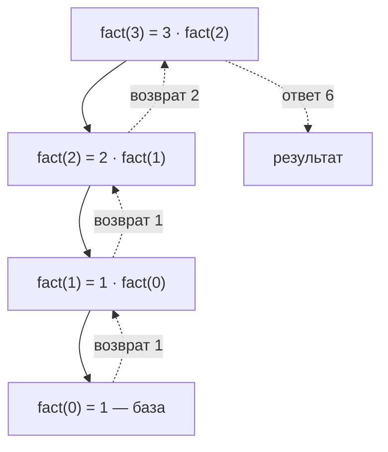

> [!info] Дополнительная тема
> Рекурсии нет в лекциях курса, но о ней часто спрашивают на защите «Подпрограмм» и она встречается в задачах. Урок короткий.

## Функция, которая вызывает саму себя

**Рекурсия** — это когда функция вызывает саму себя для задачи меньшего размера. У любой рекурсивной функции две части:

1. **База** — простой случай, где ответ известен сразу, без вызова себя.
2. **Шаг** — сведение задачи к той же задаче меньшего размера.

```c
/* n! = n · (n−1)!,  0! = 1 */
long long fact(int n) {
    if (n == 0) return 1;          /* база */
    return n * fact(n - 1);        /* шаг */
}
```

Как это выполняется для `fact(3)`:



Каждый вызов получает **свой** экземпляр параметров и локальных переменных в стеке вызовов (кадр стека). Поэтому `n` в `fact(3)` и `n` в `fact(2)` — разные переменные.

> [!danger] Нет базы — нет программы
> Без базы (или если шаг не приближает к ней) функция вызывает себя бесконечно, стек переполняется, и программа падает (stack overflow).

## Ещё примеры

```c
/* сумма цифр */
int digitSum(int n) {
    if (n < 10) return n;
    return n % 10 + digitSum(n / 10);
}

/* печать числа в двоичной системе: сначала старшие разряды */
void printBin(int n) {
    if (n >= 2) printBin(n / 2);
    printf("%d", n % 2);
}

/* НОД по Евклиду */
int gcd(int a, int b) {
    return b == 0 ? a : gcd(b, a % b);
}
```

Обрати внимание на `printBin`: печать стоит **после** рекурсивного вызова — поэтому цифры выводятся в правильном порядке, хотя получаются с конца. Сравни с циклом из модуля 3, где нужен был массив.

## Рекурсия или цикл?

| | Рекурсия | Цикл |
|---|---|---|
| Запись | короче для «вложенных» задач (деревья, Ханойские башни, перебор) | проще для линейных задач |
| Память | каждый вызов — кадр в стеке | постоянная |
| Скорость | вызовы стоят времени | быстрее |
| Опасность | переполнение стека при большой глубине | бесконечный цикл |

> [!warning] Наивный Фибоначчи
> `fib(n) = fib(n-1) + fib(n-2)` в лоб пересчитывает одно и то же много раз: `fib(40)` делает сотни миллионов вызовов. Для таких задач цикл (модуль 1) несравнимо быстрее.
