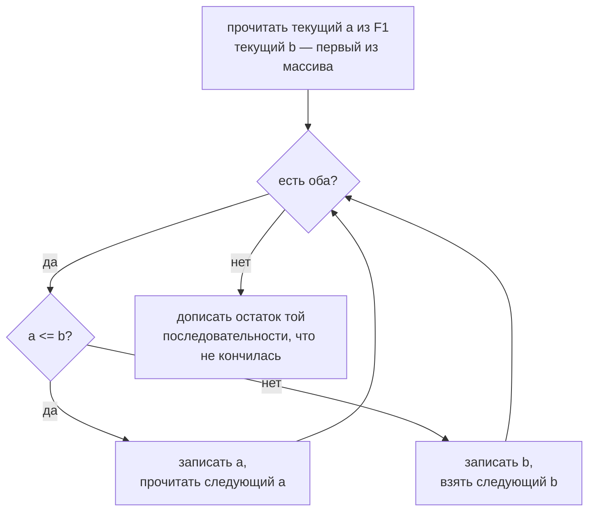

## Практикум: слияние двух упорядоченных последовательностей

Слияние — главный алгоритм ЛР №6 (вариант 2). Даны две последовательности, каждая уже упорядочена. Нужно получить одну упорядоченную, **не сортируя заново**.

Идея: держим «текущий» элемент каждой последовательности и на каждом шаге записываем **меньший** из них, а у той последовательности, откуда взяли, читаем следующий.



### Слияние двух массивов

```c
/* a[0..n-1] и b[0..m-1] упорядочены по возрастанию; результат — в c */
int i = 0, j = 0, k = 0;
while (i < n && j < m) {
    if (a[i] <= b[j]) c[k++] = a[i++];   /* <= : при равенстве первым идёт элемент из a */
    else              c[k++] = b[j++];
}
while (i < n) c[k++] = a[i++];           /* хвост a */
while (j < m) c[k++] = b[j++];           /* хвост b */
```

Каждый элемент записывается ровно один раз — слияние работает за $n + m$ шагов.

### Слияние файла с массивом (схема ЛР №6)

```c
ok = readStudent(f1, &cur);          /* текущая запись F1 */
j = 0;                               /* текущий новый студент в массиве */
while (ok && j < n) {
    if (compareStudents(cur, arr[j]) <= 0) {     /* при равенстве — сначала из F1 */
        writeStudent(tmp, cur);
        ok = readStudent(f1, &cur);
    } else {
        writeStudent(tmp, arr[j]);
        j++;
    }
}
while (ok) { writeStudent(tmp, cur); ok = readStudent(f1, &cur); }
while (j < n) { writeStudent(tmp, arr[j]); j++; }
```

> [!tip] Почему новых студентов сначала сортируют
> Слияние требует, чтобы **обе** последовательности были упорядочены. F1 упорядочен по условию, а F3 — нет. Поэтому F3 читается в массив структур и сортируется (пузырьком), а уже потом сливается с F1.

### Другие варианты ЛР №6 — те же приёмы

| Вариант | Приём |
|---|---|
| 1, 4 — статистика | один проход по файлу со счётчиками и суммами |
| 2 — включить F3 в F1 | сортировка F3 + слияние |
| 3 — исключить выбывших | переписать во временный файл всех, кого нет в списке F4 |
| 5, 6 — корректировка | переписать файл, заменяя поля у найденных записей |
