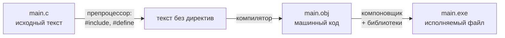

## Программа «Hello, World!» построчно

```c
/* Моя первая программа */
#include <stdio.h>

int main(void) {
    printf("Hello, World!\n");
    return 0;
}
```

| Строка | Что значит |
|---|---|
| `/* ... */` | **комментарий**: компилятор его пропускает. Однострочный вариант — `// ...` |
| `#include <stdio.h>` | подключить заголовок стандартного ввода-вывода (`printf`, `scanf`). Строки с `#` выполняет **препроцессор** до компиляции |
| `int main(void)` | функция `main` — **точка входа**: отсюда начинается выполнение. `int` — она возвращает целое число, `void` — не принимает параметров |
| `{ ... }` | **тело** функции — блок операторов |
| `printf("...\n");` | вызов функции вывода. `\n` — перевод строки. Каждый оператор заканчивается **точкой с запятой** |
| `return 0;` | завершить `main` и вернуть операционной системе код 0 — «всё хорошо» |

## Как текст становится программой



1. **Препроцессор** выполняет строки с `#`: вставляет содержимое `stdio.h` вместо `#include`, заменяет имена из `#define` на значения.
2. **Компилятор** проверяет синтаксис и переводит текст в машинный код. Здесь возникают почти все ошибки начинающих.
3. **Компоновщик** (линкер) соединяет твой код с библиотеками — например, с готовой реализацией `printf`. Ошибка «unresolved external symbol» / «undefined reference» — отсюда: функция объявлена, но не найдена.

## Специальные символы в строках

| Запись | Что выводит |
|---|---|
| `\n` | перевод строки |
| `\t` | табуляция |
| `\\` | обратный слэш `\` |
| `\"` | двойная кавычка внутри строки |
| `%%` | знак процента в `printf` (одиночный `%` начинает спецификатор) |

```c
printf("Путь: C:\\Users\\student\n");   /* Путь: C:\Users\student */
printf("Он сказал: \"Привет\"\n");       /* Он сказал: "Привет" */
printf("Готово на 100%%\n");             /* Готово на 100% */
```

## Ошибки и предупреждения

**Ошибка (error)** — программа не собралась, запускать нечего. **Предупреждение (warning)** — программа собралась, но компилятор видит подозрительное место. Предупреждения **не игнорируй**: чаще всего это будущая ошибка во время выполнения.

Как читать сообщение компилятора:

```output
main.c:5:28: error: expected ';' before 'return'
```

- `main.c` — файл, `5` — **строка**, `28` — столбец;
- `expected ';' before 'return'` — ожидалась `;` перед `return`. Ошибка в **предыдущей** строке: там забыта точка с запятой.

> [!tip] Правило первой ошибки
> Исправляй ошибки **сверху вниз** и после первой же — пересобирай. Одна пропущенная скобка порождает десятки «ошибок» ниже, которые исчезнут сами.

Самые частые ошибки новичка:

| Ошибка | Сообщение (примерно) | Исправление |
|---|---|---|
| нет `;` в конце оператора | `expected ';'` | поставить `;` |
| не закрыта `{` или `(` | `expected '}' at end of input` | найти пару для каждой скобки |
| `Printf` вместо `printf` | `implicit declaration of function 'Printf'` | C различает регистр букв |
| нет `#include <stdio.h>` | `implicit declaration of function 'printf'` | подключить заголовок |
| нет закрывающей кавычки | `missing terminating " character` | закрыть строку |
| `int main` без `return 0;` | (в `main` разрешено, но) | всегда пиши `return 0;` — так требуют в лабах |

## Стиль кода, который ждут на защите

- **Отступ** 4 пробела внутри каждого блока `{ }`.
- **Одна команда — одна строка.**
- **Понятные имена**: `sum`, `count`, `maxValue`, а не `a1`, `qq`.
- **Комментарии** к каждой переменной и к каждому смысловому блоку — это прямое требование к лабораторным (раздел «Текст программы» в модуле 1).
- Константы — **заглавными**: `#define N 50`.

```c
#define _CRT_SECURE_NO_WARNINGS
#include <stdio.h>
#include <locale.h>

#define N 3   /* количество строк приветствия */

int main(void) {
    int i;    /* номер строки */

    setlocale(LC_CTYPE, "Russian");

    /* Печать приветствия N раз */
    for (i = 1; i <= N; i++) {
        printf("%d. Привет!\n", i);
    }
    return 0;
}
```

Циклы `for` будут в модуле 2 — сейчас достаточно увидеть, как выглядит аккуратно оформленная программа.
