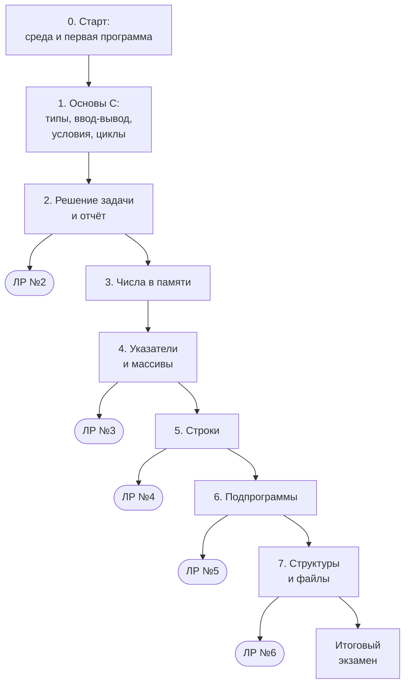

## Что это за курс

Это пошаговый курс программирования на языке **C** для первого курса: от первой программы до структур и файлов. Теория взята из лекций и методички дисциплины «Информационные технологии и основы программирования» (НГТУ) и дополнена тем, чего на лекциях не было: установкой среды, основами синтаксиса, ветвлениями и циклами.

> [!abstract] Главное правило курса
> Знания не «проходят», их **закрепляют**. Поэтому здесь нельзя просто пролистать урок: после каждого урока — тест, задачи с автопроверкой и обязательные повторения через 1, 3, 7, 14, 30, 60 и 120 дней.

## Как устроен курс

Курс делится на **модули**, модули — на **уроки**. У каждого урока одинаковые шаги:

| Шаг | Что делать | Зачем |
|---|---|---|
| 1. Цели | Прочитать, что ты должен уметь после урока | Знать, на что обращать внимание |
| 2. Видео | Посмотреть 1–2 главных ролика (остальные — по желанию) | Услышать объяснение «вживую» |
| 3. Теория | Прочитать конспект, повторить примеры кода руками | Разобраться в деталях |
| 4. Тест | Ответить на вопросы, нужно **80 %** и больше | Проверить понимание |
| 5. Практика | Решить задачи; задачи с пометкой «обязательная» — обязательно | Научиться писать код самому |

Урок считается пройденным, когда сдан тест и решены обязательные задачи. Только после этого открывается следующий урок. В конце модуля — **лабораторная работа** в том виде, в каком её сдают преподавателю: допуск, анализ, структуры данных, алгоритм, программа, тесты, отчёт.

## Интервальные повторения

Через день после урока ты помнишь примерно половину, через неделю — меньше трети. Это **кривая забывания**. Каждое повторение в нужный момент делает забывание медленнее, и после 5–7 повторений знание остаётся надолго.

```mermaid
flowchart LR
    A["Урок пройден"] -->|"через 1 день"| B["Повторение 1"]
    B -->|"через 3 дня"| C["Повторение 2"]
    C -->|"через 7 дней"| D["Повторение 3"]
    D -->|"через 14 дней"| E["Повторение 4"]
    E -->|"через 30 дней"| F["Повторение 5"]
    F -->|"через 60 дней"| G["Повторение 6"]
    G -->|"через 120 дней"| H["Выучено"]
```

Как это работает здесь:

1. Когда ты проходишь урок, курс сам ставит первое повторение **на завтра**.
2. Повторение — это 5–6 вопросов по уроку: часть с автопроверкой, часть — карточки «вспомни ответ, потом открой».
3. Ответил хорошо (80 % и больше) — следующее повторение будет позже: 3, 7, 14, 30, 60, 120 дней.
4. Ошибся — тема возвращается **на завтра** и проходит график заново. Вопросы с ошибками задаются ещё раз в конце того же повторения.
5. **Выбора нет.** Пока есть повторения на сегодня, новые уроки и лабораторные закрыты. Пройденные уроки читать можно — это даже полезно перед повторением.

> [!tip] Лучше понемногу, но каждый день
> 30–60 минут в день работают лучше, чем 5 часов раз в неделю: повторения не копятся, а мозг успевает закрепить материал во сне. Если пропустил несколько дней, повторения не сгорают — просто начни с них.

## Как проверяются задачи

Код из редактора отправляется на сервер [Compiler Explorer (godbolt.org)](https://godbolt.org), там компилируется **gcc** и запускается на тестах. Ответ программы сравнивается с ожидаемым.

> [!warning] Формат вывода в задачах — строгий
> Печатай **ровно то, что показано в примере**: без подсказок «Введите число:» и лишних слов. Пробелы и переводы строк между числами не важны, а вот лишнее слово — ошибка. Это правило тренажёров (Stepik, Codeforces).
>
> В **лабораторных** всё наоборот: там подсказки ввода и понятные сообщения об ошибках обязательны, потому что программу запускает человек.

Код курса пишется под **Visual Studio**, а проверяется на **Linux**. Тренажёр сам убирает то, чего на Linux нет: `#include <windows.h>`, `SetConsoleCP`, `system("pause")`, `scanf_s`. Так что вставляй код из Visual Studio как есть.

Что важно знать о различиях:
- `long` в Windows — 4 байта, в Linux — 8. Для больших целых пиши `long long` (8 байт везде).
- Русские буквы при **вводе** на Linux занимают 2 байта (UTF-8), а в консоли Windows — 1 байт (CP-1251). Поэтому задачи с разбором русского текста проверяются на латинице, а русскую версию запускай в Visual Studio.

## ИИ-наставник — когда совсем не получается

Если над задачей сидишь давно, а она не решается, курс подключает **нейросеть-наставника**. Она откроется в задаче, только когда выполнены все условия:

- не меньше **3 неудачных проверок**;
- все обычные **подсказки уже открыты**;
- на задачу ушло не меньше **30 минут** работы. Перерывы длиннее 5 минут не считаются.

Наставник видит условие, твой код и результат последней проверки. Он укажет, где ошибка, и задаст наводящий вопрос, но **готовое решение не напишет**. Нейросеть может работать бесплатно тремя способами, выбор — в разделе «Прогресс»:

| Вариант | Что нужно |
|---|---|
| в браузере (WebLLM) | Chrome или Edge; модель около 1 ГБ скачивается один раз |
| Ollama на компьютере | программа [Ollama](https://ollama.com) и модель, например `qwen3:8b` |
| бесплатный API | ключ Groq, OpenRouter или Google Gemini |

## Прикладные задачи и фрагменты лекций

Кроме обязательных задач, в практике многих уроков есть блок **«Прикладные задачи»**: кредитный калькулятор, проверка номера карты, подсеть IPv4, игра «Жизнь», шифры, телефонная книга, банк. Часть задач — по мотивам CS50 (Гарвард) и MIT 6.087.

Во вкладке «Видео» длинные лекции показываются **фрагментом**, ровно по теме урока. На превью видно, с какой по какую минуту. Источники: CS50 на русском, семинары МФТИ (К. Владимиров, Т. Хирьянов), selfedu, Alek OS, тренировки Яндекса.

## Где хранится прогресс

Прогресс хранится **в этом браузере** (localStorage). Если очистить данные сайта или открыть курс на другом устройстве, прогресса там не будет. Поэтому в разделе «Прогресс» есть кнопки **«Сохранить прогресс в файл»** и **«Загрузить из файла»** — делай резервную копию раз в неделю.

## Как учиться эффективно

- **Пиши код руками.** Не копируй примеры — набирай. Пальцы запоминают синтаксис.
- **Сначала попробуй сам.** Решение и подсказки открываются, но задача, решённая с подсказкой, учит в разы меньше.
- **Объясняй вслух.** Если можешь объяснить строку кода другу (или резиновой уточке), ты её понял. На защите лабораторной спрашивают именно так.
- **Ошибка — это данные.** Читай сообщение компилятора целиком: в нём номер строки и причина.
- **Решай больше.** Когда закончишь урок, порешай задачи по той же теме на [Stepik](https://stepik.org/course/3078/promo) или [informatics.msk.ru](https://informatics.msk.ru/) — ссылки есть в разделе «Ресурсы».
